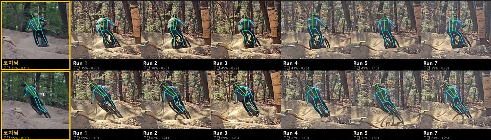
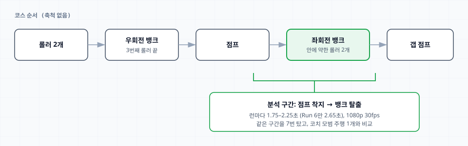
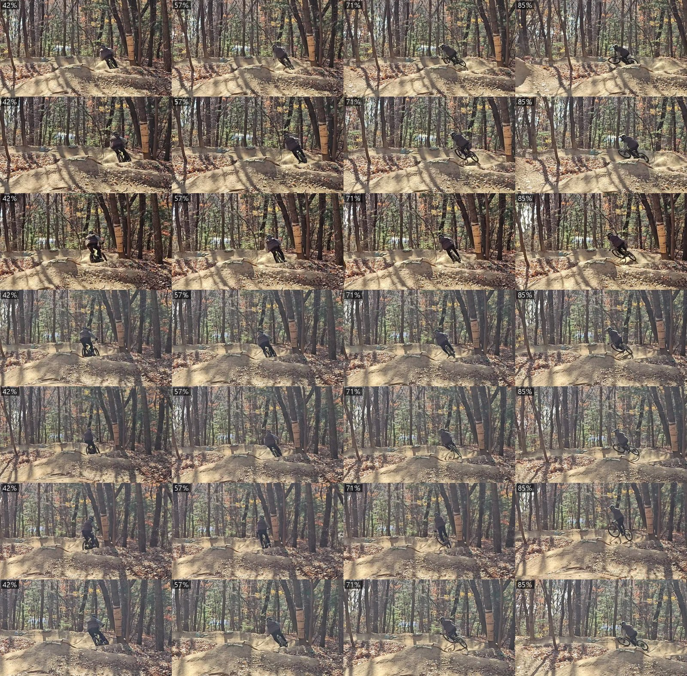
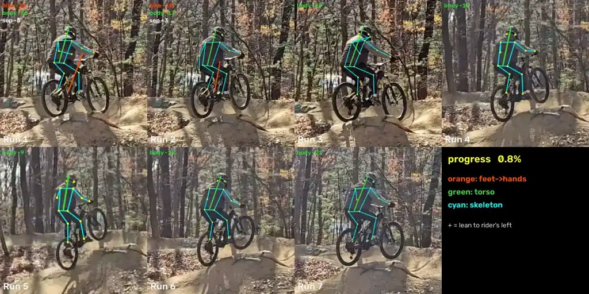
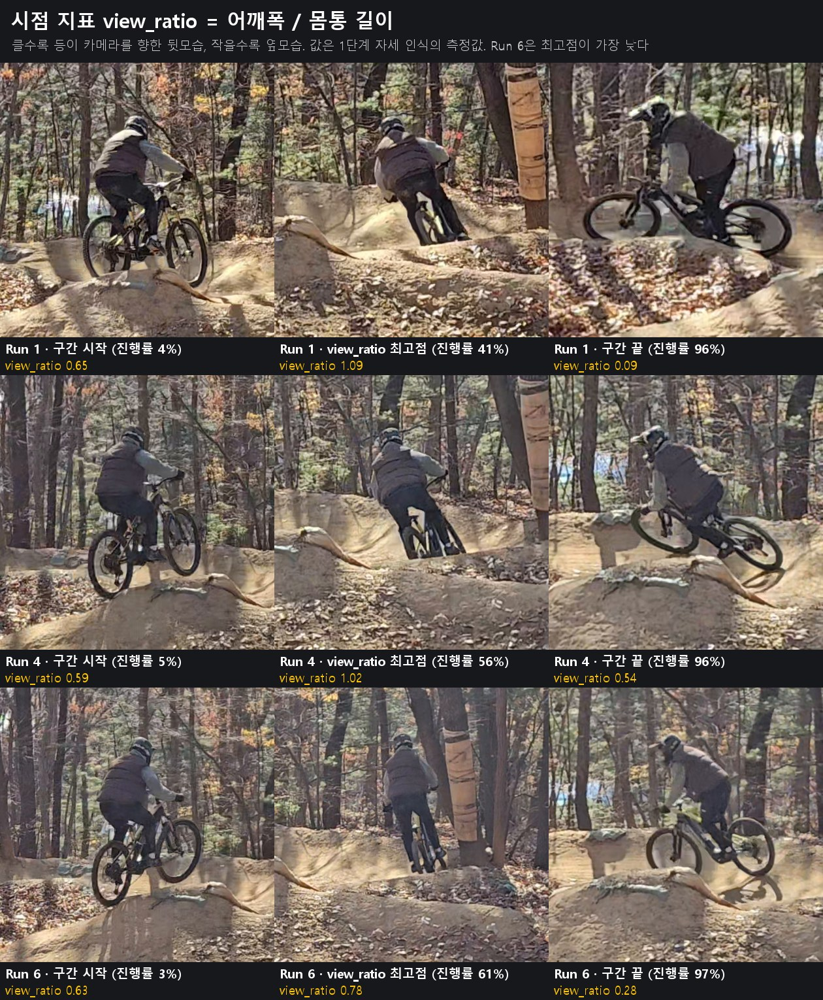
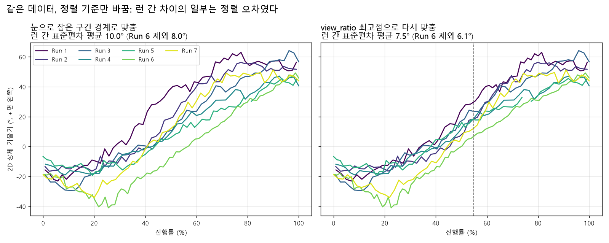
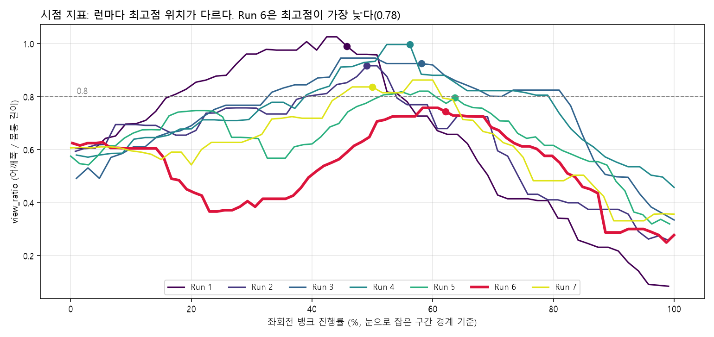
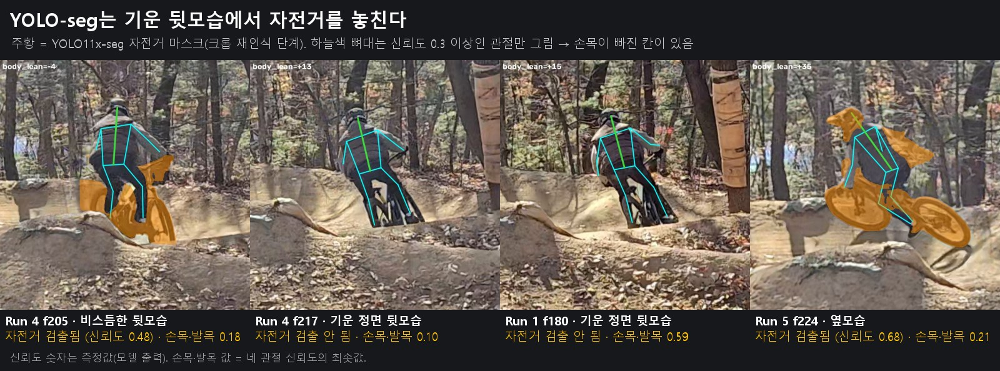
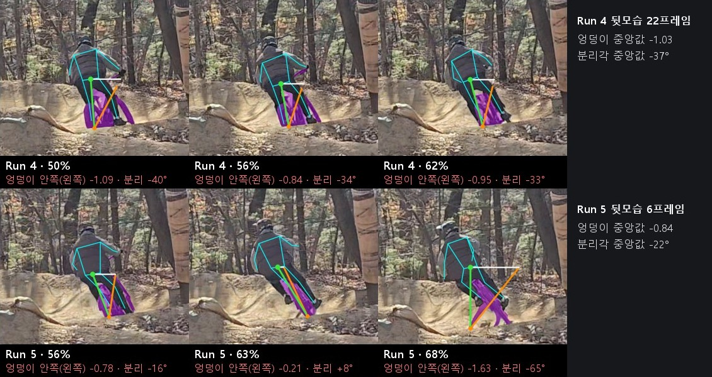
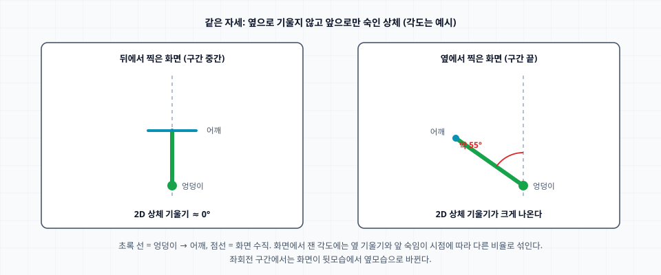

매주 한 번 MTB 주행 강습을 받는다. 강습이 끝난 날 저녁에 코치님이 그날 찍은 영상과 짧은 피드백을 메신저로 보내 준다. 첫 강습의 피드백은 좌회전이었다. 거의 모든 영상에서 좌회전 자세와 라인이 안정적이지 않으니 좌회전만 따로 연습하라는 내용이다. 영상은 7개였고 각각 10–12초다. 같은 코스를 한 번 탄 주행을 아래에서는 런이라고 부른다. 좌회전은 뱅크에서 돈다. 뱅크는 코너 바깥쪽을 벽처럼 세운 흙 코너다. 영상을 여러 번 돌려 봤지만 어느 런이 왜 다른지는 보이지 않았다.

그래서 영상을 분석하는 도구를 만들기 시작했다. 구현은 Claude Code에 맡겼다. 문제를 정하고 결과 이미지를 확인하고 어느 방법을 남길지 고르는 일은 내가 했다. 코드와 README는 [ai-mtb-coach 저장소](https://github.com/hon454/ai-mtb-coach)에 있다.

이 글은 세 편 중 첫 편이고 2D 자세 인식만으로 갈 수 있었던 곳까지를 다룬다. 먼저 결과다.



*비교 보드 세 줄 중 위 두 줄(진입, 뱅크 중간)이다. 같은 줄이 같은 순간이고 맨 왼쪽 칸이 코치님이다. 초록 선은 상체(엉덩이→어깨), 흰 점선은 화면 수직이다. 측정값이 아니라 시각적 인상이다. 코치 영상은 촬영 위치와 화각이 달라서 각도를 숫자로 비교할 수 없다. Run 6은 촬영 위치가 다른 것으로 보여 뺐다.*

뱅크에 막 들어서는 순간(윗줄)에 코치님은 이미 자전거와 몸을 왼쪽으로 기울였다. 내 런은 여섯 번 모두 상체선이 아직 수직에 가깝다. 뱅크 중간(아랫줄)에서는 내 런이 둘로 갈린다. Run 1·2·3은 코치님과 비슷하게 누웠고 Run 4·5·7은 상체가 더 서 있다. 영상을 돌려 볼 때는 보이지 않던 차이다. 다만 여기까지는 눈으로 본 인상이다. 2D 영상에서 잰 기울기에는 카메라 시점이 섞여 있고 자전거 기울기는 이 단계에서 재지 못해서 숫자를 근거로 쓰지 않았다. 이 차이가 코치님이 말한 불안정의 원인인지, 고치면 주행이 나아지는지는 다음 강습에서 확인할 일이다.

아래는 이 보드가 나오기까지 시도한 순서다.

## 좌회전 뱅크 한 구간으로 좁혔다

뱅크에서는 벽이 자전거를 받쳐 주기 때문에 자전거와 몸을 눕힌 채로 돌 수 있다. 강습 코스는 한 줄이고 7개 영상은 모두 같은 줄을 한 번씩 탄 것이다.



피드백이 좌회전으로 좁혀져 있어서 목표도 좁혔다. 전체 주행을 분석하지 않고 점프 착지부터 좌회전 뱅크 탈출까지 2초 남짓한 구간만 본다. 비교할 축은 네 가지로 잡았다.

- 같은 코너를 반복한 런 사이의 편차
- 좌회전과 우회전
- 코치님의 모범 주행과 내 주행
- 주별 변화

이 글은 첫째와 셋째를 다룬다.

## 손에 든 스마트폰 한 대라는 조건

영상은 코치님이 스마트폰을 손에 들고 라이더를 따라 돌리며 찍은 것이다. 1080p 30fps이고 카메라 위치와 거리는 런마다 조금씩 다르다. 삼각대나 여러 대의 카메라는 따로 준비해야 한다. 도구를 고르는 기준도 여기에 맞췄다. 손에 든 카메라 한 대의 영상에서 동작하는 것이 먼저다.

이 조건에서는 삼각측량 방식의 3D 관절 복원을 쓸 수 없다. 이 방식에는 고정 카메라 두 대 이상과 보정 절차가 필요하다. 픽셀을 미터로 바꾸는 보정도 카메라가 고정돼 있어야 의미가 있다. 그리고 촬영 위치가 다른 영상끼리는 화면에서 잰 각도를 그대로 비교할 수 없다. 마지막 조건은 뒤에서 두 번 문제가 된다.

## 구간을 잘라 나란히 놓았다

처음에는 인식이 전혀 없는 비교를 만들었다. 7개 영상에서 좌회전 뱅크 구간의 시작과 끝을 0.25초 단위로 영상을 보고 잡아 `segments.json`에 적었다. 구간 길이는 런마다 1.75–2.25초로 달라서 시간 대신 진행률(구간 시작 0%, 끝 100%)로 맞췄다. 결과물은 7런을 한 화면에 놓은 동기화 영상과, 진행률 8단계의 프레임 시트다.



*프레임 시트에서 가운데 네 칸만 자른 것이다. 위에서부터 Run 1–7이다. 진행률은 눈으로 잡은 구간 경계 기준이다.*

나란히 놓아도 라이더가 화면에서 너무 작아 자세는 보이지 않는다. 그리고 여섯째 줄(Run 6)이 같은 진행률에서 다른 런보다 덜 돌아 있는 것이 보인다. Run 6은 구간이 2.65초로 가장 길고 클립이 갭 점프 전에 끝난다. 이 런은 뒤에서 다시 나온다.

## 라이더를 따라가며 크롭하고 뼈대를 그렸다

다음은 라이더를 크게 보는 것이다. YOLO11x-pose로 프레임마다 사람의 관절 17개를 2D 좌표로 찾고 ByteTrack으로 프레임 사이에서 같은 사람을 이어 붙였다. YOLO11x-pose는 사진에서 사람의 관절 위치를 찾는 모델이다. ByteTrack은 검출 결과를 프레임 간에 연결하는 추적기다. 추적한 박스를 중심으로 라이더를 잘라 내고 뼈대를 겹쳐 그렸다.



*하늘색은 뼈대, 초록은 상체선, 주황은 발→손을 이은 선이다. 칸 왼쪽 위의 `bike`와 `sep` 숫자는 이 주황 선에서 나온 값인데, 아래에서 의미가 없다고 결론 낸 값이다.*

추적과 크롭은 7런 모두 끊기지 않았다. 이 단계의 결과물 중에서는 이 크롭 동기화 영상이 가장 쓸 만했다. 자전거 영역을 찾으려고 같은 계열의 분할 모델(YOLO-seg)을 돌렸지만 기울어진 뒷모습에서는 자전거가 검출되지 않았다. 손목과 발목은 뒤에서 보면 몸에 가려 신뢰도가 낮은 경우가 많았다.

관절 좌표가 생겼으니 프레임마다 지표를 뽑았다. 아래는 핵심 정의다.

```python title="tools/analyze_pose.py (발췌, 정리함)"
if ok(KP["l_sh"], KP["r_sh"], KP["l_hip"], KP["r_hip"]):
    sh, hp = mid("l_sh", "r_sh"), mid("l_hip", "r_hip")
    torso = float(np.linalg.norm(sh - hp))
    row["body_lean"] = round(lean_deg(sh, hp), 2)
    # 어깨 폭 / 몸통 길이: 뒷모습(정면)일수록 크고, 옆모습일수록 작다 → 시점 표시용
    row["view_ratio"] = round(float(np.linalg.norm(kxy[KP["l_sh"]] - kxy[KP["r_sh"]])) / max(torso, 1), 3)
# 자전거 축 근사: 발(페달) 중간 → 손(핸들) 중간
if ok(KP["l_wr"], KP["r_wr"], KP["l_an"], KP["r_an"], th=LIMB_CONF):
    wr, an = mid("l_wr", "r_wr"), mid("l_an", "r_an")
    row["bike_lean"] = round(lean_deg(wr, an), 2)
    # ...
    # 자세 높이: 발→어깨 수직거리 / 관절 길이 합 (1=완전히 선 자세, 작을수록 웅크림)
    row["stance_h"] = round(float((an[1] - sh[1]) / max(legs, 1)), 3)
```

`body_lean`은 엉덩이 중간에서 어깨 중간으로 가는 선이 화면 수직에서 기운 각도다. `bike_lean`은 자전거를 직접 찾지 못해서 발 중간과 손 중간을 이은 선으로 대신했다. `stance_h`는 발에서 어깨까지의 수직 거리를 몸통·허벅지·정강이 길이의 합으로 나눈 값으로, 주석대로 웅크린 정도를 보려고 넣었다. `view_ratio`는 어깨 폭을 몸통 길이로 나눈 값이다. 뒤에서 보면 어깨 폭이 그대로 보이고 옆에서 보면 좁아진다. 몸통 길이로 나눠서 라이더가 화면에 크게 찍혔는지 작게 찍혔는지는 상쇄된다. 카메라가 계속 움직이는 영상에서는 이 값 하나만 지금 라이더를 어느 방향에서 보고 있는지 알려 줬다.



*`view_ratio`는 측정값이다. 가운데 열이 런마다 값이 가장 큰 순간으로, 등이 카메라를 향한다.*

## 지표를 검증하다가 세 가지를 고쳤다

지표 그래프가 나오자 결론처럼 보이는 문장도 같이 나왔다. 그중 하나가 "6번 런만 몸을 세우고 탔다"였다. 지표가 재려던 것을 재고 있는지 검증하면서 이 결론들을 고쳤다.

먼저 정렬 기준이다. 진행률은 눈으로 잡은 구간 경계에 달려 있다. 경계 오차가 ±0.25초면 2초 구간에서 ±12%다. 런마다 진행률 축이 그만큼 밀려 있으면 같은 진행률에서 비교한 기울기 차이에는 정렬 오차가 들어간다. 그래서 눈으로 잡은 경계 대신 `view_ratio`가 최고인 순간, 즉 등이 카메라를 정면으로 향하는 순간을 기준점으로 삼아 다시 맞췄다.



*측정값. 같은 데이터에서 정렬 기준만 바꿨다. 런 간 표준편차의 평균이 7런 기준 10.0°에서 7.5°로 줄었다.*

런 사이의 차이로 보였던 것의 일부는 정렬 오차였다. 이어서 세 가지를 고쳤다.

첫째, "6번 런만 몸을 세우고 탔다"는 결론을 철회했다. `view_ratio` 곡선을 겹쳐 보면 Run 6은 최고점이 0.78로 7런 중 가장 낮다. 당시에는 이 값을 근거로 Run 6에는 다른 런 같은 뒷모습 구간이 없다고 판단했다. 위 장면 그림에서 보듯 Run 6의 최고점 장면도 눈으로는 뒷모습에 가깝게 보이므로, 이것은 지표 값에만 있는 차이다. 코치님이 이 런만 다른 자리에서 찍었을 가능성이 있고 구간 경계도 다른 런과 다르게 잡혔을 수 있다. 그래서 이 런의 2D 값이 다른 것을 자세 차이로 읽을 수 없다. 코치님과 비교하는 보드에서는 Run 6을 뺐다.



*측정값. 점은 정렬에 쓴 기준점이다. 곡선을 평활한 뒤 찾은 최고점이라 그림 속 곡선의 꼭대기와 조금 다를 수 있다. Run 6(빨강)은 진행률 20–40%에서 0.4 안팎까지 내려갔다가 늦게 올라온다.*

둘째, `stance_h`는 웅크림을 재는 지표가 아니었다. 분자가 발에서 어깨까지의 수직 거리라서 몸을 전혀 웅크리지 않고 옆으로 기울이기만 해도 기울기의 코사인만큼 줄어든다. 코드 주석에 남아 있는 "작을수록 웅크림"은 처음 의도이고 실제로는 기울기에 반응하는 값이었다. 무릎·엉덩이·팔꿈치의 관절각으로 바꿨다.

셋째, 2D 기울기는 자전거와 상체 모두 시점 변화가 섞인 값이다. 라이더가 좌회전하는 동안 화면은 뒷모습에서 옆모습으로 바뀌고 화면에서 잰 각도도 그에 따라 변한다. 발→손 선으로 대신한 `bike_lean`은 더 근본적인 문제가 있었다. 손과 발은 몸에 붙어 있으니 이 선은 몸과 같이 움직인다. 자전거와 상체의 차이(`separation`)가 작은 값(대략 ±10° 안)에 머무는 것은 측정 결과가 아니라 정의에서 나온 결과였다. 이 값은 버렸다.

## 크롭을 확대해 다시 인식했다

라이더가 전체 프레임에서 작게 찍히기 때문에, 추적한 박스의 2배 영역을 잘라 768px로 키운 뒤 자세와 자전거를 다시 인식하는 단계를 넣었다. 버린 `stance_h` 대신 쓸 관절각도 이 단계에서 계산한다. 당시에는 상체 뼈대가 전체 프레임에서 인식할 때보다 잘 맞는 것으로 봤다. 자전거 쪽은 달라지지 않았다.



*크롭 재인식 단계의 결과다. 주황은 YOLO-seg가 찾은 자전거 영역이고 아래 숫자는 모델이 출력한 신뢰도(측정값)다. 비스듬한 뒷모습과 옆모습에서는 자전거가 잡히고 기울어진 정면 뒷모습 두 칸에서는 잡히지 않았다.*

정면 뒷모습에서는 자전거가 뒷바퀴와 타이어 정도만 보인다. 정렬 기준점으로 삼은 바로 그 장면에서 자전거가 검출되지 않는 것이다. 잡힌 칸에서도 마스크가 라이더 일부를 덮는다. 다음 단계에서는 프레임마다 따로 찾지 않고 자전거가 잡힌 첫 프레임에서 시작해 영상 전체로 추적했다. 이 부분은 2편에서 다룬다.

## 코치님 영상을 같은 기준점에 맞췄다

강습 다음 날 코치님이 같은 코스의 같은 뱅크에서 찍힌 모범 주행 영상을 보내 주셨다. 여름에 찍은 12.7초짜리 영상이고 좌회전 뱅크 구간은 1.45초다. 이 작업은 Claude Code의 백그라운드 작업으로 돌렸다. 추적, 크롭, 자세 인식은 고치지 않고 그대로 동작했다.

정렬에는 앞에서 만든 기준점을 썼다. 런마다 `view_ratio` 최고점을 찾아 공통 진행률 52% 지점에 놓고 그 앞과 뒤를 각각 선형으로 맞춘다. 기준점 위치는 내 런이 구간의 45–63%, 코치님이 40%였다. 이 중 코치님의 기준점이 가장 불확실하다.

코치님은 점프를 더 크게 뛰어 착지 지점이 진행 방향으로 더 앞이다. 진행률 0%가 같은 위치가 아니다. 그래서 1.45초와 내 1.75–2.25초를 놓고 코치님이 더 빠르다고 읽으면 안 된다. 기준점에서 탈출까지는 코치님 0.87초, 나 0.74–1.10초로 범위 안이다.

정렬한 영상에서 Claude는 프레임 세 장을 보고 이렇게 보고했다. 뱅크에 들어서는 순간에 코치님은 이미 기울어 있고 내 런들은 거의 서 있다. 숫자 없이 장면만 본 인상이었다. 여기서 나는 인사이트를 근거 장면을 담은 시각 자료와 함께 달라고 요청했다. 이 요청은 이후 작업에도 계속 적용했다. 지금은 측정값인지 시각적 인상인지도 함께 표시한다. 그래서 같은 순간의 코치님과 내 런 6개를 한 줄에 놓고 상체선과 수직선을 그리는 보드를 만들었다. 이 글 맨 위의 이미지가 그 보드다.

보드로 확인하니 "내 런들은 거의 서 있다"는 과장이었다. 당시에는 이렇게 고쳐 적었다. 수직에 가까운 것은 Run 4·5·7이고 Run 1·2·3은 코치님보다 덜할 뿐 기울기 시작했다. 그리고 좌회전 불안정의 후보로 런마다 다른 진입 기울기 타이밍을 적었다. 이 글을 쓰면서 보드를 다시 보니 이 문장도 그대로 둘 수 없었다. 진입 줄에서는 여섯 런의 상체선이 모두 수직에 가깝다. 세 번과 세 번의 차이는 뱅크 중간 줄에서 난다. 보드의 셋째 줄인 탈출 장면은 차이가 작았고 코치님 화면이 흐려서 판단하기 어려웠다.

## 린아웃을 재려다 두 번 실패했다

이 무렵 나는 이렇게 물었다. 좌회전이면 엉덩이가 바깥쪽(오른쪽)에 있어야 하지 않나. 린아웃은 자전거를 코너 안쪽으로 더 눕히고 몸은 상대적으로 세워 엉덩이를 바깥에 두는 자세다. 내 영상에서는 린아웃을 하지 않는 것처럼 보였다.

이것을 재려면 자전거의 선이 필요하다. 이때는 자전거 영역 마스크가 있었다(SAM2라는 분할 모델로 얻었고 2편에서 다룬다). 이 마스크에서 선을 뽑는 방법을 두 가지 시도했다.

- 마스크의 맨 아래와 맨 위(핸들) 중앙을 이은 선. 뒤에서 보면 핸들이 몸에 가려 오른쪽 그립만 보인다. 선이 오른쪽으로 끌려가서 엉덩이가 안쪽에 있다는 값이 체계적으로 나왔다.
- 타이어 접지점과 뒷바퀴 영역 중심을 이은 선. 마스크 아래쪽에 반대편 앞바퀴 조각이 섞여 접지점이 오른쪽으로 끌려갔다.



*두 번째 방법으로 다시 만든 보드의 일부다. 숫자는 측정값이지만 틀린 측정이다. 주황이 자전거 선, 초록이 접지점→엉덩이 선, 보라가 자전거 마스크다. Run 5의 68% 칸에서는 주황 선이 자전거 밖으로 벗어났다.*

이 보드는 거의 모든 칸에서 엉덩이가 안쪽이라고 나온다. 숫자만 보면 결론처럼 읽힌다. 하지만 숫자를 만든 선이 자전거를 따라가지 않았고 두 방법의 보드는 모두 폐기했다. 대신 숫자 없이 엉덩이와 뒷바퀴 부근만 확대한 장면 보드를 만들었다. 그 보드에서는 자전거와 몸이 같이 기우는 것처럼 보였다(시각적 인상). 이 판단은 자전거 기울기를 따로 잰 뒤에 일부 바뀐다.

## 2D로는 자전거와 몸의 기울기를 나눌 수 없다

여기까지 와서 문제가 두 가지 남았다.

하나는 화면에서 잰 기울기의 의미다. 위 정렬 그래프에서 2D 상체 기울기는 구간 동안 −10~−25°에서 +45~+65°까지 올라간다. 이 값을 그대로 옆으로 누운 각도라고 읽을 수는 없다. 화면에서 잰 각도는 3D 자세를 카메라가 보는 평면에 투영한 것이기 때문이다.



옆으로 전혀 기울지 않고 앞으로만 숙인 상체를 뒤에서 찍으면 화면에서는 수직이다. 같은 자세를 옆에서 찍으면 화면에서 크게 기운다. 좌회전 구간에서는 화면이 뒷모습에서 옆모습으로 바뀌므로, 2D 기울기 곡선이 올라가는 것 중 얼마가 옆 기울기이고 얼마가 앞 숙임인지 2D 좌표만으로는 나눌 수 없다. 촬영 위치가 다른 코치님 영상과 각도를 숫자로 비교할 수 없는 것도 같은 종류의 문제다.

다른 하나는 자전거다. 코너링에서 보고 싶은 것은 자전거가 얼마나 누웠고 몸이 그에 비해 얼마나 섰는지다. 자세 인식 모델은 사람만 찾는다. 손과 발을 이은 선은 몸의 일부라 자전거를 대신하지 못했고, 프레임별 분할은 기준점인 정면 뒷모습에서 자전거를 놓쳤고, 마스크에서 선을 뽑는 근사는 두 번 틀렸다.

그래서 2D 단계에서는 다음을 얻었다.

- 같은 순간끼리 놓고 볼 수 있는 정렬 기준(`view_ratio` 최고점)
- 코치님은 진입에서 이미 기울이고 내 런은 그보다 늦다는 것, 뱅크 중간에서 내 런이 두 그룹으로 갈린다는 관찰(시각적 인상)
- 2D 기울기 숫자와 자전거 축 근사는 결론의 근거로 쓰지 않는다는 판단

코치님이 말한 자세 불안정이 이 차이들인지는 다음 강습 영상을 같은 보드에 놓고 확인한다.

2편에서는 자전거 기울기를 직접 잰다. 자전거 영역을 영상 전체에서 추적해 마스크로 얻고 자전거 지오메트리로 만든 3D 모델을 그 실루엣에 맞춘다. 결과가 맞는지는 내가 프레임 위에 직접 그린 핸들바 선으로 채점한다.
