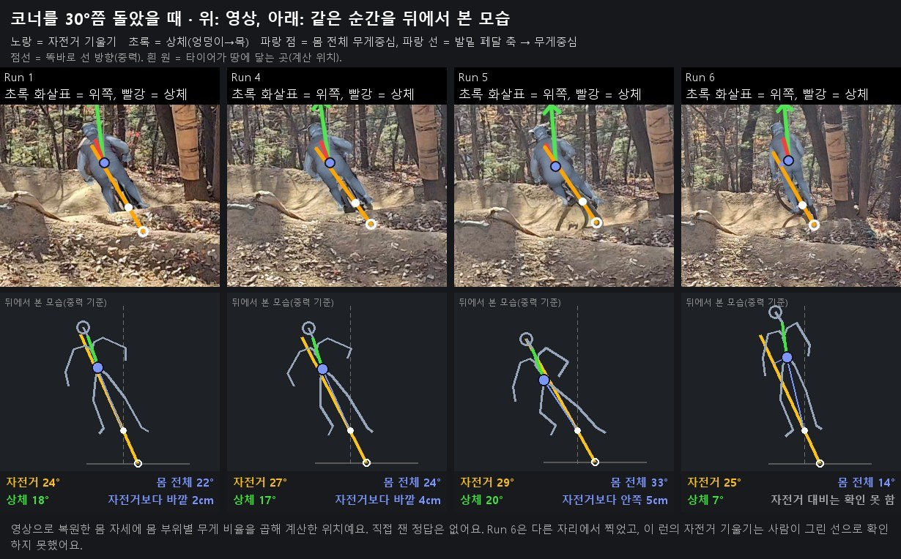
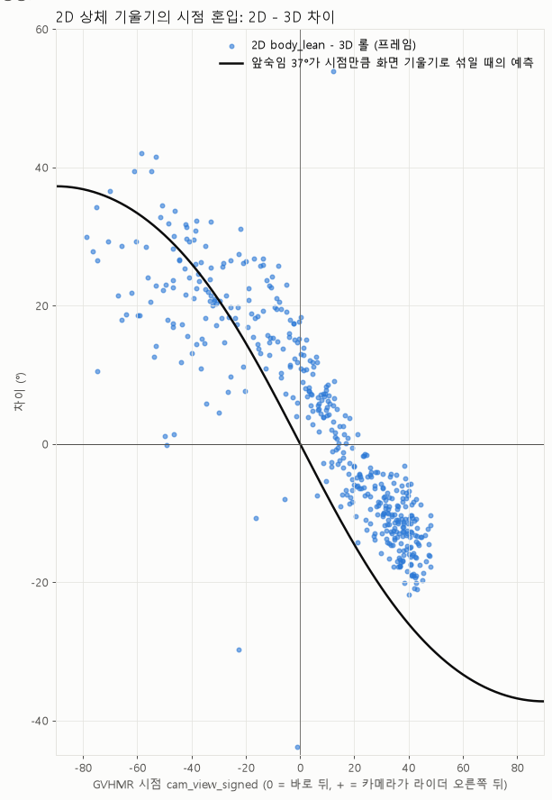
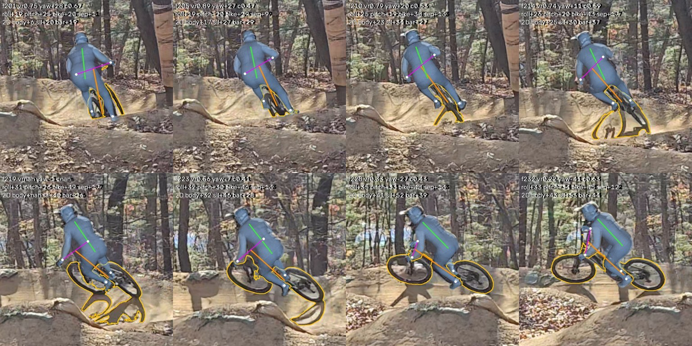
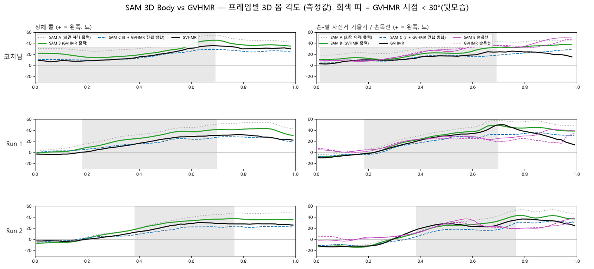
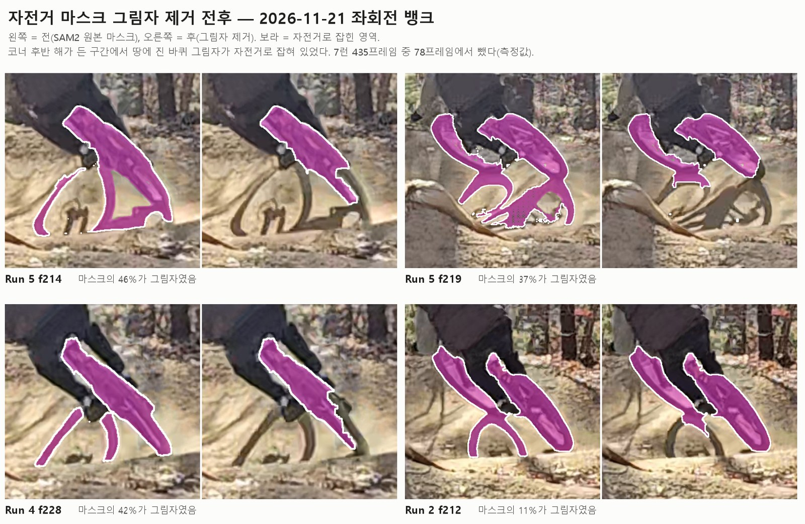
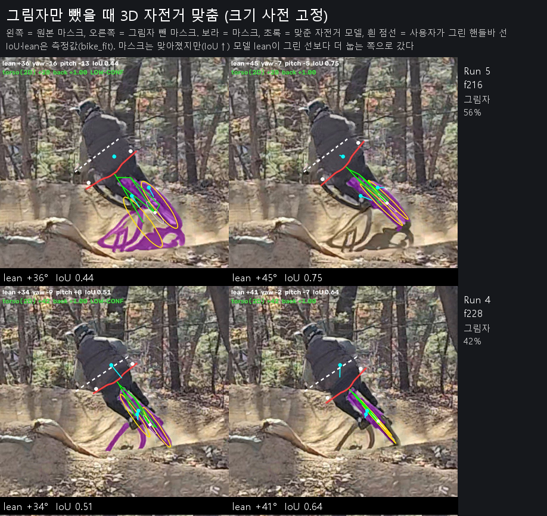
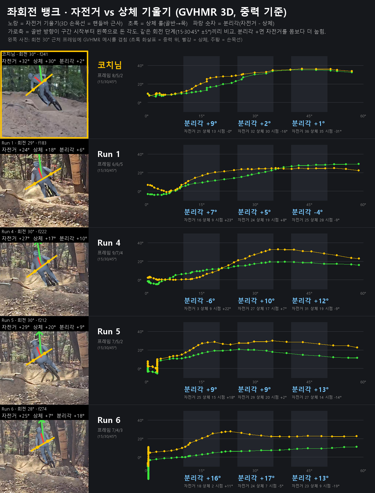

MTB 강습에서 좌회전 자세가 불안정하다는 피드백을 받았다. 코치님이 스마트폰으로 찍어 준 영상에서 자세 차이를 찾는 도구를 만들고 있다. [2D 자세 인식을 다룬 글](/posts/ai-mtb-coach-2d-pose/)은 화면에서 잰 상체 기울기에 카메라 시점이 섞인다는 데서 멈췄다. [자전거 기울기를 다룬 글](/posts/ai-mtb-coach-bike-lean/)은 자전거 기울기의 정답이 없다는 데서 멈췄다. 이 글은 3D 몸 자세 모델 두 가지로 상체 기울기를 다시 재고 몸 전체 무게중심까지 계산한 과정이다. 구현과 분석은 Claude Code가 했다. 나는 결과 이미지를 보고 이상한 곳을 짚었고 어느 값을 기준으로 둘지 골랐다. 코드는 [ai-mtb-coach 저장소](https://github.com/hon454/ai-mtb-coach)에 있다.

먼저 결과다.



측정값에 가정을 더한 계산값이다. 아랫줄은 윗줄과 같은 순간의 3D 관절을 뒤에서, 중력을 기준으로 본 그림이다. 노랑은 자전거 기울기(양 손목을 이은 선에서 얻음), 초록은 상체, 파랑 점은 몸 전체 무게중심이다. 아래 cm 값은 무게중심이 자전거 면에서 떨어진 거리다.

코너를 45° 돌았을 때 Run 4·5·6은 상체가 자전거보다 12–13° 덜 누운 것으로 나왔고 Run 1·2·3은 −6°에서 −1° 사이였다. 그 구간의 프레임은 Run 4·5·6이 각각 4개, 2개, 3개뿐이다. 몸 전체 무게중심으로 보면 Run 4·5의 무게중심은 자전거 면에서 5 cm 이내였고 Run 6은 보류했다. 3D 상체 기울기가 맞는지 확인할 정답 데이터는 없다. 그래서 런 순위와 코치님과의 차이는 정하지 못했고, 이 숫자들이 코치님이 말한 좌회전 불안정과 관계가 있는지도 확인하지 못했다.

## GVHMR로 상체 기울기를 중력 기준으로 쟀다

상체 쪽은 3D 몸 자세 모델로 바꿨다. 앞 글에서 폰 기울기를 보정할 때 쓴 GVHMR이다. 움직이는 카메라 영상에서 사람의 3D 몸을 복원하고, 화면의 위아래가 아니라 실제 위아래(중력)를 기준으로 자세를 내놓는다. 몸은 겉면을 삼각형 그물(메시)로 표현한 몸 모델 SMPL-X로 나온다. 이 작업은 별도의 Claude Code 세션에서 진행됐다.

3D 관절에서는 상체 기울기를 둘로 나눈다. 롤은 진행 방향을 축으로 옆으로 기운 각도이고 피치는 앞으로 숙인 각도다. 나누려면 라이더가 향해 가는 수평 방향(진행 방향)이 필요하다. 계획은 3D 골반이 움직인 궤적을 쓰는 것이었다. 그런데 GVHMR이 복원한 궤적은 거의 멈춰 있었다. 실제로는 20 m 넘게 달린 5초 동안 골반의 수평 이동이 0.5–1.2 m였다. 그래서 진행 방향을 골반이 향한 방향으로 바꿨다.

```python title="tools/body3d_gvhmr.py (발췌)"
UP = np.array([0.0, 1.0, 0.0])
# ...
def angles(J, fwd):
    # ...
    left = unit(np.cross(UP, fwd))
    v = J[:, J_NECK] - J[:, J_PELVIS]
    W = (J[:, J_LWR] + J[:, J_RWR]) / 2
    A = (J[:, J_LANK] + J[:, J_RANK]) / 2
    s = W - A
    dot = lambda x, y: np.sum(x * y, -1)  # noqa: E731
    roll = np.degrees(np.arctan2(dot(v, left), dot(v, UP)))
    pitch = np.degrees(np.arctan2(dot(v, fwd), dot(v, UP)))
    bike = np.degrees(np.arctan2(dot(s, left), dot(s, UP)))
    # ...
```

`UP`은 중력 반대 방향, `fwd`는 진행 방향, `left`는 라이더의 왼쪽이다. `roll`은 골반에서 목으로 가는 벡터 `v`가 왼쪽으로 간 만큼과 위로 간 만큼으로 잰 각도이고 `pitch`는 앞으로 간 만큼으로 잰 각도다. `bike`는 같은 계산을 발목 중점에서 손목 중점으로 가는 벡터 `s`에 한 것이다. 손은 그립에, 발은 페달에 있으니 자전거 중심면을 대신한다고 본 값이고 아래에서 손·발 평면이라고 부른다.

이 3D 롤을 2D 상체 기울기와 프레임마다 비교했다.



측정값이다. 가로축은 카메라가 라이더를 보는 방향(시점)으로 0°가 바로 뒤, ±90°가 옆이다. 세로축은 2D 상체 기울기에서 3D 롤을 뺀 값이다. 검은 곡선은 앞으로 37°(앞숙임의 중앙값) 숙인 상체가 시점만큼 화면 기울기로 섞일 때의 예측이다.

점들이 곡선의 모양을 따라가고 시점 −40°보다 옆쪽에서는 흩어진다(시각적 인상). 2D 값에 앞숙임이 시점만큼 섞인다는 설명과 맞는다. 다만 GVHMR의 3D 몸은 같은 2D 관절에 맞춰 만든 것이라 이 곡선은 구조상 성립한다. 3D 롤이 맞다는 증명은 아니다. 옆모습에서는 롤이 카메라의 깊이 방향이라 복원이 약하다. 이때부터 2D 상체 기울기는 런 비교에서 뺐고 롤은 뒷모습에 가까운 구간에서만 비교한다.

런을 맞추는 기준도 바꿨다. 뒷모습 프레임은 런마다 코너의 다른 단계에 있다. 그래서 골반 방향이 구간 시작부터 왼쪽으로 15°, 30°, 45° 돈 순간(±5°)끼리 비교했다. 이 각도를 회전 단계라고 부른다. 손·발 평면에서 3D 롤을 뺀 분리각은 회전 15·30·45°에서 Run 5가 +15°, +26°, +27°, Run 7이 +14°, +13°, +5°였다(측정값). Run 7은 Run 1–4와 겹쳤다. 이때의 결론은 자전거를 몸보다 더 눕힌 런이 Run 5뿐이라는 것이었다.

## SAM 3D Body로 다시 재니 폰 기울기가 드러났다

두 번째 모델은 SAM 3D Body다. 사진 한 장에서 사람의 3D 몸 메시를 복원하는 Meta의 모델이다. 프레임마다 따로 돌고 중력 방향은 알려 주지 않는다. 그래서 처음에는 화면 아래가 중력이라고 가정했다. 이 작업도 별도의 Claude Code 세션에서 진행됐다.



파란 몸이 복원한 메시, 초록은 상체선, 보라는 양 손목을 이은 선(손목선), 주황은 발목 중점과 손목 중점을 이은 선이다. 노란 테두리는 SAM2가 추적한 자전거 마스크다. 칸 위의 글자는 화면 아래 중력을 가정한 값이라 읽지 않는다. 메시는 뒷모습과 옆모습 모두 라이더 윤곽에 겹친다(시각적 인상).

다음으로 두 모델의 값을 프레임마다 비교했다. 뒷모습 구간(시점 30° 미만, 226프레임)에서 SAM 3D Body의 상체 롤은 GVHMR보다 중앙값으로 14.8° 컸다. Claude는 이 차이를 세 단계로 나눠 보고했다. 중력을 GVHMR이 추정한 것으로 바꾸면 6.8° 줄고, 진행 방향도 GVHMR의 골반 방향으로 바꾸면 7.9° 더 줄었다. 그 뒤에 남는 관절 차이는 −0.3°였다(측정값, 모두 중앙값이고 합은 정확히 맞지 않는다).

화면 아래가 중력이라는 가정이 틀렸다. 폰은 GVHMR 추정으로 런 중앙값 기준 옆으로 5–7°, 아래로 2–5° 기울어 있었다. 앞 글에서 그린 선을 보정할 때 쓴 그 기울기다. 내가 그린 핸들바 선 45프레임으로 채점해도 같았다. SAM 3D Body 손목선과 그린 선의 평균 차는 화면 아래 중력일 때 6.7°, GVHMR 중력을 쓰면 3.9°였다. GVHMR 손목선은 3.3°다. 이후 SAM 3D Body의 절대 각도는 GVHMR 중력을 쓴 값으로 본다.



측정값이다. 위에서부터 코치님, Run 1, Run 2이고 가로축은 구간 진행률, 회색 띠는 뒷모습 구간이다. 왼쪽 열이 상체 롤, 오른쪽 열이 손·발 평면과 손목선(분홍)이다. 회색 점선은 화면 아래 중력(그림의 SAM A), 초록은 GVHMR 중력(SAM B), 파랑 점선은 진행 방향까지 GVHMR 것으로 바꾼 값(SAM C), 검정은 GVHMR이다.

왼쪽 열에서 선이 회색 점선, 초록, 파랑 점선 순서로 내려오며 검정에 가까워진다. 중력과 진행 방향을 같게 두면 한쪽으로 쏠린 차이는 남지 않았다. 당시 기록으로 차이의 크기는 중앙값 2–4°였다. 다만 두 모델이 서로 맞는 것이 값이 맞다는 확인은 아니다. 두 모델은 같은 영상을 보고 가린 팔다리를 비슷한 방식으로 추정한다.

Run 5에서는 두 모델 모두 손·발 평면이 손목선과 그린 선보다 높게 나왔다. Claude의 진단으로는 보이는 관절의 2D 위치는 영상과 맞았고 두 모델이 갈린 곳은 깊이였다. 원인은 확인하지 못했고 손·발 평면은 손목선과 함께만 본다.

## 그림자를 빼니 마스크는 맞고 기울기는 더 틀어졌다

위 몽타주의 윗줄 넷째 칸과 아랫줄 첫 칸에서 노란 테두리가 땅에 진 바퀴 그림자까지 감싸고 있다. 나는 이 몽타주에서 그것을 찾았다. 해가 드는 코너 출구에서 7런 모두 같은 일이 있었다. 앞 글의 실루엣 맞추기는 이 마스크에 3D 자전거 모델을 맞춘 것이다. 그래서 이미 만든 마스크에서 그림자 덩어리를 빼는 옵션(`--deshadow`)을 넣었다.

```python title="tools/bike_sam2.py (발췌)"
SH_EDGE, SH_BRIGHT, SH_BELOW, SH_NEAR, SH_LDARK = 0.40, 0.35, 0.5, 8, 28
# ...
    for i in range(1, n):
        # ...
        comp = lab == i
        per = comp & ~(cv2.erode(comp.astype(np.uint8), np.ones((3, 3))) > 0)
        if (per & outside).sum() < SH_EDGE * max(per.sum(), 1):
            continue
        if (comp & (L >= SH_LDARK)).sum() < SH_BRIGHT * comp.sum():
            continue
        if np.mean(np.nonzero(comp)[0] > ground_y) < SH_BELOW:
            continue
        rem |= comp
```

이 반복문 앞에서 마스크 안의 화소 가운데 바깥 땅과 색상이 같고 더 어두운 것을 그림자 후보로 잡아 덩어리(`comp`)로 묶는다. 조건 세 가지를 모두 넘는 덩어리만 지운다. 둘레의 40% 이상이 마스크 바깥과 닿아야 한다. 바퀴 안쪽으로 비친 땅은 타이어에 둘러싸여 있어 여기서 걸러진다. 짙지 않은 그림자 화소가 35% 이상이어야 한다. 절반 이상이 땅 높이(`ground_y`, 낮은 쪽 발목에서 0.15 m 아래)보다 아래에 있어야 한다.



쌍마다 왼쪽이 SAM2 원본 마스크, 오른쪽이 그림자를 뺀 마스크다. 보라가 자전거로 잡힌 영역이다. 7런 435프레임 가운데 78프레임의 마스크가 바뀌었다. 가장 많이 지운 프레임은 Run 5 f216으로 마스크의 56%가 그림자였다(측정값).

이 마스크로 실루엣 맞추기를 다시 돌렸다. 그린 선과의 차이는 오히려 커졌다.



왼쪽이 원본 마스크, 오른쪽이 그림자를 뺀 마스크에 맞춘 결과다. 흰 점선은 내가 그린 핸들바 선, 빨강은 모델의 핸들바, 보라는 마스크다. 이 그림은 런별 크기 값을 원본 마스크에서 구한 것으로 고정하고 마스크만 바꾼 실험이다. Run 5 f216에서 마스크와 모델이 겹친 정도(IoU)는 0.44에서 0.75로 올랐지만 모델의 기울기는 +36°에서 +45°로 커졌고 모델 핸들바는 그린 선보다 더 누웠다(측정값).

크기 값을 고정하지 않는 기본 실행의 결과는 따로다. 모델 핸들바와 그린 선의 평균 차는 내 런 41프레임에서 원본 마스크 7.0°, 그림자 뺀 마스크 9.5°였다(측정값). 앞 글의 5.8°와는 프레임 구성과 재는 방법이 다르다. 기본 실행에서는 런별 크기 값이 조금 달라지고 그 차이가 마스크가 바뀌지 않은 프레임까지 퍼졌다.

그림자를 뺀 뒷모습 마스크는 얇은 바퀴 띠만 남아서 기울기를 잡아 줄 정보가 적어 보인다(시각적 인상). 측정된 것은 그린 선과의 차이가 커졌다는 것까지다. 위 그림은 다시 돌린 결과다. 크기 값을 고정한 첫 실험은 라이브러리가 `cv2.imread`를 덮어써 원본 마스크를 읽지 못한 채 돌았고 그 결과는 버렸다.

실루엣 맞추기의 입력 마스크를 고를 때 Claude는 원본 마스크 쪽이 0.7° 낫다고 안내했고 추천안은 그림자를 뺀 마스크였다. 나는 추천안을 골랐다. 그 뒤 Claude가 안내를 정정했다. 0.7°는 크기 값을 고정한 실험의 차이였고 기본 실행에서는 위의 7.0°와 9.5°로 2.5° 차이였다. 나는 입력을 원본 마스크로 되돌리기로 했다. 실루엣 맞추기는 마스크의 작은 변화에도 크게 흔들려서 자전거 기울기의 주 측정으로 쓰지 않는다.

## 자전거 기준을 손목선으로 바꾸자 결론이 또 바뀌었다

분리각에 쓸 자전거 기울기를 무엇으로 잴지는 Claude가 GVHMR 손목선을 추천했고 내가 그 안을 골랐다. 분리각은 이제 손목선에서 3D 상체 롤을 뺀 값이고 회전 단계별로 본다.



측정값이다. 왼쪽 사진은 회전 30° 근처 프레임이다. 오른쪽 그래프의 가로축은 회전 단계, 노랑은 자전거 기울기(손목선), 초록은 상체 롤이고 어두운 띠가 15·30·45°의 ±5° 구간이다. 상체 롤은 정답으로 검증하지 못한 값이다. 코치님은 같은 회전 단계에서 시점이 −16°, −31°로 더 옆쪽이라 참고만 한다. Run 6은 촬영 자리가 다르고 그린 선이 없어 손목선을 확인하지 못했다.

| 회전 15/30/45° | 코치님 | Run 1 | Run 2 | Run 3 | Run 4 | Run 5 | Run 6 | Run 7 |
|---|---|---|---|---|---|---|---|---|
| 분리각(°) | +9/+2/+1 | +7/+5/−4 | +2/+5/−6 | +3/+5/−1 | −6/+10/+12 | +9/+9/+13 | +16/+17/+13 | +9/+11/+2 |
| 프레임 수 | 8/5/2 | 6/6/5 | 3/5/5 | 6/6/6 | 9/7/4 | 7/5/2 | 7/4/3 | 5/4/4 |

측정값이고 각 회전 단계 ±5° 구간의 중앙값이다. 양수면 자전거가 상체보다 더 누운 것이다.

그래프에서 Run 4·5·6은 회전 30–45°에서도 노랑이 초록 위에 머물고 Run 1은 40° 근처에서 두 선이 만난다. 회전 45°의 분리각은 Run 4·5·6이 +12°에서 +13°, Run 1·2·3이 −6°에서 −1° 사이다. 당시 기록으로 프레임별 흔들림은 ±3–5°였고 두 묶음의 차이는 그보다 크다.

이 차이를 "Run 4·5·6은 상체를 세우고 자전거만 눕혔다"로 읽기에는 걸리는 것이 있다. Run 5의 45° 구간은 프레임이 2개다. Run 6의 손목선은 그린 선으로 확인하지 못했다. Run 4는 당시 기록으로 회전 36–41°에서 손목선이 그린 선보다 11–16° 더 눕게 나왔다. 코치님은 분리각이 +1°에서 +2°였지만 시점이 달라 내 런과 숫자로 비교하지 않는다.

자전거를 몸보다 더 눕힌 런이 어느 것인지는 재는 방법을 바꿀 때마다 달라졌다.

| 단계 | 자전거 기울기 | 상체 | 자전거를 몸보다 더 눕힌 것으로 나온 런 |
|---|---|---|---|
| 실루엣 맞추기 5차(앞 글) | 실루엣 맞추기 | 2D | Run 5 하나 |
| GVHMR | 손·발 평면 | 3D 롤 | Run 5만. Run 7은 Run 1–4와 겹침 |
| 그린 선과 네 방법 비교(앞 글) | 방법마다 다름 | 3D 롤 | 순위를 매기지 않음 |
| 두 모델 비교 | 실루엣 맞추기, 그린 선 | 3D 롤 | Run 5·7(순서는 정하지 않음) |
| 손목선 기준 | 손목선 | 3D 롤 | 회전 45°에서 Run 4·5·6 |
| 무게중심 | 손목선 면 | 몸 전체 | Run 4·5는 무게중심이 바깥에 있지 않음. Run 6 보류 |

마지막 줄은 내 제안에서 나왔다. 몸 전체의 무게중심을 표시해 보자고 했다. 무게중심은 몸 각 부위의 위치를 무게 비율로 평균한 점이다. 부위별 무게 비율은 정리된 표(de Leva, 1996)에서 가져왔고 부위의 위치는 GVHMR 관절에서 얻었다. cm 단위는 내 키로 크기를 맞춰서 얻었다. BB(크랭크가 도는 축)는 두 발의 중간점으로 잡았고 BB에서 무게중심으로 그은 선을 무게선이라고 부른다. 맨 위 그림의 파랑 선이다.

| 회전 30/45° | 코치님 | Run 1 | Run 2 | Run 3 | Run 4 | Run 5 | Run 6 | Run 7 |
|---|---|---|---|---|---|---|---|---|
| 무게중심이 자전거 면에서 바깥으로 떨어진 거리(cm) | +19/+21 | +2/+1 | +7/+4 | +6/+2 | +4/+5 | −5/0 | +15/+14 | +6/+1 |

GVHMR 관절에서 낸 측정값에 부위별 무게 비율이라는 가정을 더한 계산값이다. 자전거 면은 손목선으로 잡았다.

Run 4·5는 회전 30·45°의 상체 분리각이 +9°에서 +13° 사이인데 무게선은 자전거와 거의 같이 기울었다. 자전거와 무게선의 차이는 −4°에서 +4°, 무게중심은 자전거 면에서 −5 cm에서 +5 cm 사이다. 상체를 덜 눕혔다는 것은 상체 자세에 대한 말이고 무게 위치까지 바깥이라고는 말할 수 없다. 당시 기록으로 Run 5는 그린 선 3프레임이 손목선으로 잡은 자전거 면을 뒷받침했고 Run 4는 회전 30°까지만 뒷받침됐다.

Run 6은 회전 30°에서 무게선이 14°로 가장 덜 기울었다(다른 내 런은 17–33°). 자전거를 무게선보다 얼마나 더 눕혔는지는 그린 선이 없어 보류했다. 코치님 값도 키와 자전거를 모르고 시점이 더 옆쪽이라 보류했다.

무게중심은 분리각과 같은 관절, 같은 손목선에서 나온 값이라 독립된 확인이 아니다. 맞는지 틀리는지는 판단할 수 없고 런끼리 비교만 한다.

## 다음 강습에서 확인할 것

운영 방향은 내가 정했다. 이 도구는 상업화하지 않는다. 먼저 나와 코치님만 쓰고, 코치님의 다른 수강생은 자료를 받아 내가 직접 분석한다. 라이선스 원문으로는 GVHMR 코드가 교육·연구·비영리 목적, SMPL-X가 비상업 연구용이다(법률 자문은 아니다).

코치님의 피드백은 좌회전을 따로 연습하라는 것이었다. 여기까지의 측정 가운데 그 좌회전 불안정과 이어진 것은 없다. 다음 강습 전후로 할 일은 아래와 같다.

촬영

- 핸들바에 폰을 달고 좌회전 뱅크를 1회 탄다. 폰의 센서(IMU, 가속도와 회전을 재는 센서)로 자전거 기울기와 진행 방향의 정답을 얻어 손목선과 손·발 평면 중 어느 쪽이 맞는지, 분리각의 런 순서가 어떤지를 가린다.
- 매주 같은 자리, 같은 높이에서 찍는다. Run 6처럼 촬영 자리가 달라 비교에서 빠지는 런을 없앤다.
- 뱅크 옆에서 1회 찍는다. 뒷모습에서는 카메라의 깊이 방향이라 보드에서 뺀 앞뒤 무게중심을 옆모습에서 본다.
- 코치님 모범 주행을 내 런과 같은 자리에서 찍는다. 지금 영상은 같은 회전 단계에서 시점이 달라 참고만 했다.
- 촬영할 때의 줌 배율을 적어 둔다. GVHMR이 영상에서 추정한 초점거리(렌즈의 화각을 정하는 값)를 확인하는 데 쓴다.

핸들바 선 그리기

- 회전 30–45° 구간과 Run 5·7의 같은 진행률 구간에 선을 더 그린다.
- Run 6 보드를 그린다.

확인할 질문

- Run 4·5·6처럼 상체를 자전거보다 덜 눕힌 런과 Run 1·2·3처럼 같이 누운 런 가운데 어느 쪽이 코치님이 본 안정적인 자세에 가까운가.
- 첫 글에서 본 진입 타이밍의 차이가 다음 영상에도 남아 있는가.
