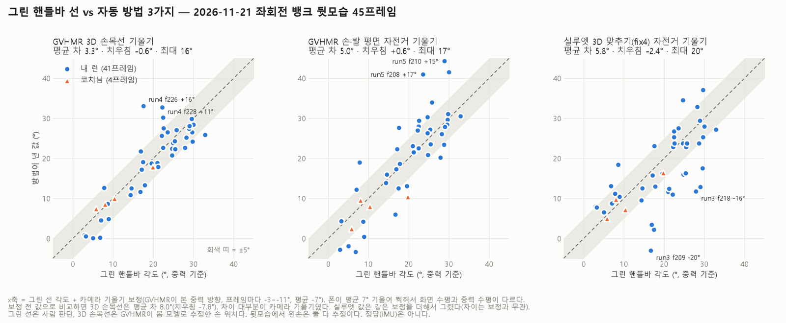
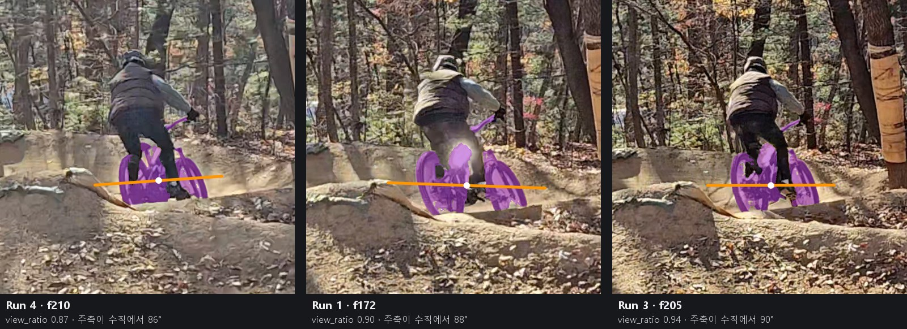
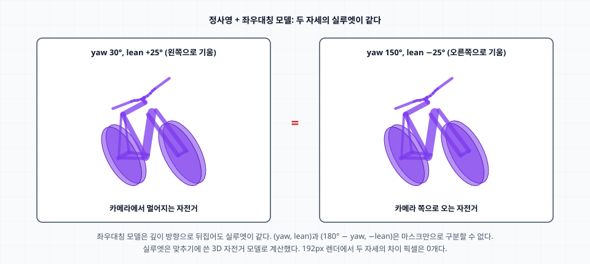
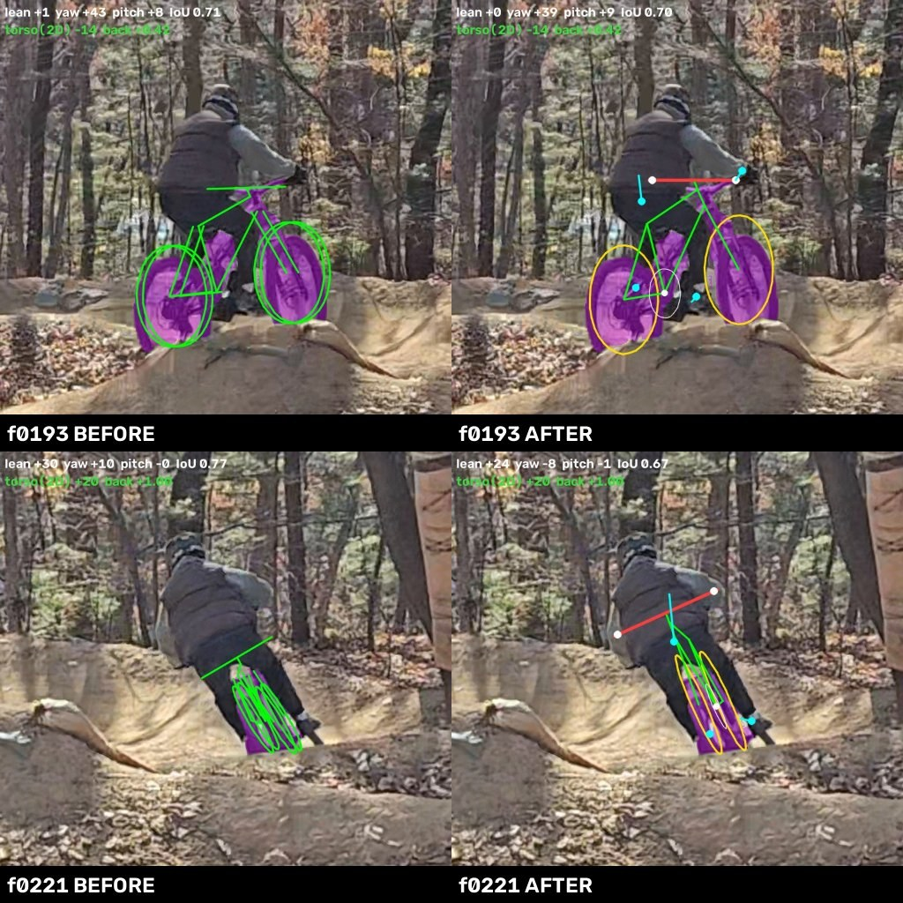
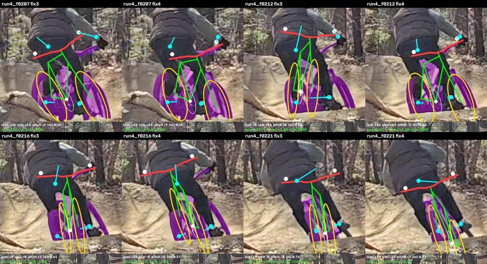
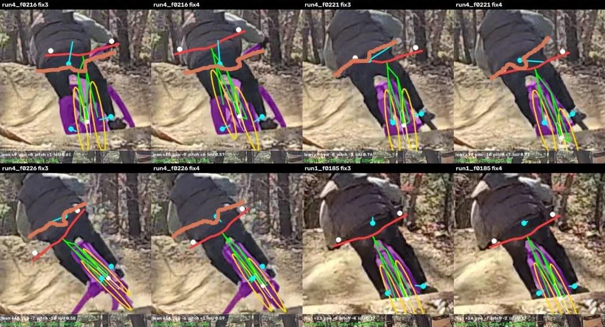
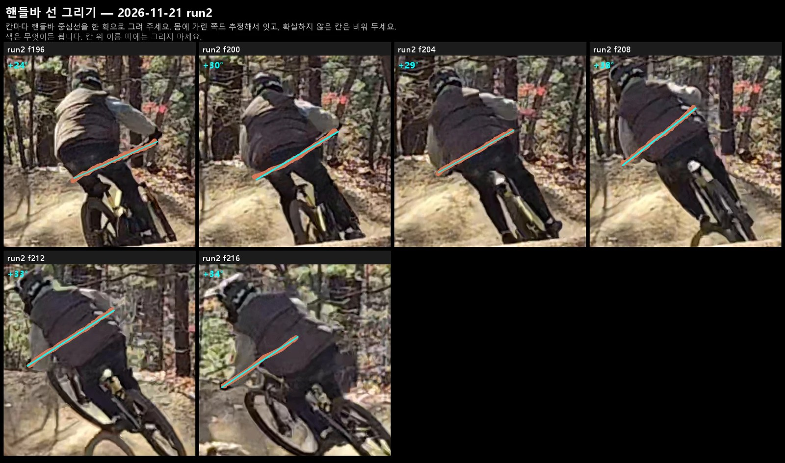
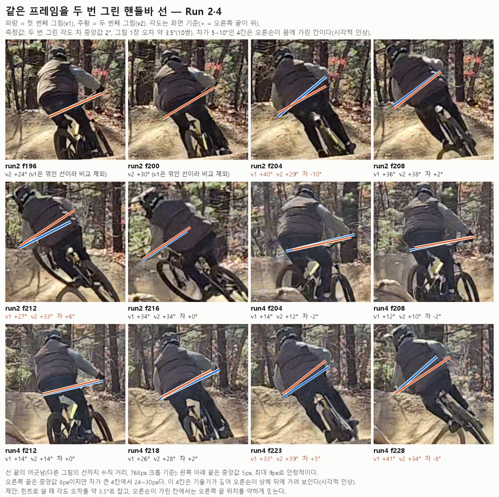
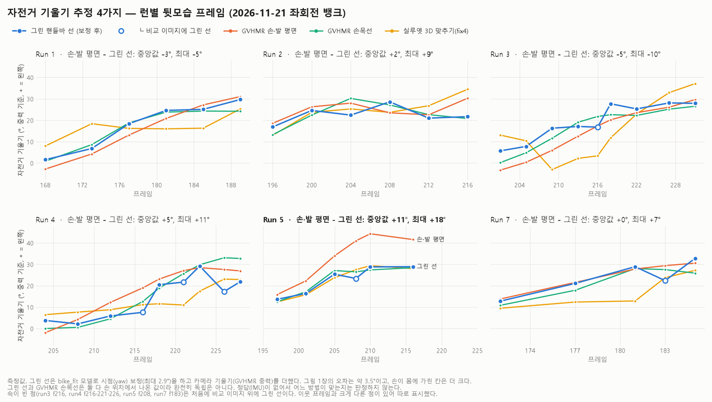

MTB 강습에서 좌회전 자세가 불안정하다는 피드백을 받았다. 코치님이 스마트폰으로 찍어 준 영상에서 자세 차이를 찾는 도구를 만들고 있다. [앞 글](/posts/ai-mtb-coach-2d-pose/)에서는 2D 자세 인식으로 상체가 기우는 타이밍을 비교했다. 코너링에서는 자전거가 얼마나 누웠고 몸이 그에 비해 얼마나 섰는지도 보고 싶다. 이 글은 그 자전거 기울기를 재려고 한 과정이다. 구현은 Claude Code에 맡겼다. 나는 결과 이미지에서 틀린 곳을 짚었고 마지막에 어느 값을 기준으로 둘지 정했다. 코드는 [ai-mtb-coach 저장소](https://github.com/hon454/ai-mtb-coach)에 있다.

먼저 결과다.



측정값이다. 가로축은 내가 영상 위에 직접 그린 핸들바 선의 각도(카메라 기울기 보정 후)이고 세로축은 자동 방법이 낸 자전거 기울기다. 점이 점선 위에 있으면 둘이 같고 회색 띠는 ±5°다. 오른쪽 칸이 이 글에서 가장 오래 붙잡은 3D 실루엣 맞추기다.

실루엣 맞추기는 다섯 번 고쳤지만 그린 선과 평균 5.8° 달랐고 최대 20° 벗어났다. 3D 몸 자세 모델에서 얻은 양 손목을 이은 선은 평균 3.3° 달랐다. 그래서 실루엣 맞추기로 얻은 자전거 기울기는 참고 값으로만 남겼다. 그린 선은 모델에 입력으로 넣지 않고 채점 기준으로 남겼다. 런은 같은 코스를 한 번 탄 주행이고 영상은 7개다. 그린 선도 정답은 아니라서 런끼리 순위는 매기지 않는다.

분석 구간은 좌회전 뱅크(코너 바깥쪽을 벽처럼 세운 흙 코너) 2초 남짓이다. 영상은 손에 든 스마트폰 한 대로 라이더를 따라 돌리며 찍었고 구간 중간에 라이더의 등이 카메라를 향한다. 자세 인식 모델은 사람만 찾는다. 프레임마다 자전거를 찾는 분할 모델(YOLO-seg)은 바로 그 뒷모습에서 자전거를 놓쳤다. 손과 발을 이은 선은 몸의 일부라 자전거를 대신하지 못했다. 2D 단계는 자전거 기울기를 재지 못한 채 끝났다.

## SAM2 마스크는 얻었지만 2D 축은 수평으로 잡혔다

프레임마다 따로 찾는 대신 추적으로 바꿨다. YOLO-seg가 자전거를 잡은 첫 크롭(라이더를 따라가며 잘라 낸 화면)의 박스를 SAM2에 넘겼다. SAM2는 박스나 점으로 지정한 물체를 영상의 나머지 프레임에서 따라가며 영역(마스크)을 칠해 주는 모델이다. 기울어진 뒷모습을 포함해 7런 모두 구간 전체에서 마스크가 나왔다.

마스크에서 기울기를 읽는 가장 단순한 방법부터 썼다. 마스크 아래쪽 55%에 있는 픽셀들이 가장 길게 퍼진 방향(주축, PCA로 구한다)을 뒷바퀴의 방향으로 보고 그 기울기를 읽는 것이다. 이 방법은 실패했다. 앞 글에 적은 마스크 선 두 가지보다 먼저 한 시도다.



보라색이 SAM2 마스크, 주황 선이 주축이다. 측정값이고 이 글을 쓰면서 다시 계산해 그렸다. 점을 고르는 방법과 주축 계산은 도구와 같고 도구에 있는 거름 조건은 껐다. `view_ratio`는 어깨 폭을 몸통 길이로 나눈 값으로, 클수록 등이 카메라를 정면으로 향한다.

주축이 수평에 가까운 프레임 세 개를 골랐다. 뒷모습 프레임이 모두 이렇지는 않다. 세 칸 모두 어깨는 정면인데 자전거는 비스듬히 보인다(시각적 인상). 앞바퀴와 뒷바퀴가 옆으로 나란히 마스크에 들어오고 주축은 두 바퀴를 잇는 수평 방향으로 잡힌다. 나는 2D 축을 버리고 3D 모델을 마스크에 맞추기로 했다.

## 3D 자전거 모델을 마스크에 맞췄다

자전거의 치수(지오메트리)는 공개돼 있다. 바퀴 두 개와 튜브, 핸들바로 단순한 3D 자전거를 만들고 이것을 화면에 그린 실루엣이 마스크와 가장 많이 겹치는 자세를 찾는다. 찾는 값은 방향(yaw), 옆 기울기(lean), 앞뒤 기울기(pitch), 크기, 위치다. 겹침은 IoU(두 영역이 겹친 넓이를 합친 넓이로 나눈 값)로 잰다.

```python title="tools/bike_fit.py (발췌, 정리함)"
def rot(yaw, lean, pitch):
    Rz = ...  # 피치(앞 들림 +)
    Rx = ...  # 린(라이더 왼쪽으로 기울면 +)
    Ry = ...  # 요(0 = 카메라에서 멀어지는 방향)
    return Ry @ Rx @ Rz

def twin(p):
    """깊이 거울쌍: 실루엣이 같은 (180°−yaw, −lean, pitch)."""
    q = np.array(p, float).copy()
    q[0] = wrap(math.pi - q[0])
    q[1] = -q[1]
    return q

def loss(params, M, valid, kpts=None):
    R = rot(*params[:3])
    s = math.exp(params[3])
    Rm = raster(unit_uv(R), s, params[4], params[5], M.shape[0]) > 0
    v = iou(Rm, M, valid)  # 라이더 몸이 가린 영역은 valid에서 뺀다
    h = kp_term(anchor_uv(R), s, params[4], params[5], kpts)
    return 1.0 - v + h
```

`loss`가 줄일 값이다. `kp_term`과 `twin`은 아래에서 설명한다.

첫 시도는 프레임마다 Nelder-Mead(미분 없이 값을 조금씩 바꿔 가며 최솟값을 찾는 방법)로 이 값을 줄였다. 비스듬한 뒷모습과 옆모습 일부는 윤곽이 맞았다(시각적 인상). 하지만 yaw가 −167°, +135°처럼 앞뒤가 뒤집힌 해가 섞였고 한 런에 약 9분이 걸렸다.

이때는 제약과 탐색을 손보면 될 문제로 봤다. Claude가 백그라운드 작업으로 돌린 수정에서 원인이 다른 데 있다는 것이 드러났다.



모델은 좌우대칭이고 원근 없이 평행하게 투영한다(정사영). 이 조건에서는 (yaw, lean)과 (180° − yaw, −lean)의 실루엣이 같다. 멀어지며 왼쪽으로 기운 자전거와 다가오며 오른쪽으로 기운 자전거를 마스크만으로는 구분할 수 없다.

그래서 yaw를 −90°에서 +90° 사이에서만 찾고 후보마다 거울쌍(`twin`)을 붙인 뒤, 런 전체에서 Viterbi로 한 줄을 골랐다. Viterbi는 프레임마다 후보가 여러 개일 때 전체 비용이 가장 작은 후보 열을 고르는 동적 계획법이다. 비용에는 맞춤 점수, 프레임 사이의 연속성, 뒷모습 여부, 손목·발목·머리 위치 단서를 넣었다. 7런 모두 방향 뒤집힘이 0건이 됐고 한 런이 7–19초로 줄었다. IoU 중앙값은 0.63–0.73으로 나아지지 않았다. 그리고 일부 마스크에는 자전거 그림자가 섞여 있어서 그 프레임들은 맞춤이 어긋났다.

자전거 기울기를 따로 잰 분리각은 이때 처음 나왔다. 분리각은 자전거 기울기에서 상체 기울기를 뺀 값이다. 양수면 상체가 자전거보다 덜 기운 것이고 0이면 자전거와 몸이 한 덩어리로 기운 것이다. 엉덩이 위치는 이 값에 들어 있지 않아서 린아웃(자전거를 더 눕히고 엉덩이를 코너 바깥에 두는 자세)과 같은 뜻은 아니다. 앞 글에서는 확대 장면을 보고 자전거와 몸이 같이 기우는 것처럼 보인다고 적었다. 이 숫자가 나온 뒤 그 인상을 고쳐 적었다. 상체가 자전거보다 평균 10°쯤 덜 기울고 런마다 +1°에서 +17°까지 다르다는 내용이다. 다만 뒷모습에서 기울기 크기의 오차는 프레임당 약 ±10°로 봤다.

## 다섯 번 고쳤지만 분리각이 수렴하지 않았다

2차부터 수정은 같은 순서로 돌았다. 내가 결과 이미지에서 틀린 곳을 짚으면 Claude가 원인을 확인해 백그라운드 작업에 넘긴다. 돌아온 비교 이미지는 다시 본다.



Run 4의 두 프레임이다. 왼쪽이 수정 전, 오른쪽이 수정 후다. 보라색은 마스크, 선은 모델이 낸 결과다. 맞았는지는 눈으로 판단했다(시각적 인상).

나는 이 런의 결과를 보고 보라색 마스크는 잘 됐는데 3D 뼈대가 제대로 그려지지 않았다고 지적했다. 아랫줄 왼쪽 칸(221번 프레임, 이하 f221)이 그 장면이다. 뒷모습에서 다리가 바퀴 위쪽을 가리자 모델이 절반 크기로 줄었고 핸들바가 엉덩이 높이에 그려졌다. 그래서 런 단위로 크기를 고정하고 자세 인식의 손목과 발목을 그립과 페달에 묶는 제약(`kp_term`)을 넣었다. 다시 계산한 분리각은 Run 1–4가 +3°에서 +5° 사이였다. 당시에는 직전에 적은 런 간 차이가 대부분 맞추기 잡음이었다고 봤다.

그 뒤로도 뒷모습에서 핸들바와 손 위치가 맞지 않았다(시각적 인상). 내 자전거의 핸들바는 일자가 아니고 양 끝이 올라가게 꺾인 라이저 바다. 내가 이 점을 알려 줘서 3차에 반영했다. 이때 백그라운드 작업의 보고에는 그립이 손에서 15px 이내라고 적혀 있었다. Claude는 비교 이미지에서 Run 1의 왼쪽 그립이 보이는 손보다 안쪽에 있는 것을 확인했고 보고 대신 이미지를 기준으로 판단했다. 4차에는 앞바퀴 29인치, 뒷바퀴 27.5인치인 멀렛 구성을 넣었다.



칸 제목의 `fix3`이 4차, `fix4`가 5차 수정이다. 노랑이 바퀴, 초록이 프레임, 빨강이 핸들바다. 아래 설명도 눈으로 본 판단이다. f212는 4차에서 핸들바가 등 위로 올라갔다가 5차에서 손 높이로 돌아왔다. f216은 5차에서도 오른쪽에 떨어져 있는 앞바퀴 조각을 덮지 못했다. 그 조각을 덮으라는 항을 넣으면 모델이 방향 대신 기울기를 올려서 덮었기 때문에 항을 껐다.

수정마다 런별 분리각은 아래처럼 바뀌었다.

| 수정 | 바꾼 것 | Run 1 | Run 2 | Run 3 | Run 4 | Run 5 | Run 7 |
|---|---|---|---|---|---|---|---|
| 1차 | 뒤집힘 해결, 속도 | +6 | +9 | +1 | +9 | +17 | +13 |
| 2차 | 크기 고정, 손목·발목 제약 | +5 | +5 | +5 | +3 | +10 | +15 |
| 3차 | 라이저 바, 손목 거르기 | +12 | +7 | +1 | +3 | +16 | +28 |
| 4차 | 멀렛 휠, 가림 처리 | −2 | +3 | −1 | +2 | +14 | +13 |
| 5차 | Run 4의 두 프레임 겨냥 | −1 | +2 | +1 | +2 | +12 | +7 |

측정값이고 단위는 도다. 자전거가 거의 정면 뒷모습으로 찍히고 IoU가 기준을 넘은 프레임의 중앙값이다. 상체 기울기는 2D 값이다. 4차부터는 기울기를 정할 수 없는 프레임을 통계에서 뺐다. Run 6은 뒷모습 프레임이 1개뿐이라 뺐다.

같은 영상인데 모델을 고칠 때마다 런별 값이 최대 15° 움직였다. 4차를 마친 시점에 나는 이렇게 판단했다. 이 방법으로는 뒷모습 분리각이 수렴하지 않는다. 뒤에서 보면 바퀴는 가장자리만 보이고 다리와 흙 둔덕이 그마저 가린다. 정확히 뒤에서 본 프레임에서는 기울기가 15–18° 다른 해가 비슷한 점수를 냈다. 더 고치는 것보다 측정 방법을 바꾸는 쪽이 맞다. Claude가 짚은 프레임들이 4차에서 오히려 나빠졌다는 데 나도 동의했다. 5차는 내가 요청한 Run 4의 두 프레임을 겨냥했다. f212는 돌아왔고 f216은 고치지 못했다. 이 수정으로 Run 7의 값도 +13에서 +7로 움직였다.

## 내가 그린 핸들바 선을 채점 기준으로 삼았다

5차 비교 이미지를 보다가 나는 그 위에 핸들바가 있다고 생각하는 위치를 직접 그려서 보냈다.



굵은 주황 선이 내가 그린 것이고(내 판단) 가는 빨강 선이 모델의 핸들바다. 아랫줄 오른쪽 두 칸에는 그리지 않았다. 문제 프레임 위주로 고른 6장에서 둘의 차이는 평균 8°, 최대 16°였다.

모델 선이 이미 그려진 이미지 위에 그리면 내 선이 모델 선에 끌릴 수 있다. 그래서 모델 선이 없는 크롭만 모은 보드를 만드는 도구를 추가했고 나는 Run 6을 뺀 여섯 런과 코치님 영상의 보드에 그렸다. 도구는 내가 그린 보드와 원본 보드의 차이에서 그린 선을 읽는다.



주황이 내가 그린 획이고 하늘색이 도구가 읽은 선이다. 칸 왼쪽 위 각도는 읽은 선의 측정값이다.

사람이 그린 선을 기준으로 쓰려면 그 선의 오차부터 알아야 한다. Run 2와 Run 4 보드는 두 번씩 그렸다.



파랑이 첫 번째, 주황이 두 번째 그림이다. 10쌍에서 각도 차의 중앙값은 2.0°였고 그림 한 장의 오차는 표준편차 약 3.5°로 잡았다(측정값). 차이가 5–10°인 네 칸은 기울기가 깊어 오른손이 몸 뒤에 가린 칸이다(시각적 인상).

확인할 것이 두 가지 더 있었다. 하나는 핸들바 각도를 자전거 기울기로 읽어도 되는지다. 맞추기 모델로 계산하면 그린 41프레임의 방향 범위에서 둘의 차이는 3° 안쪽이었다.

다른 하나는 카메라다. 그린 선은 화면 기준 각도인데 폰이 기울어 있으면 화면의 수평이 실제 수평과 다르다. 여기에는 GVHMR을 썼다. 움직이는 카메라 영상에서 중력 방향을 기준으로 3D 몸 자세를 추정하는 모델이고 프레임별 카메라 기울기와 양 손목을 이은 선의 기울기를 얻었다. 손목선은 핸들바를 쥔 두 손을 3D에서 이은 선이다. 뒷모습에서 왼손은 가려 있어 추정이지만 실루엣보다 나은 단서로 봤다. GVHMR 추정으로는 폰이 프레임마다 3–11°, 평균 7° 기울어 있었다. 이 보정 없이 손목선과 그린 선을 비교하면 평균 차가 8.0°였고 그 대부분이 한쪽으로 쏠린 차이였다. 보정하면 3.3°다.

이렇게 내 런 41프레임과 코치님 4프레임을 채점한 것이 맨 위 그래프다. 41프레임 가운데 6프레임은 처음 비교 이미지 위에 그린 선이다. 실루엣 맞추기는 평균 5.8°, 손목선은 3.3°, 같은 3D 몸에서 손과 발의 중점으로 잡은 평면은 5.0° 달랐다.

그린 선을 모델에 넣어 보기도 했다. 그린 프레임에서는 모델 핸들바가 그린 선에 약 3° 안쪽으로 붙었다. 하지만 바뀐 것은 그 프레임과 앞뒤 두세 프레임뿐이었다. 입력으로 쓰지 않고 남겨 둔 25프레임의 오차는 6.5°에서 줄지 않았다. 입력으로 쓴 선은 채점에 쓸 수 없다. Claude가 추천한 안을 내가 택했다. 그린 선을 입력으로 넣는 옵션은 기본으로 끄고 그린 선은 채점 기준으로 남긴다. 자전거 기울기는 손목선을 먼저 보고 실루엣 맞추기 값은 참고로만 둔다.

## 아직 모르는 것

그린 선은 정답이 아니다. 뒷모습에서 왼손은 몸에 가려 있어서 내 선도 손목선도 왼쪽 끝은 추정이다. 손목선의 평균 차 3.3°는 그림 한 장의 오차와 같은 크기라서 손목선이 그보다 정확한지는 그린 선으로 가릴 수 없다. 가리려면 핸들에 센서(IMU)를 달고 달린 영상이 필요하다.

런 사이의 순서도 정하지 못했다. 5차를 마쳤을 때는 다섯 번 내내 분리각이 컸던 것이 Run 5 하나라고 적었다.



측정값이다. 파랑이 그린 선, 노랑이 실루엣 맞추기, 초록이 손목선, 주황이 손·발 평면이다. 속이 빈 파랑 점은 처음 비교 이미지 위에 그린 선이다.

Run 5에서는 f205부터 손·발 평면만 그린 선보다 8–18° 높다. Run 3에서는 실루엣 맞추기가 중간에 그린 선보다 14–20° 낮다. 자전거 기울기를 무엇으로 재느냐에 따라 런 순서가 바뀌었고 Run 5 하나라는 결론도 유지하지 못했다. 그래서 정답 없이는 런끼리 분리각 순위를 매기지 않는다.

코치님과의 비교도 결론을 내지 못했다. 코치님 영상의 뒷모습 프레임은 뱅크 진입 쪽이라 내 런의 뒷모습 구간과 같은 구간이 아니다. 그 구간에서 코치님의 분리각은 수정에 따라 −6°에서 0° 사이였다. 코치님은 린아웃이 크고 나는 없다고 말할 근거는 지금 데이터에 없다.
