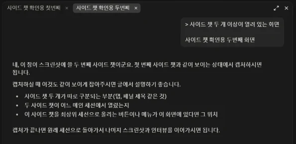
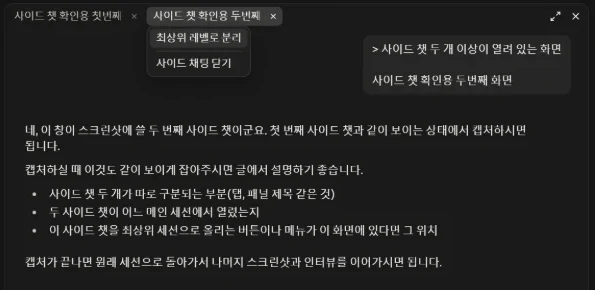
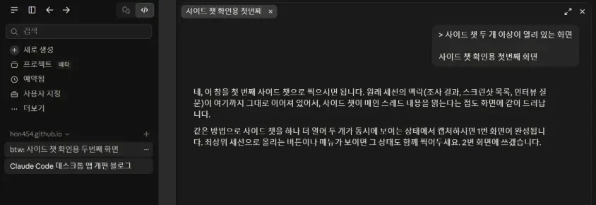
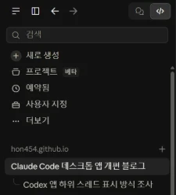
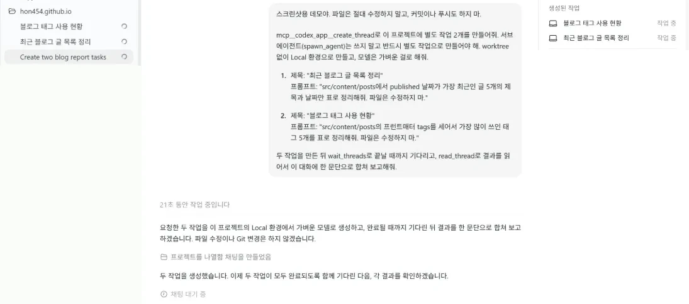
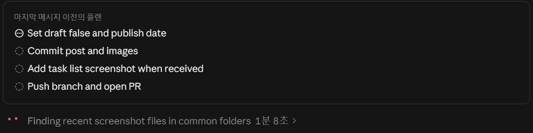
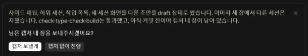
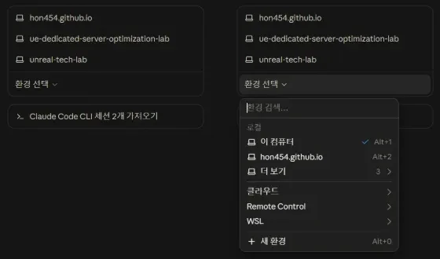

[[codex-to-claude-code-desktop|지난 글]]에서 적었듯이 ChatGPT Pro 200달러 플랜 가입이 막혀 사용량이 부족했던 탓에 이번 달은 Claude Code 데스크톱 앱을 쓰고 있다. 200달러 플랜은 바로 다음 날 다시 열렸기 때문에 한 달이 지나면 Codex로 돌아갈 생각이었다.

그런데 10월 14일(미국 시간)에 [ClaudeDevs가 데스크톱 앱 업데이트를 발표](https://x.com/ClaudeDevs/status/2110445844675838148)했다. 여러 세션을 나란히 돌리는 사용 방식에 맞춰 세션을 더 빨리 시작하고, 일을 여러 세션으로 나누고, 각 세션이 무엇을 하는지 볼 수 있게 했다는 내용이다. 지난 글에서 아쉬운 점으로 적은 사이드 채팅도 이번에 바뀌었다.

:::note[확인 환경]
Windows 11, Claude 데스크톱 앱 `2.37337.1`에서 2026년 10월 15일에 확인했다. 공식 문서는 아직 이번 업데이트 내용을 반영하지 않은 부분이 있어서, 사이드 채팅과 하위 세션은 직접 확인한 동작을 기준으로 적었다.
:::

## 사이드 채팅을 여러 개 열고 세션으로 분리할 수 있다

지난 글을 쓸 때는 사이드 채팅을 하나만 열 수 있었다. 이제는 `Ctrl+;`나 `/btw`로 연 사이드 채팅이 오른쪽 패널에 탭으로 쌓인다. 탭마다 따로 대화하고, 각 탭 모두 메인 세션의 맥락을 읽는다.

기록이 쌓이는 방식도 달라졌다. 예전에는 사이드 채팅이 하나뿐이라 닫았다가 다시 열어도 이전 사이드 채팅 기록이 계속 이어서 쌓였다. 지금은 열 때마다 새 사이드 채팅이 만들어지는 것 같다. 질문마다 깨끗한 사이드 채팅에서 시작할 수 있어서, 앞선 질문의 대화가 다음 질문에 섞이지 않는다.

탭 메뉴에는 `최상위 레벨로 분리`와 `사이드 채팅 닫기`가 있다.

`최상위 레벨로 분리`를 누르면 사이드바에 `btw:`로 시작하는 일반 세션이 생기고, 패널에는 나머지 탭만 남는다. 분리한 세션에서도 그대로 대화를 이어갈 수 있다.

써보니 사이드 채팅을 세션 포크처럼 쓰는 기능에 가깝다. 실제로 Claude에게 세션 정보를 조회하게 해보면 분리한 세션은 원래 세션을 부모로 기록하고 있고, 분리된 상태(`detached`)로 표시된다. 지난 글에서 Codex의 사이드 채팅을 포크처럼 쓸 수 있어서 더 편했다고 적었는데, 이제는 Claude Code에서도 비슷하게 쓸 수 있다.

공식 문서는 아직 사이드 채팅을 앱을 닫으면 다시 돌아갈 수 없는 대화로 설명한다. 남겨 둘 대화라면 분리해서 세션으로 만들어 두면 된다.

## 세션이 띄운 세션은 부모 아래에 묶인다

Claude가 작업 도중 다른 세션을 시작하면, 새 세션은 사이드바에서 원래 세션 아래에 묶여 표시된다. 하위 세션이 턴을 마치면 결과 요약이 부모 세션으로 돌아온다. 9월 중순에도 사이드바를 [부모/자식 트리로 보여 달라는 요청](https://github.com/anthropics/claude-code/issues/95195)이 올라왔을 만큼 이전에는 세션 사이의 관계가 사이드바에 드러나지 않았다.

이 글을 준비하면서도 Codex 쪽 동작을 조사하는 일을 하위 세션으로 맡겼다. Claude가 조사 세션을 카드로 제안했고, 카드를 눌러 시작하자 이 세션 아래에 붙었다. 조사가 끝나자 결과가 원래 세션으로 전달됐다.

Codex에서는 조율하는 작업이 별도 작업(백그라운드 스레드)을 만들어 일을 나누는 식으로 써왔다. 비교하려고 Codex에서도 작업 하나에 별도 작업 두 개를 만들게 해봤다.

만들어진 작업은 사이드바에 원래 작업과 같은 레벨로 나열된다. 원래 작업의 오른쪽 패널에 `생성된 작업`으로 표시되기는 하지만, 사이드바는 트리 구조가 아니다. 생성된 작업 쪽에 들어가 있으면 어느 작업이 만들었는지 알기 어려울 것 같다. 실제로 작업이 늘어나면 어느 대화에서 시작된 작업인지 헷갈렸다. Claude Code에서는 시작한 세션 아래에 묶여 있어서 이 관계가 바로 보인다.

Codex도 서브에이전트는 각자의 스레드를 열어 진행 상황을 볼 수 있고, 부모 아래 묶어 보여주는 쪽이 의도된 동작으로 보인다. 다만 8월 이후 일부 데스크톱 빌드에서 서브에이전트 스레드가 최상위 목록에 따로 뜬다는 [이슈](https://github.com/openai/codex/issues/38780)가 올라와 있다. 내가 불편했던 쪽은 서브에이전트가 아니라 별도 작업이었다.

## 작업 과정이 기본으로 보인다

이제 Claude가 여러 단계의 일을 하면 마지막 메시지 아래에 작업 목록이 붙는다. 진행 중인 단계와 남은 단계가 표시되고, 계획이 바뀌면 목록도 함께 바뀐다.

예전에는 진행 상황을 보려고 ledger나 체크포인트 문서 같은 외부 파일을 따로 만들고, 세션이 그 파일을 확인하면서 단계가 끝날 때마다 보고하게 했다. 이제는 그런 파일 없이도 지금 어느 단계인지 화면에서 바로 보인다.

턴이 끝나면 요약 카드도 뜬다. 무엇이 바뀌었고 어디까지 됐는지를 두세 문장으로 정리하고, 사용자가 정해야 할 일이 있으면 질문과 선택 버튼을 함께 보여준다. 발표 내용에 따르면 사이드바에서도 작업 중인 세션과 입력을 기다리는 세션이 구분된다.

## 새 세션 화면과 환경 저장

새 세션 화면도 바뀌었다. `새로 생성`을 누르면 화면 가운데에 최근에 쓴 폴더 목록과 `환경 선택` 메뉴가 뜬다. 환경 선택에서는 로컬, 클라우드, Remote Control, WSL을 고를 수 있고, `새 환경`으로 구성을 추가할 수 있다. 로컬 환경에는 `Alt+1`, `Alt+2` 같은 단축키가 붙는다. CLI에서 시작한 세션을 가져오는 버튼도 같은 화면에 있다.

[업데이트 소개 기사](https://alphasignal.ai/news/anthropic-s-claude-code-now-runs-nested-sessions-and-saves-dev-environments)에 따르면 저장한 환경에는 여러 폴더와 SSH 호스트나 클라우드 대상, 폴더별 worktree 사용 여부가 들어간다.

지난 글에서 여러 폴더를 묶는 과정이 어색하다고 적었는데, 환경 저장이 그 부분을 겨냥한 기능으로 보인다. 아직 직접 써보지는 않아서 Codex의 프로젝트처럼 쓸 수 있는지는 확인하지 못했다.

## 정리

한 달이 지나면 Codex로 돌아갈 생각이었다. 그런데 지난 글에서 아쉬운 점으로 적은 사이드 채팅이 2주도 안 돼서 바뀌었고, 세션이 띄운 세션을 묶어 보여주는 방식은 Codex보다 낫다고 느꼈다. 돌아갈지는 조금 더 써보고 정하려 한다.

## 참고 자료

- [ClaudeDevs: Claude Code 데스크톱 앱 업데이트 발표](https://x.com/ClaudeDevs/status/2110445844675838148)
- [AlphaSignal: Anthropic's Claude Code Now Runs Nested Sessions and Saves Dev Environments](https://alphasignal.ai/news/anthropic-s-claude-code-now-runs-nested-sessions-and-saves-dev-environments)
- [Claude Code Docs: Use Claude Code Desktop](https://code.claude.com/docs/en/desktop)
- [anthropics/claude-code#95195: Desktop sidebar: show sessions as a parent/child tree](https://github.com/anthropics/claude-code/issues/95195)
- [openai/codex#38780](https://github.com/openai/codex/issues/38780)
