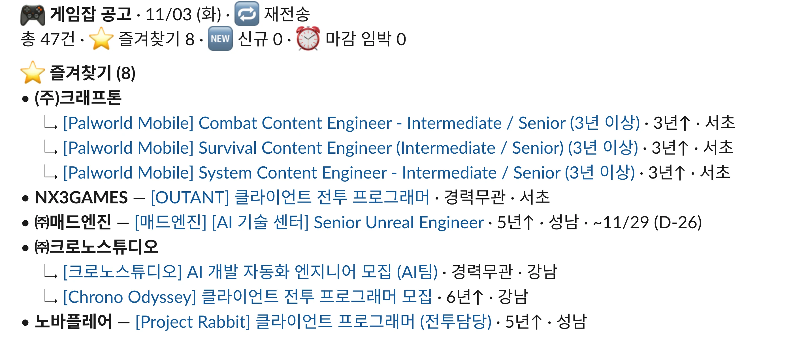
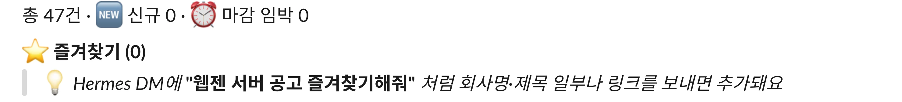
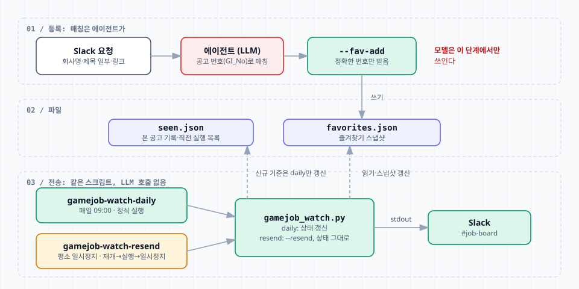

[이전 글](/posts/hermes-agent-gamejob-watch/)에서 만든 게임잡 공고 알림은 매일 오전 9시(KST)에 서울·경기 언리얼·C++ 경력 공고 40여 건을 Slack `#job-board` 채널로 보낸다. 목록을 며칠 받아 보니 지원을 고민할 공고를 따로 표시해 둘 곳이 필요했다. 매일 같은 목록에서 같은 공고를 다시 찾는 일이 반복됐기 때문이다.

원하는 사용 방식은 정해져 있었다. 회사명이나 제목 일부, 링크 같은 대략적인 설명을 Hermes에 보내면 그 공고를 즐겨찾기에 넣고, 바로 채널에 목록을 다시 보내서 적용된 모습을 보여 주는 것이다.

## 즐겨찾기를 어디에 두고 어떻게 보여 줄지

저장 위치는 세 가지를 비교했다.

- `config.json`의 watch 안에 `favorites` 목록을 두는 방식
- 별도 파일 `favorites.json`에 두는 방식
- Notion이나 Obsidian에 동기화하는 방식

첫 번째는 관리할 파일이 늘지 않지만 검색 조건과 내 기록이 한 파일에 섞인다. 세 번째는 나중에 붙여도 되는 기능이라 원본으로 삼을 이유가 없었다. 별도 파일로 정했다. 즐겨찾기한 공고는 공고 번호(`GI_No`)만이 아니라 회사, 제목, 경력, 지역, 마감일, 추가한 시각과 메모까지 스냅샷으로 저장한다. 게임잡에서 공고가 내려가도 어떤 공고였는지 남기려는 목적이다.

```json title="~/.hermes/data/gamejob-watch/favorites.json (1건)"
{
  "favorites": {
    "286506": {
      "id": "286506",
      "company": "㈜매드엔진",
      "title": "[매드엔진] [AI 기술 센터] Senior Unreal Engineer",
      "url": "https://www.gamejob.co.kr/Recruit/GI_Read/View?GI_No=286506",
      "career": "경력5년↑",
      "location": "경기 > 성남시",
      "employ": "정규직",
      "deadline_raw": "~11/29",
      "added_at": "2026-11-03T14:56:31+09:00",
      "note": "",
      "last_live": "2026-11-03"
    }
  }
}
```

`last_live`는 마지막으로 게임잡 목록에서 확인된 날짜다. 공고가 목록에 있는 동안은 실행할 때마다 스냅샷을 새 값으로 갱신한다.

표시 규칙은 다음과 같다.

- 즐겨찾기 구간 `⭐ 즐겨찾기 (N)`을 언리얼 구간 위에 둔다. 즐겨찾기한 공고는 언리얼·C++ 구간에서 빠지고, 그 구간의 건수도 그만큼 줄어든다. 같은 공고가 두 번 나오지 않게 하려는 것이다.
- 즐겨찾기한 공고는 필터를 통과하지 못해도 표시한다. 필터는 후보를 고르는 기준이고, 즐겨찾기는 내가 이미 고른 결과이기 때문이다.
- 즐겨찾기한 공고에는 신규 표시(🆕)를 붙이지 않는다. 필터 밖의 공고를 즐겨찾기했을 때 가짜 신규가 생기지 않게 하려는 것이다.
- 목록에서 사라진 공고는 자동으로 지우지 않는다. 스냅샷으로 표시하면서 `🔚 게시 종료`를 붙이고 구간 맨 아래로 내린다.
- 메모가 있으면 공고 줄 끝에 `· 📝 1차 지원 예정`처럼 메모 내용을 붙인다.



8건을 한 번에 넣고 재전송한 목록이다. 같은 회사의 공고는 다른 구간처럼 회사명 아래에 묶인다.

즐겨찾기가 하나도 없을 때도 구간은 남기고, 등록 방법을 인용 블록 한 줄로 안내한다. 공고 목록과 섞이지 않게 글머리 기호 대신 인용 블록을 썼다.



지금은 예시에 특정 회사 대신 `"[회사명] [공고 키워드] 즐겨찾기해줘"`라는 자리표시자를 쓴다.

## 대충 말해도 찾는 일은 에이전트가 맡는다

"크래프톤 팰월드 모바일 전투 쪽 즐겨찾기해줘" 같은 요청을 공고 번호로 바꾸는 일은 스크립트에 넣지 않았다. 이 매칭은 에이전트가 하고, 스크립트는 정확한 공고 번호나 링크만 받는다.

```bash
S=~/.hermes/scripts/gamejob_watch.sh
$S --fav-add 286506 279893 ...           # 공고 번호나 링크, 여러 건 가능
$S --fav-remove 286506                   # 해제
$S --fav-list                            # 목록
$S --fav-note 286506 "1차 지원 예정"      # 메모, 빈 문자열이면 삭제
$S --resend                              # 신규 표시 상태를 바꾸지 않고 다시 출력
```

에이전트는 상세 페이지 캐시(`seen.json`)와 현재 목록에서 회사명과 제목을 맞춰 본다. 후보가 하나로 좁혀지면 바로 등록하고, 여러 개면 짧은 선택지로 되묻는다. 찾지 못하면 링크를 달라고 한다. 이렇게 나누면 사람 말을 해석하는 부분에만 모델이 쓰이고, 매일 오전 9시의 크론은 이전처럼 LLM 호출 없이 스크립트만 실행한다.

처음 등록할 때는 채널에 올라온 목록에서 8줄을 그대로 복사해 보냈다. 회사명이 빠진 하위 줄도 섞여 있었지만 줄마다 공고 링크가 들어 있어서 번호를 바로 얻었다. 매칭 판단이 필요한 것은 회사명이나 제목 일부만 보낼 때다.

## 신규 표시를 건드리지 않는 재전송

즐겨찾기를 넣은 뒤 바로 채널에 다시 보내는 부분에서 걸리는 점이 있었다. 기존 일일 크론을 수동 실행(`cronjob run`)하면 실제 실행이라서 본 공고 기록(`seen.json`)과 직전 실행 목록이 갱신된다. 즐겨찾기할 때마다 이렇게 보내면 다음 날 아침의 신규 표시와 "사라진 공고" 집계가 어긋난다.

그래서 스크립트에 `--resend` 옵션을 추가했다. 미리보기(`--dry-run`)처럼 신규 판정 기준인 본 공고 기록과 직전 실행 목록을 바꾸지 않고, 제목 옆에 `🔁 재전송`을 붙인다. 속도를 위해 이미지 본문 OCR은 건너뛰어서 한 번에 20초 정도 걸린다. 이 옵션을 실행하는 재전송 크론을 따로 등록하고 일시정지해 두었다. 크론 작업에는 일정이 필요해서 일일 크론과 같은 매일 오전 9시로 등록했다.

```json title="gamejob-watch-resend"
{
  "id": "4d47295f5480",
  "name": "gamejob-watch-resend",
  "script": "gamejob_watch_resend.sh",
  "no_agent": true,
  "schedule": { "kind": "cron", "expr": "0 9 * * *" },
  "enabled": false,
  "state": "paused",
  "deliver": "slack:C0CE49Y6VKK"
}
```

`gamejob_watch_resend.sh`는 일일 크론의 래퍼와 같은 스크립트를 `--resend`로 실행한다. 스크립트 출력을 채널에 보내는 일은 크론 전송을 거쳐야 해서, 재전송도 크론으로 만들었다.

일시정지한 크론은 수동 실행도 거부된다. 그래서 재전송할 때는 크론을 재개하고, 실행하고, 바로 다시 일시정지한다. 실행은 백그라운드에서 이어지므로 일시정지해도 전송은 끝난다. 재개한 채로 두면 다음 날 오전 9시에 정식 목록과 재전송 목록이 함께 올라가기 때문에, 이 순서를 스킬 문서에 적어 두었다.



검증은 실제 데이터를 복사한 폴더에서 먼저 했다. 즐겨찾기 3건(일부러 만든 게시 종료 공고 1건 포함)을 넣었을 때 언리얼 구간이 40건에서 38건으로 줄었고, 게시 종료 공고에는 마감일 대신 `🔚 게시 종료`가 붙었다. 재전송 전후로 본 공고 기록과 직전 실행 목록은 그대로였다. 정식 실행에서는 게시 종료된 즐겨찾기 공고가 직전 실행 목록(`last_ids`)에 들어가지 않는 것도 확인했다. 들어가면 다음 실행마다 "사라진 공고"로 잡힌다.

## 점검에서 나온 필터 오탐

즐겨찾기를 붙인 뒤 스크립트와 설정을 한 번 점검했다. 정규식은 대소문자를 구분하지 않고 공고 제목과 본문에 적용되는데, 단어 일부에 걸리거나 범위가 너무 넓은 항목이 나왔다. 경력 조건과 설정 검증도 하나씩 손봤다.

유니티 판정 정규식의 `unity`는 `community`나 `opportunity` 안에서도 걸렸다. 영어 공고에 흔한 단어라서, 언리얼 공고가 유니티 언급이 더 많다고 판정돼 빠질 수 있었다. 이번 목록에서 이 때문에 빠진 공고는 없었지만 단어 단위로만 맞추게 바꿨다.

```text title="other_engine_regex"
before: 유니티|unity|cocos|…
after:  유니티|\bunity(?![a-z])|cocos|…
```

직무 포함 정규식의 `엔진`은 엔진 프로그래머를 받으려고 넣은 단어인데, 제목에 `언리얼엔진`이 들어간 아트 공고까지 통과시켰다. 드래곤플라이의 `[스페셜포스 리마스터] 언리얼엔진 3D 그래픽 모집`이 그런 경우였다. 제목에 `아트`가 없어서 제외 정규식에도 걸리지 않았다. 앞에 `언리얼`이 붙은 `엔진`은 맞추지 않도록 부정형 lookbehind를 넣었다. 블랙스톰의 `언리얼5 RPG 게임 프로젝트 신규 개발자 채용 (이펙트)`는 `개발자`로 통과하고 있어서, 제외 정규식에 `이펙트`를 추가했다.

```text title="role_include_regex"
before: …|서버|엔진|네트워크|…
after:  …|서버|(?<!언리얼)(?<!언리얼 )엔진|네트워크|…
```

반대 방향의 오탐도 있었다. 제외 정규식의 `보안`이 네오플의 `최적화/보안 클라이언트 프로그래머`를 직무 단계에서 빼고 있었다. 보안 직군만 빠지도록 범위를 좁혔다. 이 공고는 본문에 Unity가 적혀 있어서 고친 뒤에도 엔진 단계에서 빠졌고, 최종 목록은 바뀌지 않았다.

```text title="role_exclude_regex"
before: …|인프라|보안|강사|…
after:  …|인프라|보안 ?(?:엔지니어|관제|담당자|운영)|정보보안|강사|…
```

경력 조건에도 하나가 있었다. 하이퍼센트의 `[PC 게임] 언리얼 개발자 신입 채용`은 게임잡 경력 필드가 `경력무관`이라 통과하고 있었다. `career_min_years`가 설정되어 신입을 제외하는 경우에는 제목에 `신입`만 있고 `경력`이 없는 공고는 빼도록 했다. `서버(신입/경력)`처럼 둘 다 적힌 공고는 남는다.

정규식 변경은 캐시된 상세 페이지에 다시 적용하면 되기 때문에, 바꾸기 전과 후의 결과를 공고 번호로 비교했다. 최종 47건에서 아트·이펙트 공고 2건이 빠져 45건, 신입 공고 1건이 더 빠져 44건이 됐다.

마지막으로 조건 변경 명령(`--set`)의 검증 범위를 넓혔다. 이전에는 일부 정규식만 저장 전에 검사해서, 엔진 판정 정규식에 오타가 있으면 그대로 저장되고 다음 날 크론이 오류로 끝날 수 있었다. 지금은 이름이 `_regex`로 끝나는 항목을 모두 저장 전에 컴파일해 본다.
