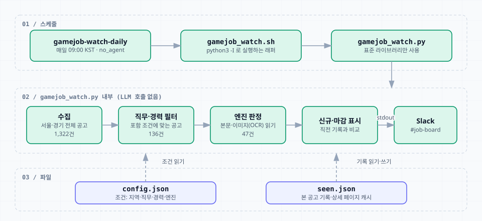
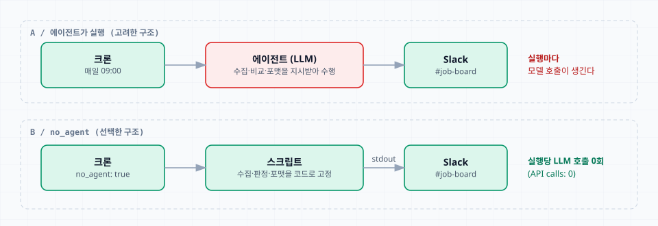
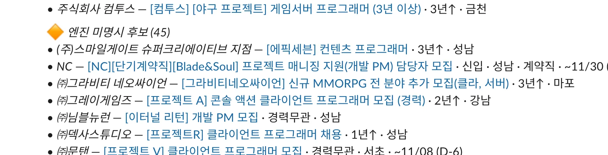
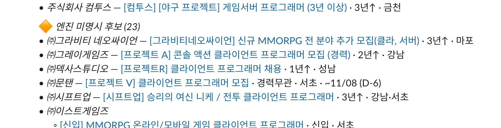
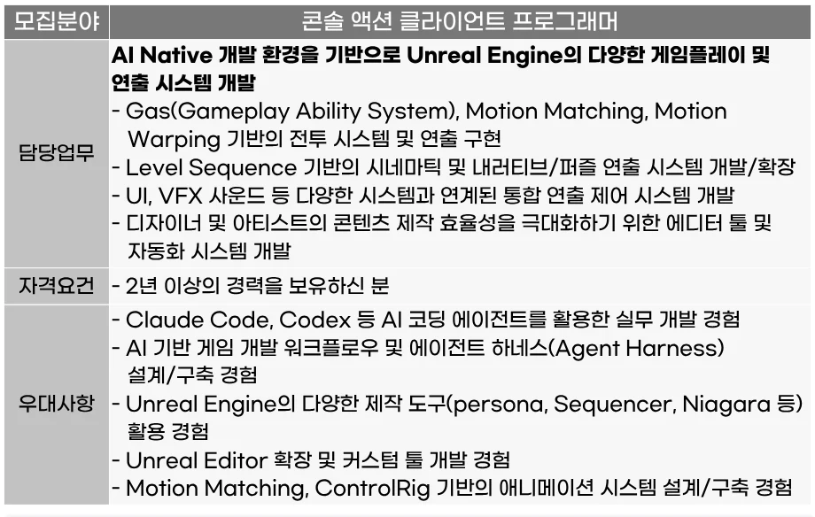
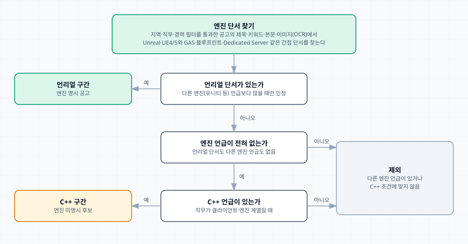
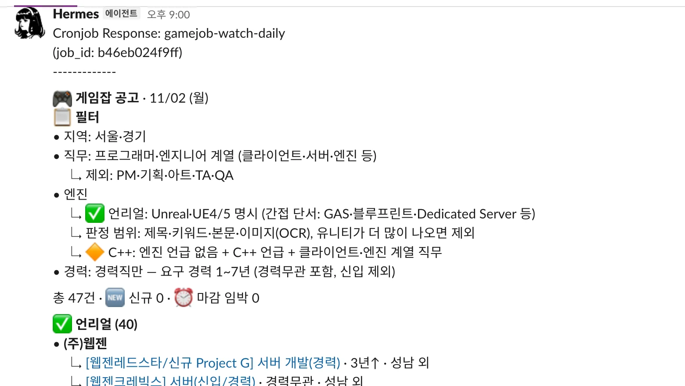
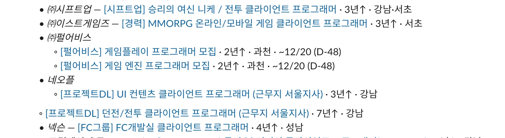
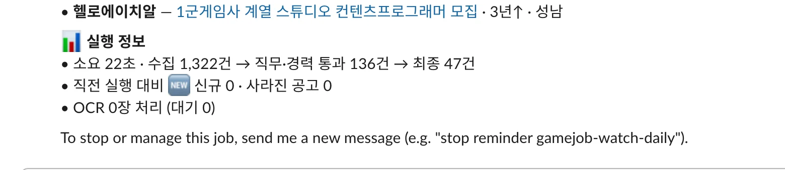

언리얼 클라이언트 개발 공고를 게임잡에서 매일 직접 찾아보는 일을 Hermes Agent에 맡겼다. 지금은 서울·경기 언리얼 경력 공고가 매일 오전 9시(KST)에 Slack `#job-board` 채널로 도착하고, 이 크론은 실행할 때 LLM을 호출하지 않는다.



## 에이전트가 아니라 스크립트로 돌린다

처음 정한 조건은 단순했다. 하루 한 번 오전 9시에 실행하고, 신규 공고만이 아니라 현재 진행 중인 전체 목록을 보여 준다. 새로 올라온 공고에는 신규 표시를 붙인다. 이전 공고를 계속 보여 주지 않으면 놓칠 수 있다는 이유였다. 알림은 DM이 아니라 별도 채널에 받기로 했다.

실행 방식으로는 두 가지를 비교했다. 에이전트가 매번 수집하고 비교하고 포맷하는 방식과, 이 단계를 스크립트로 고정하고 크론이 스크립트만 실행하는 방식이다. 이 작업은 요청, 파싱, 목록 비교, 포맷팅이 대부분이라 높은 추론이 필요하지 않다. 스크립트는 결과가 매일 같은 규칙으로 나오고 비용이 거의 없다. 대신 사이트 구조가 바뀌거나 차단되면 스크립트가 실패하고, 실패하면 알림이 간다. 스크립트 방식으로 정했다.



크론은 `no_agent` 모드로 등록했다. 이 모드에서는 스케줄러가 스크립트를 실행하고 stdout을 그대로 채널에 보낸다. 수동으로 실행한 결과에도 `API calls: 0`과 `Mode: no_agent (script)`가 찍혔다.

처음에는 언리얼 전용 스킬 `gamejob-unreal-watch`로 시작했다. 이후 검색 조건을 직접 정하고 바꿀 수 있게 스킬 이름을 `gamejob-watch`로 바꾸고, 조건을 `config.json`의 watch 단위로 분리했다. 지역, 직무, 경력, 엔진 규칙이 모두 이 파일에 있고, 변경은 스크립트 옵션으로 한다.

## 키워드 검색으로는 놓친다

처음 확인할 건 게임잡 검색이었다. 스크립트에서 `GET /Recruit/joblist?searchstring=...`을 보내면 서버가 키워드를 무시하고 모든 공고를 돌려줬다. 엉터리 검색어를 넣어도 마찬가지였다. 브라우저에서 같은 주소로 검색이 되는 것은 페이지가 목록을 따로 불러오기 때문으로 보인다. 스크립트에서 키워드가 실제로 적용되는 쪽은 `POST /Recruit/_GI_Job_List/`였다.

그런데 키워드가 적용돼도 문제가 남았다. 일부 공고에는 `언리얼`이라는 단어가 없어서 검색에 걸리지 않았다. 키워드에 `C++, GAS`만 적힌 공고가 그런 경우다. 그래서 키워드 검색을 버리고 서울·경기 공고를 전부 수집한 뒤, 직무와 본문을 읽어 판정하는 구조로 바꿨다. 한 번 실행에 수집하는 공고는 1,000건이 넘는다(최근 실행에서 1,322건).

## 오분류를 추적하며 규칙을 고친 과정

판정 규칙은 Slack에 실제로 보낸 결과를 내가 보고 짚는 대로 고쳤다. 큰 수정은 세 가지였다.

첫째는 엔진이 적히지 않은 후보를 기기 종류로 좁히려던 시도다. 새 필터로 처음 보낸 전송은 전체 78건 가운데 엔진 미명시 후보가 45건이었고, 개발 PM과 유니티 프로젝트가 섞여 있었다. 금지 목록을 늘리지 않고 들어오는 조건을 좁히기로 했다. 직무 포함 목록에서 PM 관련 단어를 빼고, 엔진 미명시 후보는 게임잡에 PC·콘솔 대상으로 등록된 공고만 받았다. 모바일 프로젝트는 대개 유니티라는 가정이었다. 후보는 23건, 전체는 55건이 됐다.





그런데 유니티 공고인 니케 공고가 여전히 후보에 있었다. 본문에 엔진 이름이 없었고 등록된 디바이스는 `모바일게임, 멀티플랫폼게임`이었다. 후보 조건이 PC·콘솔·멀티플랫폼 중 하나만 있어도 통과였는데, 이 공고처럼 `멀티플랫폼게임`이 모바일 위주 게임에도 붙기 때문에 걸러지지 않았다. 디바이스가 전부 PC나 콘솔일 때만 통과시키자 후보가 17건에서 9건으로 줄었다. 하지만 모바일과 멀티플랫폼 공고도 받아야 하는데, 기기 종류로 유니티를 가려내는 방식은 근거가 약하다고 보고 접었다.

둘째는 본문을 읽는 위치가 틀렸다는 점이다. 니케 공고를 다시 확인하다가 본문을 읽지 못하고 있었다는 것을 알았다. 실제 담당업무와 자격요건은 View 페이지가 아니라 iframe 두 개(`GI_Read_Comt_Ifrm`, `GI_Read_GI_Comment_Ifrm`)에 있는데, 이 iframe을 댓글 영역으로 오해해서 읽지 않았다. 그때까지의 엔진 판정은 제목, 키워드, 모집분야, 디바이스만 보고 한 것이었다. 본문을 읽기 시작하자 "Unity 엔진 ... 능숙하신 분" 같은 문장이 잡혔고, 본문에 유니티가 있던 후보는 빠졌다. 반대로 본문에 언리얼이 적혀 있던 공고는 언리얼 구간으로 올라왔다.

본문을 읽으니 유니티 필수에 언리얼 우대인 공고, `Unreal Engine 또는 Unity`로 적힌 공고가 언리얼 구간에 들어와 있다는 것도 보였다. 그래서 언리얼 언급이 유니티 언급보다 많을 때만 언리얼 공고로 인정하기로 했다. 이 규칙이 생기면서 니케 공고를 번호로 제외하던 수동 설정을 걷어 냈다.

셋째는 본문이 이미지 한 장인 공고다. 언리얼 공고인데 빠져 있던 공고([GI_No=285987](https://www.gamejob.co.kr/Recruit/GI_Read/View?GI_No=285987))는 `Tong_....png` 한 장이 본문이었다. 이미지 안에는 Unreal Engine, GAS, Unreal Editor가 적혀 있었지만 텍스트로는 한 글자도 읽을 수 없었다.



위 이미지는 공고 이미지에서 이 표만 잘라 낸 것이다.

직무 필터를 통과한 136건 가운데 26건(약 19%)이 이미지 본문이었다. 공고마다 `include_ids`로 고정하는 방법도 있었지만 이미지 공고가 계속 올라오기 때문에 자동화하는 쪽을 택했다. macOS의 Swift로 Apple Vision의 한국어 OCR을 스크립트에 붙였다. OCR은 로컬에서 실행되므로 모델 호출이 없다. 이미지는 한 번 읽어 캐시에 저장하고, 실행마다 처리하는 장수에 상한을 둬서 크론이 길어지지 않게 했다. 이미지 주소에 한글이 들어 있는 공고에서 OCR이 실패하는 오류도 이때 고쳤다.

## 엔진 판정 기준을 정리하기

한동안은 엔진 미명시 후보를 PC·콘솔 후보와 모바일·멀티플랫폼 후보 두 구간으로 나눠 보여 줬다. 후보를 둘로 나눌 필요는 없다고 판단해서 하나로 합쳤고, 기기 구분 설정(`candidate_platform_regex`)은 비워 뒀다. 이어서 구간 이름도 "언리얼 명시"는 "언리얼", "엔진 미명시"는 "C++"로 바꿨다. 이름만 바꾼 게 아니라 규칙으로 만들었다. 엔진 언급이 없는 공고 중 C++가 언급된 공고만 후보가 된다. 모바일 유니티 프로젝트는 대개 C#이라 이 조건에서 걸러지는 효과도 있다. 후보 7건은 모두 이 조건을 만족해서 목록은 그대로였다.

최종 기준은 두 구간이다. 언리얼 구간은 본문이나 이미지에 Unreal, UE4/5나 간접 단서가 있고, 그 언급이 다른 엔진보다 많은 공고다. C++ 구간은 엔진 언급이 전혀 없고 C++가 언급되며 직무가 클라이언트·엔진 계열인 공고다. 다른 엔진 언급이 더 많거나 후보 조건에 맞지 않는 공고는 어느 구간에도 들어가지 않는다.



간접 단서도 함께 정했다. 처음 필터 안내에는 `Unreal·UE4/5·GAS·블루프린트`만 적혀 있었는데, 목록을 넓혔다. 이제 GAS, 블루프린트, UMG, Dedicated Server, Niagara, Nanite, `UCLASS`와 `UPROPERTY` 같은 매크로, Gameplay Ability System, World Partition, Enhanced Input, Control Rig, MetaSound를 쓴다. Slate, Sequencer, Chaos, Lumen, Mass, PCG, Epic Games, Lyra는 너무 일반적이라 넣지 않았다. Dedicated Server는 유니티 프로젝트에서도 쓰는 말이지만, 언리얼보다 유니티 언급이 많은 공고는 언리얼 구간에 넣지 않는 규칙이 이를 걸러 준다. 이 단서들을 추가했을 때 기존 캐시에서 판정이 바뀐 공고는 없었다.

필수와 우대를 나눠서 우대에만 언리얼이 있는 공고를 따로 표시하는 방안도 검토했다. 이미지 본문의 OCR 텍스트는 순서를 믿을 수 없어서 파싱 비용에 비해 얻는 게 적다고 보고 하지 않기로 했다. 해당하는 공고는 당시 언리얼 구간 40건 중 1건 정도였다.

## Slack에서 읽기 편하게 고치기

첫 전송 결과에서 바로 고칠 것이 나왔다. 가장 먼저 필터 내용을 항상 최상단에 두기로 했다. 제목도 `게임잡 언리얼 개발 공고`에서 `게임잡 공고`로 바꿨다. 조건이 바뀔 때마다 제목이 어긋나므로 제목에는 조건을 넣지 않고 필터 블록에 적는다. 한 줄로 길게 이어지던 필터는 항목별 목록으로 나눴다.



들여쓰기는 여러 번 고쳤다. 같은 회사의 공고가 여러 개면 회사명 아래에 하위 항목으로 묶어 보여 주는데, 처음에는 한 회사에서 회사명 줄의 글머리 기호가 사라졌다. 여러 공고가 있는 회사의 이름 앞에 `•`를 붙이고 아래 항목을 들여써서 고쳤다.

다음 문제는 메시지가 길어서 나뉘는 지점에서 하위 항목의 들여쓰기가 사라지는 것이었다.



소스를 확인해 보니 Slack 어댑터가 긴 메시지를 나눈 뒤 다음 조각을 `lstrip()`한다. 새 조각의 첫 줄 앞 공백이 지워지는 이유다. 처음에는 일반 공백 대신 공백으로 취급되지 않는 점자 빈 칸(U+2800)으로 들여써서 막았다. 하지만 회사명 줄과 하위 공고가 서로 다른 조각으로 갈라지는 문제는 그대로였다. 그래서 나뉠 것 같으면 다음 블록에서 시작하게 바꿨다. 회사 묶음은 쪼개지 않고, 블록이 2,400자 가까이 되면 다음 묶음부터 새 블록에서 시작한다. 이렇게 하면 블록이 하위 항목으로 시작하는 일이 없다. 이때 점자 빈 칸은 걷어 내고 일반 공백 들여쓰기로 되돌렸다.

그런데 블록 중간에 있는 묶음에서도 공백 들여쓰기가 사라지는 경우가 나왔다. 블록 경계만의 문제가 아니었다. 그래서 공백 들여쓰기를 포기하고 하위 항목의 줄 머리를 점자 빈 칸 두 개와 `↳`로 바꿨다. 공백이 사라져도 `↳`만으로 하위 항목임을 알 수 있다. 블록을 나누는 방식은 그대로 두었다.

같은 확인 과정에서 Hermes의 Slack 어댑터가 `*텍스트*`를 기울임으로 바꾼다는 것도 알게 됐다. 굵게 하려던 회사명이 기울임으로 나오고 있어서 굵은 글씨는 `**텍스트**`로 쓴다.

마지막으로 메시지 맨 아래에 실행 정보를 붙였다. 소요 시간, 수집에서 최종까지의 건수, 직전 실행 대비 신규와 사라진 공고 수, OCR 처리 현황을 보여 준다. 소요 시간은 스크립트 실행 시간만 잰다.



## 최종 구성

스킬 `gamejob-watch`는 스크립트, OCR 도우미, 설명 문서로 이루어진다. 조건과 상태는 스킬 밖에 둬서 스킬을 수정해도 남는다.

```text
~/.hermes/skills/productivity/gamejob-watch/
├── SKILL.md              # 조건 변경 절차, 필터 원칙, 함정 기록
└── scripts/
    ├── gamejob_watch.py  # 수집·판정·포맷 (표준 라이브러리만 사용)
    └── ocr.swift         # Apple Vision OCR (필요할 때 컴파일)

~/.hermes/scripts/gamejob_watch.sh        # 크론이 실행하는 래퍼
~/.hermes/data/gamejob-watch/config.json  # 조건
~/.hermes/data/gamejob-watch/seen.json    # 본 공고 기록, 상세 페이지 캐시
```

크론은 래퍼 스크립트 하나를 실행한다.

```bash title="~/.hermes/scripts/gamejob_watch.sh"
#!/bin/bash
exec /usr/bin/python3 -I "$HOME/.hermes/skills/productivity/gamejob-watch/scripts/gamejob_watch.py" "$@"
```

`config.json`은 watch 이름 아래에 조건을 둔다. 정규식이 길어서 일부는 `…`로 줄였다.

```json title="~/.hermes/data/gamejob-watch/config.json (일부)"
{
  "watches": {
    "unreal-dev": {
      "title": "게임잡 공고",
      "local_codes": ["I000", "B000"],
      "location_regex": "서울|경기",
      "role_include_regex": "프로그래|개발자|엔지니어|클라이언트|서버|엔진|…",
      "role_exclude_regex": "아트|\\bTA\\b|테크니컬|…|QA|기획|…",
      "candidate_role_regex": "클라이언트|클라\\b|게임플레이|엔진|…",
      "engine_regex": "언리얼|unreal|\\bUE[45]\\b|\\bGAS\\b|블루프린트|…",
      "other_engine_regex": "유니티|unity|cocos|코코스|godot|자체 ?엔진|in-?house engine",
      "candidate_require_regex": "C\\+\\+",
      "career_min_years": 1,
      "career_max_years": 7,
      "career_any_ok": true,
      "imminent_days": 3,
      "baseline_first_run": true
    }
  }
}
```

경력 조건은 요구 경력이 1년에서 7년인 공고와 경력무관만 받고 신입은 제외하는 설정이다. 경력이 7–8년 수준이라 요구 경력의 하한이 7년 이하인 공고만 보기로 했다. 필터는 제외 목록을 늘리는 대신 포함 조건으로 정하는 것이 원칙이다. 직무는 제목이 포함 정규식에 맞아야 하고, `role_exclude_regex`는 남은 것을 정리하는 용도로만 쓴다. PM 직군은 포함 정규식에 PM 관련 단어를 넣지 않아서 빠지고, 유니티 프로젝트는 본문의 엔진 언급을 비교해서 걸러진다.

조건은 스크립트 옵션으로 바꾼다. 변경한 뒤에는 `--dry-run`으로 결과를 확인한다. 이 옵션은 본 공고 기록을 갱신하지 않는다.

```bash
S=~/.hermes/scripts/gamejob_watch.sh
$S --show                                  # watch 목록과 설정
$S --set unreal-dev career_max_years 7     # 값은 JSON 또는 문자열
$S --dry-run --watch unreal-dev            # 미리보기
```

크론 작업은 `no_agent`로 등록되어 있다. 아래는 저장된 작업 정의에서 실행에 쓰이는 항목이다.

```json title="gamejob-watch-daily"
{
  "id": "b46eb024f9ff",
  "name": "gamejob-watch-daily",
  "script": "gamejob_watch.sh",
  "no_agent": true,
  "schedule": { "kind": "cron", "expr": "0 9 * * *" },
  "deliver": "slack:C0CE49Y6VKK"
}
```

스크립트가 0이 아닌 코드로 끝나면 오류 알림이 간다. 채널 메시지 맨 위의 `Cronjob Response`와 `job_id`는 크론 전송이 붙이는 머리글이다.

`cronjob run`으로 수동 실행하면 실제 전송이고 본 공고 기록도 바뀐다. 필터를 크게 바꾼 뒤에는 신규 표시가 한꺼번에 붙을 수 있으므로, 채널에 보내지 않고 기준만 갱신할 때는 래퍼를 직접 실행한다.

## 다음에 하려는 일

지금 이 파이프라인은 조건에 맞는 후보를 모아서 보여 주는 데까지만 한다. 그 뒤는 두 가지로 이어 갈 계획이다.

- 후보 추천도: 모은 후보를 세컨드 브레인(이력, 경력, 포트폴리오 같은 내 자료를 정리해 둔 곳)의 기준 자료와 비교해서 공고마다 추천도를 붙인다.
- 지원서 사전 준비: 내가 직접 고른 일부 후보에 한해서 에이전트가 다룰 수 있는 브라우저인 ego-browser로 지원 양식을 확보하고, 세컨드 브레인 자료를 바탕으로 그 양식에 맞춰 지원서를 미리 준비한다.
