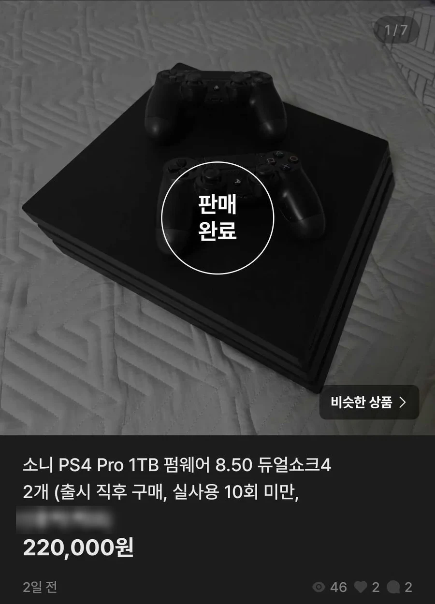
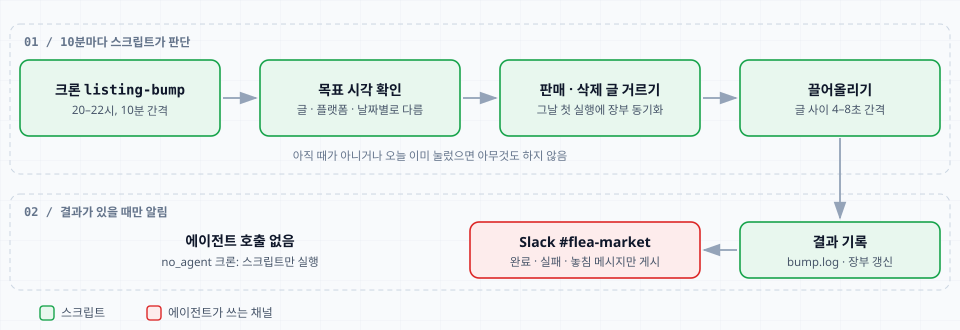
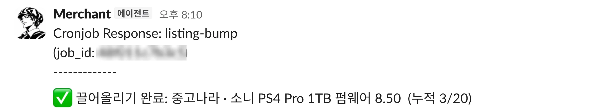
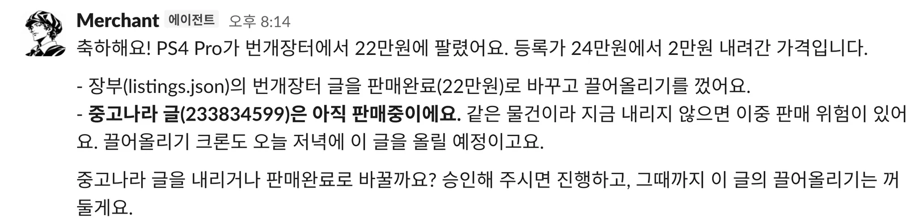
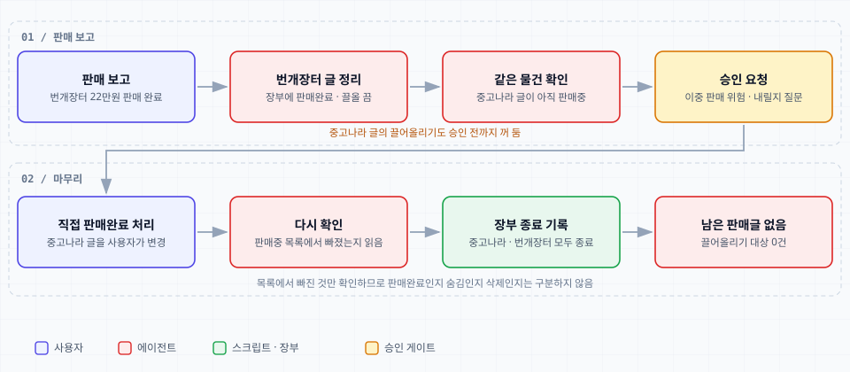

[전편](/posts/hermes-agent-secondhand-listing/)에서 Merchant 프로필로 PS4 Pro 판매글을 중고나라와 번개장터에 올렸다. 이번에는 올린 뒤를 맡겼다. 판매 중인 글을 매일 끌어올리고, 팔리면 남은 글을 정리한다. 같은 PS4 Pro가 올린 지 이틀 만에 번개장터에서 22만원에 팔렸고, 그 사이에 돌린 일을 정리한다.



## 올린 글을 장부로 다시 관리한다

전편에서는 올린 뒤에는 추적하지 않는 쪽으로 범위를 줄였다. 이번에는 판매 중인 글을 계속 끌어올리고 싶다는 요구가 생겨서 장부를 다시 뒀다. 스크립트가 모델 없이 돌아야 해서 판매 중인 글 목록을 스크립트가 직접 알아야 했기 때문이다.

- `listings.json`: 글마다 플랫폼, URL, 제목, 가격, 상태, 끌어올리기 이력과 가격 변경 이력을 적는다.
- `listing-sync` 스킬: 두 플랫폼의 내 상품 페이지를 읽기 전용으로 열어 장부와 비교하고, 새 글 추가·종료 처리·가격 변경 반영을 한다.
- `price-adjust` 스킬: 가격을 바꾸고 플랫폼 목록에서 다시 읽어 확인한 뒤에만 장부에 기록한다. 이번 22만원은 채팅 흥정으로 정해져서 이 스킬을 쓰지 않았다.

`listings.json`은 `data/` 아래에 있어서 설정 백업 저장소에는 올라가지 않는다. 글 URL과 가격 같은 거래 정보를 올리지 않으려는 선택이다.

## 끌어올리기 규칙부터 확인했다

횟수 제한과 비용은 플랫폼마다 다르다. 구현 전에 직접 확인했다.

- 중고나라: 글 상세 페이지의 `위로 올리기` 버튼을 누르면 확인창이 뜬다. 상품당 하루 2회, 최대 20번이라고 적혀 있다. 총 한도가 20번이라 아무 때나 누르면 금방 소진돼서 하루 1회로 잡았다. 하루 1번이면 글 하나로 20일 정도 쓴다.
- 번개장터: 공식 고객센터 FAQ 기준으로 무료 UP체험권이 매일 5개 충전되고, 같은 상품에는 하루 한 번만 쓸 수 있다. 영상 광고를 보는 UP과 유료 UP은 자동화하지 않는다.

끌어올리기가 실제로 됐는지는 알림 문구가 아니라 상대 시간 표시로 확인한다. 올리기 전 "17분 전"이던 글이 올린 뒤 "4초 전"으로 바뀐 것을 읽어야 성공으로 기록한다.

## 모델 없이 크론으로 돌린다

끌어올리기는 가격이나 문구를 바꾸지 않고 같은 글을 다시 노출하는 일이다. 매번 판단할 것이 없어서 에이전트를 부르지 않는 `no_agent` 크론으로 만들었다.

```text title="cron job listing-bump"
schedule: */10 20-22 * * *  (Asia/Seoul)
no_agent: true
script:   listing_bump.py → listing-bump/scripts/bump_listings.py
deliver:  #flea-market
```



- 글과 플랫폼마다 날짜별 목표 시각이 있다. 날짜, 플랫폼, 글 ID를 해시해서 오후 8시대 안에서 정한다. 한꺼번에 몰아 누르지 않으려는 방식이다.
- 목표 시각이 지났고 오늘 아직 누르지 않은 글만 대상이 된다. 오후 11시까지 못 누르면 그날은 포기하고 `놓침`으로 알린다.
- 그날 첫 대상 실행에서 `listing-sync`를 한 번 돌려 판매됐거나 삭제된 글을 먼저 `ended`로 바꾼다. 팔린 글을 누르지 않기 위해서다.
- 글은 하나씩, 4–8초 간격으로 누른다. 실패하면 하루 최대 3번 다시 시도한다.
- 간격, 하루 횟수, 중고나라 총 한도는 `data/bump_config.json`으로 코드 수정 없이 바꾼다. 글마다 `bump.enabled`로 끌 수도 있다.
- Slack에는 결과가 있을 때만 올린다. 아무것도 하지 않은 실행은 출력이 비어서 메시지가 없다.



`누적 3/20`은 중고나라가 센 이 글의 끌어올리기 횟수다.

## 팔린 뒤에는 남은 글이 위험하다

판매는 11월 8일 오후에 끝났다. 번개장터에서 22만원에 팔렸다고 Slack에 적었더니 Merchant가 이렇게 답했다.



번개장터 글은 장부에서 `sold`로 바뀌고 판매가 22만원이 기록됐고, 끌어올리기도 꺼졌다.

남은 문제는 같은 물건을 올려 둔 중고나라 글이었다. 아직 판매중이라 이중 판매 위험이 있었고, 그날 저녁 끌어올리기 크론이 이 글을 올릴 예정이었다. 그래서 이 글의 끌어올리기를 먼저 끄고, 글을 내리거나 판매완료로 바꾸는 일은 승인 대상이라 내게 물었다.



중고나라 글은 내가 판매완료로 바꾸고 다시 확인을 시켰다. 판매중 목록에서 글이 빠진 것이 확인돼 장부에 `ended`로 기록됐고, 그날 저녁 크론은 두 글 모두 아무것도 누르지 않았다.

## 마치며

사진 한 장과 한 줄로 시작한 판매글이 끌어올리기를 거쳐 실제 판매까지 이어졌다. 자동화를 만들고 그 결과로 물건이 실제로 팔리는 것까지 보니 신기했고, AI 자동화가 일하는 방식을 바꾸고 있다는 것을 처음으로 몸으로 느꼈다.
