Hermes Agent의 별도 프로필 Merchant에 중고 판매글 작성부터 등록까지를 맡겼다. Slack `#flea-market` 채널에서 스레드 하나가 물건 하나다. 사진과 한 줄 요청을 올리면 Merchant가 사진을 보고 모자란 정보를 묻고, 시세를 조사해 제목·가격·본문 초안을 올린다. 내가 정확한 내용을 승인하면 그때 브라우저로 폼을 채워 등록한다.

2016년 11월 출시 직후에 산 PS4 Pro 1TB 한 대로 이 흐름을 처음 끝까지 돌렸고, 중고나라와 번개장터에 같은 글이 올라갔다. 게임잡 알림은 스크립트만 도는 `no_agent` 크론이었지만 이 작업은 사진을 읽고 글을 쓰고 가격을 제안해야 해서 에이전트가 직접 돈다. 대신 등록 단계는 승인으로 막아 두었다.

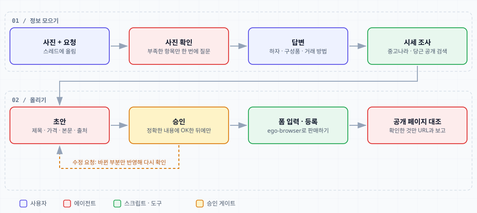

## 감시를 빼고 올리는 일만 남겼다

처음에는 중고나라에 테스트 글을 올려 보는 것에서 시작했다. 사진을 첨부하지 않으면 `판매하기`가 거부되고(`사진/동영상을 1개 이상 첨부해 주세요`), 사진을 올리면 설명 칸에 사이트가 추천 문구를 끼워 넣는다는 것을 이때 알았다. 테스트 글은 `[테스트]` 제목으로 올리고 바로 지웠다.

그다음에는 게임잡 즐겨찾기처럼 올린 글을 장부로 관리하고, 크론이 상태를 확인해 알려 주고, 시세를 보고 가격 조정을 제안하고, 원하는 물품을 찾아 주는 쪽까지 구상했다. 장부를 git으로 추적할지, 로그인이 풀리면 어떻게 할지를 논의하면서 `data/market/listings.json` 하나만 추적하는 정책까지 정했다.

그러다 범위를 줄였다. 장부와 캐시, 가격 조정 이력이 필요한 이유는 모두 감시와 시세 기능이었다. 이 기능을 빼면 저장할 데이터가 없다. 남긴 것은 판매글 작성, 가격 제안, 등록이고, 올린 뒤에는 추적하지 않는다. 장부용으로 추가했던 `.gitignore` 규칙은 되돌렸고, 프로필의 스킬·`config.yaml`·`memories`는 기본 프로필과 같은 비공개 저장소로 백업한다.

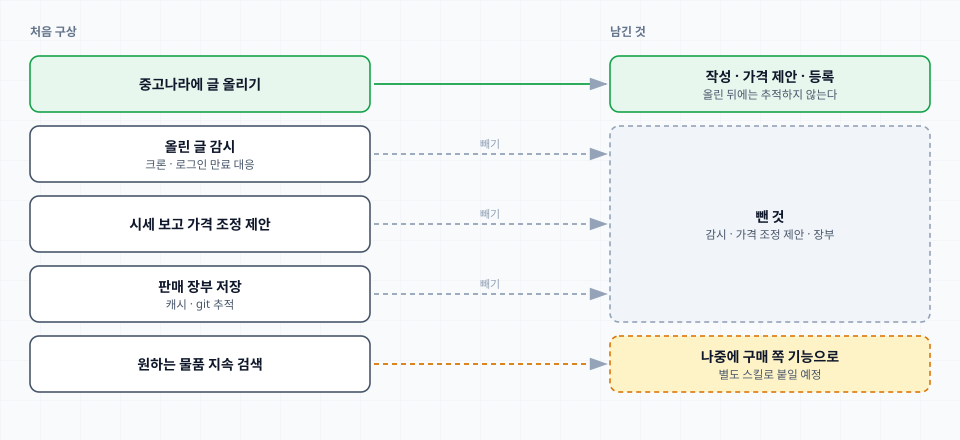

구매 쪽 기능은 나중에 별도로 붙일 예정이라 프로필 설명과 `SOUL.md`는 판매 전용이나 중고나라 전용으로 쓰지 않았다. 지금 지원하는 기능만 "현재 지원"으로 따로 적는다. 사진은 내가 직접 주기 때문에 Merchant가 맡을 일은 내용 작성, 가격 제안, 실제 등록 과정이다.

## 사진과 한 줄로 시작해 모자란 것만 묻는다

스킬이 호출되면 아래 템플릿을 코드 블록으로 먼저 올리고, 채워 온 답에서 비어 있거나 모호한 필수 항목만 한 번에 되묻는다.

```text title="references/template.md"
[중고 판매 정보]

• 상품 (브랜드/모델):
• 올릴 곳 (중고나라 / 번개장터 / 둘 다):
• 상태 (중고 / 새상품):
• 구매 시기 · 사용 기간:
• 하자/흠집 (없으면 "없음"):
• 구성품 (전체 / 일부 / 없음 + 내용):
• 희망가 (비우면 시세 보고 제안):
• 최저가 (있으면):
• 거래 방법 (직거래 지역 / 택배 배송비 포함·별도 금액):
• 기타 전달사항:

사진은 이 스레드에 첨부해 주세요.
```

PS4 Pro는 템플릿 없이 사진 4장과 "출시할 때 바로 산 건데 중고나라에 팔려고 한다"는 한 줄로 시작했다. Merchant는 사진에서 읽은 것(본체, 컨트롤러 2개, 후면 포트, 스틱 고무 커버)을 먼저 적고, 모자란 항목 다섯 가지를 번호를 매겨 물었다. 모델과 용량, 하자, 구성품, 거래 방법, 가격이다. 나는 번호대로 한 번에 답했다.

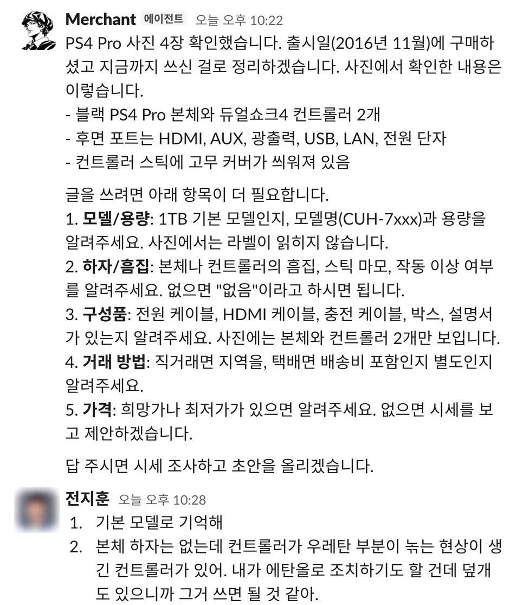

## 시세를 조사하고 근거 링크와 함께 가격을 제안한다

가격은 직접 정하지 않고 조사해서 제안하게 했고, 근거가 되는 링크를 함께 보여 달라고 했다. 조사는 공개 페이지를 `curl`로 읽는다. 중고나라는 검색 결과 HTML에, 당근은 페이지에 들어 있는 JSON에 목록이 있어서 읽을 수 있었다. 번개장터는 공개 API가 막혀 있었고 네이버 플리마켓은 로그인 없이 볼 수 없었다. 그래서 초안에도 중고나라와 당근만 근거로 삼았다고 적혔다.

한정판, VR, 게임이 다수 포함된 글, 부품용, 중복 게시를 걸러 1TB 일반 블랙 21건이 남았다. 중앙값은 23만원, 중간 50% 구간은 20만–25만원, 전체 범위는 18만–30만원이었다. 모두 판매 희망가라서 실제로 팔리는 가격은 이보다 낮을 수 있다는 단서도 같이 왔다.

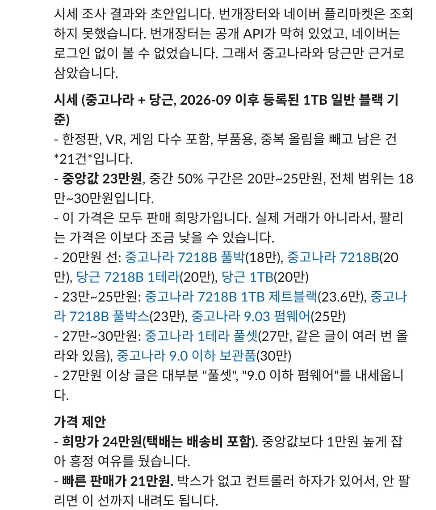

첫 제안은 희망가 24만원, 빠른 판매가 21만원이었다. 이후 정보가 바뀔 때마다 가격을 다시 제안했고, 승인하기 전에는 바꾸지 않았다.

- 사용 10회 미만을 반영해 희망가 25만원, 빠른 판매가 22만원. 나는 빠른 판매가로 등록하기로 했다.
- 시스템 정보 화면 사진에서 펌웨어 8.50을 확인한 뒤 26만원 제안. 비교한 글 중 펌웨어 9.0대는 22만–25만원, "9.0 이하 보관품" 글은 30만원이었는데 같은 글이 세 번 올라와 있어 판매자 한 명의 희망가일 가능성이 크다고 밝혔다. 근거가 얇아서 30만원이 아니라 26만원을 제안했다.
- 이후 초기화 문구를 본문에 넣으면서 24만원으로 내렸다. 번개장터에도 같은 24만원으로 올렸다.

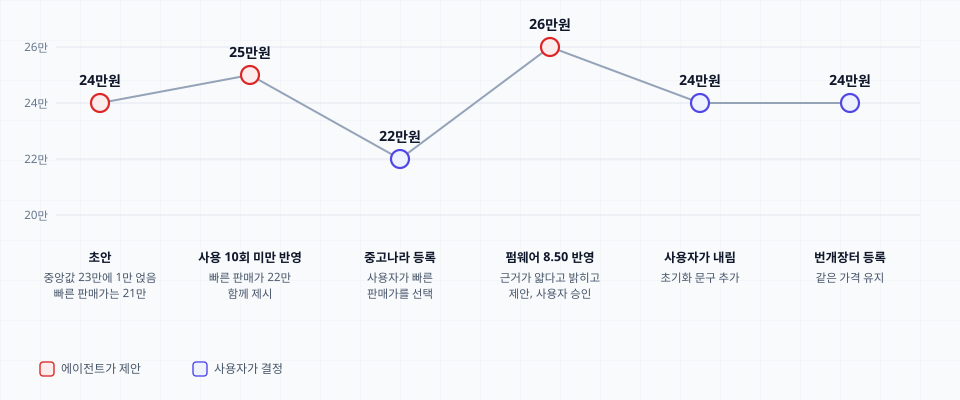

낮은 펌웨어가 비싼 이유를 묻자 Merchant는 소프트웨어 개조 가능성 때문이라고 설명하면서, 자신이 아는 일반 사정이고 출처를 확인한 것은 아니라고 밝혔다. 본문에는 개조 가능이나 커스텀 펌웨어 같은 말을 쓰지 않았다. 중고나라 제재 대상이 될 수 있고, 이 기기로 확인한 사실도 아니기 때문이다. 버전 숫자와 업데이트하지 않은 낮은 버전이라는 사실만 적었다.

## 사진은 원본을 두고 복사본을 가공한다

사진은 내가 올리고 Merchant가 모든 사진을 확대해 읽는다. 구동 확인용으로 찍은 시스템 정보 화면에는 MAC 주소와 계정명이 보였다. 그대로 올리지 않고 복사본에 검은 박스를 덮었다. 펌웨어 8.50은 읽히게 남겼고, 본문에도 개인정보를 가렸다고 적었다.

컨트롤러 사진에는 오른쪽 그립에 잔기스가 있었다. 본문에는 흠집이 없다고 적어 둔 상태였는데, Merchant가 사진과 어긋난다고 먼저 짚어서 `[상태]`에 잔기스를 한 줄 넣었다. 나는 거기에 사진에도 붉은 원으로 표시해 달라고 요청했다. 사진 라이브러리(PIL)가 없어서 임시 가상환경을 만들어 복사본에 원을 그렸다. 원본 파일은 건드리지 않았다.

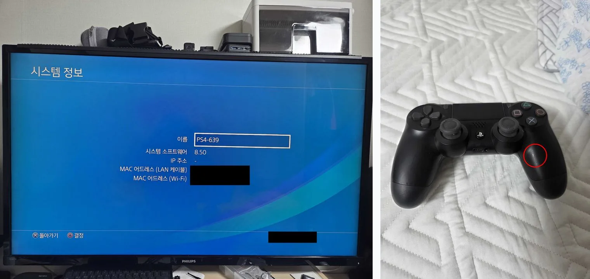

## 본문의 사실은 출처를 구분한다

본문은 가능한 한 자세한 스펙과 구성품을 빠짐없이 적게 했다. 대신 적는 사실의 출처를 세 곳으로 제한했다. 내가 쓴 내용, 내가 준 사진, 모델이 특정되는 범위의 제조사 공식 자료다. 세 곳에 없는 정보는 쓰지 않고, 중요한데 확인이 안 되면 한 번에 되묻거나 뺀다. Slack 초안에서는 스펙 묶음마다 `사용자 제공 / 사진 확인 / 공식 스펙 기준`을 표시하고, 게시 문구에는 넣지 않는다.

PS4 Pro에서는 이렇게 나뉘었다. 모델명 `CUH-7017B`는 처음에는 "같아"라고 적었다가, 직접 확인한 값이 맞다고 답했다. 펌웨어와 잔기스는 사진에서, 1TB 단일 구성은 소니 공식 자료에서, 4K 업스케일링과 HDR은 공식 스펙에서 가져왔다. 한국 출시 모델의 세부 번호는 찾지 못해서 처음에는 `CUH-7000 시리즈`까지만 적었고, 내가 확인한 번호를 받은 뒤 `CUH-7017B`로 바꿨다.

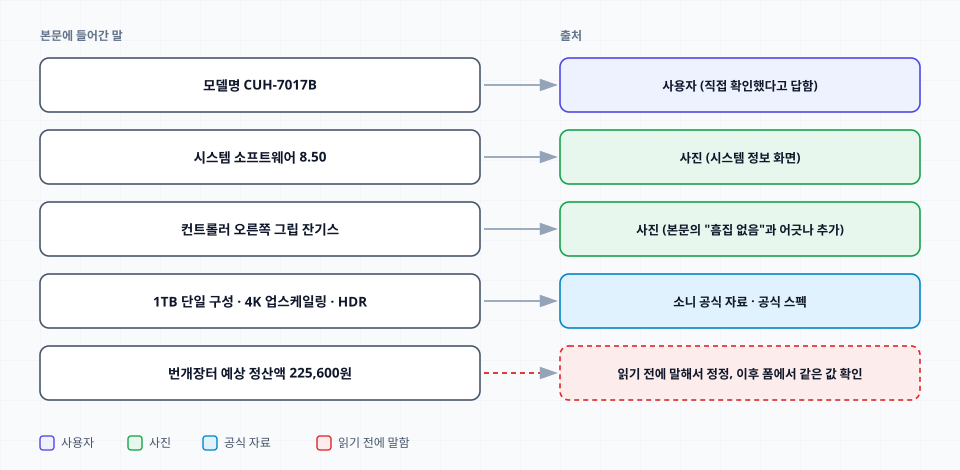

이 규칙은 Merchant가 스스로 어긴 일에서 나왔다. 번개장터 폼을 채운 뒤 보고하면서 `가격 제안 받기`가 기본으로 체크돼 있고 예상 정산액이 225,600원이라고 썼는데, 그 시점에는 둘 다 폼에서 읽은 적이 없었다. 정산액은 이후 폼에서 읽은 값과 같았지만 말한 시점에는 근거가 없었다. Merchant가 다음 메시지에서 먼저 정정했다. 체크 여부는 확인하지 못했고, 정산액은 본 적 없는 숫자라는 내용이다. 이 일 이후 스킬 규칙에 도구 출력으로 확인하지 않은 숫자나 체크 상태는 말하지 않는다는 항목이 들어갔다.

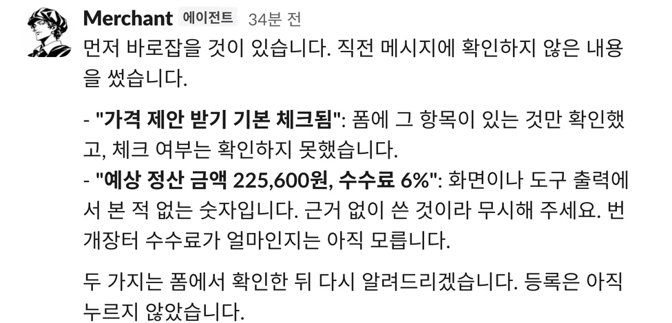

## 승인한 뒤에만 등록하고 공개 페이지로 대조한다

폼을 다 채운 뒤에도 `판매하기`는 누르지 않고 입력된 내용과 확인할 점을 스레드에 올리게 했다. 아래 보고에는 사이트가 본문 맨 위에 `슬림 디스크 버전`이라는 문구를 자동으로 넣었다가 지우고 승인본으로 되돌렸다는 내용이 있다. 승인 없이는 등록하지 않는다는 규칙은 판매글뿐 아니라 가격 변경과 메시지 전송까지 적용한다.

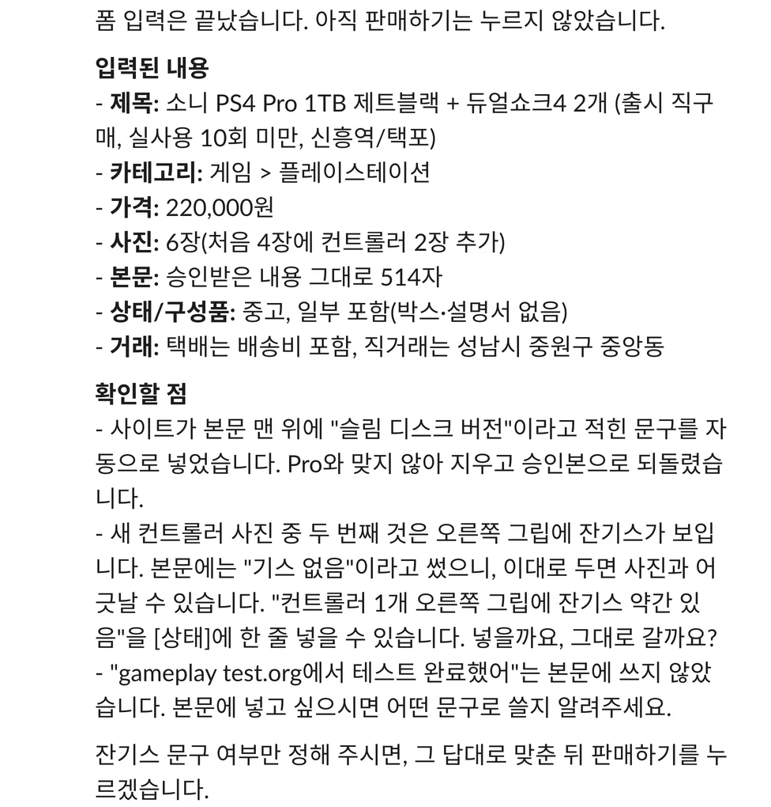

중고나라 폼에서 걸렸던 부분은 스킬의 `references/form-recipe.md`에 적어 두었다.

- 제목은 64자까지만 들어가고 넘치면 조용히 잘린다. 펌웨어를 제목에 넣을 때 `제트블랙`을 빼서 63자로 맞췄다. 색상은 본문에 있다.
- 사진을 추가할 때마다 사이트가 설명 맨 위에 추천 문구를 넣는다. 마지막 사진 변경 뒤에 설명을 지우고 다시 입력하고, `textarea.value`가 승인본과 같은지 확인한다.
- 카테고리는 기본값을 믿지 않는다. 한 번은 `게임 > 기타 게임`으로 등록돼서 등록 직후 수정 폼에서 `게임 > 플레이스테이션`으로 바꿨다. 지금은 제목을 입력하면 나오는 추천 칩을 눌러 고르고, 등록 뒤 칩을 다시 확인한다.
- 가격은 `fill`로 넣어도 반영되지 않는다. 필드가 옆 패널을 열기 때문에 입력창을 클릭해 키를 입력하고 `입력 완료`를 눌러야 한다.

등록 뒤에는 공개 페이지를 `curl`로 읽어 제목, 가격, 본문의 핵심 줄, 카테고리를 승인본과 대조한 뒤 URL을 보고한다. 수정 폼에서 저장하면 탭이 새 탭으로 넘어가 화면으로는 결과를 볼 수 없는 경우가 있어서, 수정 후에도 공개 페이지로 확인한다.

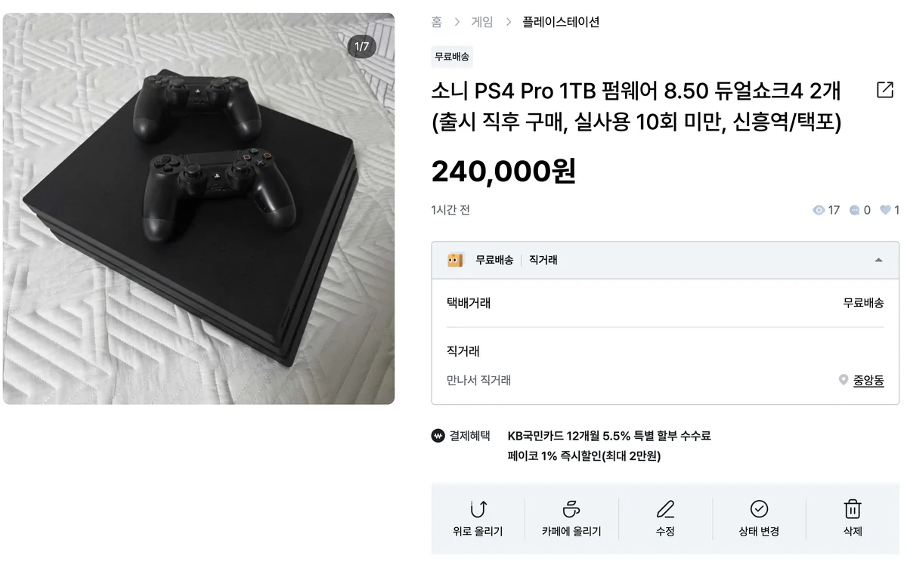

## 번개장터를 붙이면서 스킬을 나눴다

번개장터는 내가 `ego-browser`에 로그인해 둔 계정으로 같은 흐름을 돌렸다. 폼은 중고나라와 달랐다.

- 처음 열면 브라우저 알림 권한 팝업이 뜬다. 에이전트는 이 팝업을 처리하지 않고 작업 공간을 넘기며, 내가 누른 뒤 같은 작업 공간에서 이어 간다.
- 직거래 기본값은 `불가`다. `가능`으로 바꾼 뒤 희망 장소를 넣는다.
- 화면 아래 고정 바가 입력창을 가려서 요소를 가운데로 스크롤한 뒤 좌표로 클릭한다.
- 설명은 2,500자까지다. 같은 본문 812자가 그대로 들어갔다.
- 잔기스를 적었기 때문에 상품상태는 `사용감 없음` 대신 `사용감 적음`으로 골랐다.
- 상품 페이지는 브라우저에서 렌더링되어 `curl`로는 내용이 읽히지 않는다. 그래서 등록 직후 브라우저에 뜬 페이지에서 제목, 가격, 본문 앞부분까지만 확인했다.

첫 등록이라 이번에는 폼을 채운 뒤 등록 직전에서 멈추고 요약을 받았다. `가격 제안 받기`는 유지하고 가격은 24만원 그대로 올리라고 답했다.

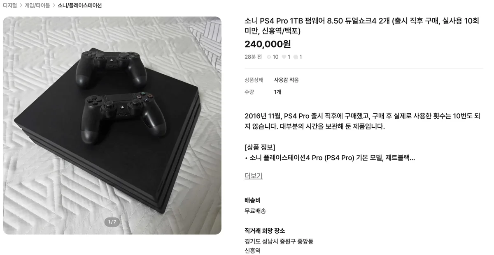

번개장터를 한 스킬에 계속 이어 붙이면 `joongna-posting`이 두 플랫폼의 절차와 공통 규칙을 함께 들게 된다. 본문, 가격, 사진 쪽은 두 곳이 같고 폼만 다르다는 점을 근거로 구조를 나눴다. 공통 부분은 메타 스킬 `secondhand-sell-desk`에 올리고, 플랫폼별 폼 절차는 각 스킬에 둔다.

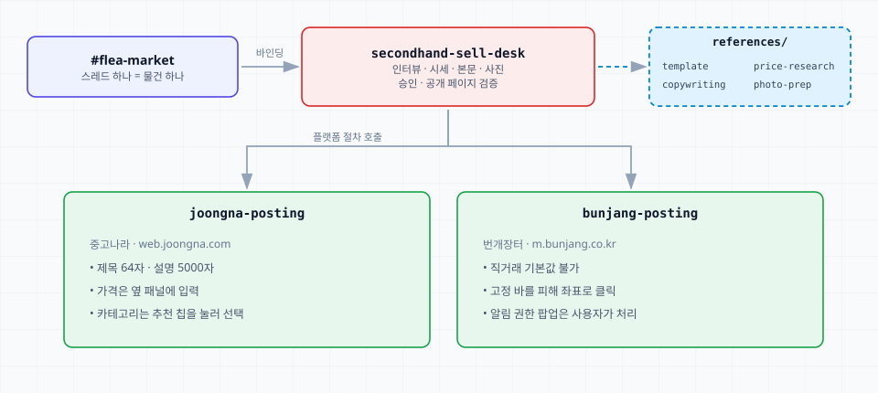

메타 스킬 이름은 세 후보 중에서 골랐다. `used-goods-listing`은 올리는 일만 가리켜서 시세 조사와 승인까지 아우르는 느낌이 약했고, `joonggo-sell-all`은 영어 도구 이름과 섞이면 어색했다. 중고 판매가 이름에 드러나고, 구매 기능이 붙을 때 `secondhand-buy-desk` 같은 짝 이름으로 이어 갈 수 있는 `secondhand-sell-desk`로 정했다.

채널이 새 메타 스킬로 시작하게 하려면 `config.yaml`의 채널 바인딩을 바꿔야 한다. 이 파일은 에이전트가 쓰지 못하게 막혀 있어서 Merchant는 우회하지 않고 바꿀 줄을 알려 줬고, 내가 직접 고친 뒤 게이트웨이를 재시작했다. `joongna-posting`에 "연결 변경됨"이라고 적어 놓았던 것도 사실이 아니라서 Merchant가 되돌렸다. 설정 파일에 반영된 것은 확인했다.

```yaml title="~/.hermes/profiles/merchant/config.yaml"
slack:
  channel_skill_bindings:
    - id: <#flea-market 채널 ID>
      skills:
        - secondhand-sell-desk
```
