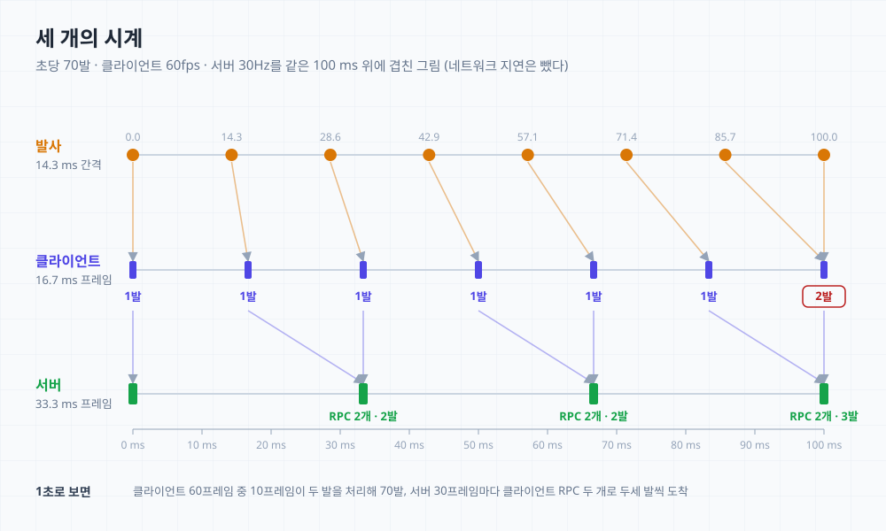
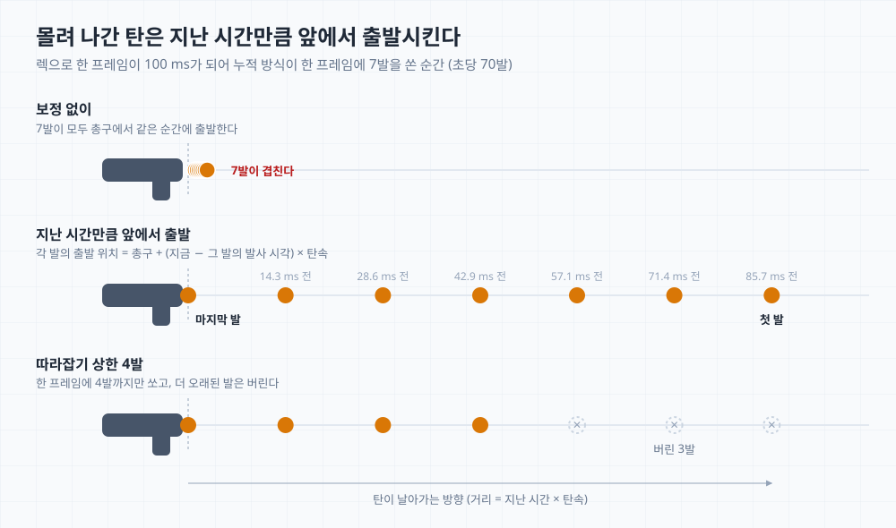
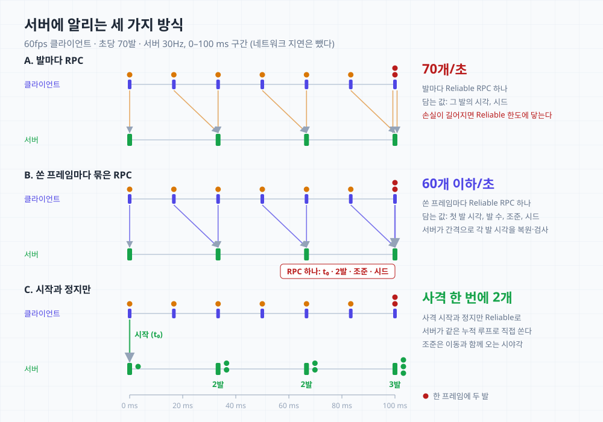
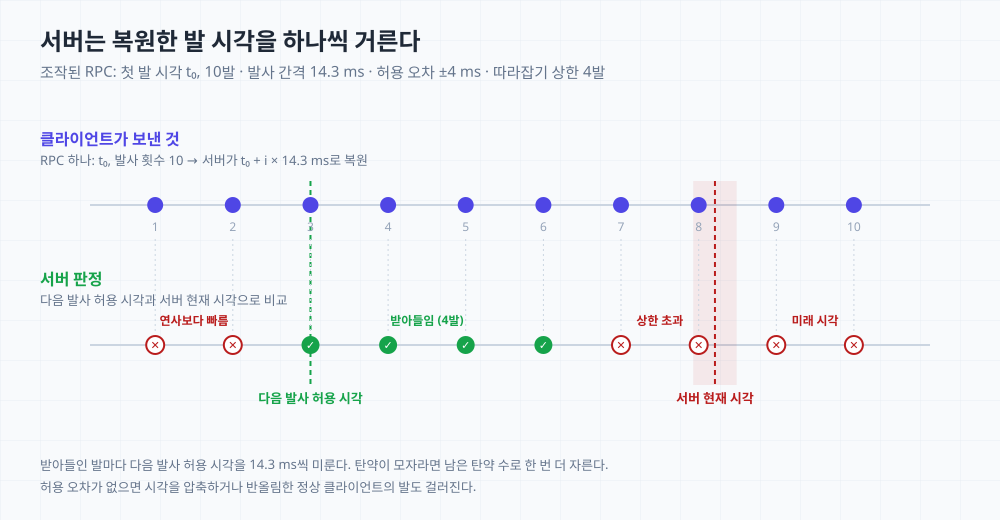
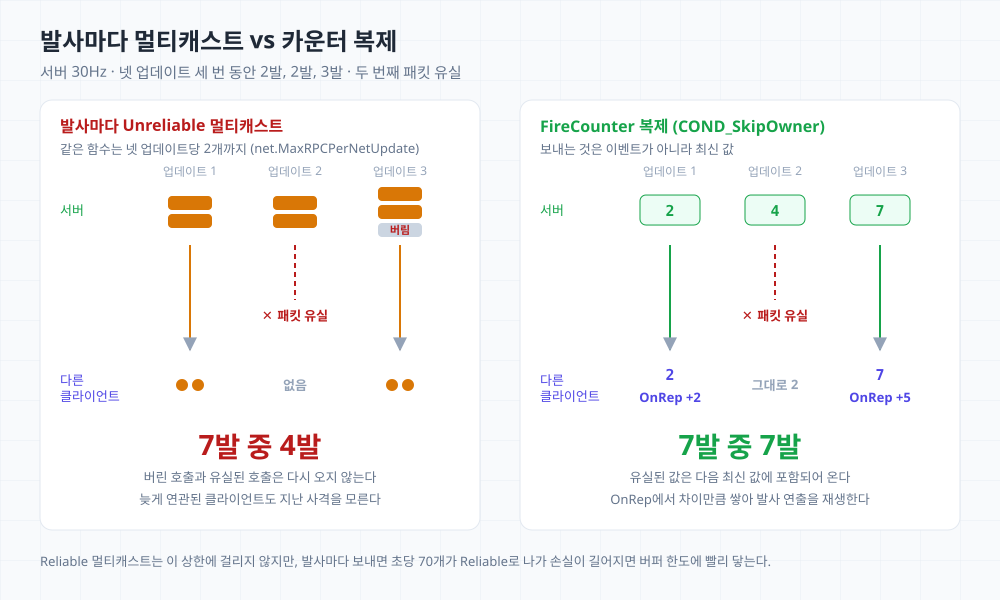

면접에서 Night of the Dead의 총기 시스템을 설명하고 나니 이런 질문이 이어졌다.

> 서버가 30프레임, 클라이언트가 60프레임으로 돌 때 초당 70발을 쏘는 총이 있다면 동기화를 어떻게 짜겠는가.

답이 잘 정리되지 않았고, 질문은 쏘는 클라이언트, 서버, 다른 클라이언트로 나뉘어 다시 이어졌다. 그런데도 나는 서버 되감기로 명중을 판정하는 이야기로 새서, 판정이 아니라 발사를 알리는 흐름을 묻는 것이라는 말을 들었다. 다른 클라이언트에게는 어떻게 알리느냐는 질문에는 멀티캐스트로 보낸다고 답했다가, 앞에서는 복제로 보낸다고 하지 않았느냐는 질문을 받았다. 앞서 발사 횟수를 멀티캐스트 대신 복제로 보내게 만든 일을 이야기해 놓고, 그와 반대로 답한 것이다.

면접이 끝나고 프로젝트를 다시 열어 보니, 면접관이 유도하던 것으로 보이는 답의 뼈대가 내 코드에 이미 있었다. 서버는 받은 발사 RPC를 그대로 실행하고, 다른 클라이언트에는 발사 카운터를 복제해서 알리는 구조다. 쏘는 쪽에는 프레임 때문에 늦어진 시간을 다음 발사에서 빼 주는 코드도 넣어 두었다. 고연사용이라는 것은 알았지만 코드를 읽고 옮긴 정도였고, 프레임 레이트가 낮아질 때를 위한 보정 정도로 이해하고 있었다.

다만 그 뼈대만으로는 초당 70발을 낼 수 없다는 것도 다시 보면서 알았다. 쏘는 클라이언트, 서버, 다른 클라이언트 순서로 무엇이 문제이고 어떻게 푸는지 정리했고, 실제 슈터 게임의 방식은 공개된 Source 엔진 코드와 밸브 문서로 확인했다. 서버 프레임은 면접관이 정한 30Hz로 둔다.

## 질문 다시 보기

초당 70발이면 발사 간격은 1000 ÷ 70, 약 14.3 ms다. 클라이언트 프레임은 1000 ÷ 60, 약 16.7 ms이고 서버 프레임은 1000 ÷ 30, 약 33.3 ms다. 발사 간격이 클라이언트 프레임보다도, 서버 프레임보다도 짧다.



같은 100 ms 구간에 세 간격을 겹치면 문제가 셋 보인다.

- 쏘는 클라이언트는 어떤 프레임에서 두 발을 쏴야 한다. 1초로 보면 70 − 60 = 10, 60프레임 중 10프레임이다.
- 쏜 프레임마다 RPC를 보내면 서버는 한 프레임에 두세 개씩 받는다. 무엇을 몇 번 보내고, 서버는 받은 것을 어떻게 처리하나.
- 서버가 33.3 ms마다 복제하면 다른 클라이언트에는 발사 횟수가 두세 발씩 한꺼번에 도착한다.

그림은 네트워크 지연을 뺐다. 지연이 있어도 전체가 그만큼 뒤로 밀릴 뿐 어긋나는 모양은 같다.

## 쏘는 클라이언트에서 한 프레임에 여러 발 쏘기

게임 코드는 프레임마다 한 번 돈다. 발사 간격이 프레임보다 길면 프레임마다 "쏠 때가 됐나"만 확인하면 되지만, 짧으면 한 번 확인할 때 두 발 이상이 밀려 있을 수 있다.

ShooterGame과 Night of the Dead는 한 발을 쏜 뒤 다음 발사 타이머를 다시 거는 구조다. 타이머는 프레임 사이에 만료돼도 다음 프레임에서야 불리므로 매번 조금씩 늦는다. 넘친 시간 보정은 이 늦어진 만큼을 다음 타이머 간격에서 뺀다. 이 보정은 UE 4.27 배포본의 ShooterGame 기준이고, 공개된 4.25 기준 소스에는 없이 타이머를 그대로 다시 건다.

```cpp
// ShooterGame(UE 4.27 배포본) AShooterWeapon::HandleReFiring (발췌)
float SlackTimeThisFrame = FMath::Max(0.0f, (MyWorld->TimeSeconds - LastFireTime) - WeaponConfig.TimeBetweenShots);
if (bAllowAutomaticWeaponCatchup)
{
	TimerIntervalAdjustment -= SlackTimeThisFrame;
}
```

늦어진 시간은 직전에 실제로 쏜 시각을 기준으로 재고, 한 번 갚으면 0으로 돌아간다. 그래서 연사가 프레임 레이트보다 느린 총에서도 프레임 경계에서 잃는 시간이 조금 남는다. 같은 규칙으로 시뮬레이션하면 60fps에서 750 RPM 총은 720 RPM 정도로 쏜다. 발사 간격 80 ms(60000 ÷ 750)가 프레임 경계에 걸려 5프레임, 83.3 ms로 늘어나기 때문이다(60000 ÷ 83.3 ≈ 720). 연사가 프레임 레이트를 넘으면 문제가 커진다. 타이머 콜백 한 번에 한 발이라 간격을 아무리 줄여도 프레임마다 많아야 한 발이고, 60fps에서 초당 70발 무기는 60발에서 멈춘다.

밸브의 Source 엔진은 이 문제를 반복문으로 푼다. Source SDK의 무기 기반 클래스 `CBaseCombatWeapon`의 코드다.

```cpp
// To make the firing framerate independent, we may have to fire more than one bullet here on low-framerate systems,
// especially if the weapon we're firing has a really fast rate of fire.
info.m_iShots = 0;
float fireRate = GetFireRate();

while ( m_flNextPrimaryAttack <= gpGlobals->curtime )
{
	// MUST call sound before removing a round from the clip of a CMachineGun
	WeaponSound(SINGLE, m_flNextPrimaryAttack);
	m_flNextPrimaryAttack = m_flNextPrimaryAttack + fireRate;
	info.m_iShots++;
	if ( !fireRate )
		break;
}
```

다음 발사 시각이 현재 시각 이하인 동안 쏘고, 쏠 때마다 그 시각을 발사 간격만큼 미룬다. 이 시각이 실제 시간을 기준으로 계속 쌓이기 때문에 밀린 발은 그 프레임에서 한꺼번에 나간다. 같은 코드가 클라이언트의 예측과 서버에서 함께 돈다. 주석도 낮은 프레임 레이트를 이유로 든다. 낮은 프레임 레이트를 위한 보정이라는 내 이해는 방향은 맞았고, 내가 옮긴 코드가 한 번에 한 발씩만 갚는다는 것을 몰랐다.



60fps에서 1초 동안 쏘면 넘친 시간 보정은 매 프레임 한 발씩 60발에 그치고, 누적 방식은 밀린 발을 그 프레임에서 바로 쏴서 6프레임에 한 번씩(60 ÷ 10) 두 발, 70발이 된다.

언리얼에서는 누적값 하나로 쓰면 간단하다.

```cpp
// 버튼을 누르면 FireAccumulator = TimeBetweenShots로 두어 첫 발이 그 프레임에 바로 나간다
// 사격 중인 동안 매 프레임: 쌓인 시간만큼 먼저 쏘고, 이번 프레임 시간은 다음 프레임 몫으로 쌓는다
while (FireAccumulator >= TimeBetweenShots)
{
	FireOneShot();
	FireAccumulator -= TimeBetweenShots; // 남는 값은 항상 발사 간격보다 작다
}
FireAccumulator += DeltaTime;
```

한 프레임에 나가는 발 수는 쌓인 시간 ÷ 발사 간격의 정수 부분이다. 쏜 발 수 × 발사 간격을 빼고 남은 시간에 이번 프레임 시간을 더해 다음 프레임으로 넘긴다. 더하는 순서를 바꿔 프레임 시간을 먼저 더하면 버튼을 누른 프레임에 14.3 + 16.7 = 31.0 ms가 쌓여 첫 프레임에 두 발이 나간다. 60fps에서는 프레임마다 16.7 − 14.3 = 2.4 ms씩 남고, 이 나머지가 발사 간격을 넘는 6프레임에 한 번씩(2.4 × 6 = 14.4 ms) 두 발이 나간다.

총구 화염과 반동은 서버 응답을 기다리지 않고 바로 재생한다. 한 프레임에 여러 발이 나가면 탄이 같은 위치에서 겹쳐 출발하므로, 각 발을 (지금 − 그 발의 발사 시각) × 탄속만큼 앞에서 출발시킨다. 먼저 쏜 탄일수록 앞에 있게 된다.

:::note[프레임 레이트가 연사보다 높을 때]
같은 총을 144fps에서 쏘면 한 프레임이 1000 ÷ 144, 약 6.9 ms라 발사 간격보다 짧다. 한 프레임에 두 발이 몰리지는 않는다. 다만 넘친 시간 보정은 144fps에서도 프레임 경계 손실 때문에 5프레임에 두 발, 144 × 2 ÷ 5 ≈ 58발에 그친다. 프레임 레이트와 관계없이 누적 방식이 필요하다.
:::

:::note[렉으로 프레임이 길어질 때]
순간적인 렉으로 한 프레임이 100 ms가 되면 누적 방식은 그 프레임에서 100 ÷ 14.3, 약 7발을 한꺼번에 쏜다. 2초가 멈추면 70 × 2 = 140발이다. 이 7발도 앞의 방법대로 지난 시간만큼 앞에서 출발시킨다. Source 코드는 루프 바로 아래에서 발 수를 탄창에 남은 수로만 자른다. 탄창과 별개로 한 프레임에 따라잡는 발 수나 시간에도 상한을 두는 편이 낫다.


:::

## 서버에 발사 알리기

쏘는 클라이언트가 서버에 무엇을 몇 번 보내느냐는 세 가지로 나눌 수 있다.



### A. 발마다 RPC

ShooterGame과 Night of the Dead의 방식이다. ShooterGame 히트스캔 무기는 발사와 명중 보고로 명중한 발마다 Reliable RPC를 두 개 보낸다. 발사만 세어도 초당 70개다. 확인받지 못한 Reliable 번치가 액터 채널마다 정해진 한도(`RELIABLE_BUFFER`)에 이르면 연결이 끊긴다. 회선이 좋으면 금방 확인받아 쌓이지 않지만, 손실이나 지연이 길어지면 이 수가 빠르게 늘어난다. Reliable 버퍼 한도는 [Reliable 버퍼 상태를 보고 대용량 데이터 나눠 보내기](/posts/notd-reliable-rpc-data-streaming/)에서도 다뤘다.

### B. 쏜 프레임마다 묶은 RPC

그 프레임에 쏜 발들을 RPC 하나에 담고, 쏜 게 없는 프레임은 보내지 않는다. 첫 발 시각, 발 수, 조준 방향, 탄 퍼짐에 쓸 난수 시드를 담는다. 서버는 첫 발 시각에 발사 간격을 더해 각 발의 시각을 복원하고, 시드로 탄 퍼짐을 똑같이 재현한다. 60fps에서는 초당 60개 이하가 된다. 다만 144fps처럼 프레임 레이트가 연사보다 높으면 프레임마다 많아야 한 발이라 A와 개수가 같다.

### C. 사격 시작과 정지만

버튼을 누를 때와 뗄 때만 시각과 함께 보내고, 서버가 같은 누적 방식으로 직접 쏜다. 서버는 30Hz라 서버 프레임마다 두세 발을 쏜다. 조준 방향은 따로 보내지 않아도 된다. 언리얼의 캐릭터 이동 RPC가 `ControlRotation`을 싣고 오므로 서버는 마지막으로 받은 값을 쓴다. 이동 RPC는 묶여서 일정 주기로 가기 때문에 그만큼 조준이 늦을 수 있다. 짧게 끊어 쏘면 시작과 정지가 같은 서버 프레임에 도착하므로, 서버 프레임 경계가 아니라 전달된 두 시각 사이로 발 수를 계산해야 한두 발짜리 사격이 사라지지 않는다.

Source 엔진은 C를 끝까지 밀고 간 형태다. [밸브 개발자 위키](https://developer.valvesoftware.com/wiki/Source_Multiplayer_Networking)에 따르면 클라이언트는 서버 틱마다 키보드와 마우스 상태를 담은 사용자 명령을 만들고, 여러 개를 한 패킷에 묶어 보낸다. 서버는 틱마다 받은 사용자 명령을 처리하면서 위의 무기 코드를 서버에서도 돌린다. 발사 이벤트를 따로 보내지 않고 서버가 입력으로 발 수를 계산한다. CS2는 여기서 더 나아가 틱 사이에서 [샷이 발사된 정확한 순간](https://www.counter-strike.net/cs2)을 서버가 알게 했다.

### 세 방식 비교

세 방식을 같은 기준으로 놓으면 다음과 같다.

| | A. 발마다 RPC | B. 쏜 프레임마다 묶은 RPC | C. 시작과 정지만 |
| --- | --- | --- | --- |
| 초당 발사 RPC (60fps) | 70개 | 60개 이하 | 사격 한 번에 2개 |
| 프레임 레이트가 연사보다 높을 때 | 발 수만큼 | A와 같아진다 | 그대로 2개 |
| 발 수를 정하는 쪽 | 클라이언트 | 클라이언트 | 서버 |
| 서버 검증 | 발마다 필요 | 발 수와 시각 검사 필요 | 시작·정지 시각 정도 |
| 클라이언트 화면과 서버 탄 | 맞추기 쉽다 | 맞추기 쉽다 | 어긋날 수 있다 |
| ShooterGame 구조에서 바꿀 곳 | 없다 | 발사 RPC 하나 | 발사 흐름 전체 |

B는 클라이언트가 실제로 쏜 시각과 조준을 그대로 보내므로, 서버가 시드로 클라이언트 화면과 같은 발을 재현하기 쉽다. ShooterGame 구조에서는 발사 RPC의 인자를 바꾸고 프레임 단위로 묶는 정도로 끝난다. 대신 발 수와 시각을 클라이언트가 정하기 때문에 [아래](#서버의-발사-검증)처럼 서버 검증이 꼭 필요하고, 프레임 레이트가 연사보다 높은 환경에서는 RPC 수가 A보다 줄지 않는다.

C는 사격 한 번에 발사 RPC가 두 개라 Reliable 부담이 가장 적고 프레임 레이트와도 관계없다. 서버가 직접 쏘니 클라이언트가 발 수를 부풀릴 여지도 없다. 대신 서버는 자기 프레임에서, 마지막으로 받은 조준으로 쏘기 때문에 쏘는 사람 화면의 탄과 서버의 탄이 어긋날 수 있다. 이를 맞추려면 시드를 공유하고 발사 시각을 보정하는 처리가 따로 필요하고, 발사 흐름을 서버 중심으로 다시 짜야 해서 기존 구조에서 옮기는 비용이 크다.

그래서 ShooterGame 같은 구조를 고연사에 맞추는 것이 목적이면 B가 현실적이고, 처음부터 입력 기반으로 설계할 수 있으면 Source처럼 C 쪽이 RPC와 검증 부담이 적다.

### 서버가 한 프레임에 RPC를 여러 개 받으면

서버는 프레임 시작에 받은 패킷을 처리하면서 RPC를 도착 순서대로 하나씩 실행한다. 한 프레임에 두 개가 오면 합치거나 나누지 않고 두 번 실행한다. 같은 액터의 Reliable RPC는 보낸 순서가 보장된다. 면접에서 나는 서버가 틱을 쪼개서 시뮬레이션한다고 답했는데, 그럴 필요가 없다.

각 RPC에서 서버는 발 수와 시각을 검사하고, 통과한 발 수만큼 탄약을 깎고 발사 카운터를 올린다. 명중 판정은 별개다. 서버가 판정하면서 쏜 사람의 화면 기준으로 맞히게 하려면 되감기가 필요하고, ShooterGame처럼 클라이언트가 판정한 결과를 서버가 허용 범위 안인지만 확인하는 방식도 있다.

### 서버의 발사 검증

B 방식에서는 발 수와 시각을 클라이언트가 정한다. 조작된 클라이언트가 "지금, 10발"을 보내도 서버가 걸러야 하므로 다음을 확인한다.

- 무기마다 다음 발사 허용 시각을 들고 있다가, 복원한 각 발의 시각이 그보다 이르면 거르고 통과할 때마다 발사 간격만큼 미룬다.
- 발 수는 클라이언트와 같은 따라잡기 상한과 남은 탄약으로 자른다.
- 마지막 발의 시각(첫 발 시각 + (발 수 − 1) × 발사 간격)이 서버 시간보다 미래이거나 너무 과거면 거른다. 클라이언트는 `GetServerWorldTimeSeconds()` 같은 서버 시간 추정치로 시각을 보내야 비교가 성립한다. 이 추정치는 지연만큼 실제 서버 시간보다 뒤처지므로 과거 쪽 허용치에는 왕복 지연을 넣는다.
- 시각을 압축하거나 프레임 단위로 반올림하면 정상 클라이언트도 조금씩 어긋나므로 허용 오차를 둔다.



RPC를 통째로 버리기보다 허용되는 발까지만 처리하는 쪽이 정상 사용자의 오차에 너그럽다. 클라이언트의 탄약 표시는 서버가 복제한 탄약 값으로 바로잡힌다.

## 다른 클라이언트에 카운터로 알리기

서버는 쏜 만큼 올린 발사 카운터를 `COND_SkipOwner`로 복제한다. 쏜 사람은 이미 자기 화면에 연출했으니 받지 않는다. 복제는 "한 발 쐈다"는 이벤트가 아니라 지금 카운터 값을 보낸다. 서버가 30Hz면 그사이 쏜 발 수(70 ÷ 30, 약 2.3발)만큼 카운터가 +2, +2, +3씩 뛰어서 도착한다.



받는 쪽은 OnRep에서 차이를 남은 발 수에 쌓고, 쏘는 쪽과 같은 누적 방식으로 발사 간격에 맞춰 꺼낸다(가운데 줄). 맨 아래 줄은 카운터가 바뀔 때마다 연출을 한 번만 재생하는 경우로, 아래 Night of the Dead 절에서 다시 본다. 클라이언트는 복제 변수를 고치지 않는다. 지난 값과 남은 발 수는 각 클라이언트의 로컬 변수다.

```cpp
// AMyWeapon.h
UPROPERTY(ReplicatedUsing = OnRep_FireCounter)
int32 FireCounter = 0;          // 서버만 올린다

UFUNCTION()
void OnRep_FireCounter();

int32 LastSeenFireCounter = 0;  // 로컬: 지난번에 본 값
int32 PendingShots = 0;         // 로컬: 아직 재생하지 않은 발 수
float PlaybackAccumulator = 0.f;
bool bHasSeenFireCounter = false;

// AMyWeapon.cpp
void AMyWeapon::GetLifetimeReplicatedProps(TArray<FLifetimeProperty>& OutLifetimeProps) const
{
	Super::GetLifetimeReplicatedProps(OutLifetimeProps);
	DOREPLIFETIME_CONDITION(AMyWeapon, FireCounter, COND_SkipOwner);
}

void AMyWeapon::OnRep_FireCounter()
{
	if (bHasSeenFireCounter)
	{
		PendingShots += FireCounter - LastSeenFireCounter;
	}
	bHasSeenFireCounter = true;    // 처음 받은 값은 재생하지 않고 맞추기만 한다
	LastSeenFireCounter = FireCounter;
}

void AMyWeapon::Tick(float DeltaTime)
{
	Super::Tick(DeltaTime);

	// 쌓인 시간만큼 먼저 꺼내고, 이번 프레임 시간은 다음 프레임 몫으로 쌓는다
	while (PendingShots > 0 && PlaybackAccumulator >= TimeBetweenShots)
	{
		PlayRemoteShotEffect();
		--PendingShots;
		PlaybackAccumulator -= TimeBetweenShots;
	}

	PlaybackAccumulator += DeltaTime;
	if (PendingShots == 0)
	{
		// 쉬는 동안은 발사 간격까지만 채워 둔다. 다음 발은 도착한 프레임에 바로 나가고, 쉰 시간이 그 이상 넘어오지는 않는다
		PlaybackAccumulator = FMath::Min(PlaybackAccumulator, TimeBetweenShots);
	}
}
```

이렇게 하면 +2가 도착한 프레임에 한 발, 다음 프레임에 한 발이 나가 1초 동안 70발이 거의 일정한 간격으로 보이고, 쏘는 쪽보다 많아야 서버 한 프레임만큼 늦게 끝난다. 받는 쪽도 60fps라 남는 2.4 ms가 쌓여 6프레임에 한 번은 두 발을 꺼내고, 이때도 먼저 꺼낸 탄을 앞에서 출발시킨다. 총구 화염과 사운드는 발마다 재생할 필요가 없다. ShooterGame의 `bLoopedMuzzleFX`, `bLoopedFireSound`처럼 사격 중인 동안 루프로 켜 두고 멈추면 끈다.

### 왜 발마다 멀티캐스트가 아닌가

서버가 발마다 멀티캐스트를 부르면 어떻게 되는지 같은 조건에서 비교했다.



Unreliable 멀티캐스트는 바로 보내지 않고 모아 두었다가 프로퍼티 복제 때 내보낸다. 이때 같은 함수는 넷 업데이트 한 번에 `net.MaxRPCPerNetUpdate`개(기본 2)까지만 보내고 나머지는 버린다. 서버 프레임마다 넷 업데이트가 일어난다면, 두세 발을 쏘는 프레임에서 세 번째 발은 보내지도 않는다. 유실된 패킷의 호출도 다시 오지 않는다. Reliable 멀티캐스트는 이 제한에 걸리지 않지만 초당 70개를 Reliable로 보내니, 손실이 길어지면 앞에서 본 한도에 빠르게 다가간다. 어느 쪽이든 나중에 연관된 클라이언트는 지나간 RPC를 받지 못한다.

카운터는 최신 값이라 빠진 발이 다음 값에 포함돼 온다.

Source 엔진은 다른 클라이언트에 발사마다 가벼운 이벤트를 보낸다. Team Fortress 2의 `TE_FireBullets`는 위치, 각도, 무기, 난수 시드를 담은 Unreliable 임시 엔티티이고, 소리가 들리는 범위의 플레이어 중 예측한 당사자인 쏜 사람을 수신자에서 뺀다. 받는 쪽은 시드로 탄 퍼짐을 똑같이 재현한다. 방법은 언리얼의 카운터 복제와 다르지만, 쏜 사람을 빼고 가볍게 보내며 받는 쪽이 재현하는 것은 같다.

### 몰려 온 카운터와 사격 정지

패킷 손실로 넷 업데이트 세 번, 약 130 ms 분량이 빠졌다가 카운터가 9 오르면(70 × 0.13 ≈ 9), 남은 발 수에 9가 한꺼번에 쌓인다. 쏜 사람이 이미 멈췄어도 아래 그림의 조건에서는 약 117 ms 더 쏘는 것처럼 보인다. 손실이 1초 이어졌다면 1초 동안 아무도 쏘지 않는데 총소리가 난다. 남은 발 수에 서버 두 프레임 분량 정도의 상한을 두고, 넘친 발은 버리거나 한 프레임에 여러 발씩 빨리 꺼낸다.



정지는 카운터만으로는 알 수 없어서 사격 상태를 따로 복제하고, 정지로 바뀌면 남은 발 수를 비운다. ShooterGame은 사격이 끝나면 서버가 `BurstCounter`를 0으로 되돌리고, OnRep에서 0을 보면 연출을 끈다. 이 카운터에 위의 차이 방식을 쓰면 문제가 생긴다. 넷 업데이트 사이에 한 발 쏘고 멈추면 0 → 1 → 0이 되어 클라이언트는 아무것도 모르고, 5에서 멈췄다가 바로 다시 쏴서 2가 되면 차이가 음수로 나온다. 카운터는 계속 올리고 사격 상태를 따로 두면 이 문제가 없다. 대역폭을 아끼려고 `uint8`로 두면 255 다음에 0으로 돌아가는데, `static_cast<uint8>(FireCounter - LastSeenFireCounter)`처럼 뺀 결과를 다시 `uint8`로 자르면 넘어간 경우에도 차이가 맞는다.

처음 복제될 때나 연관성을 되찾았을 때도 조심한다. 지난 값은 0인데 카운터가 532로 오면 532발이 쌓인다. 위 코드처럼 첫 수신에서는 재생하지 않고 값만 맞춘다. 액터가 클라이언트에 남은 채로 연관성만 되찾으면 이 검사를 지나치는데, 그때는 앞 문단의 남은 발 수 상한이 막는다.

## Night of the Dead에서는

Night of the Dead의 총기는 내가 ShooterGame 구조를 참고해 다시 만들었다. 그때 탄환 사본을 만드는 멀티캐스트를 지우고, 다른 클라이언트의 발사 연출은 발사 카운터를 `COND_SkipOwner`로 복제해 OnRep에서 재생하도록 새로 만들었다.

투사체 총기는 서버에 발마다 Reliable RPC를 두 개 보냈고, OnRep에서는 카운터가 바뀔 때마다 연출을 한 번 재생했다. 일반 총기의 최고 연사가 750 RPM, 초당 12.5발(750 ÷ 60)이라 이 구조로 충분했다. 면접에서는 서버 프레임을 데디케이티드 서버 기본값인 30으로 답했는데, 다시 확인해 보니 서버 틱 상한은 60으로 설정돼 있었다. 상한이 60이니 복제 한 번에 카운터는 대부분 한 발씩 오르는 셈이었다.

같은 구조에 초당 70발 총을 넣었다면 세 단계 모두에서 어긋났을 것이다. 쏘는 쪽은 넘친 시간 보정이라 60fps에서 60발에 묶인다. 서버에는 그 60발마다 Reliable RPC가 두 개씩, 60 × 2 = 초당 120개가 가서 손실이 길어지면 한도에 빨리 닿는다. 다른 클라이언트는 위 카운터 그림의 맨 아래 줄처럼 카운터가 여러 발씩 뛰어 와도 연출은 한 번이라 실제보다 느리게 쏘는 것처럼 보인다. 서버 틱이 60이면 그림보다는 덜하지만 복제는 많아야 초당 60번이고, 서버 프레임이 떨어지면 더 크게 뛴다.

## 다시 답한다면

같은 질문을 다시 받는다면 이렇게 답하고 싶다. 처음 받은 질문부터 두고, 그 뒤는 나뉘어 이어진 질문별로 정리했다. 답이 하나로 정해지지 않는 질문은 답을 나눠 적었다.

### 서버 30프레임, 클라이언트 60프레임에서 초당 70발을 쏘는 총은 어떻게 동기화하나요

서버에 무엇을 보내느냐에 따라 두 가지로 답할 수 있다.

**방법 1. 쏜 프레임마다 묶어 보내기** ([본문의 B](#b-쏜-프레임마다-묶은-rpc))

> 쏘는 클라이언트, 서버, 다른 클라이언트 세 단계로 말씀드리겠습니다. 초당 70발이면 발사 간격이 14.3 ms라 클라이언트 프레임보다도, 서버 프레임보다도 짧은 게 문제입니다. 쏘는 클라이언트는 프레임 시간에 이월된 나머지를 더해 발사 간격으로 나눈 몫만큼 쏘고, 나머지는 다음 프레임으로 넘깁니다. 그러면 프레임마다 한두 발씩 나가 1초에 정확히 70발이 됩니다. 연출은 서버를 기다리지 않고 바로 재생하고, 한 프레임에 두 발이 나가면 먼저 쏜 탄을 지난 시간만큼 앞에서 출발시킵니다. 렉으로 프레임이 길어질 때를 대비해 따라잡는 발 수에는 상한을 둡니다. 서버에는 발마다 RPC를 보내지 않고, 쏜 프레임마다 첫 발 시각, 발 수, 조준 방향, 탄 퍼짐 시드를 RPC 하나에 묶어 보냅니다. 서버는 RPC가 한 프레임에 두세 개 와도 도착 순서대로 각각 실행하면서, 첫 발 시각과 발사 간격으로 각 발의 시각을 복원해 연사와 탄약을 검사하고 통과한 만큼 발사 카운터를 올립니다. 다른 클라이언트에는 그 카운터를 `COND_SkipOwner`로 복제하고, 받는 쪽은 두세 발씩 뛰어 오는 차이를 남은 발 수에 쌓아 같은 누적 방식으로 발사 간격에 맞춰 재생합니다. 기존 ShooterGame 구조에서 바꿀 곳이 적은 대신, 발 수와 시각을 클라이언트가 정하니 서버 검증이 꼭 필요하고, 프레임 레이트가 연사보다 높으면 RPC 수는 줄지 않습니다.

**방법 2. 입력만 보내고 서버가 쏘기** ([본문의 C](#c-사격-시작과-정지만))

> 쏘는 클라이언트와 서버가 같은 발사 코드를 돌리는 방식으로 말씀드리겠습니다. 쏘는 클라이언트는 위와 같은 누적 방식으로 바로 쏘고 연출합니다. 서버에는 사격 시작과 정지만 그 시각과 함께 보내고, 서버가 같은 누적 방식으로 직접 쏩니다. 서버는 30Hz라 서버 프레임마다 두세 발을 쏘고, 조준은 캐릭터 이동 RPC가 싣고 오는 `ControlRotation`을 씁니다. 짧게 끊어 쏴서 시작과 정지가 한 프레임에 같이 와도, 전달된 두 시각 사이로 발 수를 계산하면 한두 발짜리 사격도 빠지지 않습니다. 발사 RPC가 거의 없어서 Reliable 부담이 가장 적은 대신, 서버가 쏘는 시점과 조준이 클라이언트 화면과 조금 어긋날 수 있어 시드를 맞추거나 판정을 보정하는 처리가 필요합니다. Source 엔진이 틱마다 입력을 보내고 서버가 무기 코드를 다시 돌리는 것이 이 방식입니다. 다른 클라이언트 쪽은 서버가 쏜 만큼 카운터를 올려 복제하는 것으로 같습니다.

### 서버는 다른 클라이언트에게 발사를 어떻게 알리나요

> 발사 카운터를 복제하고, 받는 쪽이 차이만큼 다시 재생하게 합니다. 서버는 처리한 발 수만큼 카운터를 올리고 `COND_SkipOwner`로 복제해서, 이미 연출한 쏜 사람은 받지 않게 합니다. 서버가 30Hz라 카운터는 두세 발씩 뛰어서 가는데, 받는 쪽은 OnRep에서 지난 값과의 차이를 남은 발 수에 쌓고 쏘는 쪽과 같은 누적 방식으로 발사 간격에 맞춰 재생합니다. 총구 화염과 사운드는 사격 중인 동안 루프로 켜 두고, 손실 뒤 한꺼번에 몰려 와도 사격이 끝난 뒤까지 이어지지 않게 남은 발 수에 상한을 둡니다.

### 서버가 한 프레임에 발사 RPC를 여러 개 받으면 어떻게 처리하나요

> 받은 RPC를 도착 순서대로 그 프레임 안에서 각각 실행하면 됩니다. 합치거나 틱을 나눌 필요가 없고, 같은 액터의 Reliable RPC라 보낸 순서도 보장됩니다. 각 RPC에서는 발 시각과 발 수를 다음 발사 허용 시각, 따라잡기 상한, 탄약으로 검사하고, 통과한 만큼 탄약을 깎고 발사 카운터를 올립니다. 시작과 정지만 보내는 방식이라면 두 RPC가 한 프레임에 같이 와도 전달된 두 시각 사이로 발 수를 계산합니다. 명중 판정은 이 흐름과 별개로 처리합니다.

### 발사 횟수는 복제로 보낸다고 했는데, 멀티캐스트로 보내야 하나요

> 아닙니다, 카운터 복제가 맞습니다. 발마다 Unreliable 멀티캐스트를 보내면 같은 함수는 넷 업데이트당 기본 두 개까지만 나가고 나머지는 버려지며, 유실된 것도 다시 오지 않습니다. Reliable로 바꾸면 초당 70개가 Reliable로 나가서 손실이 길어지면 버퍼 한도에 빨리 닿습니다. 카운터는 최신 값이라 패킷이 빠져도 다음 값에 누적돼 옵니다. Night of the Dead에서도 다른 클라이언트 연출은 멀티캐스트가 아니라 이 카운터 복제로 만들었고, 일반 총기 최고 연사가 초당 12.5발이라 OnRep마다 한 번 재생해도 충분했습니다. 초당 70발이라면 차이만큼 쌓아 발사 간격으로 재생하도록 바꿔야 합니다.

## 참고 자료

- [Shooter Game, Epic Developer Community](https://dev.epicgames.com/documentation/unreal-engine/shooter-game?application_version=4.27)
- [Source SDK 2013: basecombatweapon_shared.cpp](https://github.com/ValveSoftware/source-sdk-2013/blob/master/src/game/shared/basecombatweapon_shared.cpp)
- [Source Multiplayer Networking, Valve Developer Community](https://developer.valvesoftware.com/wiki/Source_Multiplayer_Networking)
- [Remote Procedure Calls in Unreal Engine](https://dev.epicgames.com/documentation/unreal-engine/remote-procedure-calls-in-unreal-engine)
