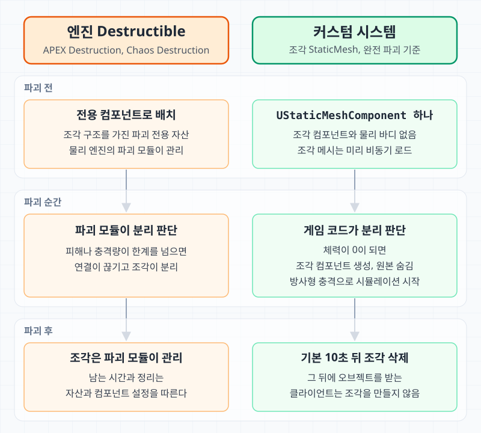
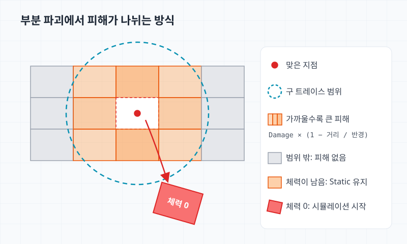
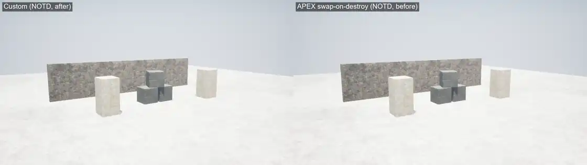
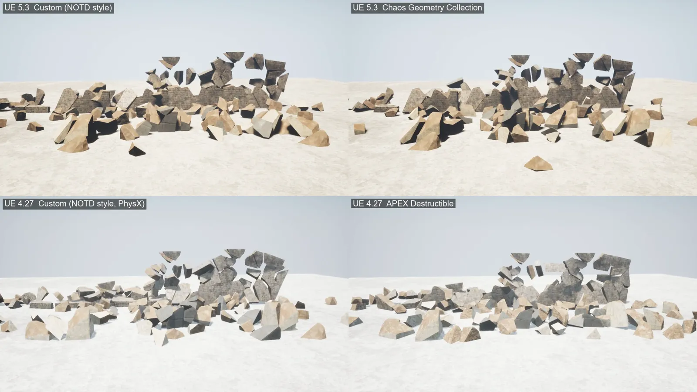

[Night of the Dead](/projects/night-of-the-dead/)의 월드에는 부술 수 있는 오브젝트가 많다. 나무와 덤불 같은 식생, 필드에 놓인 오브젝트, 던전의 구조물이 무기나 차량에 맞아 부서진다. 차량과 일부 아이템도 부서질 때 파편을 남긴다.

UE4에서는 PhysX 기반의 APEX Destruction으로 이 오브젝트들을 처리했는데, 원인을 알 수 없는 에러가 너무 많이 발생했고 크래시로 이어졌다. 시각 효과와 성능은 거의 같을 거라고 보고, 우리가 직접 제어할 수 있도록 필요한 기능만 최소한으로 구현한 파괴 시스템으로 바꿨다([개발 업데이트 #10](https://steamcommunity.com/games/1377380/announcements/detail/3711572693139781185)).

이후 [개발 업데이트 #15](https://store.steampowered.com/news/app/1377380/view/3888357282609115394)에서 UE5로 이전하면서 물리 엔진이 PhysX에서 Chaos로 바뀌었다. UE5에는 PhysX와 함께 APEX Destruction도 빠졌고, 엔진의 파괴 기능은 Chaos Destruction이 맡는다. 하지만 당시 Chaos Destruction은 다루기 어려웠고 성능 문제도 있었다. 그래서 Chaos Destruction으로 옮기지 않고 UE4에서 만든 시스템을 그대로 가져갔다. 이 시스템의 조각은 일반 `UStaticMeshComponent`이고 코드가 APEX나 PhysX API를 직접 호출하지 않아서, 물리 엔진이 바뀌어도 파괴 로직을 다시 짤 필요가 없었다.

이 글은 엔진 Destructible과 커스텀 시스템의 구조를 일반화해 비교하고, 당시 환경을 재현한 실험 프로젝트에서 교체 전 구성과 성능을 측정한 결과를 정리한다. 겉모습과 오브젝트 하나를 부술 때의 비용은 교체 전 구성과 같거나 나았다. 여러 오브젝트를 한 프레임에 부수는 부하 시험에서 병목을 찾았고, 프레임당 조각 예산으로 그 스파이크를 교체 전 구성보다 낮췄다.

<div class="at-a-glance">
<p class="at-a-glance-title">한눈에 보기: 교체 전 구성(교체형 APEX)과 비교, UE 4.27 재현 환경</p>
<div class="at-a-glance-grid">
<div class="at-a-glance-item"><p class="at-a-glance-value">−27%</p><p class="at-a-glance-label">단일 파괴 스파이크</p><p class="at-a-glance-detail">3.68ms → 2.67ms</p></div>
<div class="at-a-glance-item"><p class="at-a-glance-value">5.24ms</p><p class="at-a-glance-label">순차 파괴 p95</p><p class="at-a-glance-detail">50개, 60fps 예산 16.7ms 안</p></div>
<div class="at-a-glance-item"><p class="at-a-glance-value">1/10.8</p><p class="at-a-glance-label">대기 프레임 시간</p><p class="at-a-glance-detail">2,000개, 상주형 APEX 대비</p></div>
<div class="at-a-glance-item"><p class="at-a-glance-value">−82%</p><p class="at-a-glance-label">동시 파괴 스파이크</p><p class="at-a-glance-detail">100개, 138ms → 25ms (교체형 32ms)</p></div>
</div>
<p class="at-a-glance-note">조합별 3회 실행의 중앙값이다. 동시 파괴는 프레임당 조각 예산을 적용한 결과다. 측정 조건은 <a href="#재현-환경에서-측정하기">재현 환경에서 측정하기</a>에 있다.</p>
</div>

## 엔진 Destructible과 커스텀 시스템

APEX Destruction과 Chaos Destruction은 구현이 다르지만 큰 흐름은 비슷하다. 원본 메시를 에디터에서 미리 분할해 파괴 전용 자산을 만든다. UE4는 Destructible Mesh, UE5는 Geometry Collection이다. 조각들은 이 자산과 전용 컴포넌트 하나에 묶여 배치되고, 어떤 조각이 언제 떨어질지는 물리 엔진의 파괴 모듈이 정한다.

Chaos Destruction의 경우 Geometry Collection을 처음에 하나의 강체 클러스터로 시뮬레이션한다. 조각 사이에는 연결 그래프와 strain 값이 있고, 충돌이나 Physics Field가 연결 한계를 넘는 충격량을 가하면 연결이 끊어진다. APEX Destruction은 컴포넌트에 가한 피해가 자산에 설정한 피해 한계를 넘으면 조각을 분리한다.

커스텀 시스템은 이 역할을 게임 코드로 가져왔다.

| 항목 | 엔진 Destructible (APEX, Chaos) | 커스텀 시스템 |
| --- | --- | --- |
| 조각 자산 | 에디터에서 분할한 전용 자산 하나 | Blender에서 나눈 조각 StaticMesh 목록 |
| 파괴 전 배치 | 조각 구조를 가진 전용 컴포넌트(상주형) 또는 통짜 메시 뒤 파괴 시 교체(교체형) | 원본 `UStaticMeshComponent` 하나 |
| 조각 분리 판단 | 파괴 모듈 (피해 한계, 연결 strain) | 게임 코드 (조각별 체력과 거리 감쇠) |
| 조각의 물리 | 파괴 모듈이 관리하는 강체 | `UStaticMeshComponent`의 물리 시뮬레이션 |
| 파괴 후 조각 | 자산과 컴포넌트 설정에 따른다 | 일정 시간 뒤 조각 컴포넌트 삭제 |
| 물리 엔진 교체 | 파괴 모듈 자체가 바뀐다 (APEX에서 Chaos로) | 조각 코드는 그대로 |

엔진 방식은 분할과 분리 판단을 엔진에 맡기는 대신, 문제가 생기면 원인이 엔진 모듈 안에 있을 수 있다. 커스텀 시스템은 필요한 기능만 두고, 조각이 생기고 움직이고 사라지는 시점을 모두 게임 코드에서 정한다.



## 조각 데이터

조각은 Blender에서 원본 메시를 미리 잘라 만든 StaticMesh다. 조각마다 다음 정보를 둔다.

```cpp
USTRUCT()
struct FFragmentData
{
	GENERATED_BODY()

	UPROPERTY(EditAnywhere)
	TSoftObjectPtr<UStaticMesh> Mesh;

	// 부분 파괴에서 이 체력이 0이 되면 조각이 떨어져 나간다.
	UPROPERTY(EditAnywhere)
	float MaxHealth = 20.f;

	// 피해와 충격을 받지 않고 제자리에 남는 조각
	UPROPERTY(EditAnywhere)
	bool bIgnoreDamage = false;

	// 부분 파괴에서는 움직이지 않고 완전 파괴 때만 시뮬레이션하는 조각
	UPROPERTY(EditAnywhere)
	bool bSimulateOnlyOnFullDestruction = true;

	UPROPERTY(EditAnywhere)
	float MassScale = 1.f;
};
```

조각 메시는 소프트 레퍼런스로 두고, 액터가 월드에 들어오면 높은 우선순위로 비동기 로드한다. 파괴되는 순간에는 메시가 이미 메모리에 있다.

## 완전 파괴

부분 파괴를 켜지 않은 오브젝트는 체력이 다 닳았을 때 한 번에 부서진다. 이런 오브젝트는 파괴 전에 조각 컴포넌트를 만들지 않는다. 월드에 있는 동안은 원본 `UStaticMeshComponent` 하나다.

체력이 0이 되면 그때 조각 데이터로 `UStaticMeshComponent`를 만들어 붙이고, 원본 메시의 표시와 충돌을 끈다. 이후 조각에 물리 시뮬레이션을 켜고 조각 전체의 바운드 중심에서 방사형 충격을 준다.

```cpp
void UFragmentDestructionComponent::DestructAll()
{
	if (bDestructed)
	{
		return;
	}
	bDestructed = true;

	for (UFragmentMeshComponent* Fragment : Fragments)
	{
		Fragment->SetMobility(EComponentMobility::Movable);
		Fragment->SetVisibility(true);
		Fragment->SetCollisionEnabled(ECollisionEnabled::QueryAndPhysics);
		// 캐릭터는 조각에 막히지 않는다.
		Fragment->SetCollisionResponseToChannel(ECC_Pawn, ECR_Ignore);
		Fragment->SetCullDistance(FragmentCullDistance);

		if (!Fragment->IgnoresDamage())
		{
			Fragment->SetSimulatePhysics(true);
			Fragment->AddRadialImpulse(ImpulseOrigin, ImpulseRadius, ImpulseStrength, RIF_Linear);
		}
	}
}
```

캐릭터는 조각과 충돌하지 않는다. 오브젝트에 따라 조각끼리의 충돌도 끌 수 있고, 조각의 컬링 거리도 따로 지정할 수 있다.

조각은 기본 10초 동안 남는다. 그 뒤 서버가 모든 클라이언트에 조각 삭제를 멀티캐스트하고, 복제되는 파괴 상태 값을 켠다. 그 뒤에 이 오브젝트를 처음 받는 클라이언트는 이 값만 보고 원본 메시를 숨기며, 조각은 만들지 않는다.

조각 컴포넌트는 복제되지 않는다. 서버는 파괴 시점과 충격 위치만 알리고, 각 클라이언트가 자기 조각을 따로 시뮬레이션한다.

## 부분 파괴

맞은 부분만 떨어져 나가야 하는 오브젝트는 부분 파괴를 켠다. 이 경우에는 메시를 로드한 직후 조각 컴포넌트를 미리 만들고 원본 메시를 숨긴다. 조각은 `Static` 모빌리티에 물리 시뮬레이션이 꺼진 상태로 시작한다.

서버가 피해를 받으면 맞은 위치와 법선, 피해량을 멀티캐스트한다. 각 머신은 그 위치에서 `ECC_Destructible` 채널로 구 트레이스를 한 번 하고, 걸린 조각 중 이 오브젝트의 조각에만 피해를 나눈다.



```cpp
void UFragmentDestructionComponent::DestructPartially(const FVector& HitPoint, const FVector& HitNormal, float Damage)
{
	TArray<FHitResult> Hits;
	SweepFragments(HitPoint, HitNormal, PartialRadius, Hits);

	for (const FHitResult& Hit : Hits)
	{
		auto* Fragment = Cast<UFragmentMeshComponent>(Hit.GetComponent());
		if (Fragment == nullptr || Hit.GetActor() != GetOwner())
		{
			continue;
		}

		// 맞은 지점에서 멀수록 피해가 선형으로 줄어든다.
		const float Falloff = 1.f - FVector::Dist(Hit.ImpactPoint, HitPoint) / PartialRadius;
		const float FragmentDamage = Damage * Falloff;
		Fragment->ApplyDamage(FragmentDamage);

		// 체력이 0이 된 조각만 떨어져 나간다.
		if (Fragment->CanDetach())
		{
			Fragment->SetMobility(EComponentMobility::Movable);
			Fragment->SetSimulatePhysics(true);

			const float Strength = FMath::Min(FragmentDamage * DamageToImpulse, MaxPartialImpulse);
			Fragment->AddRadialImpulse(ImpulseOrigin, ImpulseRadius, Strength, RIF_Constant);
		}
	}
}
```

`CanDetach()`는 피해를 무시하는 조각, 완전 파괴 때만 움직이는 조각, 체력이 남은 조각을 걸러 낸다. 충격의 세기는 피해량에 비례하되 상한을 둔다. 조각 컴포넌트는 `AddImpulse()`도 재정의해서, 속도가 기준(기본 초속 26m) 이상인 조각에는 그 경로로 들어오는 충격을 더하지 않는다.

## 연출 전용 파편

플레이어가 지은 건물과 차량, 부서지는 아이템은 같은 조각 컴포넌트를 연출 전용 경로로 쓴다. 이 경로는 클라이언트에서만 동작한다.

- 건물이 무너지거나 아이템이 부서졌다는 이벤트를 받거나 차량이 파괴되면, 클라이언트가 로컬에서 복제되지 않는 파편 액터를 스폰한다.
- 파편 액터가 조각 컴포넌트를 만들고 바로 완전 파괴를 실행한다.
- Dedicated Server와 렌더링 디테일이 낮음인 클라이언트에서는 파편을 만들지 않는다.
- 조각 메시를 미리 비동기 로드해 두고, 파괴 시점까지 로드가 끝나지 않았으면 설정에 따라 동기 로드하거나 연출을 건너뛴다.
- 건물과 문은 HP가 70% 이하로 떨어지면 서버가 클라이언트들에 조각 메시 로드를 알려, 무너지기 전에 로드를 시작한다.

파편이 남는 시간은 게임 상황을 보고 정한다.

```cpp
float ACosmeticDebrisActor::GetLifeSpanFor(const FOptimizeStatus& Status, float DefaultLifeSpan) const
{
	// 프레임이 크게 떨어졌거나 웨이브 규모가 크면 파편을 만들지 않는다.
	if (Status.FPS <= 15 || IsLargeWave(Status))
	{
		return 0.f;
	}

	return DefaultLifeSpan;
}
```

결과가 0이면 조각을 만들지 않고 파편 액터를 바로 제거한다. 그렇지 않으면 기본 10초의 수명을 두고 조각을 만든다.

## 재현 환경에서 측정하기

교체할 때는 시각 효과와 성능이 APEX와 거의 같을 거라고 보고 안정성을 기준으로 판단했다. 이 판단을 수치로 확인하려고 당시 환경을 별도 실험 프로젝트에 재현했다. UE 4.27(PhysX)에는 커스텀 방식과 교체 전 구성인 교체형 APEX를, 이전 후 엔진인 UE 5.3(Chaos)에는 커스텀 방식과 Chaos Geometry Collection을 같은 조각과 같은 충격 조건으로 구현했다. 회사의 코드와 에셋은 쓸 수 없어서 조각 생성기와 각 방식을 새로 만들고, 재질은 엔진의 Starter Content만 썼다. 크래시 빈도는 재현할 수 없어 측정 대상에서 뺐다.

### 비교 조건

NOTD가 커스텀 시스템 전에 쓴 APEX는 처음부터 Destructible 컴포넌트를 배치하는 방식이 아니었다. 평소에는 통짜 StaticMesh를 두고, 파괴할 때 Destructible 컴포넌트를 만들어 교체했다. 그래서 이 교체형을 주 비교 대상으로 두고, 처음부터 전용 컴포넌트를 들고 있는 상주형은 참고값으로만 쟀다.

| 엔진 | 방식 | 구성 |
| --- | --- | --- |
| UE 4.27.2 (PhysX) | Custom | 통짜 StaticMesh, 파괴 시 조각 `UStaticMeshComponent` 생성 |
| UE 4.27.2 (PhysX) | ApexSwap | 통짜 StaticMesh, 파괴 시 `UDestructibleComponent` 생성 (NOTD의 커스텀 도입 전 구성) |
| UE 5.3.2 (Chaos) | Custom | 위와 같은 코드 |
| UE 5.3.2 (Chaos) | ChaosSwap | 통짜 StaticMesh, 파괴 시 `UGeometryCollectionComponent` 생성 |
| 두 엔진 | Apex, Chaos (상주형) | 처음부터 전용 컴포넌트. 참고값 |

- 조각은 세 방식이 같다. 100×100×200cm 기둥을 보로노이 셀 24개로 나눴고, 겉면과 단면 재질 슬롯을 따로 뒀다.
- NOTD처럼 조각 메시와 Destructible 에셋은 미리 로드한 상태에서 쟀다. 파괴 순간의 비용에 에셋 로딩은 들어가지 않는다.
- 충격은 세 방식 모두 속도 변화 600cm/s, 반경 300cm, 선형 감소로 줬다. NOTD 원본은 `bVelChange=false`였지만, 5.3의 `UGeometryCollectionComponent::AddRadialImpulse`는 이 값에서 강체에 효과가 없어서 속도 변화로 맞췄다.
- 에디터 빌드를 쿠킹 없이 `-game -benchmark -fps=60`으로 실행했다. 1280×720 창, VSync 끔. 조합마다 3회 실행해 중앙값을 썼다.
- 측정 PC는 Ryzen 9 5950X, RTX 4090, 메모리 64GB다.
- 렌더러와 엔진 버전이 달라서 ms는 같은 엔진 안에서만 비교한다.

### 겉모습



같은 엔진에서 커스텀 방식(왼쪽)과 교체형 APEX(오른쪽)로 같은 장면을 부쉈다. 조각이 같아서 깨지는 모양과 흩어지는 범위는 거의 같다. APEX는 피해를 준 다음 프레임에도 청크가 아직 Dynamic이 아니라서 충격을 2프레임 뒤에 줬고, 그만큼 조각 위치는 조금씩 다르다.



### 부수기 전: 대기 비용

| 엔진 | 오브젝트 수 | Custom | 상주형 |
| --- | ---: | --- | --- |
| UE 4.27 | 1,000 | 1.46ms, 32MB | Apex 8.34ms, 129MB |
| UE 4.27 | 2,000 | 1.57ms, 52MB | Apex 17.01ms, 242MB |
| UE 5.3 | 1,000 | 2.87ms, 11MB | Chaos 6.26ms, 76MB |
| UE 5.3 | 2,000 | 3.22ms, 14MB | Chaos 11.43ms, 144MB |

부서지지 않은 오브젝트를 세워 두기만 했을 때의 프레임 시간과 스폰 메모리다. 2,000개에서 커스텀은 상주형보다 프레임 시간이 UE4에서 1/10.8, UE5에서 1/3.6이었고 메모리도 크게 적었다. 교체형은 대기 상태가 커스텀과 같은 통짜 StaticMesh라서 따로 재지 않았다. 파괴 오브젝트가 월드에 많이 놓이는 게임에서는 부서지기 전까지 일반 StaticMesh로 두는 구조가 대기 비용을 좌우한다.

### 하나씩 부술 때

오브젝트 하나를 부순 프레임의 스파이크는 UE4에서 Custom 2.67ms, ApexSwap 3.68ms로 커스텀이 27% 낮았다. UE5에서는 Custom 4.50ms, ChaosSwap 4.46ms로 같은 수준이었다.

실제 플레이에 가까운 경우로 50개를 0.2초마다 하나씩 부쉈다. 첫 파괴부터 마지막 조각이 사라질 때까지의 프레임 시간이다.

| 엔진 | 방식 | 평균 | p95 |
| --- | --- | ---: | ---: |
| UE 4.27 | Custom | 3.13ms | 5.24ms |
| UE 4.27 | ApexSwap | 1.81ms | 2.59ms |
| UE 5.3 | Custom | 6.40ms | 11.51ms |
| UE 5.3 | ChaosSwap | 3.90ms | 6.40ms |

평균은 커스텀이 1.6~1.7배 높지만, p95가 UE4 5.24ms, UE5 11.51ms로 두 엔진 모두 60fps 예산(16.7ms) 안이다. UE4 일부 실행에는 방식과 관계없이 GPU 시간 33ms 프레임이 몇 개 섞여 있었다. 게임 스레드는 1ms 미만이었으므로 측정 PC 환경 탓으로 보고, 최댓값은 결론에 쓰지 않았다.

### 부하 시험: 한꺼번에 부술 때

웨이브 중 폭발처럼 여러 오브젝트가 한 프레임에 부서지는 경우를 보려고 동시에 부수는 수를 늘렸다. N개를 한 프레임에 부쉈을 때 0.5초 안의 가장 긴 프레임이다.

| N | UE4 Custom | UE4 ApexSwap | UE5 Custom | UE5 ChaosSwap |
| ---: | ---: | ---: | ---: | ---: |
| 1 | 2.67ms | 3.68ms | 4.50ms | 4.46ms |
| 10 | 13.69ms | 5.79ms | 22.50ms | 7.30ms |
| 50 | 67.82ms | 15.75ms | 106.34ms | 24.46ms |
| 100 | 138.12ms | 31.83ms | 191.23ms | 43.67ms |

동시에 부수는 수가 10개를 넘으면 커스텀의 스파이크가 교체형보다 빠르게 커진다. 100개에서는 UE4 138ms, UE5 191ms로 교체형의 4배를 넘었고, 조각을 64개로 늘린 세트에서는 차이가 더 벌어졌다. 여기가 이 구조의 한계 지점이다.

100개 동시 파괴를 Unreal Insights로 따로 기록해 파괴 프레임을 나눠 봤다. 트레이스 실행은 위 표의 수치와 별도다.

| 엔진 | 방식 | 파괴 처리 | 컴포넌트 등록 (`FScene_AddPrimitive`) |
| --- | --- | ---: | --- |
| UE 4.27 | Custom | 107.9ms | 2,400회, 23.4ms |
| UE 4.27 | ApexSwap | 18.3ms | 100회, 0.8ms |
| UE 5.3 | Custom | 142.7ms | 2,400회, 33.7ms |
| UE 5.3 | ChaosSwap | 12.2ms | 100회, 0.3ms |

교체형은 오브젝트 하나에 컴포넌트 하나를 만들고 조각은 그 안에서 처리한다. 커스텀은 조각마다 `UStaticMeshComponent`를 만들어 등록하므로 100개 × 24조각 = 2,400개의 컴포넌트가 한 프레임에 생긴다. UE5에서는 물리 씬에 바디를 넣는 `FChaosScene::AddActorsToScene_AssumesLocked`도 2,400회(7.9ms) 불렸다. UE4 트레이스에는 이보다 잘게 나눈 스코프가 없어 나머지 시간의 내역은 확인하지 못했다.

NOTD는 이런 상황에 대비해 연출 전용 파편에 프레임이 15fps 이하로 떨어지거나 웨이브가 크면 조각을 만들지 않는 조건을 두었다. 측정으로 비용이 어디서 나오는지 확인했으니, 조각을 생략하지 않고 비용을 여러 프레임에 나누는 방법을 시험했다.

## 프레임당 조각 예산 두기

스파이크의 원인이 한 프레임에 몰리는 컴포넌트 생성이라면, 생성을 여러 프레임에 나누면 된다. 개선안에서는 한 프레임에 만들 수 있는 조각 컴포넌트 수에 예산을 두고(24조각 오브젝트 10개분인 240개), 예산을 넘는 파괴 요청은 줄을 세워 다음 프레임에 처리했다. 오브젝트 하나는 언제나 한 프레임에 통째로 부서지고, 차례를 기다리는 동안에는 통짜 메시가 그대로 보인다.

```cpp
bool UFragmentBudgetSubsystem::TrySpend(int32 Cost)
{
	// 조각이 예산보다 많은 오브젝트도 부서져야 하므로, 이번 프레임에 아직 만든 조각이 없으면 허용한다.
	if (SpentThisFrame == 0 || SpentThisFrame + Cost <= BudgetPerFrame)
	{
		SpentThisFrame += Cost;
		return true;
	}
	return false;
}

void UFragmentBudgetSubsystem::RequestDestruct(AFragmentDestructible* Object, const FVector& ImpactPoint)
{
	// 앞선 요청이 기다리는 중이면 순서를 지키려고 뒤에 선다.
	if (Pending.Num() == 0 && TrySpend(Object->GetFragmentCount()))
	{
		Object->BreakNow(ImpactPoint);
		return;
	}
	Pending.Add({ Object, ImpactPoint });
}

void UFragmentBudgetSubsystem::Tick(float DeltaTime)
{
	int32 Processed = 0;
	for (; Processed < Pending.Num(); ++Processed)
	{
		AFragmentDestructible* Object = Pending[Processed].Object.Get();
		if (Object == nullptr)
		{
			continue;
		}
		if (!TrySpend(Object->GetFragmentCount()))
		{
			break;
		}
		Object->BreakNow(Pending[Processed].ImpactPoint);
	}
	Pending.RemoveAt(0, Processed);
	SpentThisFrame = 0;
}
```

| 엔진 | N | Custom | 예산 적용 | 교체형 | 다 부서지기까지 |
| --- | ---: | ---: | ---: | ---: | ---: |
| UE 4.27 | 50 | 67.82ms | 17.90ms | 15.75ms | 0.07초 |
| UE 4.27 | 100 | 138.12ms | 25.22ms | 31.83ms | 0.15초 |
| UE 5.3 | 50 | 106.34ms | 28.60ms | 24.46ms | 0.07초 |
| UE 5.3 | 100 | 191.23ms | 37.31ms | 43.67ms | 0.15초 |

100개 동시 파괴의 스파이크가 UE4에서 138ms에서 25ms로(82% 감소), UE5에서 191ms에서 37ms로(80% 감소) 내려가 교체형보다 낮아졌다. 조각 64개 세트의 50개 동시 파괴도 UE4에서 192.78ms에서 28.11ms가 됐다. 100개가 다 부서지기까지는 0.15초가 걸리고, 그동안 차례를 기다리는 오브젝트는 통짜 메시로 서 있다. 10개 이하는 예산 안이라 결과가 달라지지 않는다.

## 다음 단계

예산은 파괴 순간의 비용을 나눈다. 조각이 움직이는 동안의 비용은 조각마다 컴포넌트와 강체를 갱신하는 데서 나오는 것으로 보이며, 100개 동시 파괴에서 UE4 평균 11.29ms로 교체형(2.66ms)보다 높다. 다음 단계는 멈춘 조각을 Instanced Static Mesh로 옮기는 식으로 조각별 컴포넌트 수 자체를 줄이는 것이다.

측정 범위는 다음과 같다.

- 네트워크, 오목 메시, Nanite, 비동기 물리는 다루지 않았다.
- 교체형은 같은 액터에 컴포넌트를 만들었다. NOTD는 별도 액터를 스폰했을 수 있다.
- NOTD의 APEX 에셋이 남아 있지 않아 원래 Destructible Mesh 설정값은 알 수 없다.
- 측정 PC 한 대의 결과다.

## 참고 자료

- [Destruction Overview in Unreal Engine](https://dev.epicgames.com/documentation/unreal-engine/destruction-overview)
- [Creating a Destructible Object in Unreal Engine 4 & Blender - Kids With Sticks](https://kidswithsticks.com/creating-a-destructible-object-in-unreal-engine-4-blender/)
