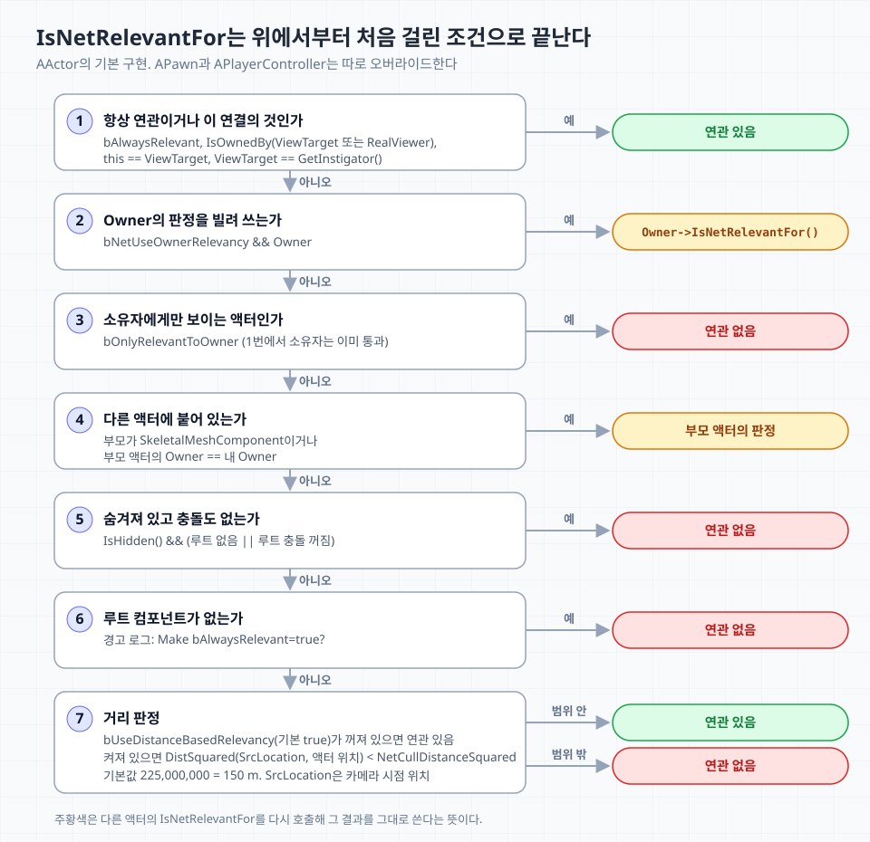
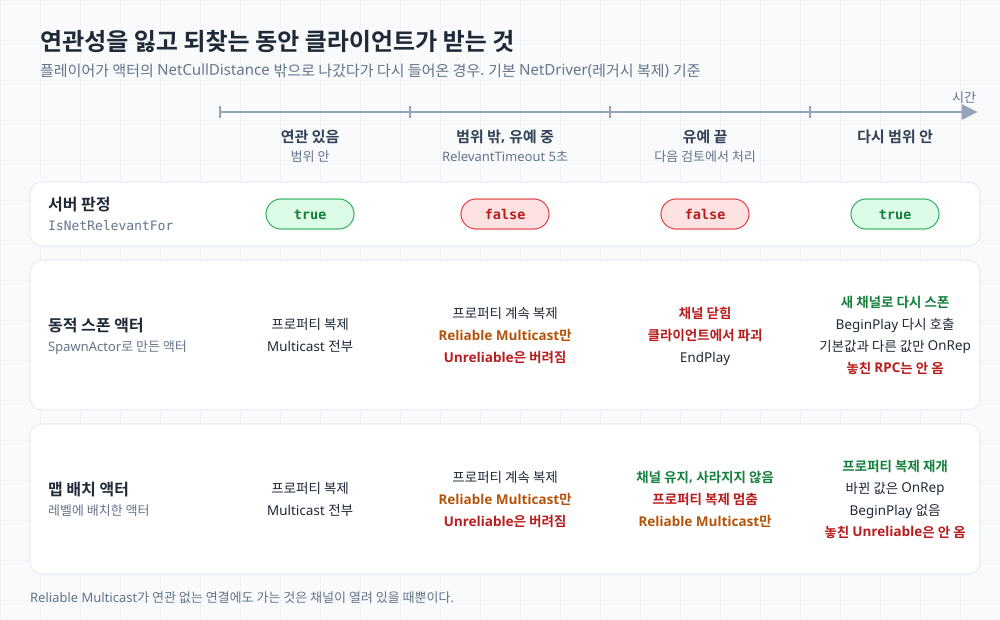

면접에서 RPC의 Reliable을 설명한 직후 "Net Relevancy는 무엇인가요?"라는 질문을 받았다. 연관성이 있느냐에 따라 RPC를 호출할 수 있는지가 갈린다고 답하자 꼬리 질문이 이어졌다.

> 그럼 액터가 Relevant해야 할 때와 아니어야 할 때는 각각 언제인가요? 코드에서는 결국 그걸 정해 줘야 하잖아요.

이 질문에는 답하지 못했고 면접은 다음 질문으로 넘어갔다. 돌이켜보면 처음 답부터 헛다리였다. 질문은 서버가 어떤 액터를 어떤 클라이언트에 보내느냐였는데, 나는 RPC를 호출할 수 있느냐를 말했다. 그것은 Relevancy가 아니라 Ownership이 정하는 문제다.

답하지 못한 것이 꽤 충격이었다. Relevancy는 서버가 무엇을 누구에게 보낼지 정하는, 언리얼 네트워크의 근간이 되는 개념이다. Night of the Dead에서 [Replication Graph](/posts/unreal-engine-replication-graph/)를 다루며 늘 만지던 것이기도 하다. 실마리 하나만 잡혔어도 설명을 이어 갈 수 있었을 텐데, 그 첫 문장을 꺼내지 못해 뒤의 답변 전체가 막혔다는 점이 가장 치명적이었다. 중요한 개념이라는 인식은 있었지만 그 자리에서 어떻게 설명해야 할지 떠오르지 않았고, 개념이 부족했다고 생각한다. 그래서 다시 공부하고 정리해 보려 한다.

## Relevancy가 정하는 것

면접관의 첫 질문은 Relevancy가 무엇이냐였다. 레벨에는 액터가 많지만 한 플레이어에게 영향을 주는 것은 일부다. 서버는 연결(connection)마다 그 클라이언트에 의미 있는 액터 집합을 정하고 그 집합의 액터만 복제한다. 이 집합에 드는 액터가 그 연결에 Relevant하다. 판정 단위는 액터가 아니라 액터와 연결의 쌍이라서, 같은 액터가 A 클라이언트에는 연관 있고 B 클라이언트에는 연관 없을 수 있다.

서버에서 Relevancy는 Actor channel을 열고 닫는 기준이다.

- 채널이 없는 액터는 연관 없으면 보내지 않는다. 연관 있으면 채널을 열고 처음 복제한다.
- 채널이 있는 액터는 연관성을 잃어도 바로 닫지 않고 유예 뒤에 닫는다(아래 [연관성을 잃고 되찾을 때](#연관성을-잃고-되찾을-때)).
- Multicast RPC도 연관 있는 연결에만 보낸다.

Relevancy가 RPC에 관여하는 것은 이 세 번째 항목 정도다. 꼬리 질문인 "언제 Relevant해야 하나"의 답은 아래의 판정 순서와, 그 순서를 바꾸는 플래그에 있다.

## `IsNetRelevantFor`의 판정 순서



`AActor`의 기본 구현이다. 위에서부터 검사해 처음 걸린 조건으로 끝난다.

```cpp
// Engine/Private/ActorReplication.cpp
bool AActor::IsNetRelevantFor(const AActor* RealViewer, const AActor* ViewTarget, const FVector& SrcLocation) const
{
	if (bAlwaysRelevant || IsOwnedBy(ViewTarget) || IsOwnedBy(RealViewer) || this == ViewTarget || ViewTarget == GetInstigator())
	{
		return true;
	}
	else if (bNetUseOwnerRelevancy && Owner)
	{
		return Owner->IsNetRelevantFor(RealViewer, ViewTarget, SrcLocation);
	}
	else if (bOnlyRelevantToOwner)
	{
		return false;
	}
	else if (RootComponent && RootComponent->GetAttachParent() && RootComponent->GetAttachParent()->GetOwner() && (Cast<USkeletalMeshComponent>(RootComponent->GetAttachParent()) || (RootComponent->GetAttachParent()->GetOwner() == Owner)))
	{
		return RootComponent->GetAttachParent()->GetOwner()->IsNetRelevantFor(RealViewer, ViewTarget, SrcLocation);
	}
	else if(IsHidden() && (!RootComponent || !RootComponent->IsCollisionEnabled()))
	{
		return false;
	}

	if (!RootComponent)
	{
		UE_LOGF(LogNet, Warning, "Actor %ls / %ls has no root component in AActor::IsNetRelevantFor. (Make bAlwaysRelevant=true?)", *GetClass()->GetName(), *GetName() );
		return false;
	}

	return !GetDefault<AGameNetworkManager>()->bUseDistanceBasedRelevancy ||
			IsWithinNetRelevancyDistance(SrcLocation);
}
```

세 인자는 연결마다 정해진다.

| 인자 | 값 |
| --- | --- |
| `RealViewer` | 연결의 PlayerController |
| `ViewTarget` | 연결의 ViewTarget. 보통 조종 중인 Pawn |
| `SrcLocation` | 그 연결의 카메라 시점 위치 |

단계별로 보면 다음과 같다. 번호는 위 그림과 같다.

1. 이 연결의 것인지 먼저 본다. `bAlwaysRelevant`이거나, Owner 체인에 그 연결의 PlayerController나 Pawn이 있거나, 그 Pawn이 Instigator면 숨김이나 거리와 관계없이 연관 있다.
2. `bNetUseOwnerRelevancy`면 Owner의 판정을 그대로 쓴다.
3. `bOnlyRelevantToOwner`면 연관 없다. 소유자는 이미 1번에서 통과했으므로, 여기까지 온 것은 소유자가 아닌 연결뿐이다.
4. 다른 액터에 붙어 있으면 부모 액터의 판정을 따른다. Epic 문서는 스켈레탈 메시에 붙은 경우만 설명하지만, 부모 액터의 Owner가 내 Owner와 같을 때도 부모를 따른다.
5. 숨기기만 해서는 빠지지 않고, 루트 충돌까지 꺼져 있어야 연관 없음이 된다. 반대로 렌더링이 필요 없다고 충돌 없는 액터를 서버에서 `SetHidden(true)`로 스폰하면 아무에게도 복제되지 않는다. [Replication Graph를 측정](/posts/unreal-engine-replication-graph/)할 때 테스트 액터 5,000개가 이 조건에 걸려 기본 드라이버로는 하나도 복제되지 않았다.
6. 루트 컴포넌트가 없으면 경고 로그를 남기고 연관 없음이 된다. 루트 없이 데이터만 나르는 액터는 1–3번에서 결론이 나도록 플래그를 정해 둔다.
7. 마지막이 거리다. 기준점은 Pawn이 아니라 카메라 시점이라서, 3인칭 카메라가 폰 뒤로 빠져 있으면 기준점도 그만큼 뒤에 있다. `NetCullDistanceSquared`는 이름대로 제곱값이고 기본값 `225000000`은 150 m다.

### 클래스별 오버라이드

기본 구현은 `AActor`의 것이고 엔진 클래스 몇 개는 판정이나 기본값이 다르다.

| 클래스 | 판정 또는 기본값 |
| --- | --- |
| `APawn` | 자신의 Controller와 서로 밟고 선 액터에는 항상 연관 있다. `bNetUseOwnerRelevancy`는 보지 않는다 |
| `APlayerController` | 자기 연결에만 연관 있다 |
| `AController` | 기본으로 `bOnlyRelevantToOwner` |
| `AGameStateBase`, `APlayerState` | 기본으로 `bAlwaysRelevant` |

`bOnlyRelevantToOwner`는 NetDriver가 한 번 더 걸러서, 오버라이드가 플래그를 무시해도 소유 연결 밖으로는 가지 않는다.

## Owner가 판정을 바꾸는 방식

Owner는 판정 순서에서 세 번 쓰인다.

1. 소유 체인. `IsOwnedBy`는 Owner를 끝까지 따라 올라간다. 무기의 Owner가 Pawn이고 Pawn의 Owner가 PlayerController면(빙의하면 Pawn의 Owner는 PlayerController가 된다) 무기는 거리와 관계없이 그 플레이어에게 항상 연관 있다.
2. `bOnlyRelevantToOwner`. 소유자 외에는 연관 없다. Owner가 없으면 아무에게도 가지 않는다.
3. `bNetUseOwnerRelevancy`. 판정을 Owner에게 넘긴다. 폰이 들고 있는 무기나 장비는 폰이 보이는 클라이언트에게 같이 보여야 하므로 이 플래그를 켜고 Owner를 폰으로 둔다.

1번 조건에는 Instigator도 있다. 내 Pawn이 Instigator인 투사체는 거리와 관계없이 나에게 연관 있다.

판정은 서버에서 돌기 때문에 Owner도 서버에서 정한다.

```cpp
// 예시: 폰이 들고 다니는 무기
AMyWeapon::AMyWeapon()
{
	bReplicates = true;
	bNetUseOwnerRelevancy = true; // 폰이 연관 있는 연결에만 연관 있다
}

// 서버에서 스폰할 때 Owner와 Instigator를 지정한다
FActorSpawnParameters Params;
Params.Owner = OwnerPawn;
Params.Instigator = OwnerPawn;
GetWorld()->SpawnActor<AMyWeapon>(WeaponClass, SpawnTransform, Params);
```

정리하면 꼬리 질문의 답은 다음 표다.

| 액터 | 설정 |
| --- | --- |
| 모두가 알아야 하는 전역 상태(GameState, PlayerState) | `bAlwaysRelevant` |
| 소유자만 알면 되는 것(PlayerController) | `bOnlyRelevantToOwner`와 Owner |
| 들고 있는 폰을 따라가야 하는 것(무기, 장비) | `bNetUseOwnerRelevancy`와 Owner |
| 보이는 거리만 다른 것 | `NetCullDistanceSquared` |
| 팀원에게만 보이는 것처럼 규칙이 특수한 것 | `IsNetRelevantFor` 오버라이드 |

### 관련 함수와 프로퍼티

| 이름 | 하는 일 |
| --- | --- |
| `IsNetRelevantFor` | 특정 연결에 연관 있는지 판정한다. NetDriver가 자동으로 부르며 오버라이드할 수 있다 |
| `IsWithinNetRelevancyDistance` | 시점 위치와의 거리 제곱이 `NetCullDistanceSquared`보다 작은지 확인한다 |
| `IsRelevancyOwnerFor` | `bOnlyRelevantToOwner` 액터의 소유자 판정에 쓴다 |
| `IsReplayRelevantFor` | 리플레이 녹화에 넣을지 판정한다 |
| `ForceNetRelevant` | 강제로 연관 있게 한다고 설명되지만 조건이 있다(아래 [주의할 점](#forcenetrelevant는-연관성을-유지해-주지-않는다)) |
| `bAlwaysRelevant` | 모든 연결에 연관 있다. `bOnlyRelevantToOwner`보다 우선한다 |
| `bOnlyRelevantToOwner` | 소유자에게만 연관 있다 |
| `bNetUseOwnerRelevancy` | Owner가 있으면 Owner의 `IsNetRelevantFor`와 `GetNetPriority`를 쓴다 |
| `bRelevantForNetworkReplays` | 리플레이에 복제할지 정한다. 기본값 true |
| `NetCullDistanceSquared` | 연관 있는 최대 거리의 제곱. 기본 150 m |
| `Owner` | `bOnlyRelevantToOwner`와 `bNetUseOwnerRelevancy`가 참조하는 소유자 |

## 연관성을 잃고 되찾을 때

여기부터는 면접에서 이어서 받을 만한 질문을 정리했다. 먼저 "연관성을 잃었다가 되찾으면 클라이언트에서는 무슨 일이 생기나요?"다.



- 연관성을 잃어도 바로 끊지 않는다. 마지막으로 Relevant했던 때부터 `RelevantTimeout`(기본 5초)이 지날 때까지는 계속 복제한다. 경계를 오가는 액터가 생겼다 사라지기를 반복하지 않게 하는 장치로 보인다.
- 유예가 끝나면 동적으로 스폰한 액터는 채널이 닫혀 클라이언트에서 파괴되고 `EndPlay`가 불린다. 맵에 배치한 액터는 채널이 남아 사라지지 않고 복제만 멈춘다.
- 다시 Relevant해지면 동적 액터는 새로 스폰되어 `BeginPlay`가 다시 불리고, 기본값과 다른 프로퍼티의 OnRep이 온다. 맵에 배치한 액터는 복제가 재개되어 바뀐 값의 OnRep이 온다. 처음부터 범위 밖에서 스폰된 액터도 Relevant해질 때까지는 클라이언트에 나타나지 않는다.

RPC는 프로퍼티와 다르게 다룬다. 연관 없는 연결에도 채널이 열려 있으면 Reliable Multicast는 간다. Unreliable Multicast는 연관 없는 연결에는 가지 않는다. 그래서 유예 중인 액터나 채널이 남아 있는 맵 배치 액터는 범위 밖에서도 Reliable Multicast를 받는다. 채널이 닫힌 동적 액터는 아무것도 받지 못하고, 다시 Relevant해져도 그사이 RPC는 재전송되지 않는다.

액터를 짤 때는 두 가지를 전제로 둔다.

- 동적 액터의 클라이언트 `BeginPlay`와 `EndPlay`는 여러 번 불릴 수 있다. `BeginPlay`에서 다른 객체에 등록했다면 `EndPlay`에서 해제해, 다시 불려도 문제없게 한다.
- 늦게 보게 된 클라이언트도 알아야 하는 상태는 RPC가 아니라 복제 프로퍼티에 두고, 현재 프로퍼티 값만으로 상태를 다시 맞출 수 있게 한다. RPC는 그 순간의 연출 같은 이벤트에 쓴다.

## 바꿀 때 주의할 점

"연관성을 직접 바꿀 때 주의할 점은요?"라는 질문에는 세 가지를 답할 수 있다.

### `ForceNetRelevant`는 연관성을 유지해 주지 않는다

Epic 문서는 `ForceNetRelevant`를 "기본적으로 연관 없는 액터를 강제로 연관 있게 한다"고 설명하지만 실제 동작은 다르다. `bAlwaysRelevant`를 켜는 것은 복제하지 않던 액터뿐이다. 이미 복제 중인 액터에는 `ForceNetUpdate`만 부르는데, `ForceNetUpdate`는 다음 복제 검토에 넣을 뿐 연관성 검사는 그대로 거친다. 범위 밖의 복제 액터를 보이게 하려면 `bAlwaysRelevant`나 Owner 계열 플래그, 오버라이드 중 하나를 쓴다.

### 오버라이드는 싸야 한다

기본 드라이버는 복제 검토 대상인 액터 수 × 연결 수만큼 `IsNetRelevantFor`를 부른다. 오버라이드에서 트레이스나 컨테이너 탐색을 하면 액터와 플레이어가 늘수록 서버 비용이 곱으로 커진다. Epic 문서도 복제 시스템을 잘 모르면 의도치 않은 결과가 생길 수 있다며 오버라이드에 주의를 당부한다.

### Replication Graph와 Iris는 `IsNetRelevantFor`를 부르지 않는다

[Replication Graph](/posts/unreal-engine-replication-graph/)는 클래스의 CDO 플래그를 보고 액터를 노드(항상 연관, 연결별, Grid)로 라우팅하고, 노드가 Relevancy 판정을 대신한다. Iris도 CDO의 `bAlwaysRelevant`, `bOnlyRelevantToOwner`, `bNetUseOwnerRelevancy`로 공간 필터를 쓸지 정하고, `bOnlyRelevantToOwner` 액터에는 소유자 필터를 건다. 두 경로 모두 `IsNetRelevantFor` 오버라이드는 무시되므로 특수한 규칙은 노드나 필터로 다시 구현해야 한다.

## Relevancy, Dormancy, Priority

Relevancy를 설명하면 Dormancy, Priority와는 무엇이 다르냐는 질문도 나오기 쉽다. 셋 다 "덜 보내기" 위한 장치지만 묻는 질문이 다르다.

| | Relevancy | Dormancy | Priority |
| --- | --- | --- | --- |
| 묻는 것 | 이 연결에 이 액터를 보낼 것인가 | 바뀐 게 없으니 검사를 쉬어도 되는가 | 대역폭이 모자랄 때 무엇을 먼저 보낼 것인가 |
| 단위 | 액터 × 연결 | 정책은 액터, 휴면 상태는 연결별 | 액터 × 연결 |
| 걸렸을 때 클라이언트 | 동적 액터는 사라진다 | 액터가 남고 마지막 값을 유지한다 | 갱신이 늦어진다 |
| 관련 API | `bAlwaysRelevant`, `NetCullDistanceSquared`, `IsNetRelevantFor` | `NetDormancy`, `FlushNetDormancy` | `NetPriority`, `GetNetPriority` |

Priority는 연관 있는 액터 사이의 순서다. [Actor Priority 문서](https://dev.epicgames.com/documentation/unreal-engine/actor-priority-in-unreal-engine)에 따르면 연결이 포화됐을 때 무엇을 먼저 보낼지 정하는 상대 비율이다. Dormancy는 Relevancy와 다르다. 휴면 액터는 클라이언트에 남은 채 정해 둔 시점까지 업데이트만 멈춘다. 자세한 내용은 [휴면 액터 깨우기](/posts/unreal-engine-waking-dormant-actors/)에 정리했다.

## 다시 답한다면

같은 질문을 다시 받는다면 위 내용을 줄여 이렇게 답하고 싶다.

> Relevancy는 서버가 어떤 액터를 어떤 클라이언트 연결에 복제할지 정하는 연결별 판정으로, 그 클라이언트와 상관없는 액터를 빼서 대역폭을 아낍니다. 서버는 연결마다 `IsNetRelevantFor`를 불러 true인 액터에만 채널을 열어 복제하고, 연관성을 잃으면 5초쯤 유예한 뒤 동적으로 스폰한 액터는 채널을 닫아 클라이언트에서 지웁니다. 기본 기준은 거리라서 `NetCullDistanceSquared`, 기본 150 m 밖이면 Relevant하지 않습니다. 거리 말고 다른 기준이 필요하면 플래그로 정합니다. GameState처럼 모두가 알아야 하면 `bAlwaysRelevant`, PlayerController처럼 소유자만 알아야 하면 `bOnlyRelevantToOwner`, 무기처럼 든 폰을 따라가야 하면 `bNetUseOwnerRelevancy`를 켜고 Owner를 지정합니다. 규칙이 특수하면 `IsNetRelevantFor`를 오버라이드합니다. 동적 액터는 다시 Relevant해지면 새로 스폰되고 그사이 RPC는 오지 않으니, 늦게 본 클라이언트도 알아야 하는 상태는 복제 프로퍼티에 둡니다.

## 참고 자료

- [Actor Relevancy in Unreal Engine](https://dev.epicgames.com/documentation/unreal-engine/actor-relevancy-in-unreal-engine)
- [Actor Priority in Unreal Engine](https://dev.epicgames.com/documentation/unreal-engine/actor-priority-in-unreal-engine)
- [Net Relevancy Explained; Actor Relevancy Explained - UE C++ Tutorial, enigma tutorials](https://www.youtube.com/watch?v=acDHLHQgwwo)
