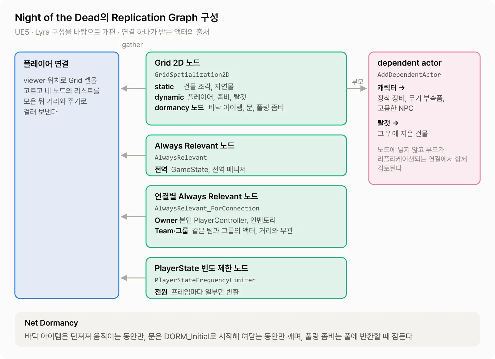
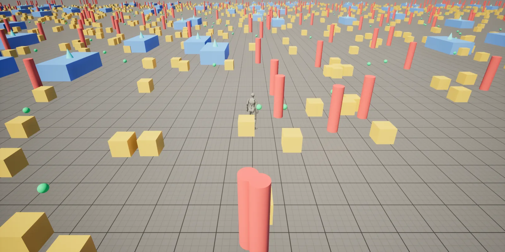
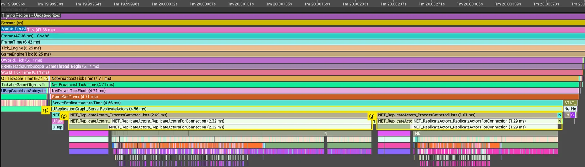
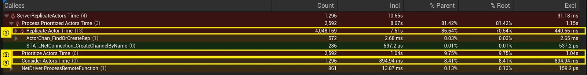
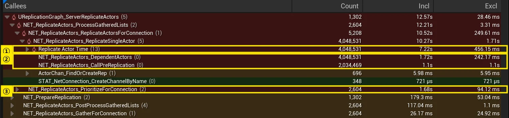
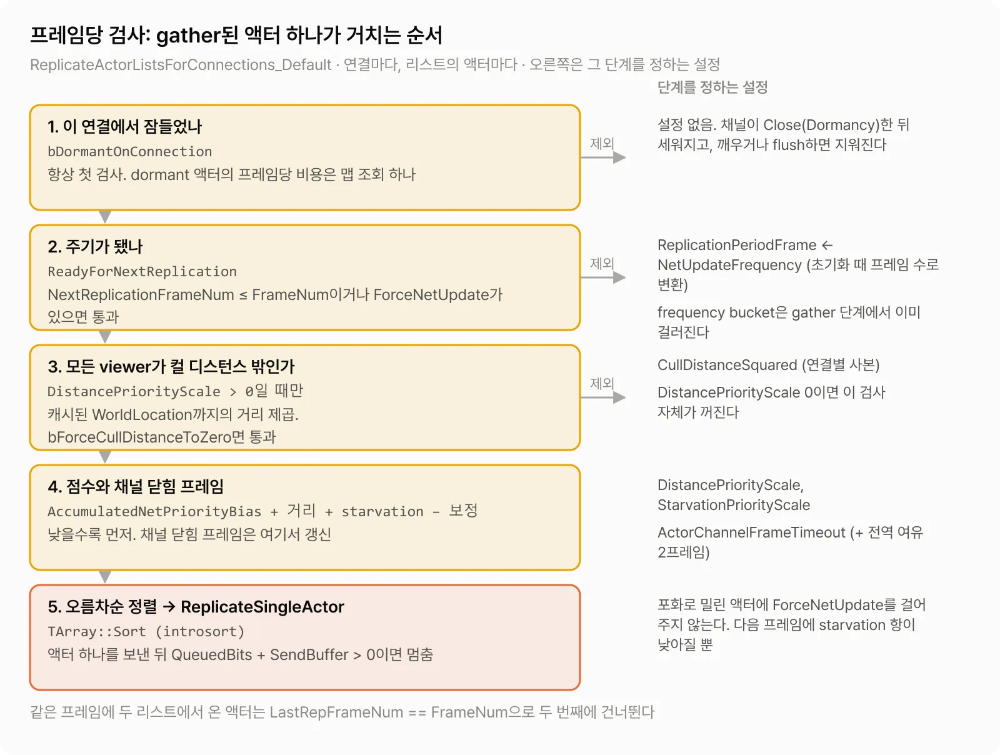
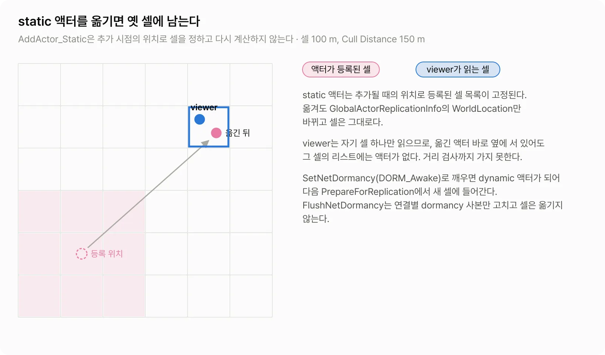

:::note[TL;DR]
- 리플리케이션 그래프는 기본 드라이버가 매 프레임 모든 액터 × 모든 연결에 대해 하는 relevancy 검토를, 프레임을 넘어 유지되는 노드 리스트로 바꾼다. 어느 연결에 무엇을 보낼지가 같다면 송신량도 같고, 보내는 액터 하나당 채널 밖 비용은 기본 드라이버보다 0.5 µs쯤 더 든다. 줄어드는 것은 frequency bucket처럼 보내는 횟수를 낮추는 도구를 쓸 때다.
- 액터 5,000개, 클라이언트 2개에서 프레임당 `ServerReplicateActors`는 맵 전체에 흩어진 조건에서 기본 2.54 ms, 리플리케이션 그래프 0.35 ms이고, 모두 한곳에 몰린 조건에서 8.09 ms와 4.48 ms다. 밀집에서의 차이는 frequency bucket이 dynamic 액터를 세 프레임에 한 번만 후보로 올려서 생긴 것이고, 보내는 횟수를 맞추면 리플리케이션 그래프가 22% 느리다. 기본 드라이버도 `NetUpdateFrequency`를 10 Hz로 낮추면 3.06 ms로 떨어진다.
- 액터 수와 연결 수에 기본 드라이버는 선형(액터당 0.46 µs, 연결당 0.78 ms)이고 리플리케이션 그래프의 연결별 비용은 viewer 근처 액터 수를 따른다.
- 기본 드라이버에서 잠든 액터가 consider list에서 빠지는 것은 모든 연결에서 잠든 뒤다. 넓은 맵에 흩어진 잠든 소품은 매 프레임 검토되고, 플레이어마다 자기 주변에만 액터가 있는 조건에서 밀집 조건에 가까운 6.47 ms가 나온다.
- 설정값 중 측정에서 효과가 컸던 것은 버킷 수와 `NetUpdateFrequency`뿐이다. `DistancePriorityScale` 0은 거리 컬링을 끄고, `ActorChannelFrameTimeout` 0은 채널을 닫지 않는다. `NetUpdateFrequency`는 서버 프레임 레이트보다 낮을 때만 뜻이 있다.
- 엔진에는 액터가 움직이는지 판별하는 코드가 없다. `UBasicReplicationGraph`는 모든 액터를 dormancy 경로로 넣고, 그래도 커스텀 그래프와 같은 자릿수(Uniform 0.40 ms, Cluster 3.44 ms)가 나온다. Team Node와 owner 변경이 필요 없으면 거기서 멈춰도 된다.
- 5.8.3에서 재현한 것: 잠재운 직후의 reliable multicast가 지연이 있을 때 리플리케이션 그래프에서만 유실된다. static으로 넣은 액터는 옮겨도 옛 셀에 남는다. `bNetTemporary` 발사체는 ensure가 나고 매 버킷 차례마다 채널을 다시 연다. 끊긴 연결의 dormancy 사본은 기본 설정에서 지워지지 않는다.
- 도입 기준은 비율 하나다. `stat game`에서 consider와 prioritize 시간이 `ReplicateActor` 시간보다 크면 리플리케이션 그래프가 그 몫을 줄인다. Iris와는 양자택일이고, Epic은 deprecate 계획이 없다고 하지만 릴리스 노트에 5.6 이후 항목이 없다.
:::



[Night of the Dead](/projects/night-of-the-dead/)는 밤마다 좀비가 몰려오는 오픈월드 생존 게임이고 Dedicated Server 멀티플레이를 지원한다. 2021년부터 2024년 6월까지 멀티플레이 동기화를 맡으면서 Replication Graph를 UE4에서 실험적으로 도입했고, UE5로 옮기면서 Lyra의 구성을 따라 위 그림처럼 개편했다. 리플리케이션 그래프는 켜면 서버가 가벼워진다고 알려져 있지만 무엇이 줄고 무엇이 그대로인지는 설명이 드물다. Iris를 공부하기 전에 Replication Graph를 최신 기준으로 더 완전히 이해하려고 5.8.3 소스와 측정으로 다시 확인했다.

테스트 프로젝트에서 기본 드라이버, `UBasicReplicationGraph`, 커스텀 그래프를 같은 조건으로 측정했다. 소스 경로는 UE 5.8.3 기준이며, 엔진 파일은 `Engine/Source/Runtime/`을, 플러그인 파일은 `Engine/Plugins/Runtime/ReplicationGraph/Source/`를 생략했다.

## 기본 드라이버가 하는 일과 리플리케이션 그래프가 바꾸는 것

`UNetDriver::ServerReplicateActors`는 매 네트워크 틱마다 세 단계를 거친다(`Engine/Private/NetDriver.cpp`).

1. **Consider**: `FNetworkObjectList`의 활성 액터를 순회해 `NetUpdateFrequency`로 계산한 갱신 시각이 지난 액터를 모은다. dormant 액터는 별도 목록에 있어 이 순회에서 빠진다.
2. **Prioritize**: 연결마다 consider list의 액터 하나하나에 `AActor::IsNetRelevantFor`와 `GetNetPriority`를 호출해 정렬한다.
3. **Replicate**: 정렬된 순서로 채널을 열어 `UActorChannel::ReplicateActor`를 호출한다.

비용은 두 번째 단계에 집중된다. `IsNetRelevantFor`와 `GetNetPriority`는 가상 함수라 엔진은 답이 언제 바뀌는지 알 수 없고, 매 프레임 모든 액터 × 모든 연결에 대해 다시 부른다. relevancy 검사를 통과한 액터만 세 번째 단계에 들어가므로, 넓은 맵에 액터가 흩어진 게임일수록 두 번째 단계의 비용이 실제 송신 작업보다 커진다. 액터가 모두 한곳에 몰려 모든 연결에 관련 있으면 두 번째 단계는 어차피 다 통과하고 세 번째 단계가 지배한다.

리플리케이션 그래프는 `UReplicationDriver`를 구현한 `UReplicationGraph`다. 서버의 `UNetDriver`가 리플리케이션 드라이버를 가지고 있으면 `ServerReplicateActors`는 CSV 통계 범위만 열고 바로 `ReplicationDriver->ServerReplicateActors`로 넘긴다. consider list 구성과 우선순위 계산은 돌지 않고, 플러그인 안에서 `IsNetRelevantFor`를 부르는 곳은 디버그 액터의 오버라이드뿐이다. 프로퍼티 비교와 직렬화는 그대로 `UActorChannel::ReplicateActor`가 한다.

리플리케이션 그래프는 프레임을 세 단계로 처리한다.

1. **Gather**: 연결마다 전역 노드와 그 연결의 노드에 `GatherActorListsForConnection`을 호출해 후보 리스트를 모은다. 노드는 대부분 프레임을 넘어 유지되는 리스트를 돌려주므로 어떤 액터를 고려할지를 다시 계산하지 않는다. 기본 드라이버의 consider list 구성에 해당하는 단계다.
2. **Prioritize**: 모은 리스트의 액터마다 dormancy, 리플리케이션 주기, 거리 컬링을 적용하고 우선순위 점수를 매겨 정렬한다.
3. **Replicate**: 정렬된 순서로 `ReplicateSingleActor`를 호출하고, 연결이 포화되면 멈춘다.


Grid는 거리 검사를 대체하지 않는다. Grid 노드는 플레이어가 있는 셀의 리스트를 돌려줄 뿐이고, 셀에는 Cull Distance 범위가 셀과 겹치는 모든 액터가 들어 있으므로 반경 밖 액터도 섞여 있다. 실제 거리 검사는 2단계에서 연결별 `CullDistanceSquared`로 따로 한다. 라이브스트림의 표현으로는 Grid가 broad phase, 거리 검사가 narrow phase다. 노드도 매 틱 조건을 검사하지 않는다. 노드의 역할은 조건을 한 번 평가해 리스트에 넣어 두고 바뀔 때만 옮기는 것이며, 매 틱 돌아가는 액터별 검사는 2단계에 모여 있다.

리플리케이션 그래프가 줄이는 것은 서버 CPU다. 어떤 액터를 어느 연결에 보낼지가 같다면 보내는 바이트도 같다. 다만 리플리케이션 그래프 쪽에는 기본 드라이버에 없는 송신 측 도구가 둘 있다. dynamic 액터를 `NumBuckets`개 버킷에 나눠 두고 `ReplicationFrameNum % NumBuckets`번 버킷만 돌려주는 frequency bucket 노드와, 이동 상태를 한 번 직렬화해 모든 연결에 재사용하는 Fast Shared Path다. Fast Shared Path는 액터 쪽에 `FastSharedReplicationFunc`로 등록할 unreliable multicast 함수를 써야 하고 그 프레임에는 일반 프로퍼티 리플리케이션이 생략되는 경로라, 측정에서는 켜지 않았다. 랩 액터에는 이동 상태가 없고, 효과가 Player Pawn 수 × 연결 수에서 나오므로 클라이언트 16개로는 보여 줄 폭이 작다.

## 측정: 액터 5,000개, 클라이언트 16개까지

### 실험 구성

측정 환경은 [Push Model 포스트](/posts/unreal-engine-push-model-networking/)와 같은 테스트 프로젝트에 랩 모듈을 더한 것이다.

- 맵: 4 km × 4 km의 평평한 바닥에 PlayerStart 하나만 있는 랩 전용 레벨
- 프로세스: 에디터 바이너리를 `-server`로 띄운 Dedicated Server와 `-game -nullrhi -nosound`로 띄운 헤드리스 클라이언트. 한 PC(Ryzen 9 5950X)에서 서버와 클라이언트를 서로 다른 CCD에 고정
- 지표: 서버 프레임은 약 46 ms(초당 21 프레임)이고 그중 약 41 ms가 틱 레이트 대기라, 비교는 프레임당 `ServerReplicateActors` 배타 시간으로 한다
- 엔진: `++UE5+Release-5.8-CL-58210709`

랩 서브시스템은 커맨드라인으로 조건을 받아 다음 순서로 돈다.

1. 클라이언트 N개가 붙으면 Player Pawn을 배치하고 둘씩 같은 팀으로 묶는다. 플레이어마다 owner 전용 인벤토리 액터를 하나 스폰한다.
2. 랩 액터 5,000개를 소품(노란 상자) 60%, 루트(loot, 초록 구) 20%, AI(빨간 기둥) 15%, 탈것(파란 상자) 5%로 나눠 스폰하고, 탈것마다 dependent actor인 무기(하늘색 원뿔)를 하나 더 붙인다. 전역 액터 3개가 추가된다. 무기와 Pawn, 인벤토리까지 합치면 리플리케이션 액터는 5,265개다. 모든 랩 액터는 16개의 리플리케이션 프로퍼티를 push 기반으로 등록한다.
3. 60초 warmup. 절반 지점에서 소품의 90%를 `DORM_DormantAll`로 보낸다. 루트는 처음부터 dormant다.
4. 60초 측정. CSV 프로파일러 캡처와 Insights 트레이스 리전을 연다. 깨어 있는 액터의 1%가 초마다 프로퍼티 하나씩을 바꾸고, 루트의 0.1%가 초마다 flush 후 쓰기를 한다. AI는 초당 3 m로 직선 이동하며 영역 경계에서 튕긴다.



클라이언트에서 본 랩 액터다. 색은 위의 종류 구분이고 마네킹이 Player Pawn이다.

공간 분포는 세 가지다. Cull Distance는 모든 랩 클래스에서 150 m(`NetCullDistanceSquared` 기본값)다.

| 분포 | 액터 위치 | 플레이어 위치 | 뜻 |
| --- | --- | --- | --- |
| Uniform | 2 km × 2 km에 균일 | 스쿼드별로 흩어짐 | 게임 중반. Cull Distance 안에 액터의 약 2% |
| Cluster | PlayerStart 중심 Cull Distance의 80% 안 | 모두 PlayerStart | 핫드롭. 모든 액터가 모든 연결에 관련 |
| NearPlayers | 플레이어마다 자기 주변 Cull Distance의 80% 안 | 맵 곳곳에 흩어짐 | 중간 지점. 플레이어마다 자기 몫만 보이고, 2인이면 각자 절반 |


드라이버는 셋이다.

- 기본 드라이버(`Generic`)
- 플러그인의 `UBasicReplicationGraph`. 모든 액터를 dormancy 경로로 넣는다
- 뒤의 커스텀 그래프 절에서 만드는 `UOpenWorldReplicationGraph`(이하 OpenWorld 그래프). 소품을 static, 루트를 dormancy, AI와 탈것을 dynamic 경로로 Grid에 넣고 dynamic 액터에 frequency bucket 3개를 쓴다

주 비교 조건은 5회, 나머지는 3회 반복해 평균을 쓰고, 실행마다 프레임 시간이 흔들리므로 프레임당 ms와 함께 Insights의 호출 수(`Prioritize_InnerLoop`가 검토한 액터 수, `Replicate Actor Time`의 호출 수)를 같이 본다. 밀집 조건에는 갱신률을 맞춘 대조군 둘을 더했다. OpenWorld 그래프의 버킷을 1개로 줄인 것과, 기본 드라이버의 `NetUpdateFrequency`를 10으로 낮춘 것이다.

Unreal Insights에는 리플리케이션 그래프 전용 트랙이 없지만 `-statnamedevents`로 띄우면 타이머가 보인다. 아래는 OpenWorld 그래프의 Cluster 런에서 서버 프레임 하나를 확대한 것이다.



① `UReplicationGraph_ServerReplicateActors` 4.56 ms 아래에 `NET_PrepareReplication`(Grid의 dynamic 액터 셀 갱신이 여기)이 한 번 오고, 그 뒤에 연결마다 `NET_ReplicateActors_GatherForConnection`과 `NET_ReplicateActors_ProcessGatheredLists`(안에 `PrioritizeForConnection`과 `ReplicateActorsForConnection`), `NET_ReplicateActors_LookForNonRelevantChannels`가 이어진다. ② ③은 두 연결의 `ProcessGatheredLists`로 2.69 ms와 1.61 ms다. 프레임의 나머지 약 41 ms는 틱 레이트 대기다.

타이머의 호출 수도 읽을 거리다. `Prioritize_InnerLoop`의 호출 수가 검토한 액터 수이고 `Replicate Actor Time`의 호출 수가 보낸 액터 수다. `RG_QUICK_SCOPE_CYCLE_COUNTER`로 선언된 `Prioritize_InnerLoop*`, `ReplicateSingleActor` 등은 Test·Shipping에서 컴파일되지 않는다.

### 드라이버와 분포

아래는 프레임당 `ServerReplicateActors` ms로, 5회 평균과 표준편차다.


| 분포 | 기본 드라이버 | Basic 그래프 | OpenWorld 그래프 |
| --- | --- | --- | --- |
| Cluster | 8.09 ± 0.09 | 3.44 ± 0.03 | 4.48 ± 0.04 |
| NearPlayers | 6.47 ± 0.47 | 2.25 ± 0.02 | 2.84 ± 0.02 |
| Uniform | 2.54 ± 0.20 | 0.40 ± 0.01 | 0.35 ± 0.02 |

기본 드라이버의 NearPlayers와 Uniform은 런마다 서버 프레임 시간이 41–47 ms로 흔들려 편차가 ±8%이고, 나머지 조건은 ±2% 안이다. 같은 기본 드라이버 Uniform 조건을 다른 측정 세트에서 다시 돌리면 2.05–2.23 ms가 나와, 표의 2.54는 가장 높은 세트의 값이다. 아래의 단계별 분해는 위의 Insights 타이머로 했고, 트레이스가 있는 첫 번째 런 하나의 값이라 표의 평균과 조금 다르다.

Uniform에서 리플리케이션 그래프는 기본 드라이버의 7분의 1이다. 첫 런의 Insights 타이머로 나눈 프레임당 ms는 다음과 같다.

| 단계 | 기본 드라이버 | OpenWorld 그래프 |
| --- | --- | --- |
| 후보 모으기 | consider list 구성 1.7 | `PrepareForReplication` 0.12, gather 0.01 |
| 우선순위 | 두 연결 0.9 | 0.04 (검토 항목 71개) |
| 리플리케이션 | 0.2 (프레임당 67회) | 0.13 |
| 합계 | 2.8 | 0.3 |

기본 드라이버는 5,265개 중 연결당 31개쯤만 보내는데 비용의 90% 이상이 보낼지 말지를 정하는 데 든다. OpenWorld 그래프는 Grid가 viewer 셀의 리스트만 돌려주므로 나머지 5,100개는 검토 대상이 아니다.

모든 액터가 모든 연결에 관련 있는 Cluster에서도 OpenWorld 그래프가 기본 드라이버의 55%, Basic이 43%다. 다만 이것은 판별 비용의 차이가 아니라 보내는 횟수의 차이다.

| 드라이버 | 연결당 `ReplicateActor` 호출 | 구성 |
| --- | --- | --- |
| 기본 | 1,561 | 깨어 있는 액터 전부를 매 프레임 |
| Basic | 524 | 깨어 있는 1,580개 전부가 버킷 3개에 나뉘어 세 프레임에 한 번 |
| OpenWorld | 735 | AI·탈것 1,000개가 버킷에서 333회, 깨어 있는 소품 315개가 static 리스트에서 매 프레임, dependent 무기가 탈것에 묻어 83회 |

보내는 횟수가 다르면 비교가 아니므로 갱신률을 맞춘 대조군을 두었다.


기본 드라이버의 `NetUpdateFrequency`를 10으로 낮추면 호출이 연결당 501회로 줄고 3.06 ms가 된다. 서버가 초당 21–23 프레임이라 10 Hz는 세 프레임에 한 번꼴이다. 반대로 OpenWorld의 버킷을 1개로 줄이면 호출 수가 1,555회로 100 Hz 기본 드라이버의 1,561회와 거의 같아지고, 이때 리플리케이션 그래프는 9.89 ms로 기본 드라이버보다 22% 느리다. 네 조건의 호출당 비용은 2.6–3.2 µs로 같은 자릿수다. 밀집에서 비용을 정하는 것은 보내는 횟수이고, 그것은 양쪽 모두 설정이 정한다.

어디서 느린지는 Insights가 보여 준다. 측정 구간 60초를 선택하고 Callees 트리를 기본 드라이버와 버킷 1개 리플리케이션 그래프에서 펼친 것이다.





① `UActorChannel::ReplicateActor` 안의 시간은 7.51 s와 7.22 s, 프레임당 5.80 ms와 5.55 ms로 같고 호출당 약 1.8 µs다. 후보를 고르는 단계도 비슷하다. 위 그림의 기본 드라이버는 ② 두 연결의 우선순위 1.04 s와 ③ consider list 894.94 ms(프레임당 0.69 ms)를 합쳐 프레임당 1.49 ms, 아래 그림의 리플리케이션 그래프는 prepare와 gather 0.16 ms에 ③ 우선순위 계산 1.68 s를 합쳐 1.45 ms다. 차이는 `NET_ReplicateActors_ReplicateSingleActor`가 채널 밖에서 하는 일에 있다. 아래 그림의 ② `DependentActors` 1.72 s와 `CallPreReplication` 1.1 s가 그 일부인데, `DependentActors`는 inclusive라 그 안에서 재귀 호출되는 무기 액터의 채널 시간이 대부분이고 순회 자체(Excl 열)는 0.24 s다.

| 리플리케이션 그래프의 채널 밖 작업 | ms |
| --- | --- |
| `ReplicateSingleActor` 자체. dependent 목록 수집, 연결 정보의 프레임 번호 갱신, 채널 조회 | 1.31 |
| 액터마다 `PreReplication` 호출(`CallPreReplication`) | 0.85 |
| dependent actor 순회와 그 채널 닫힘 프레임 갱신(`DependentActors` 자체) | 0.19 |
| 연결별 리스트 순회와 채널 정리(`ReplicateActorsForConnection` 잔여, `LookForNonRelevantChannels`, 후처리) | 0.30 |
| 합계 | 2.65 |

기본 드라이버에서 `ReplicateActor` 밖에 남는 리플리케이션 루프 시간은 0.93 ms다. `PreReplication`은 consider list를 만들면서 부르므로 앞의 consider list 0.69 ms 안에 들어 있다. 리플리케이션한 액터 하나당 채널 밖 비용은 기본 0.30 µs, 리플리케이션 그래프 0.85 µs다. 리플리케이션 그래프의 영속 리스트는 검토할 액터를 줄이는 장치이고, 보낼 액터가 많을수록 액터당 부가 비용은 기본 드라이버보다 크다.

NearPlayers는 둘의 중간이어야 하는데 기본 드라이버는 6.47 ms로 Cluster에 가깝다. 보내는 양은 연결당 770회로 Cluster의 절반인데, consider list 구성이 1.38 ms로 Cluster의 두 배이고 우선순위 계산이 1.97 ms다.


원인은 dormancy의 집계 단위다. 랩은 소품의 90%와 루트 전부를 `DORM_DormantAll`로 두는데, `FNetworkObjectList`는 액터가 모든 연결에서 dormant가 됐을 때만 active 목록에서 뺀다(`Engine/Private/NetworkObjectList.cpp`, `MarkDormant`의 `DormantConnections.Num() == NumConnections`). Cluster에서는 두 클라이언트가 모든 액터를 받으므로 3,685개가 빠져 active가 1,580개이지만, 흩어진 분포에서는 각 소품을 한 클라이언트만 받으므로 영영 active에 남고 매 프레임 5,265개 전부가 consider list를 거친다. Uniform의 1.7 ms도 같은 원인이다.

CSV의 `NumberOfFullyDormantActors`가 Cluster에서 3,685, NearPlayers에서 0, Uniform에서 60 남짓(두 플레이어가 3 m 거리라 같은 소품 일부를 본다)인 것이 그 흔적이다. 일부 연결에서만 dormant인 액터는 그 연결의 우선순위 계산만 건너뛰고 consider list 구성 비용은 그대로 내며, 모든 연결이 그 액터를 한 번씩 본 뒤에야 목록에서 빠진다. 넓은 맵에서는 그런 일이 잘 일어나지 않는다. 리플리케이션 그래프는 dormant 액터를 연결별 `bDormantOnConnection`으로 걸러서 이 문제가 없다.

### 액터 수와 연결 수

아래는 Uniform에서 액터 수를 1,000에서 20,000으로 늘린 결과다.


기본 드라이버는 0.59에서 9.69 ms로 정비례한다. 액터 하나당 프레임당 0.46 µs이고, 20,000개 런의 분해는 consider list 5.2 ms, 우선순위 3.8 ms, 리플리케이션 0.5 ms다. OpenWorld 그래프는 0.18에서 0.82 ms로 4.5배 늘고, 그 증가분은 열린 채널 수(52 → 254)에 비례한다. 연결별 gather·prioritize·리플리케이션 비용은 맵의 액터 수가 아니라 viewer 근처의 액터 수를 따른다. 전역 `PrepareForReplication`만 dynamic 액터 전체의 위치를 매 프레임 읽으므로 그 몫은 액터 수에 비례해 남는다.

연결 수를 2에서 16으로 늘린 결과는 다음과 같다.


연결 수에서는 둘 다 선형이지만 기울기가 6배 다르다. 기본 드라이버는 연결당 0.78 ms, OpenWorld는 0.13 ms다. 16 연결에서 기본 드라이버의 13.0 ms 중 9.2 ms가 16번의 우선순위 계산이다. 액터 5,265개 × 연결 16개의 relevancy 검토가 이 숫자다. 리플리케이션 그래프의 2.14 ms는 리플리케이션 0.9 ms와 나머지 1.2 ms이고, 연결마다 자기 셀의 리스트만 본다.

### dormant 비율과 Push Model

소품의 dormant 비율과 Push Model 설정을 바꾼 결과다.


소품을 모두 깨어 있게 두면 기본 드라이버는 2.13에서 2.56 ms, OpenWorld는 0.36에서 0.63 ms로 늘고 채널 수가 73에서 167로 는다. 깨어 있는 소품은 값이 바뀔 때마다 보내지고 채널이 열린 채로 유지된다. 기본 드라이버의 consider list는 앞서 본 대로 어차피 5,265개 전부라 변화는 리플리케이션 단계에만 나타난다.

Push Model은 리플리케이션 그래프 위에서 그대로 동작하지만 이 부하에서는 잴 수 있는 차이가 없다. 차트의 Push Model 두 조건(끔 2.20/0.39 ms, 켜고 skip 2.39/0.42 ms)은 기준과의 차이가 런 편차 안이다. `net.PushModelSkipUndirtiedReplication`은 `UActorChannel::ReplicateActor`가 부르는 `FObjectReplicator` 안에서 판정되고 리플리케이션 그래프의 `ReplicateSingleActor`도 같은 함수를 부르므로, 리플리케이션 그래프 쪽에 Push Model을 의식하는 코드는 없다. 프레임당 리플리케이션이 41건이고 변경률이 1%라 프로퍼티 비교 시간이 0.025 ms에서 0.013 ms로 줄어도 `ServerReplicateActors`의 3–6%다. 다만 리플리케이션 그래프는 채널에 들어가기 전에 `LastRepFrameNum`을 쓰므로 Push Model이 안에서 비교를 건너뛰어 0바이트로 끝나도 주기는 소비되고 `NumReplicatedCleanActors`로 집계된다. 두 최적화는 서로 다른 층을 줄이므로 함께 켜서 손해 볼 것은 없다.

## 수치가 나오는 구조: 세 층, Grid, 프레임당 검사

### 세 층의 상태

리플리케이션 그래프는 상태를 세 층으로 나눠 가진다(`Public/ReplicationGraphTypes.h`).

| 층 | 구조체 | 만들어지는 때 |
| --- | --- | --- |
| 클래스 | `FClassReplicationInfo` | 리플리케이션 그래프 초기화의 `InitGlobalActorClassSettings`. 미등록 클래스는 첫 조회 때 lazy init |
| 액터 | `FGlobalActorReplicationInfo` | `AddNetworkActor`에서 클래스 정보를 `Settings`에 복사해 생성 |
| 연결×액터 | `FConnectionReplicationActorInfo` | 그 연결이 그 액터를 처음 만질 때 `FindOrAdd`로 생성. 액터 정보에서 주기와 Cull Distance를 복사 |


복사이므로 나중에 윗층을 바꿔도 아래층에는 전파되지 않는다. 클래스 정보 조회는 `TClassMap::Get`이 부모 클래스를 거슬러 올라가 찾은 값을 요청한 클래스 이름으로 복사해 캐시하므로, 자식 클래스가 한 번이라도 조회된 뒤에 부모 클래스에 `SetClassInfo`를 해도 그 자식에는 반영되지 않는다. 런타임에 Cull Distance를 바꾸려면 클래스, 액터, 모든 연결의 정보를 따로 고쳐야 한다.

- 엔진의 `SetAllCullDistanceSettingsForActor`는 액터와 모든 연결 두 층만 쓰고 클래스는 둔다.
- 디버그 명령 `Net.RepGraph.SetClassCullDistance`는 클래스와 액터, 그리고 명령을 보낸 연결 하나만 고친다.
- 공간화된 액터는 거기에 더해 Grid의 `NotifyActorCullDistChange`로 셀 등록을 다시 해야 넓어진 반경의 연결에서 후보가 된다.

뒤의 설정값 절에서 런타임 `SetNetUpdateFrequency`가 반영되지 않는 것도 같은 구조다. 거리 검사와 셀 계산은 액터 정보에 캐시된 `WorldLocation`을 쓴다.

### Grid와 셀

`UReplicationGraphNode_GridSpatialization2D`가 거리 기반 relevancy를 맡는다. 설정은 `CellSize`, `SpatialBias`, `ConnectionMaxZ` 셋이고 모두 생성자에서 0 또는 월드 최대로 초기화되므로 프로젝트가 채워야 한다. 액터는 세 경로로 들어온다.

| 경로 | 셀에 들어가는 때 | 위치 갱신 | 언제 쓰는가 |
| --- | --- | --- | --- |
| `AddActor_Static` | 추가 시 한 번 | 없음 | 스폰 뒤 안 움직이는 액터 |
| `AddActor_Dynamic` | 매 프레임 `PrepareForReplication`에서 | 매 프레임 `GetActorLocation` | 움직이는 액터 |
| `AddActor_Dormancy` | `bWantsToBeDormant`면 static, 아니면 dynamic으로 넣고 dormancy 변경 이벤트를 구독 | dormant일 때 없음 | 잠들 때는 안 움직이고 깨면 움직이는 액터 |

액터가 들어가는 셀은 하나가 아니다. `GetCellInfoForActor`는 위치를 중심으로 Cull Distance만큼의 정사각형을 만들어 그 사각형이 겹치는 모든 셀에 넣는다. Cull Distance 150 m에 셀 100 m면 끝 인덱스를 포함하므로 한 액터가 3×3 또는 4×4 셀에 들어간다. 대신 gather는 viewer가 서 있는 셀 하나만 본다. 이웃 셀을 찾아다니는 대신 액터 쪽이 미리 퍼져 있는 구조다. 여기에 쓰이는 Cull Distance는 연결별 값이 아니라 액터 정보의 `Settings.GetCullDistance()`다.


static 액터는 추가될 때의 위치로 셀이 정해지고 다시 계산되지 않는다. dynamic 액터만 매 프레임 `PrepareForReplication`에서 위치를 읽어 셀을 옮긴다. `SetBiasAndGridBounds`로 경계를 정하지 않은 그래프에서는 `SpatialBias`보다 작은 좌표에 액터가 나타나면 Grid를 통째로 다시 만들므로, 맵 밖으로 날아가는 발사체 클래스는 `AddToClassRebuildDenyList`에 넣어 가장자리 셀로 클램프되게 한다. Lyra는 `Lyra.RepGraph.DisableSpatialRebuilds`(기본 1)로 `AActor` 자체를 목록에 넣어 재구축을 끈다.

셀 노드는 자기 리스트가 곧 static 리스트이고, dynamic 액터는 frequency bucket 노드로, dormant 액터는 dormancy 노드로 간다.

```text
GridSpatialization2D
└── GridCell (셀마다)
    ├── static 리스트 (자기 ReplicationActorList)
    ├── DynamicNode: ActorListFrequencyBuckets 또는 DynamicSpatialFrequency
    └── DormancyNode
        └── ConnectionDormancyNode (연결마다, 마스터 리스트의 사본)
```

static 액터가 잠들면 셀이 자기 리스트에서 빼서 dormancy 노드로 옮기고, 깨면 다시 돌려보낸다. `AddActor_Dormancy`로 들어온 액터는 깨어나면 dynamic 액터가 되어 위치가 갱신되고, `AddActor_Static`으로 들어온 액터는 깨어나도 원래 셀에 그대로 있다. Dormancy 노드는 연결마다 마스터 리스트의 사본을 두고 gather 때마다 `bDormantOnConnection`인 액터를 빼므로, 사본은 그 연결이 아직 받지 못한 dormant 액터 목록이다. 셀에 dormant 액터가 많으면 새 연결마다 그만큼 복사하고, 연결이 끊겨도 사본은 저절로 사라지지 않는다.

### 프레임당 검사와 점수

gather가 끝나면 `ReplicateActorListsForConnections_Default`가 리스트를 순회해 `FPrioritizedRepList`를 만든다(`Private/ReplicationGraph.cpp`). 액터 하나가 거치는 검사 순서와 각 단계를 정하는 설정은 다음과 같다.



- dormant 검사가 전역 정보 조회보다 앞에 있어서, 잠든 액터의 프레임당 비용은 맵 조회 하나다.
- 거리 컬링은 `DistancePriorityScale > 0`인 클래스만 거친다. 베이스 그래프는 `AInfo`와 `APlayerController`를 0으로 두지만 Basic과 Lyra식 초기화가 모든 클래스를 1로 덮어쓰므로, 실제로 이 액터들을 지키는 것은 Cull Distance 0이다(0이면 검사를 건너뛴다). `bForceCullDistanceToZero`가 켜진 액터도 빠지지 않는다.
- 채널 닫힘 프레임은 리플리케이션이 아니라 거리 검사를 통과한 시점에 갱신된다.

점수는 낮을수록 먼저 리플리케이션된다. 정렬이 오름차순이고 중요도 보정이 모두 뺄셈이기 때문이다.

| 항목 | 계산 | 기본값에서의 범위 |
| --- | --- | --- |
| 기준 | `AccumulatedNetPriorityBias` | 0 |
| 거리 | `Clamp(최단 거리² / MaxDistanceScaling, 0, 1) × DistancePriorityScale` | 0–1. `MaxDistanceScaling`은 `60000²`, 즉 600 m |
| starvation | `1 - Clamp((FrameNum - LastRepFrameNum) × StarvationPriorityScale / MaxFramesSinceLastRep, 0, 1)` | 0–1. `MaxFramesSinceLastRep`는 20. 오래 못 받을수록 0에 가까움 |
| 잠들려는 액터 | `bWantsToBeDormant`이고 한 번 이상 리플리케이션됐으면 | −1.5 |
| `ForceNetUpdate` | `ForceNetUpdateFrame > LastRepFrameNum` | −1 |
| 본인 viewer·ViewTarget | `Net.ForceConnectionViewerPriority`(기본 1)면 | −MAX_FLT, 아니면 −10 |

- `AccumulatedNetPriorityBias`는 클수록 덜 중요하다. 이름만 보고 양수를 넣으면 반대로 동작한다.
- 잠들려는 액터의 −1.5는 주석에 이유가 있다. dormancy는 마지막 리플리케이션이 ack돼야 완료되므로, 새로 스폰된 액터들에 계속 밀리면 영영 잠들지 못한다.
- 정렬은 `TArray::Sort`, 즉 introsort라 같은 점수의 액터는 프레임마다 순서가 바뀔 수 있다. Epic이 포럼에서 우선순위는 고려 순서만 바꾸며 액터 간 순서는 보장되지 않는다고 답한 것과 맞는다.

정렬된 리스트는 앞에서부터 `ReplicateSingleActor`로 보낸다.

- 채널에 들어가기 전에 `LastRepFrameNum`과 `NextReplicationFrameNum`을 쓰므로 0바이트를 보내도 주기는 소비된다.
- `PreReplication`은 연결이 몇 개든 액터당 프레임당 한 번만 부른다.
- `bWantsToBeDormant`면 리플리케이션할 때마다 `StartBecomingDormant`를 다시 건다.
- dependent actor는 부모 직후에 재귀적으로 리플리케이션한다.

채널은 프레임 수로 닫힌다. `UpdateActorChannelCloseFrameNum`은 `FrameNum + ReplicationPeriodFrame + ActorChannelFrameTimeout + GlobalActorChannelFrameNumTimeout`을 계산해 기존 값보다 크면 갱신한다. 기본값으로 주기 1, 타임아웃 4, 전역 여유 2이므로 마지막으로 gather되고 7프레임 뒤에 닫힌다. `LookForNonRelevantChannels`가 매 프레임 연결의 채널 맵을 돌며 지난 채널을 `Close(Relevancy)`한다. startup 액터(`IsNetStartupActor`)의 채널은 이 경로로 닫지 않는다. 레거시의 `RelevantTimeout`이 초 단위인 것과 달리 전부 프레임 단위다.

## 설정값이 실제로 바꾸는 것

셀 크기, 버킷 수, 갱신 주기, 우선순위 스케일, 채널 타임아웃이 각각 무엇을 바꾸는지 소스에서 확인하고, OpenWorld 그래프로 하나씩 바꿔 가며 쟀다. 조건은 Uniform 분포, 액터 5,000개, 클라이언트 2개이고 기준값은 셀 100 m, 버킷 3개, `NetUpdateFrequency` 100, `DistancePriorityScale` 1, `StarvationPriorityScale` 1, `ActorChannelFrameTimeout` 4다. 각 3회 평균이고 단위는 프레임당 `ServerReplicateActors` ms, 호출은 연결당 `ReplicateActor` 횟수, 검토는 `Prioritize_InnerLoop`가 프레임에 본 항목 수다.

| 설정 | 값 | ms | 호출 | 채널 | 검토 |
| --- | --- | --- | --- | --- | --- |
| 기준 | | 0.35 | 21 | 76 | 79 |
| `CellSize` | 25 m | 0.38 | 23 | 80 | 65 |
| | 400 m | 0.40 | 23 | 80 | 181 |
| 버킷 수 | 1 | 0.42 | 33 | 78 | 146 |
| | 6 | 0.34 | 20 | 80 | 68 |
| `NetUpdateFrequency` | 10 | 0.32 | 14 | 74 | 80 |
| | 2 | 0.28 | 8 | 74 | 80 |
| `DynamicSpatialFrequency` | 버킷 대신 | 0.40 | 16 | 76 | 48 |
| `DistancePriorityScale` | 0 | 0.41 | 34 | 153 | 71 |
| `StarvationPriorityScale` | 0 | 0.34 | 21 | 76 | 79 |
| `ActorChannelFrameTimeout` | 0 | 0.35 | 21 | 212 | 79 |

시간을 크게 바꾸는 설정은 없다. 이 밀도에서 설정값이 바꾸는 것은 보내는 횟수와 열린 채널 수이고, 그 효과는 Cull Distance 안의 액터 수에 비례해 Cluster에서 커진다.

설정마다 소스에서 하는 일, 측정에서 보인 것, 언제 만지는지를 적는다.

`CellSize`는 액터 하나가 등록되는 셀 수(Cull Distance 150 m에 25 m 셀이면 12×12 또는 13×13), dynamic 액터의 셀 갱신 빈도, viewer 셀에 섞이는 Cull Distance 밖 액터 수를 정한다. 측정에서는 25 m와 400 m 모두 0.05 ms 안이고 400 m에서 검토 항목만 두 배다. Cull Distance와 같은 자릿수로 두고 `NET_PrepareReplication`과 검토 항목 수를 보며 조정한다.

버킷 수는 `ActorListFrequencyBuckets`가 셀의 dynamic 액터를 나눠 `ReplicationFrameNum % NumBuckets`번 버킷만 돌려주는 단위다. dynamic 액터 주기의 하한이고, `ReplicationPeriodFrame`과 겹치면 주기를 버킷 수의 배수로 올림한 값이 실제 간격이다(버킷 3에 주기 4면 6프레임). 1개면 호출 33회이고 Cluster에서는 4.48 ms와 9.89 ms를 가른다. Cull Distance 안에 dynamic 액터가 많을 때 가장 먼저 만지되, 30 Hz에 3개면 dynamic 액터가 10 Hz라 이동 보간이 감당하는지 클라이언트에서 확인한다.

`NetUpdateFrequency`는 초기화 때 CDO 값으로 `RoundToInt(NetServerMaxTickRate / NetUpdateFrequency)`를 `ReplicationPeriodFrame`에 쓰고 그 뒤로는 프레임 수로만 센다. 런타임 `SetNetUpdateFrequency`는 반영되지 않고(`Net.RepGraph.SetPeriodFrame`은 클래스·액터와 명령을 보낸 연결의 값을 고친다) `MinNetUpdateFrequency`의 적응형 주기도 없다. 100·10·2에서 호출은 21·14·8회, 시간은 0.35·0.32·0.28 ms로 호출보다 완만하게 준다. 클래스별 송신 횟수를 정하는 값이고 서버 프레임 레이트보다 낮을 때만 뜻이 있다.

`DynamicSpatialFrequency`는 거리와 시야 방향 존마다 주기를 보간해 gather 안에서 직접 리플리케이션한다. prioritize 단계를 거치지 않아 `DistancePriorityScale`과 `StarvationPriorityScale`이 효과가 없다. 기본 존은 `constexpr` 30 Hz 가정이고 `Net.RepGraph.DyanmicSpatialization.Reinit`(오타가 실제 이름)도 같은 30 Hz 기본값을 다시 만들 뿐이라, 틱이 다르면 프로젝트가 존과 비트 예산을 직접 구성한다. 측정에서 호출은 16회로 줄지만 gather가 0.01에서 0.07 ms로 늘어 0.40 ms다. Cull Distance 안의 dynamic 액터가 수백 개일 때 송신량을 줄이는 용도이고 CPU는 늘어난다. 존 표의 함정은 커스텀 그래프 절에 있다.

`DistancePriorityScale`은 거리 점수의 가중치다. 거리 검사가 `if (DistancePriorityScale > 0)` 안에 있어 0이면 거리 컬링이 꺼지고, 측정에서 채널이 76에서 153으로, 호출이 34회로 늘었다. 거리 가중치만 끄려면 아주 작은 양수를 쓴다. 베이스 그래프가 `AInfo`와 `APlayerController`에 0을 두는 이유도 컬링 방지지만 Basic·Lyra식 초기화는 1로 덮어쓴다.

`StarvationPriorityScale`은 오래 못 받은 액터를 앞으로 당기는 가중치다. 0으로 둬도 변화가 없었다. 포화가 없으면 순서가 결과를 바꾸지 않기 때문이고, 포화돼서 뒤의 액터가 밀릴 때만 뜻이 있다. `Net.RepGraph.StarvedList`(마지막 리플리케이션 이후 프레임 수 순)로 확인한다.

`ActorChannelFrameTimeout`은 마지막 gather 뒤 채널을 닫기까지의 프레임이다. 전역 여유 2를 더해 기본 7프레임이고, 0은 relevancy로는 닫지 않는다는 뜻이다(dormancy·tear-off·파괴로는 닫힌다). 0에서 채널이 212개가 되고 AI가 Cull Distance 경계를 드나드는 동안 계속 는다. Cull Distance 경계에서 채널이 자주 열리고 닫히면 올린다. 열린 채널은 양쪽 메모리이고 클라이언트에 액터가 남는다.

## 커스텀 그래프: 라우팅 테이블, Team Node, 걸리는 것

`UBasicReplicationGraph`는 플러그인을 켜고 `ReplicationDriverClassName`에 `/Script/ReplicationGraph.BasicReplicationGraph`를 적으면 켜진다. Basic의 라우팅은 셋뿐이다.

- `bAlwaysRelevant`면 전역 `ActorList`
- `bOnlyRelevantToOwner`면 연결별 노드
- 나머지는 전부 Grid의 `AddActor_Dormancy`

엔진에는 액터가 움직이는지 판별하는 코드가 없고, `AActor`에 그 정보가 없으므로 깨어 있으면 움직일 수 있다는 가정으로 넣는다는 주석이 `RouteAddNetworkActorToNodes`에 달려 있다. 안 움직이는 소품 수천 개를 깨운 채로 두면 Basic은 그만큼의 `PrepareForReplication` 비용을 낸다. static·dynamic을 가르는 것은 프로젝트의 클래스 라우팅 테이블이고, 그것이 커스텀 그래프를 쓰는 첫 번째 이유다. Basic에는 owner 변경의 재라우팅, PlayerState 빈도 제한, 팀 같은 범주도 없다. PlayerState는 `bAlwaysRelevant`라 전역 리스트로 가긴 한다.

### 액터 범주와 라우팅

리플리케이션 그래프를 어떻게 구성할지는 게임의 액터가 어떤 범주로 나뉘는지에 달려 있다. 아래 표는 공식 문서의 예시와 Lyra 5.8.3의 `ULyraReplicationGraph`, 2018년 라이브스트림의 Fortnite 그래프에서 오픈월드 멀티플레이어의 범주를 추린 것이고, 랩 액터 종류도 이 범주를 따른다.

| 범주 | 예와 특성 | 리플리케이션 그래프에서 가는 곳 |
| --- | --- | --- |
| 월드 소품 | 건물 조각, 나무. 수만 개, 스폰 후 안 움직임 | Grid의 static 리스트. 피해를 받을 때만 깨어남 |
| 루트·픽업 | 바닥의 무기, 상자. 수천 개, 집히기 전까지 안 변함 | Grid의 dormancy 리스트. 집히면 파괴 정보 전송 |
| Player Pawn | 100명. 계속 움직이고 매 프레임 바뀜 | Grid의 dynamic 리스트. 이동은 Fast Shared Path |
| AI Pawn | 좀비, 야생동물. 수백 개, 움직임 | Grid의 dynamic 리스트. 거리별 빈도 조절 |
| 탈것과 탑승물 | 탈것과 탈것의 무기 | 탈것은 dynamic, 무기는 dependent actor |
| 발사체 | 총알, 수류탄. 짧게 살고 많이 생김 | dynamic 리스트, 셀 재구축 금지 목록 |
| 전역 상태 | GameState, 안전지대. 모두에게 항상 필요 | AlwaysRelevant 노드 |
| 스쿼드 | 4인 스쿼드. 거리와 무관하게 서로 보여야 함 | Team Node |
| 본인 소유 | 인벤토리, PlayerController. owner에게만 | 연결별 AlwaysRelevant 노드 |
| PlayerState | 100명분. 모두에게 필요하지만 느려도 됨 | 빈도 제한 노드 |

측정에 쓴 `UOpenWorldReplicationGraph`는 Lyra 5.8.3의 구조를 바탕으로 이 표를 구현한 것이다. Lyra 자체는 `ULyraReplicationGraphSettings`의 `bDisableReplicationGraph`가 기본 true라 샘플을 켜도 리플리케이션 그래프는 꺼져 있고, 켜면 셀 100 m, 버킷 3개, 파괴 정보 거리 300 m, Fast Shared Path 켬(10 KB/s, Cull Distance의 80%)이 기본값이다. 클래스마다 `Spatialize_Static`, `Spatialize_Dynamic`, `Spatialize_Dormancy`, `RelevantAllConnections`, `RelevantOwnerConnection`, `NotRouted` 중 하나를 정하고, 레거시 플래그에서 기본값을 유도한 뒤 프로젝트 설정으로 덮어쓴다.

- `bAlwaysRelevant`면 `RelevantAllConnections`
- Lyra는 `bOnlyRelevantToOwner`와 `bNetUseOwnerRelevancy` 클래스를 `NotRouted`로 두고, 연결별 노드가 PlayerController와 Pawn, PlayerState만 직접 끌어온다. 측정용 그래프는 그 대신 `RelevantOwnerConnection` 라우팅을 두었다
- 나머지 리플리케이션 액터는 `Spatialize_Dynamic`

dynamic이 기본값인 이유는 그것이 항상 맞는 쪽이기 때문이다. static으로 잘못 넣으면 움직이는 액터가 보이지 않고, dynamic으로 넣으면 비용만 든다. static과 dormancy는 클래스를 알 때만 명시한다.

탈것의 무기처럼 부모가 리플리케이션될 때만 함께 가면 되는 액터는 노드에 넣지 않고 `AddDependentActor`로 부모에 묶는다. 기본 드라이버에서 `bNetUseOwnerRelevancy`로 owner를 따라가던 장비·무기 클래스가 여기 해당한다. Lyra 규칙으로는 `NotRouted`가 되어 그래프로 옮기면 조용히 보이지 않게 되므로, 부모에 묶거나 dynamic으로 명시해야 한다. 보장되는 것은 부모와 같은 프레임에 고려된다는 것까지이고, 같은 패킷에 들어간다는 보장은 없다. dependent actor 목록은 노드가 아니라 액터 정보의 배열이라 PrintAll의 노드 트리에는 나오지 않는다.

### Team Node와 Cull Distance 0

팀원을 거리와 무관하게 보여 주는 노드는 리스트만 돌려줘서는 동작하지 않는다. prioritize 단계의 거리 컬링이 리스트 출처를 가리지 않기 때문이다. 포럼의 "팀원을 리스트에 직접 넣었는데도 거리 컬링된다"는 보고가 이 경우로 보인다. 노드는 gather 때 그 연결의 액터 정보에 `bForceCullDistanceToZero`를 세우고, 팀에서 빠진 액터는 플래그를 풀어야 한다.

```cpp
// OpenWorldReplicationGraph.cpp, UOpenWorldReplicationGraphNode_Team::GatherActorListsForConnection
for (FActorRepListType Actor : TeamActorList)
{
	FConnectionReplicationActorInfo& Info = Params.ConnectionManager.ActorInfoMap.FindOrAdd(Actor);
	if (!Info.bForceCullDistanceToZero) { Info.bForceCullDistanceToZero = 1; Forced.Add(Actor); }
}
Params.OutGatheredReplicationLists.AddReplicationActorList(TeamActorList);
```

Team Node는 같은 팀의 연결들이 공유하는 노드라 전역 노드 목록에는 없지만, `CreateNewNode`로 만들고 `bRequiresPrepareForReplicationCall`을 켜 두면 `InitNode`가 `PrepareForReplicationNodes`에 넣어 준다. 직접 넣어야 하는 것은 `CreateChildNode`로 만든 노드뿐이고, 둘 다 하면 `PrepareForReplication`이 프레임마다 두 번 돈다. 팀원의 Pawn은 Grid에도 있어 가까운 팀원은 두 리스트에서 돌아오지만, 같은 프레임의 중복은 `LastRepFrameNum == FrameNum`으로 걸러진다.

### 만들 때 걸리는 것

- **Blueprint 서브클래스의 설정.** `InitGlobalActorClassSettings`에서 `TObjectIterator<UClass>`로 클래스를 돌 때 `SKEL_`, `REINST_`로 시작하는 컴파일 중간 클래스는 건너뛰어야 하고, `GlobalActorReplicationInfoMap.SetInitClassInfoFunc`로 lazy init을 걸어야 한다. 리플리케이션 그래프는 `BeginPlay` 전에 초기화되므로 그 시점에 로드되지 않은 Blueprint 서브클래스는 순회에 나오지 않고, lazy init이 없으면 부모 클래스 값이 복사돼 동작은 하지만 그 서브클래스에 설정을 줄 길이 없어진다.
- **설정은 엔진 초기화 전에.** 같은 이유로 클래스 설정은 CDO에서만 읽을 수 있고, 게임 코드에서 CVar를 바꾸는 것도 맵 로드 뒤에 실행되는 `-ExecCmds`도 늦다. `UDeveloperSettingsBackedByCVars`로 둔 값은 `-dpcvars="OpenWorld.RepGraph.DynamicActorFrequencyBuckets=1"` 형식으로 줘야 초기화 때 읽힌다. 설정값 절의 측정은 이 방식으로 조건을 바꿨다.
- **드라이버 지정.** ini의 `ReplicationDriverClassName`과 `UReplicationDriver::CreateReplicationDriverDelegate` 둘 다 공식 문서에 있다. 델리게이트가 ini보다 우선하고 `nullptr`를 돌려주면 기본 드라이버로 가며, 어느 쪽이든 `NetDriverName`이 `NAME_GameNetDriver`인지 확인해야 한다. `InitBase`를 지나는 서버 드라이버가 모두 같은 델리게이트를 부르므로 DemoNetDriver(리플레이)와 BeaconNetDriver도 해당된다.
- **`DynamicSpatialFrequency` 존 표.** 헤더의 `MinDotProduct` 주석은 이 값 이상이어야 그 존이라고 적고 있지만, `CalcFrequencyForActor`는 `DotP <= MinDotProduct`인 첫 존을 고른다. 주석대로 `{0.8 앞쪽}, {-1.0 나머지}` 순으로 적으면 정면의 액터가 어느 존에도 들어가지 않아 리플리케이션에서 빠지고, 액터마다 프레임마다 "was not placed in any valid zone" 경고가 찍혀 측정 60초에 약 12,900줄, 프레임당 1.1 ms의 로그 비용이 Insights 측정값에 들어갔다. 존은 오름차순으로 적고 마지막을 1.0으로 끝낸다.
- **스트리밍 레벨.** 노드의 리스트는 레벨별로 나뉘어 있고, gather는 클라이언트가 그 레벨을 로드했을 때만(`ClientVisibleLevelNamesRef`) 돌려준다. 로드하지 않은 레벨의 액터는 `LogReplicationGraph` Verbose에 "Level Not Loaded"로 남는다. 스트리밍 레벨의 `bAlwaysRelevant` 액터는 전역 노드가 아니라 Lyra의 `AlwaysRelevantStreamingLevelActors`처럼 레벨별 리스트에 두고, 액터의 outer가 바뀌는 프로젝트는 5.5 업그레이드 노트대로 `Net.RepGraph.HandleDynamicActorRename`(기본 0)을 켠다.
- **viewer는 카메라다.** 리플리케이션 그래프의 viewer는 Pawn이 아니라 `GetPlayerViewPoint`가 돌려주는 위치다. 거리 검사도 이 위치 기준이라 Cull Distance 150 m보다 높이 띄운 관전 카메라는 바닥의 액터를 하나도 받지 못한다. 관전 카메라가 있는 게임은 viewer가 어디인지부터 확인한다.

## 도입 기준, 그리고 Iris

기준은 비율 하나다. 서버의 `ServerReplicateActors`에서 보낼지 말지를 정하는 비용이 실제로 보내는 비용보다 큰가. 기본 드라이버에서 `stat game`의 `Consider Actors Time`과 `Prioritize Actors Time`을 합친 값이 `Replicate Actor Time`보다 크면 리플리케이션 그래프가 그 몫을 줄인다. 둘이 비슷하거나 리플리케이션 쪽이 크면 리플리케이션 그래프는 액터당 0.5 µs쯤을 더 쓰는 쪽이다. 측정에서는 Insights의 consider list와 prioritize 타이머로 같은 비율을 봤다. 

그 비율을 키우는 것은 리플리케이션 액터 수와 연결 수의 곱이다. 맵이 넓고 액터가 흩어져 있을수록, 연결이 많을수록 차이가 커진다. 반대로 액터 대부분이 모든 플레이어에게 관련 있는 게임(작은 아레나, 소규모 협동)에서는 리플리케이션 그래프가 줄일 검토가 없고, 보내는 양을 줄이려면 기본 드라이버의 `NetUpdateFrequency`를 서버 프레임 레이트보다 낮게 잡는 것으로 충분하다. Cluster에서 10 Hz로 낮춘 기본 드라이버는 3.06 ms로, 버킷 3개의 리플리케이션 그래프 4.48 ms보다 쌌다.

도입하기로 했다면 순서는 다음과 같다.

1. 리플리케이션 그래프 없이 `stat game`이나 Insights로 검토 비용과 리플리케이션 비용의 비율을 잰다. 이 수치가 없으면 도입 뒤에 무엇이 나아졌는지 말할 수 없다.
2. `UBasicReplicationGraph`로 켜고 같은 조건을 다시 잰다.
3. 커스텀 그래프는 클래스 라우팅 테이블부터 만든다. 앞의 범주 표대로 나누고, 모르는 클래스는 dynamic으로 둔다.
4. 버킷 수와 `NetUpdateFrequency`로 보내는 횟수를 정하고, `Net.RepGraph.PrintAll`로 Passed 목록이 기대한 액터로만 차 있는지 확인한다. 셀 크기와 우선순위 스케일은 측정 없이 만지지 않는다.
5. 부록 A의 버그를 피한다. dormant 직후의 reliable multicast, Seamless Travel 중의 multicast, 옮기는 static 액터, `bNetTemporary`, 끊긴 연결의 dormancy 사본이다.

비용도 있다. 플러그인은 `IsBetaVersion: true`로 선언돼 있고 Iris와 양립하지 않으며, 클래스 라우팅은 액터 클래스가 늘 때마다 유지보수 대상이고 잘못 라우팅된 액터는 조용히 보이지 않는다. 그래서 2번에서 멈추는 것도 선택이다. Basic 그래프는 측정에서 커스텀 그래프와 같은 자릿수였고, Team Node와 owner 변경이 필요 없는 게임이라면 그것으로 충분하다.

플러그인의 앞날은 "deprecated"라는 말이 커뮤니티에 돌지만 Epic의 공개 발언은 그렇지 않다. 2026년 1월 포럼 글 "5.7 Iris Strategy"에서 Epic의 Alex Koumandarakis는 레거시 리플리케이션 시스템과 리플리케이션 그래프를 deprecate할 계획이 없고, 세 시스템이 나란히 지원되도록 계획돼 있다고 답했다. 다만 릴리스 노트의 리플리케이션 그래프 항목은 5.4의 수정과 5.5 업그레이드 노트의 `HandleDynamicActorRename` 권장이 마지막이고 5.6부터 5.8까지는 없다. 유지보수는 되고 개발은 멈춘 상태로 보인다.

Iris와는 양자택일이다. 5.8 문서 "Migrate to Iris"는 Iris가 replication graph를 지원하지 않으며, Iris의 Filter와 Prioritizer가 리플리케이션 그래프 기능의 대체물이라고 적고 있다. 소스에서는 `SetReplicationDriver`가 NetDriver가 Iris를 쓰도록 설정돼 있으면 `checkf`로 멈추고, 핸드셰이크에서 상대가 Iris를 쓰면 드라이버를 내려놓는다. Fortnite는 2024년 4월에 Iris로 전환했다고 Unreal Fest Orlando 2025에서 Petter Rangström이 말했다. 같은 강연에서 리플리케이션 그래프가 "Fortnite가 요구하는 액터·연결 수는 감당했지만 경쟁 게임 같은 고밀도 액션에서는 여전히 버거웠다"는 것이 Iris를 만든 동기로 나온다. 그 강연의 "Porting" 슬라이드(20분 30초)를 소스로 보강해 표로 옮기면 다음과 같다.

| Replication Graph | Iris |
| --- | --- |
| `AlwaysRelevant` 노드, `NotRouted` | ini의 클래스별 always/never relevant 설정 |
| `GridSpatialization2D` | `UNetObjectGridFilter`와 거리 기반 Prioritizer |
| `AlwaysRelevant_ForConnection` | never relevant로 두고 inclusion group에 추가 |
| frequency bucket, `DynamicSpatialFrequency`, `ReplicationPeriodFrame` | Prioritizer. 누적 priority가 1을 넘을 때 리플리케이션하고 1 미만의 priority로 빈도를 낮춘다 |
| 연결별 Cull Distance override, dependent actor | `ReplicationSystemUtil` |
| dormancy 노드, Fast Shared Path, TearOff 노드 | 강연에서 언급 없음. 공식 "Migrate to Iris" 문서는 dormancy를 바뀌지 않는 기능으로 적는다 |

`NetUpdateFrequency`의 의미가 바뀐다는 점이 가장 큰 차이다. Iris에서는 폴링 주기일 뿐이고 언제 보낼지는 누적 priority가 정한다. 리플리케이션 그래프의 `ReplicationPeriodFrame`을 그대로 옮길 자리는 없다. 5.8.3 기준으로 리플리케이션 그래프는 플러그인 하나와 C++ 약 1,200줄(측정에 쓴 리플리케이션 그래프의 헤더, 구현, 설정 합계)로 켜지고 Fortnite가 2024년까지 쓴 경로다. Iris는 custom `NetSerialize`와 서브오브젝트 등록 같은 호환성 점검이 필요하고 리플레이가 아직 레거시 경로를 쓴다.

## 부록 A. 5.8.3에서 재현한 버그와 함정

커뮤니티에 보고된 것 중 5.8.3 소스에서 확인한 것들로, 넷은 랩에서 재현했고 Seamless Travel 하나는 소스로만 확인했다. 버그마다 현상과 원인, 대처를 먼저 적고 소스 분석과 랩 재현은 접어 두었다.

### dormant 직후의 reliable multicast가 유실된다

- 현상: 액터를 `DORM_DormantAll`로 보낸 직후 reliable multicast를 보내면 네트워크 지연이 있을 때 일부 클라이언트가 받지 못한다. Epic 포럼에 2026년 5월 올라온 보고(UE-378758)이고, Epic이 재현을 확인했으며 2026년 7월 기준 미수정이다. 랩에서는 `PktLag=200`에서 잠재운 지 4프레임 뒤에 보낸 reliable RPC 50개가 전부 사라졌고 기본 드라이버는 하나도 잃지 않았다.
- 원인: 잠재운 액터의 채널이 `Closing`인 동안 리플리케이션 그래프는 close bunch의 ack가 올 때까지 연결 정보의 채널을 비우지 않고, multicast 경로는 그 연결을 건너뛰며 새로 열지도 않는다.
- 대처: reliable RPC를 먼저 보내고 잠재운다. 잠든 액터에 보내야 하면 그 연결의 채널이 정리된 뒤(`NotifyActorChannelCleanedUp`)로 미룬다.

<details>
<summary>소스 분석과 랩 재현</summary>

닫힌 채널의 처리에서 기본 드라이버와 리플리케이션 그래프가 갈린다.

1. `SetNetDormancy`를 받은 액터는 다음 리플리케이션에서 `StartBecomingDormant`가 걸리고, ack 안 된 변경이 없으면(`FObjectReplicator::ReadyForDormancy`, `net.DormancyHysteresis` 기본 0) 바로 다음 틱에 `Close(Dormancy)`가 된다. 한동안 값이 바뀌지 않은 액터는 잠재우자마자 채널이 닫히는 셈이다.
2. `UActorChannel::Close`는 `Closing`을 세우고 엔진의 `ActorChannels` 맵에서 액터를 뺀다. 기본 드라이버는 그 순간부터 채널이 없다고 보고 다음 틱에 새 채널을 열 수 있다.
3. 리플리케이션 그래프는 같은 시점에 호출되는 `NotifyActorChannelRemoved`가 비어 있고(주석: "we're still waiting for the close bunch to be acked"), close bunch의 ack가 와서 `CleanUp`될 때의 `NotifyActorChannelCleanedUp`에서야 연결 정보의 `Channel`을 비운다.
4. 그 사이 `ReplicateSingleActor`는 `Closing` 채널을 만나면 0을 돌려주고, multicast RPC 경로는 그 연결을 `continue`로 건너뛰며 새로 열지도 않는다. reliable이어도 재시도는 없다.


랩에서는 AI 50개를 같은 프레임에 `DORM_DormantAll`로 보내고 N프레임 뒤 액터마다 reliable multicast를 하나씩 보낸 뒤, 두 클라이언트가 받은 수를 셌다. Cluster 1,000개 조건이라 50개 모두 두 클라이언트의 Cull Distance 안이고(움직이다 벗어나는 한두 개는 제외), 서버 송신에 `PktLag=200`을 걸었다. 표는 두 클라이언트가 각각 받은 RPC 수다.

| RPC까지의 지연 | OpenWorld 그래프 | 기본 드라이버 |
| --- | --- | --- |
| 4프레임 (190 ms) | 0 / 0 | 48 / 49 |
| 8프레임 (380 ms) | 32 / 32 | 측정 안 함 |
| 12프레임 | 49 / 49 | 49 / 49 |
| 16프레임 | 48 / 49 | 측정 안 함 |
| 24프레임 | 49 / 49 | 49 / 49 |

리플리케이션 그래프에서는 4프레임 뒤에 보낸 reliable RPC 50개가 전부 사라졌고 8프레임 뒤에는 18개가 사라졌다. 기본 드라이버는 같은 지연에서 잃지 않는다.

잠재운 뒤 두어 프레임 뒤에 채널이 닫히고, close bunch가 200 ms 뒤에 도착하고 그 ack가 돌아올 때까지 채널은 `Closing`이다. 잠재운 시점부터 재면 창은 8프레임(약 370 ms)에 가깝다. ack가 돌아와 채널이 정리된 연결부터 새 채널이 열리며 RPC가 다시 가므로, 8프레임에서는 일부만 도착했고 12프레임부터는 전부 도착했다. 지연이 없으면 창이 로컬 ack 한 번의 길이뿐이라 어느 드라이버도 잃지 않는다.

</details>

### Seamless Travel 중의 multicast

- 현상: 클라이언트가 Seamless Travel을 끝내기 전에 서버가 Persistent Level 액터(GameState 등)에 reliable multicast를 보내면 클라이언트는 도착 후 그 액터를 파괴해 버린다. Epic이 알려진 문제(UE-361443)로 확인했고 2026년 7월 기준 미수정이다. 랩에서 재현하지는 않았고 소스로만 확인했다.
- 원인: owner RPC 경로는 채널을 열기 전에 `NetDriver->IsLevelInitializedForActor`를 확인하지만 multicast 경로는 확인하지 않는다.
- 대처: `ProcessRemoteFunction`을 오버라이드해 multicast에서도 같은 검사를 넣는다.

### static으로 넣은 액터를 옮기면 보이지 않는다

- 현상: 스폰 직후 위치를 바꾸는 액터, 플레이어가 집어서 옮기는 소품을 static으로 두면 옛 셀에 남아 끝까지 보이지 않는다. 포럼과 블로그에 "static 액터가 뭉텅이로 사라진다"는 보고가 반복되는 이유로 보인다.
- 원인: `AddActor_Static`은 추가 시점의 위치로 셀을 정하고 다시 계산하지 않는다. 깨워도 소용없다. Grid는 `AddActor_Dormancy`로 들어온 액터의 dormancy 변화만 구독하므로, `Spatialize_Dormancy`로 넣은 액터는 `SetNetDormancy(DORM_Awake)`로 깨우면 dynamic 리스트로 옮겨져 다음 `PrepareForReplication`에서 새 셀에 들어가지만 `Spatialize_Static`으로 넣은 액터는 깨워도 옛 셀에 남고, 액터 정보에 캐시된 `WorldLocation`도 갱신되지 않아 거리 검사까지 옛 위치로 한다. `FlushNetDormancy`는 연결별 dormancy 사본만 고치고 셀은 옮기지 않는다.
- 대처: 옮길 수 있는 소품은 `Spatialize_Dormancy`로 두고 집을 때 깨우고 놓을 때 다시 재운다. 이미 static으로 등록한 액터를 옮겨야 하면 노드에서 빼고 다시 넣는다.



<details>
<summary>랩 재현</summary>

랩에서 맵 반대편(2 km 밖)의 소품 5개를 플레이어 0의 Pawn에서 3–5 m 옆으로 옮기고 값을 하나 바꾼 뒤, 그 클라이언트가 10 m 안에서 보는 소품 수를 30초 동안 셌다.

| 소품 상태와 조작 | 기본 드라이버 | Basic (dormancy 경로) | OpenWorld (static 라우팅) |
| --- | --- | --- | --- |
| 깨어 있는 소품을 옮김 | 5 | 5 | 0 |
| 잠든 소품을 옮기고 `FlushNetDormancy` | 측정 안 함 | 0 | 측정 안 함 |
| 잠든 소품을 `DORM_Awake`로 깨우고 옮김 | 측정 안 함 | 5 | 0 |

static으로 넣은 소품은 깨어 있든 깨우든 옛 셀에 남아 끝까지 보이지 않는다. dormancy 경로도 잠든 채로 옮기면 같다. flush는 연결별 dormancy 사본에 액터를 다시 넣을 뿐 셀을 옮기지 않는다. `DORM_Awake`로 깨워 옮긴 경우만 다음 `PrepareForReplication`부터 5개가 보였다. 4.24 포럼 보고에 있던 "`Spatialize_Static` 액터를 파괴하면 ensure가 난다"는 5.8.3에서 소품 10개를 측정 중에 `Destroy`해도 재현되지 않았다. 그 뒤 수정된 것으로 보인다.

</details>

### bNetTemporary는 지원되지 않는다

- 현상: `UReplicationGraph::AddNetworkActor`는 `bNetTemporary` 액터에 대해 ensure를 내고(5.4 릴리스 노트의 "Ensure when an actor is replicated with bNetTemporary set"), 그 뒤에는 2019년 포럼의 관찰대로 `bNetTemporary`를 무시하고 수백 번 리플리케이션한다.
- 원인: `bNetTemporary` 액터의 첫 번치는 `bClose`가 켜져 있어 채널을 열면서 닫고, 기본 드라이버는 `SentTemporaries`로 그 액터를 다시 고려하지 않는다(`Engine/Private/DataChannel.cpp`, `NetDriver.cpp`). 리플리케이션 그래프는 이 목록을 보지 않으므로 닫힌 채널이 정리되면 다음 버킷 차례에 채널을 새로 열어 다시 보낸다.
- 대처: 발사체는 `bNetTemporary` 대신 짧은 수명의 dynamic 액터로 두고 셀 재구축 금지 목록에 넣는다.

<details>
<summary>랩 재현</summary>

랩의 발사체는 `bNetTemporary`에 `InitialLifeSpan` 1.5초이고, Uniform 5,000개 조건에서 초당 5개를 플레이어 주변에 스폰했다. 리플리케이션 그래프 서버 로그에는 ensure가 한 번 찍힌다.

```text
Ensure condition failed: !Actor->bNetTemporary [File: ReplicationGraph.cpp] [Line: 790]
ReplicationGraph does not support bNetTemporary. Actor: RepGraphLabProjectile_0 has bNetTemporary set.
```

측정에서 프레임당 채널 열기가 0.02회에서 5.1회가 됐고 `ServerReplicateActors`는 0.35에서 0.59 ms로 늘었다. 살아 있는 발사체가 7개 안팎일 때의 값이다. 기본 드라이버는 같은 조건에서 2.51 ms로 발사체가 없을 때와 같다.

</details>

### 연결이 끊겨도 남는 dormancy 사본

- 현상: 연결이 끊겨도 셀의 dormancy 노드는 그 연결의 사본을 가지고 있다. 랩에서는 재접속 8번에 사본이 3개에서 17개로 늘었고, 정리를 켜면 6개까지 줄되 톱니 모양으로 오르내렸다.
- 원인: 기본값 `Net.RepGraph.DormancyNodeObsoleteBehavior` 0은 사본을 지우지 않는다. Epic 지원 포럼의 답변은 그 이유로 멀리 간 클라이언트의 add/remove 반복이 만드는 프레임 스파이크를 든다. 정리를 켜도 즉시는 아니다. 떼어내는 코드는 `CallFunctionOnValidConnectionNodes` 안에만 있어 그 셀의 dormancy 노드에 액터가 추가·제거되거나 flush될 때만 돌고 gather 때는 돌지 않는다.
- 대처: `DormancyNodeObsoleteBehavior`를 1로 두면 연결 객체가 사라진 사본을 지우고, `SetNumFramesUntilObsolete`를 양수로 두면 살아 있지만 오래 gather되지 않은 연결의 사본까지 지운다. 접속·해제가 잦은 서버라면 두 설정을 같이 켜고, 셀마다 dormant 액터가 많다면 사본의 메모리까지 같이 본다.

<details>
<summary>랩 재현</summary>

랩에서는 Uniform 5,000개 조건으로 클라이언트 2개를 붙인 뒤, 120초 동안 10초마다 두 번째 클라이언트를 죽이고 다시 띄우는 것을 8번 반복하면서 살아 있는 `UReplicationGraphNode_ConnectionDormancyNode` 수를 5초마다 셌다.

| 설정 | 시작 | 8회 재접속 뒤 |
| --- | --- | --- |
| 기본값 (`DormancyNodeObsoleteBehavior` 0) | 3 | 17 |
| `DormancyNodeObsoleteBehavior` 1, `SetNumFramesUntilObsolete(100)` | 2 | 6 (9까지 올랐다가 2로 떨어지는 톱니) |


기본값에서는 재접속마다 2개씩 늘고 하나도 줄지 않는다. 정리 옵션을 켜면 조용한 셀의 사본이 다음 액터 변화가 있을 때까지 남아, 노드 수가 9에서 5로, 7에서 2로 떨어졌다가 다시 쌓이는 톱니 모양이 됐다.

</details>

## 부록 B. 디버깅: 끄고 비교하기, PrintAll

리플리케이션 그래프 문제의 첫 단계는 그래프를 끄는 것이다. ini의 `ReplicationDriverClassName`으로 켠 경우 `Net.RepDriver.Enable 0`이나 커맨드라인 `-RepDriverDisable`로 설정을 두고도 기본 드라이버로 다시 시작해 같은 현상이 나는지 본다. 둘 다 드라이버 생성 시점에만 읽히고, Lyra처럼 `CreateReplicationDriverDelegate`로 만드는 프로젝트에서는 델리게이트가 먼저 반환하므로 그쪽의 끄기 설정(Lyra는 `bDisableReplicationGraph`)을 쓴다.

이 비교는 두 드라이버의 차이도 드러낸다. 서버에서는 렌더링이 필요 없다는 이유로 랩 액터 5,000개를 `SetHidden(true)`로 스폰하자 레거시 `AActor::IsNetRelevantFor`가 숨겨져 있고 충돌이 없는 액터를 관련 없음으로 판정해 기본 드라이버에서는 랩 액터가 하나도 리플리케이션되지 않았고, 이 함수를 부르지 않는 리플리케이션 그래프에서는 멀쩡했다. 아래는 Uniform 조건의 런 하나에서 두 연결에 열린 액터 채널 수의 합이다.

| 액터 상태 | 기본 드라이버 | OpenWorld 그래프 |
| --- | --- | --- |
| 보임 | 73.4 | 62.1 |
| `SetHidden(true)` | 28.0 (Pawn, PlayerState, 전역 액터뿐) | 78.7 |

리플리케이션 그래프 문제로 좁혀지면 서버에서 `Net.RepGraph.PrintAll <프레임 수> <연결 인덱스>`를 찍는다. 노드 트리와 각 리스트의 액터, 그리고 연결 하나의 우선순위 결과가 나온다. 아래는 랩의 OpenWorld 그래프에서 Uniform 조건으로 찍은 출력을 줄인 것이다.

<details>
<summary>PrintAll 출력 예</summary>

```text
Replication Frame 897
ReplicationGraphNode_GridSpatialization2D_0
  Tracking 1002 dynamic actors:
  ReplicationGraphNode_GridCell_0
    Static
      World [17 Actors] RepGraphLabProp_219 RepGraphLabProp_357 RepGraphLabProp_449 ...
    Dynamic
      World Bucket 1 [13 Actors] RepGraphLabAI_6 RepGraphLabAI_238 RepGraphLabAI_365 ...
      World Bucket 2 [13 Actors] RepGraphLabAI_428 RepGraphLabAI_481 RepGraphLabVehicle_20 ...
      World Bucket 3 [13 Actors] RepGraphLabAI_21 RepGraphLabAI_183 RepGraphLabAI_332 ...
    Dormant
      World [158 Actors] RepGraphLabLoot_51 RepGraphLabLoot_63 RepGraphLabLoot_77 ...
  ReplicationGraphNode_GridCell_1
    ...
  ReplicationGraphNode_GridCell_6
    ...
    Dormant
      World [158 Actors] RepGraphLabLoot_4 RepGraphLabLoot_12 RepGraphLabLoot_51 ...
        Child: ReplicationGraphNode_ConnectionDormancyNode_0
          World [158 Actors] RepGraphLabLoot_4 RepGraphLabLoot_12 RepGraphLabLoot_51 ...
ReplicationGraphNode_ActorList_0
  World [5 Actors] WorldSettings GameStateBase_0 RepGraphLabGlobal_0 RepGraphLabGlobal_1 RepGraphLabGlobal_2
OpenWorldReplicationGraphNode_PlayerStateFrequencyLimiter_0
  Bucket[0] [2 Actors] PlayerState_0 PlayerState_1
Connection: NULL
  OpenWorldReplicationGraphNode_AlwaysRelevant_ForConnection_0
    World [2 Actors] GameplayDebuggerCategoryReplicator_0 RepGraphLabInventory_0
    Rebuilt [3 Actors] BP_ThirdPersonPlayerController_C_0 BP_ThirdPersonCharacter_C_0 PlayerState_0
  Team0_0 (Team 0)
    Members [2 Actors] BP_ThirdPersonCharacter_C_0 BP_ThirdPersonCharacter_C_1
[18 Skipped Actors]
RepGraphLabProp_624                      Dist Culled 18108.84
RepGraphLabAI_108                        Dist Culled 17347.25
WorldSettings                            Not ready (2 frames left)
PlayerState_1                            Not ready (15 frames left)
 Culled Classes: [RepGraphLabProp, 7] [RepGraphLabAI, 5] [RepGraphLabVehicle, 3]
[23 Passed Actors]
BP_ThirdPersonCharacter_C_0              -340282346638528859811704183484516925440.0000 (Dist: 399.78 | 0.00) (FramesLastRep: 1 | 0.95)
BP_ThirdPersonCharacter_C_0              -340282346638528859811704183484516925440.0000 (Dist: 399.78 | 0.00) (FramesLastRep: 1 | 0.95)
BP_ThirdPersonPlayerController_C_0       -340282346638528859811704183484516925440.0000 (Dist: 77347.03 | 1.00) (FramesLastRep: 1 | 0.95)
BP_ThirdPersonCharacter_C_0              -340282346638528859811704183484516925440.0000 (Dist: 399.78 | 0.00) (FramesLastRep: 1 | 0.95)
RepGraphLabAI_593                        0.8515 (Dist: 2309.59 | 0.00) (FramesLastRep: 3 | 0.85)
RepGraphLabAI_685                        0.8697 (Dist: 8419.37 | 0.02) (FramesLastRep: 3 | 0.85)
BP_ThirdPersonCharacter_C_1              0.9501 (Dist: 699.78 | 0.00) (FramesLastRep: 1 | 0.95)
RepGraphLabProp_1923                     0.9762 (Dist: 9709.84 | 0.03) (FramesLastRep: 1 | 0.95)
RepGraphLabGlobal_0                      1.9500 (Dist: 77347.03 | 1.00) (FramesLastRep: 1 | 0.95)
PlayerState_0                            1.9500 (Dist: 77347.03 | 1.00) (FramesLastRep: 1 | 0.95)
```

</details>

읽는 법은 다음과 같다.

- 한 액터가 여러 셀에 나오는 것이 정상이다.
- 셀의 dormancy 사본이 마스터와 같은 수라면 그 사본에서 아직 빠진 액터가 없다는 뜻이다(새 연결, flush 직후, dormancy 완료 전).
- `[Skipped Actors]`에는 거리나 주기 같은 사유가 붙고, 거리·프레임 상세는 개발 빌드에서만 나온다.
- `[Passed Actors]`는 점수 오름차순이다. 본인 Pawn은 viewer 규칙으로 `-MAX_FLT`이고, 같은 Pawn이 여러 번 나오는 것은 Grid, Team Node, 연결 노드가 각각 돌려줬기 때문이다.
- Passed 목록이 기대한 액터로만 차 있는지 보는 것이 라우팅 검증이다.

그 밖의 명령은 다음과 같다.

- `Net.RepGraph.PrintAllActorInfo <문자열>`: 이름이 문자열을 포함하는 액터의 클래스·전역·연결 정보를 찍어 세 층이 어떻게 복사됐는지 보여 준다.
- `Net.RepGraph.StarvedList`: 연결의 모든 액터를 마지막 리플리케이션 이후 프레임 수로 정렬해 HUD에 띄운다.
- `Net.RepGraph.SetClassCullDistance`, `Net.RepGraph.SetPeriodFrame`: 클래스·액터와 명령을 보낸 연결의 값을 바꾼다.

플러그인의 CVar와 명령은 65개쯤 되고 모두 `Net.RepGraph.` 접두사로 `ReplicationGraph.cpp`와 `ReplicationGraphDebugging.cpp`에 흩어져 있다. 로그 카테고리는 `LogReplicationGraph`다.

## 참고 자료

- Unreal Engine 5.8.3 소스
  - `Engine/Plugins/Runtime/ReplicationGraph/Source/`: `ReplicationGraph.h`, `ReplicationGraphTypes.h`, `ReplicationGraph.cpp`, `ReplicationGraphDebugging.cpp`, `BasicReplicationGraph.cpp`
  - `Engine/Source/Runtime/Engine/Private/`: `NetDriver.cpp`, `DataChannel.cpp`, `DataReplication.cpp`, `NetworkObjectList.cpp`, `Actor.cpp`
  - `Samples/Games/Lyra/Source/LyraGame/System/`: `LyraReplicationGraph.h`, `LyraReplicationGraph.cpp`, `LyraReplicationGraphSettings.h`
- [Replication Graph in Unreal Engine](https://dev.epicgames.com/documentation/en-us/unreal-engine/replication-graph-in-unreal-engine)
- [Replication Graph Fast Shared Path Starting Guide](https://dev.epicgames.com/community/learning/knowledge-base/rm2x/unreal-engine-replication-graph-fast-shared-path-starting-guide)
- [Migrate to Iris in Unreal Engine](https://dev.epicgames.com/documentation/en-us/unreal-engine/migrate-to-iris-in-unreal-engine)
- [Networking in 4.20: The Replication Graph, Unreal Engine Livestream, 2018](https://www.youtube.com/watch?v=CDnNAAzgltw)
- [Developing and Launching a New Replication System, Unreal Fest Orlando 2025](https://www.youtube.com/watch?v=K472O2rVvG0)
- [5.7 Iris Strategy, Epic Developer Community Forums](https://forums.unrealengine.com/t/5-7-iris-strategy/2699685)
- [Reliable RPCs get dropped on Replication Graph if Actor gets set dormant shortly before the reliable RPC gets called](https://forums.unrealengine.com/t/reliable-rpcs-get-dropped-on-replication-graph-if-actor-gets-set-dormant-shortly-before-the-reliable-rpc-gets-called/2726900)
- [Clients destroy vital actors when seamless traveling and server broadcasts a multicast RPC using Replication Graph](https://forums.unrealengine.com/t/clients-destroy-vital-actors-when-seamless-traveling-and-server-broadcasts-a-multicast-rpc-using-replication-graph/2743133)
- [Guarantee replication order](https://forums.unrealengine.com/t/guarantee-replication-order/2511085)
- [Replication Graph ignores bNetTemporary](https://forums.unrealengine.com/t/replication-graph-ignores-bnettemporary/441733)
- [ReplicationGraph node teardown](https://forums.unrealengine.com/t/replicationgraph-node-teardown/2600456)
