:::note[TL;DR]
- Replication Graph는 기본 드라이버가 매 프레임 모든 액터 × 모든 연결에 대해 하는 relevancy 검토를 노드의 영속 리스트로 바꾼다. 송신량이나 액터당 리플리케이션 비용은 줄이지 않는다.
- 액터 5,000개, 클라이언트 2개에서 프레임당 `ServerReplicateActors`는 맵 전체에 흩어진 조건에서 기본 2.54 ms, 그래프 0.35 ms이고, 모두 한곳에 몰린 조건에서 8.09 ms와 4.48 ms다. 밀집에서의 차이는 frequency bucket이 보내는 횟수를 3분의 1로 줄여서이고, 횟수를 맞추면 그래프가 22% 느리다. 액터 수와 연결 수에 기본 드라이버는 선형(액터당 0.46 µs, 연결당 0.78 ms)이고 그래프는 viewer 근처 액터 수만 따른다.
- 기본 드라이버의 dormancy 절약은 액터가 모든 연결에서 잠든 뒤에만 생긴다. 넓은 맵의 잠든 소품은 기본 드라이버에서 매 프레임 검토된다.
- 설정값 중 측정에서 효과가 컸던 것은 버킷 수와 `NetUpdateFrequency`뿐이다. `DistancePriorityScale` 0은 거리 컬링을 끄고, `ActorChannelFrameTimeout` 0은 채널을 닫지 않는다.
- 5.8.3에서 재현한 것: 잠재운 직후의 reliable multicast가 지연이 있을 때 그래프에서만 유실된다. static으로 넣은 액터는 옮겨도 옛 셀에 남는다. `bNetTemporary` 발사체는 ensure가 나고 매 버킷 차례마다 채널을 다시 연다. 끊긴 연결의 dormancy 사본은 기본 설정에서 지워지지 않는다.
- 도입 기준은 하나다. `stat net`에서 consider와 prioritize 시간이 `ReplicateActor` 시간보다 크면 그래프가 그 몫을 줄인다. 아니라면 액터당 0.5 µs를 더 쓰는 쪽이다.
:::

Night of the Dead에 Replication Graph를 빠르게 도입하려고 Lyra 프로젝트를 대략 분석해서 거의 흡사하게 적용한 적이 있다. 지금 Iris 리플리케이션 시스템을 공부하기 전에 기존의 Replication Graph를 제대로 알아 두려고 5.8.3 소스 분석과 실측을 했다.

기본 리플리케이션 드라이버는 매 프레임 모든 리플리케이션 액터를 모든 연결에 대해 다시 검토한다. 액터 수와 연결 수가 함께 커지면 실제로 보내는 데이터가 적어도 이 검토만으로 서버 CPU가 소모된다. Replication Graph는 이 검토를 액터별 가상 함수 호출에서 노드가 유지하는 영속 리스트로 바꾸는 `UReplicationDriver` 구현이다. Fortnite Battle Royale의 100명, 약 5만 개 리플리케이션 액터를 감당하려고 만들어졌고 4.20에 플러그인으로 공개됐다.

테스트 프로젝트에서 기본 드라이버, `UBasicReplicationGraph`, 커스텀 그래프를 같은 조건으로 측정했다. 소스 경로는 UE 5.8.3 기준이다. 엔진 파일은 `Engine/Source/Runtime/`을, 플러그인 파일은 `Engine/Plugins/Runtime/ReplicationGraph/Source/`를 생략했다.

## 오픈월드 멀티플레이어의 리플리케이션 부하 모델

Replication Graph를 어떻게 구성할지는 게임의 액터가 어떤 범주로 나뉘는지에 달려 있다. 아래 표는 2018년 라이브스트림에서 Dave Ratti가 보여준 Fortnite 그래프와 Lyra 5.8.3의 `ULyraReplicationGraph`, Epic 지식 베이스의 Fast Shared Path 문서에서 오픈월드 멀티플레이어의 범주를 추린 것이다. 측정에 쓴 랩 액터 종류도 이 범주를 따른다.

| 범주 | 실제 예 | 특성 | 그래프에서 가는 곳 |
| --- | --- | --- | --- |
| 월드 소품 | 건물 조각, 나무 | 수만 개, 스폰 후 안 움직임, 대부분 변하지 않음 | Grid의 static 리스트. 피해를 받을 때만 깨어남 |
| 루트·픽업 | 바닥의 무기, 상자 | 수천 개, 집히기 전까지 안 변함 | Grid의 dormancy 리스트. 집히면 파괴 정보 전송 |
| 플레이어 폰 | 100명 | 계속 움직이고 매 프레임 바뀜 | Grid의 dynamic 리스트. 이동은 Fast Shared 경로 |
| AI 폰 | 좀비, 야생동물 | 수백 개, 움직임 | Grid의 dynamic 리스트. 거리별 빈도 조절 |
| 탈것과 탑승물 | 차량, 차량의 무기 | 탈것은 움직이고 무기는 탈것을 따라감 | 탈것은 dynamic, 무기는 dependent actor |
| 발사체 | 총알, 수류탄 | 짧게 살고 많이 생김 | dynamic 리스트, 셀 재구축 금지 목록 |
| 전역 상태 | GameState, 안전지대 | 소수, 모두에게 항상 필요 | AlwaysRelevant 노드 |
| 스쿼드 | 4인 스쿼드 | 거리와 무관하게 서로 보여야 함 | 팀 공유 노드 |
| 본인 소유 | 인벤토리, 컨트롤러 | 소유자에게만 | 연결별 AlwaysRelevant 노드 |
| 플레이어 상태 | 100개 PlayerState | 모두에게 필요하지만 느려도 됨 | 빈도 제한 노드 |

## 기본 드라이버가 매 프레임 하는 일

`UNetDriver::ServerReplicateActors`는 매 네트워크 틱마다 다음을 한다(`Engine/Private/NetDriver.cpp`).

1. `ServerReplicateActors_BuildConsiderList`: `FNetworkObjectList`의 활성 액터를 순회해 `NetUpdateFrequency`로 계산한 `NextUpdateTime`이 지난 액터를 consider list에 넣는다. dormant 액터는 별도 목록에 있어 순회에서 빠진다.
2. 연결마다 `ServerReplicateActors_PrioritizeActors`: consider list의 액터마다 `AActor::IsNetRelevantFor`를 호출하고, 관련 있는 액터에 `GetNetPriority`를 호출해 우선순위를 매기고 정렬한다.
3. 연결마다 `ServerReplicateActors_ProcessPrioritizedActorsRange`: 정렬된 순서로 채널을 열고 `UActorChannel::ReplicateActor`를 호출한다. 연결이 포화되면 멈춘다.

비용은 2번에 집중된다. `IsNetRelevantFor`와 `GetNetPriority`는 가상 함수라 엔진은 답이 언제 바뀌는지 알 수 없고, 매 프레임 모든 액터×모든 연결에 대해 다시 부른다. 2018년 라이브스트림에서 Ratti는 이것을 객체 지향적으로는 깔끔하지만 상위 수준에서 최적화할 수 없는 블랙박스라고 설명했다. 리플리케이션 액터 5만 개 중 4만 5천 개가 어떤 플레이어 근처에도 없어도 100개 연결에 대해 매 프레임 이 검사를 거친다.

relevancy 검사를 통과한 액터만 3번에 들어가므로, 넓은 맵에 액터가 흩어진 게임일수록 2번의 비용이 실제 송신 작업보다 커진다. 반대로 액터가 모두 한곳에 몰려 모든 연결에 관련 있으면 2번은 어차피 다 통과하고 3번이 지배한다. Replication Graph는 2번의 비용 구조를 바꾸는 시스템이지 3번을 줄이는 시스템이 아니다. 프로퍼티 비교와 직렬화는 그대로 `UActorChannel::ReplicateActor`가 한다.

## Replication Graph가 바꾸는 것

Replication Graph는 `UReplicationDriver`를 구현한 `UReplicationGraph`다. 서버의 `UNetDriver`가 리플리케이션 드라이버를 가지고 있으면 `ServerReplicateActors`는 CSV 통계 범위만 열고 바로 `ReplicationDriver->ServerReplicateActors`로 넘긴다. 레거시 경로의 consider list 구성과 우선순위 계산은 전혀 돌지 않고, `AActor::IsNetRelevantFor`와 `GetNetPriority`도 호출되지 않는다(`Public/ReplicationGraph.h` 첫머리의 설명이고, 플러그인 안에서 `IsNetRelevantFor`를 부르는 곳은 디버그 액터의 오버라이드뿐이다).

그래프는 프레임을 세 단계로 처리한다.

1. **Gather**: 연결마다 전역 노드와 그 연결의 노드에 `GatherActorListsForConnection`을 호출해 후보 리스트를 모은다. 노드는 대부분 프레임을 넘어 유지되는 리스트를 돌려주므로 "어떤 액터를 고려할지"를 다시 계산하지 않는다.
2. **Prioritize**: 모은 리스트의 액터마다 dormancy, 리플리케이션 주기, 거리 컬링을 적용하고 우선순위 점수를 매겨 정렬한다.
3. **Replicate**: 정렬된 순서로 `ReplicateSingleActor`를 호출하고, 연결이 포화되면 멈춘다.

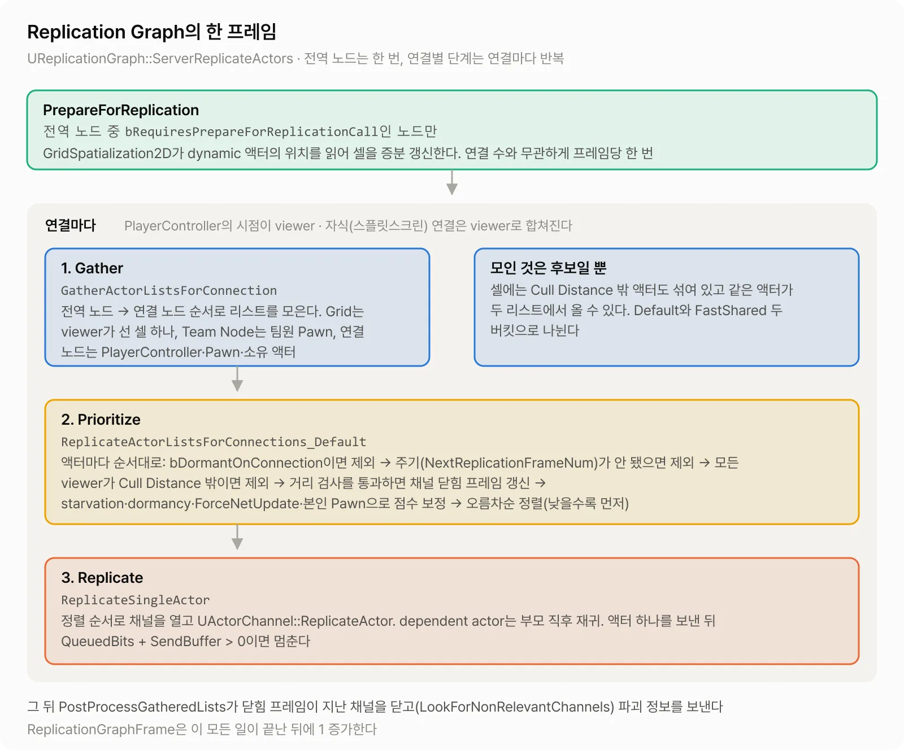

그래프를 "거리 기반에서 그리드 기반으로 relevancy 제어를 바꾸고, 노드별 조건을 매 틱 오브젝트마다 검사하는 것"으로 이해하기 쉽다. 소스를 보면 두 가지가 다르다. 그리드는 거리 검사를 대체하지 않는다. 그리드 노드는 플레이어가 있는 셀의 리스트를 돌려줄 뿐이고, 셀에는 컬 반경이 셀과 겹치는 모든 액터가 들어 있으므로 반경 밖 액터도 섞여 있다. 실제 거리 검사는 2단계에서 연결별 `CullDistanceSquared`로 따로 한다. 라이브스트림의 표현으로는 그리드가 broad phase, 거리 검사가 narrow phase다. 그리고 노드는 매 틱 조건을 검사하지 않는다. 노드의 역할은 조건을 한 번 평가해 리스트에 넣어 두고 바뀔 때만 옮기는 것이며, 매 틱 돌아가는 per-actor 검사는 2단계에 모여 있다.

그래프가 줄이는 것은 서버 CPU이고 송신량이 아니다. 어떤 액터를 어느 연결에 보낼지가 같다면 보내는 바이트도 같다. 다만 그래프 쪽에는 레거시에 없는 두 가지 송신 측 도구가 있다. 빈도 버킷과 거리별 주기로 "언제 보낼지"를 조절하는 노드, 그리고 이동 상태를 한 번 직렬화해 모든 연결에 재사용하는 Fast Shared 경로다. Fast Shared는 클래스 설정의 `FastSharedReplicationFunc`에 등록한 함수가 쏘는 unreliable multicast를 공유 번치에 한 번 직렬화해 채널이 열린 모든 연결에 보내는 경로이고, Lyra의 `ALyraCharacter::UpdateSharedReplication`처럼 액터 쪽 코드가 필요하다. 측정에 쓴 그래프는 이 경로를 켜지 않았다. 랩 액터에는 이동 상태가 없고, 효과가 "플레이어 폰 수 × 연결 수"에서 나오므로 클라이언트 16개로는 보여 줄 폭이 작기 때문이다.

## 세 층의 상태

그래프는 상태를 세 층으로 나눠 가진다(`Public/ReplicationGraphTypes.h`). 이 층의 복사 시점이 뒤에 나오는 함정 대부분의 원인이다.

| 층 | 구조체 | 만들어지는 때 | 주요 필드 |
| --- | --- | --- | --- |
| 클래스 | `FClassReplicationInfo` | 그래프 초기화의 `InitGlobalActorClassSettings`, 미등록 클래스는 첫 조회 때 lazy init | `CullDistanceSquared`, `ReplicationPeriodFrame`, `DistancePriorityScale`, `ActorChannelFrameTimeout` |
| 액터 | `FGlobalActorReplicationInfo` | `AddNetworkActor`에서 클래스 정보를 복사해 생성 | `WorldLocation`, `bWantsToBeDormant`, `ForceNetUpdateFrame`, `Settings`(클래스 정보 사본), `DependentActorList` |
| 연결×액터 | `FConnectionReplicationActorInfo` | 그 연결이 그 액터를 처음 만질 때 `FindOrAdd`로 생성 | `Channel`, `CullDistanceSquared`, `ReplicationPeriodFrame`, `NextReplicationFrameNum`, `LastRepFrameNum`, `bDormantOnConnection`, `bForceCullDistanceToZero` |

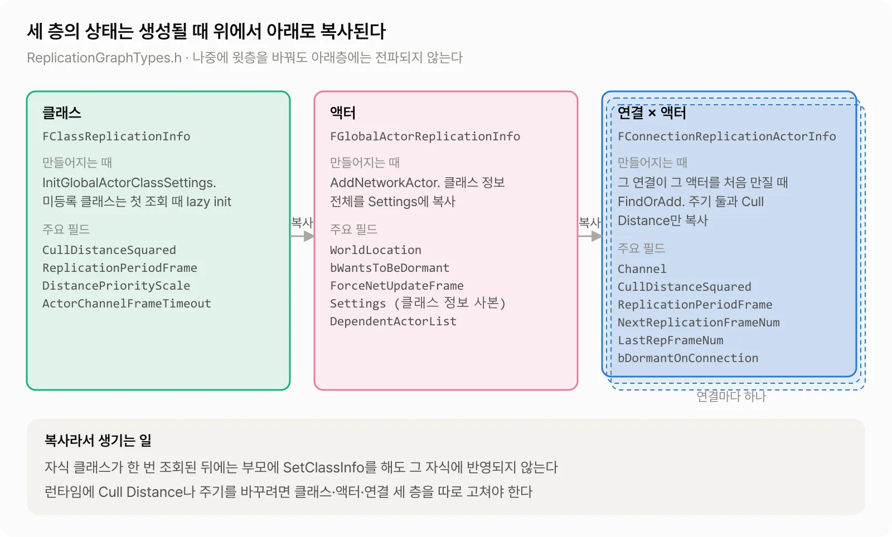

세 층은 위에서 아래로 복사된다. 액터 정보는 생성될 때 클래스 정보를 `Settings`에 복사하고, 연결×액터 정보는 생성될 때 액터 정보에서 `ReplicationPeriodFrame`, `FastPath_ReplicationPeriodFrame`, 컬 거리 세 개만 복사한다. 복사이므로 나중에 윗층을 바꿔도 아래층에는 전파되지 않는다. 그래서 두 가지 일이 생긴다.

- 클래스 정보 조회는 `TClassMap::Get`이 부모 클래스를 거슬러 올라가 찾은 값을 요청한 클래스 이름으로 복사해 캐시한다. 자식 클래스가 한 번이라도 조회된 뒤에 부모 클래스에 `SetClassInfo`를 해도 그 자식에는 반영되지 않는다.
- 런타임에 컬 거리를 바꾸려면 클래스, 액터, 모든 연결의 정보를 따로 고쳐야 한다. 엔진의 `SetAllCullDistanceSettingsForActor`와 디버그 명령 `Net.RepGraph.SetClassCullDistance`가 세 층을 각각 쓰는 이유다.

액터 정보의 `WorldLocation`은 액터가 추가될 때와 그리드 노드의 `PrepareForReplication`에서 갱신된다. 거리 검사와 셀 계산은 모두 이 캐시 값을 쓰며, 라이브스트림에서 `GetActorLocation` 중복 호출을 없앴다고 말한 것이 이 캐시다.

## 그래프가 만들어지는 때와 켜는 법

그래프는 서버가 월드를 listen할 때 만들어진다. `UEngine::LoadMap`은 `UWorld::Listen`을 `InitializeActorsForPlay`와 `BeginPlay`보다 먼저 호출하고, `Listen`이 만든 `UNetDriver`의 `InitBase`가 클라이언트가 아니고 Iris를 쓰지 않을 때 `UReplicationDriver::CreateReplicationDriver`를 호출한다. 그래서 `InitGlobalActorClassSettings`는 게임플레이 액터가 하나도 없을 때 돌고, 클래스 설정은 CDO에서 읽을 수밖에 없다. 레벨의 액터는 `OnActorsInitialized` 델리게이트로 미뤄진 `InitializeForWorld`가 등록한다.

드라이버를 지정하는 방법은 둘이다.

```ini
; DefaultEngine.ini
[/Script/OnlineSubsystemUtils.IpNetDriver]
ReplicationDriverClassName="/Script/MyGame.MyReplicationGraph"
```

```cpp
// 어디든 NetDriver가 만들어지기 전, 예를 들어 UGameInstanceSubsystem::Initialize
UReplicationDriver::CreateReplicationDriverDelegate().BindLambda(
	[](UNetDriver* ForNetDriver, const FURL& URL, UWorld* World) -> UReplicationDriver*
	{
		if (!World || !ForNetDriver || ForNetDriver->NetDriverName != NAME_GameNetDriver)
		{
			return nullptr;
		}
		return NewObject<UMyReplicationGraph>(GetTransientPackage());
	});
```

델리게이트가 바인딩돼 있으면 ini보다 우선하고, `nullptr`를 돌려주면 기본 드라이버로 간다. 맵이나 게임 모드별로 그래프를 고르거나 커맨드라인으로 켜고 끌 때 쓴다. 두 방법 모두 `NAME_GameNetDriver`인지 확인해야 한다. 데모(리플레이) 드라이버와 빔 드라이버도 같은 델리게이트를 부른다.

켜졌는지는 서버 로그 한 줄로 확인한다. 기본 드라이버는 `Generic`으로 나온다.

```
LogNet: InitBase GameNetDriver (NetDriverDefinition GameNetDriver) using replication model OpenWorldReplicationGraph
```

`Net.RepDriver.Enable 0`이나 커맨드라인 `-RepDriverDisable`로 그래프를 두고도 끌 수 있다. 문제가 그래프 때문인지 가릴 때 가장 먼저 할 일이다. Iris와는 양립하지 않는다. `SetReplicationDriver`는 NetDriver가 Iris를 쓰도록 설정돼 있으면 `checkf`로 멈추고, 5.5부터는 핸드셰이크에서 상대가 Iris를 쓰면 드라이버를 내려놓는다. 플러그인은 `EnabledByDefault: false`, `IsBetaVersion: true`로 선언돼 있다.

## 노드

노드는 `UReplicationGraphNode`를 상속하고 네 가지 일을 한다(`Public/ReplicationGraph.h`). 액터가 들어오고 나갈 때 `NotifyAddNetworkActor`와 `NotifyRemoveNetworkActor`를 받고, 연결마다 `GatherActorListsForConnection`으로 리스트를 돌려주며, 생성자에서 `bRequiresPrepareForReplicationCall`을 켠 노드는 프레임 시작에 `PrepareForReplication`을 한 번 받는다. 5.8.3에서 이 플래그를 켜는 엔진 노드는 `GridSpatialization2D`와 `AlwaysRelevant` 둘뿐이다.

노드는 전역(`AddGlobalGraphNode`), 연결별(`AddConnectionGraphNode`에 연결 하나), 공유(같은 노드를 여러 연결에 `AddConnectionGraphNode`) 세 가지로 붙일 수 있다. 공유 노드는 전역 노드 목록에 없으므로 `PrepareForReplication`을 받으려면 그래프가 직접 `PrepareForReplicationNodes`에 넣어야 한다. 뒤에서 만드는 팀 노드가 이 경우다.

### ActorList와 스트리밍 레벨

`UReplicationGraphNode_ActorList`는 가장 단순한 노드다. 영속 레벨 액터는 `ReplicationActorList`에, 스트리밍 레벨 액터는 레벨 이름별 리스트를 모은 `StreamingLevelCollection`에 들어간다. 스트리밍 레벨 리스트는 gather 때 연결이 그 레벨을 보고 있다고 보고한 경우에만 반환된다. 레거시의 "액터마다 레벨 가시성 조회"를 리스트 단위 검사 한 번으로 바꾼 구조다.

### GridSpatialization2D

거리 기반 relevancy를 맡는 노드다. 설정은 `CellSize`, `SpatialBias`, `ConnectionMaxZ` 셋이고 모두 생성자에서 0 또는 월드 최대로 초기화되므로 프로젝트가 채워야 한다. 그리드는 `SpatialBias`를 원점으로 +X, +Y 방향으로만 자라는 2차원 배열이다.

액터는 세 경로로 들어온다.

| 경로 | 셀에 들어가는 때 | 위치 갱신 | 언제 쓰는가 |
| --- | --- | --- | --- |
| `AddActor_Static` | 추가 시 한 번 | 없음 | 스폰 뒤 안 움직이는 액터 |
| `AddActor_Dynamic` | 매 프레임 `PrepareForReplication`에서 | 매 프레임 `GetActorLocation` | 움직이는 액터 |
| `AddActor_Dormancy` | `bWantsToBeDormant`면 static, 아니면 dynamic으로 넣고 dormancy 변경 이벤트를 구독 | dormant일 때 없음 | 잠들 때는 안 움직이고 깨면 움직이는 액터 |

액터가 들어가는 셀은 하나가 아니다. `GetCellInfoForActor`는 위치를 중심으로 컬 거리만큼의 정사각형을 만들어 그 사각형이 겹치는 모든 셀에 넣는다. 컬 거리 150 m에 셀 100 m면 한 액터가 3×3 또는 4×4 셀에 들어간다. 대신 gather는 viewer가 서 있는 셀 하나만 본다. 이웃 셀을 찾아다니는 대신 액터 쪽이 미리 퍼져 있는 구조다. 여기에 쓰이는 컬 거리는 연결별 값이 아니라 액터 정보의 `Settings.GetCullDistance()`다.

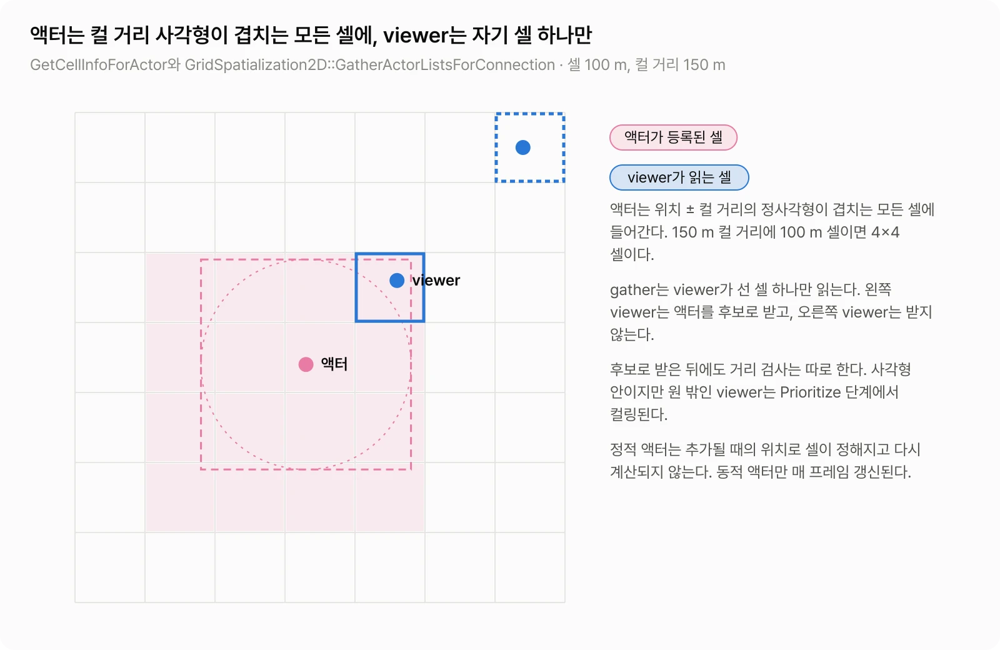

`SpatialBias`보다 작은 좌표에 액터가 나타나면 그리드를 다시 만든다. 재구축은 모든 셀 노드를 `TearDown`하고 정적·동적 액터를 전부 다시 넣는 작업이며, 셀을 100개 이상 파괴했으면 GC까지 강제한다. 발사체가 맵 밖으로 날아갈 때마다 이 일이 벌어지지 않게 하는 것이 `AddToClassRebuildDenyList`다. 목록에 있는 클래스는 그리드 가장자리 셀로 클램프된다. Lyra는 `AActor` 자체를 목록에 넣어 재구축을 통째로 끄고, `UBasicReplicationGraph`는 bias를 `-UE_OLD_WORLD_MAX`로 두어 재구축이 일어날 수 없게 한다.

동적 액터의 셀 갱신은 증분이다. `PrepareForReplication`은 액터마다 `GetActorLocation`을 읽어 새 셀 범위를 계산하고, 이전 범위와 겹치면 잃은 열과 행에서만 빼고 얻은 열과 행에만 넣는다. 정적 액터는 이 갱신을 받지 않는다. 추가될 때의 위치를 한 번 저장하고 제거할 때도 그 저장값으로 셀을 찾는다. 정적으로 넣은 액터를 게임 코드가 옮기면 그래프는 옛 셀에 둔 채로 두며, 뒤의 재현에서 다루는 "옮긴 static 액터가 보이지 않는" 현상의 원인이다. 컬 거리를 런타임에 바꿀 때도 `NotifyActorCullDistChange`를 불러야 정적 액터가 새 거리로 다시 들어간다.

### GridCell의 세 자식

셀 노드 `UReplicationGraphNode_GridCell`은 `ActorList`를 상속하므로 자기 리스트가 곧 정적 리스트다. 동적 액터는 자식 노드로 가고, 기본 자식은 `ActorListFrequencyBuckets`이며 `CreateDynamicNodeOverride`로 바꿀 수 있다. Dormant 액터는 또 다른 자식 `DormancyNode`로 간다.

```
GridSpatialization2D
└── GridCell (셀마다)
    ├── 정적 리스트 (자기 ReplicationActorList)
    ├── DynamicNode: ActorListFrequencyBuckets 또는 DynamicSpatialFrequency
    └── DormancyNode
        └── ConnectionDormancyNode (연결마다, 마스터 리스트의 사본)
```

정적 액터가 잠들면 셀이 자기 리스트에서 빼서 dormancy 노드로 옮기고, 깨면 다시 정적 리스트로 돌려보낸다. `AddActor_Dormancy`로 들어온 액터는 깨어나면 동적 액터가 되어 매 프레임 위치가 갱신되고, `AddActor_Static`으로 들어온 액터는 깨어나도 원래 셀에 그대로 있다.

### DormancyNode와 연결별 사본

Dormancy 노드의 핵심은 연결마다 리스트 사본을 둔다는 것이다. 연결이 처음 셀을 gather하면 마스터 리스트를 통째로 복사한 `ConnectionDormancyNode`를 만들고, 이 사본은 gather 때마다 `bDormantOnConnection`인 액터를 빼며 줄어든다. 즉 연결별 사본은 "이 연결이 아직 한 번도 받지 못한 dormant 액터" 목록이고, 다 받고 나면 빈 리스트가 된다. 액터가 flush되면 `DormancyFlush` 이벤트로 모든 연결 사본에 다시 들어간다.

여기에 trickle이 있다. 사본이 10번 gather된 뒤부터는 새로 잠든 액터가 없는 프레임마다 남은 액터 하나의 연결별 컬 거리를 0으로 강제한다(`bForceCullDistanceToZero`, `Net.RepGraph.TrickleDistCullOnDormancyNodes`). 컬 거리 밖에 있어서 영영 리플리케이션되지 못하는 dormant 액터를 프레임에 하나씩 억지로 보내 사본을 비우려는 장치다. 연결 노드의 첫 gather가 비싸다는 헤더 주석은 이 구조에서 나온다. 셀에 dormant 액터가 많으면 새 연결마다 그만큼 복사하고 하나씩 검사한다.

사본은 저절로 사라지지 않는다. 연결이 끊겨도 셀의 dormancy 노드는 그 연결의 사본을 가지고 있다. `Net.RepGraph.DormancyNodeObsoleteBehavior`를 1로 두고 `SetNumFramesUntilObsolete`를 설정해야 오래 gather되지 않은 사본을 지운다. 기본값이 0인 이유는 add/remove 반복 비용이다. 뒤의 재현에서 노드 수를 센다.

Dormant 액터가 뷰에서 벗어났을 때 클라이언트에서 파괴하는 기능도 이 노드에 걸려 있다. `bDestroyDormantDynamicActors`는 기본 `true`이지만 `Net.RepGraph.DormantDynamicActorsDestruction`이 0이라 아무것도 하지 않는다. 둘 다 켜면 연결이 `Net.RepGraph.DormantCellsTTLDefault` 프레임 동안 보지 않은 셀의 dormant 액터에 파괴 정보를 보내고, 연결이 돌아오면 처음부터 다시 리플리케이션한다. 루트가 수천 개인 맵에서 클라이언트 메모리를 아끼는 대가로 재진입 시 초기 리플리케이션을 다시 치르는 거래다.

### ActorListFrequencyBuckets

동적 액터의 기본 자식 노드다. 액터를 `NumBuckets`개 버킷에 가장 적은 쪽부터 나눠 넣고, gather 때 `ReplicationFrameNum % NumBuckets`번 버킷만 돌려준다. 버킷 3개면 각 액터는 세 프레임에 한 번만 후보가 된다. `ReplicationPeriodFrame`은 그 위에 따로 적용되므로 실제 주기는 둘 중 긴 쪽이다. `BucketThresholds`에 액터 수별 버킷 수를 주면 셀의 액터 수에 따라 버킷 수가 자동으로 바뀌는데 기본값은 비어 있어 고정이다. `EnableFastPath`를 켜면 차례가 아닌 버킷을 Fast Shared 플래그로 돌려줘서 이동 상태만 매 프레임 보낼 수 있다.

### UBasicReplicationGraph가 전부 dormancy로 넣는 이유

플러그인의 Basic 그래프는 `bAlwaysRelevant`면 `ActorList`, `bOnlyRelevantToOwner`면 연결별 노드, 나머지는 전부 `AddActor_Dormancy`다. 주석이 이유를 말한다.

```cpp
// Private/BasicReplicationGraph.cpp, UBasicReplicationGraph::RouteAddNetworkActorToNodes
// Note that UReplicationGraphNode_GridSpatialization2D has 3 methods for adding actor based on the mobility of the actor. Since AActor lacks this information, we will
// add all spatialized actors as dormant actors: meaning they will be treated as possibly dynamic (moving) when not dorming, and as static (not moving) when dormant.
GridNode->AddActor_Dormancy(ActorInfo, GlobalInfo);
```

그래프가 트랜스폼의 static 여부로 정적·동적을 자동 판별한다고 생각하기 쉽지만, 엔진에는 그런 판별이 없다. `AActor`에는 "움직이는가"를 알 길이 없으므로 Basic은 "깨어 있으면 움직일 수 있다"는 보수적 가정으로 모두 dormancy 경로에 넣는다. 안 움직이는 소품 수천 개를 깨운 채로 두면 Basic은 그만큼의 `PrepareForReplication` 비용을 낸다. 정적·동적을 가르는 것은 프로젝트의 클래스 라우팅 테이블이고, 그것이 커스텀 그래프를 쓰는 첫 번째 이유다. Basic의 또 다른 제약은 owner 전용 액터다. 스폰 시점에 연결이 없으면 `ActorsWithoutNetConnection`에 넣고 매 프레임 연결이 생겼는지 확인하며, 소유자가 바뀌는 경우는 지원하지 않는다.

## 우선순위는 어떻게 계산되는가

gather가 끝나면 `ReplicateActorListsForConnections_Default`가 Default 플래그의 리스트를 모두 순회해 `FPrioritizedRepList`를 만든다(`Private/ReplicationGraph.cpp`). 액터마다 검사 순서는 다음과 같다.

1. 연결 정보 `FindOrAdd`. 없으면 여기서 만들어진다.
2. `bDormantOnConnection`이면 건너뛴다. 주석대로 "항상 첫 번째이자 가장 빠른 검사"여야 해서 전역 정보 조회보다 앞에 있다. Dormant 액터의 프레임당 비용은 맵 조회 하나다.
3. `ReadyForNextReplication`: `NextReplicationFrameNum <= FrameNum`이거나 `ForceNetUpdateFrame > LastRepFrameNum`이어야 한다.
4. 거리 컬링. `DistancePriorityScale > 0`인 클래스만 대상이다. viewer마다 캐시된 `WorldLocation`까지의 거리 제곱을 재고, 모든 viewer가 연결별 컬 거리 밖일 때만 컬링된다. `bForceCullDistanceToZero`가 켜진 액터는 여기서 빠질 수 없다. `AInfo`와 `APlayerController`는 기본 클래스 설정이 `DistancePriorityScale = 0`이라 이 단계 자체를 거치지 않는다.
5. 점수 계산과 `UpdateActorChannelCloseFrameNum`. 채널 타임아웃은 리플리케이션이 아니라 거리 검사를 통과한 시점에 갱신된다.

점수는 낮을수록 먼저 리플리케이션된다. 정렬이 오름차순이고 중요도 보정이 모두 뺄셈이기 때문이다.

| 항목 | 계산 | 기본값에서의 범위 |
| --- | --- | --- |
| 기준 | `AccumulatedNetPriorityBias` | 0 |
| 거리 | `Clamp(최단 거리² / MaxDistanceScaling, 0, 1) × DistancePriorityScale` | 0~1. `MaxDistanceScaling`은 `60000²`, 즉 600 m |
| starvation | `1 - Clamp((FrameNum - LastRepFrameNum) × StarvationPriorityScale / MaxFramesSinceLastRep, 0, 1)` | 0~1. `MaxFramesSinceLastRep`는 20. 오래 못 받을수록 0에 가까움 |
| 잠들려는 액터 | `bWantsToBeDormant`이고 한 번 이상 리플리케이션됐으면 | −1.5 |
| `ForceNetUpdate` | `ForceNetUpdateFrame > LastRepFrameNum` | −1 |
| 본인 viewer·ViewTarget | `Net.ForceConnectionViewerPriority`(기본 1)면 | −MAX_FLT, 아니면 −10 |

`AccumulatedNetPriorityBias`가 클수록 덜 중요해진다는 뜻이다. 이름만 보고 양수를 넣으면 반대로 동작한다. 잠들려는 액터에 −1.5를 주는 이유는 주석에 있다. dormancy는 마지막 리플리케이션이 ack돼야 완료되므로, 새로 스폰된 액터들이 잠들려는 액터를 계속 밀어내면 영영 잠들지 못한다. 정렬은 `TArray::Sort`, 즉 introsort라 같은 점수의 액터는 프레임마다 순서가 바뀔 수 있다. Epic이 포럼에서 "우선순위는 고려 순서만 바꾸며 액터 간 순서는 보장되지 않는다"고 답한 것과 맞는다.

정렬된 리스트는 `ReplicateActorsForConnection`이 앞에서부터 `ReplicateSingleActor`로 보낸다. 같은 프레임에 두 리스트에서 돌아온 액터는 `LastRepFrameNum == FrameNum`으로 두 번째에 건너뛴다. 포화 검사는 액터 하나를 보낸 뒤에 `QueuedBits + SendBuffer.GetNumBits() <= 0` 하나로 한다. 포화되면 남은 액터에 대해 아무것도 하지 않는다. 레거시 드라이버가 포화로 밀린 액터에 `ForceNetUpdate`를 걸어 주는 것과 달리, 다음 프레임에 starvation 항이 낮아져 앞으로 오는 것이 전부다.

## ReplicateSingleActor와 채널의 수명

`ReplicateSingleActor`는 액터 하나를 연결 하나에 보낸다. 순서가 중요하다.

1. 채널이 있는데 `Closing`이면 0을 돌려주고 끝. `LastRepFrameNum`을 갱신하기 전에 빠지므로 액터는 매 프레임 다시 점수를 받고 다시 여기서 빠진다.
2. `LastRepFrameNum = FrameNum`, `NextReplicationFrameNum = FrameNum + ReplicationPeriodFrame`. 채널에 들어가기 전에 쓰므로 0바이트를 보내도 주기는 소비된다.
3. `PreReplication`은 액터당 프레임당 한 번. 연결이 몇 개든 처음 리플리케이션하는 연결이 한 번 치른다.
4. 채널이 없으면 `CreateChannelByName(NAME_Actor)`와 `SetChannelActor`.
5. `bWantsToBeDormant`면 `StartBecomingDormant`. 리플리케이션할 때마다 다시 건다.
6. `UActorChannel::ReplicateActor`. `bTearOff`면 바로 `Close(TearOff)`.
7. dependent actor를 재귀적으로 리플리케이션한다. 자식이 `ReadyForNextReplication`일 때만 보내고, 자식의 바이트는 부모의 반환값에 더해진다.

채널은 프레임 수로 닫힌다. `UpdateActorChannelCloseFrameNum`은 `FrameNum + ReplicationPeriodFrame + ActorChannelFrameTimeout + GlobalActorChannelFrameNumTimeout`을 계산해 기존 값보다 크면 갱신한다. 기본값으로 주기 1, 타임아웃 4, 전역 여유 2이므로 마지막으로 gather되고 7프레임 뒤에 닫힌다. `LookForNonRelevantChannels`가 매 프레임 연결의 채널 맵을 돌며 지난 채널을 `Close(Relevancy)`한다. 레거시의 `RelevantTimeout`이 초 단위인 것과 달리 전부 프레임 단위다. `ActorChannelFrameTimeout`이 0이면 그래프는 relevancy로 채널을 닫지 않는다.

닫힌 채널의 처리에서 레거시와 그래프가 갈린다. `UActorChannel::Close`는 `Closing`을 세우고 `UNetConnection::RemoveActorChannel`로 엔진의 `ActorChannels` 맵에서 액터를 뺀다. 레거시 드라이버는 그 순간부터 그 액터에 채널이 없다고 보고 다음 틱에 새 채널을 열 수 있다. 그래프는 같은 시점에 호출되는 `NotifyActorChannelRemoved`가 비어 있고, ack가 와서 `CleanUp`될 때의 `NotifyActorChannelCleanedUp`에서야 연결 정보의 `Channel`을 비운다.

```cpp
// Private/ReplicationGraph.cpp, UNetReplicationGraphConnection::NotifyActorChannelRemoved
void UNetReplicationGraphConnection::NotifyActorChannelRemoved(AActor* Actor)
{
	// No need to do anything here. This is called when an actor channel is closed, but
	// we're still waiting for the close bunch to be acked. Until then, we can't safely replicate
	// the actor from this channel. See NotifyActorChannelCleanedUp.
}
```

close와 ack 사이의 창에서 그래프는 액터를 리플리케이션하지 않고(1번), FastShared에서도 건너뛰며, multicast RPC 경로도 `Closing` 채널을 "채널 없음"으로 보지만 새로 열지도 않는다. 이 창이 "dormant로 보낸 직후의 reliable RPC가 유실되는" UE-378758의 자리이고, 재현 절에서 `PktLag`로 창을 늘려 확인한다.

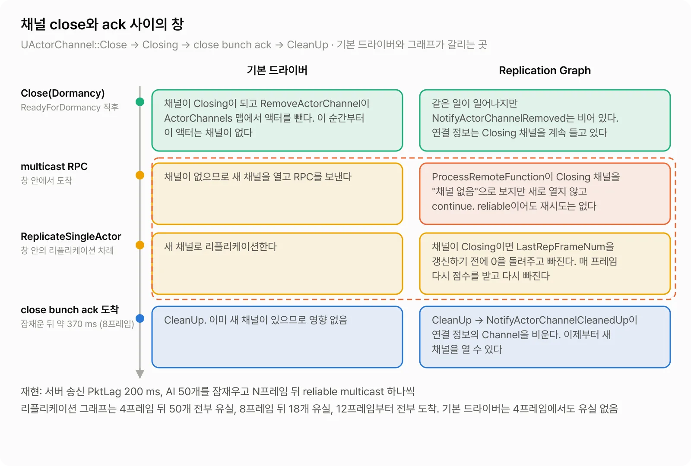

## Dormancy, dependent actor, RPC

### Dormancy 흐름

그래프는 dormancy 상태를 bool 하나로 본다. `bWantsToBeDormant = NetDormancy > DORM_Awake`이며 `DORM_DormantPartial`은 플러그인 안에 참조가 없어 `DORM_DormantAll`과 같다.

`SetNetDormancy`는 `UNetDriver::NotifyActorDormancyChange`를 거쳐 그래프로 온다. 그래프는 `bWantsToBeDormant`를 갱신하고 액터 정보의 `DormancyChange` 이벤트를 쏜다. 이 이벤트를 받는 곳이 앞서 본 그리드와 셀이다. 깨어나는 방향이면 모든 연결의 `bDormantOnConnection`도 여기서 지운다. `FlushNetDormancy`는 잠든 액터를 한 번 보내는 요청이다. 그래프는 `DormancyFlush` 이벤트로 dormancy 노드가 연결별 사본에 액터를 다시 넣게 하고, 모든 연결의 `bDormantOnConnection`을 지운다. `ForceNetUpdate`는 잠든 액터에 대해 `FlushNetDormancy`를 함께 부른다(`Engine/Private/Actor.cpp`).

액터가 실제로 연결에서 잠드는 것은 채널 쪽 일이다. `ReplicateSingleActor`가 `StartBecomingDormant`를 걸면 채널은 틱마다 `ReadyForDormancy`를 검사한다. 모든 replicator가 보낸 변경을 ack받고 NAK가 없어야 하며, `DormancyHysteresis`가 있으면 그만큼 더 기다린다. 그 뒤 `BecomeDormant`가 `Close(Dormancy)`를 하고, `UNetDriver::NotifyActorFullyDormantForConnection`이 그래프의 연결 정보에 `bDormantOnConnection = true`를 쓴다. 이 순간부터 우선순위 2번 검사에서 빠진다.

맵에 배치된 `DORM_Initial` 액터는 그래프에 아예 들어가지 않는다. `IsActorValidForReplicationGather`가 startup 액터의 `DORM_Initial`을 거부하고, 첫 `FlushNetDormancy`에서 `DORM_DormantAll`로 바뀌며 그때 `AddNetworkActor`된다. 스폰된 액터의 `DORM_Initial`은 거부되지 않고 `bWantsToBeDormant`로 들어가 첫 리플리케이션 뒤에 잠든다.

### Dependent actor

차량의 무기, 폰의 인벤토리처럼 부모가 리플리케이션될 때만 함께 리플리케이션되면 되는 액터는 노드에 넣지 않고 `GlobalActorReplicationInfoMap.AddDependentActor(Parent, Child)`로 등록한다. 자식은 `ReplicateSingleActor` 안에서 부모 직후에 재귀 리플리케이션되고, 채널 닫힘 프레임을 부모 이상으로 받으며, 자신의 `ReplicationPeriodFrame`은 지킨다. 5.2에서 `GetDependentActorList`는 deprecated되어 빈 목록을 돌려주므로 4.x 코드를 옮길 때 주의한다. 보장되는 것은 "부모와 같은 프레임에 고려된다"까지다. 포화되면 자식도 밀리고, 같은 패킷에 들어간다는 보장도 없다.

### multicast RPC가 채널을 연다

그래프가 있으면 `UNetDriver::ProcessRemoteFunction`은 그래프의 `ProcessRemoteFunction`에 넘기고, 그래프는 항상 true를 돌려준다. 레거시 RPC 경로는 돌지 않는다.

multicast는 연결마다 돈다. 연결에 채널이 없고 클래스가 `RPC_Multicast_OpenChannelForClass`에서 true이면, 컬 거리가 0이거나 viewer 중 하나가 컬 거리 안에 있을 때 채널을 새로 연다. 그리고 닫힘 프레임을 다음 프레임으로 잡고, 그 연결에서 dormant였다면 끝에 `FlushNetDormancy`를 한다. 즉 잠들어 있거나 아직 gather된 적 없는 액터에 multicast를 보내면 채널이 열리고 전체 리플리케이션이 따라온다. 기본값은 `AActor`가 true, `AController`가 false다. 컨트롤러는 비소유자에게 채널이 열리면 리플리케이션이 깨지기 때문이다.

여기에 5.8.3에 남아 있는 구멍이 있다. 소유자 RPC 경로는 채널을 열기 전에 `NetDriver->IsLevelInitializedForActor`를 확인하지만 multicast 경로는 확인하지 않는다. 클라이언트가 seamless travel을 끝내기 전에 서버가 영속 레벨 액터(GameState 등)에 reliable multicast를 보내면 전환 레벨의 클라이언트에 채널이 열리고, 클라이언트는 도착 후 그 액터를 파괴해 버린다. 포럼에서 Epic이 알려진 문제(UE-361443)로 확인했고 2026년 7월 기준 미수정이다. 랩에 travel 시나리오가 없어 소스 확인까지만 했다. 우회책은 `ProcessRemoteFunction`을 오버라이드해 multicast에서도 같은 검사를 넣는 것이다.

또 하나, multicast 루프 안에서 `IsClosingOrClosed()`인 연결을 만나면 `continue`가 아니라 `return true`다. 그 뒤의 연결은 그 RPC를 받지 못한다. `Connections` 배열 순서에 따라 재현 여부가 달라지는 종류의 문제라 직접 확인하지는 않았다.

## 수치 하나하나의 의미

그래프를 처음 설정할 때 막히는 것은 노드 구조가 아니라 숫자다. 셀 크기, 버킷 수, 갱신 주기, 우선순위 스케일, 채널 타임아웃이 각각 무엇을 바꾸는지 소스에서 확인하고, 측정에 쓴 OpenWorld 그래프로 하나씩 바꿔 가며 쟀다. 조건은 Uniform 분포, 액터 5,000개, 클라이언트 2개이고 기준값은 셀 100 m, 버킷 3개, `NetUpdateFrequency` 100, `DistancePriorityScale` 1, `StarvationPriorityScale` 1, `ActorChannelFrameTimeout` 4다. 각 3회 평균이고 단위는 프레임당 `ServerReplicateActors` ms, 호출은 연결당 `ReplicateActor` 횟수, 검토는 `Prioritize_InnerLoop`가 프레임에 본 항목 수다.

| 설정 | 값 | ms | 호출 | 채널 | 검토 |
| --- | --- | --- | --- | --- | --- |
| 기준 | | 0.35 | 21 | 76 | 79 |
| `CellSize` | 25 m | 0.38 | 23 | 80 | 65 |
| | 400 m | 0.40 | 23 | 80 | 181 |
| 버킷 수 | 1 | 0.42 | 33 | 78 | 146 |
| | 6 | 0.34 | 20 | 80 | 68 |
| `NetUpdateFrequency` | 10 | 0.32 | 14 | 74 | 80 |
| | 2 | 0.28 | 8 | 74 | 80 |
| `DynamicSpatialFrequency` | 버킷 대신 | 0.40 | 16 | 76 | 48 |
| `DistancePriorityScale` | 0 | 0.41 | 34 | 153 | 71 |
| `StarvationPriorityScale` | 0 | 0.34 | 21 | 76 | 79 |
| `ActorChannelFrameTimeout` | 0 | 0.35 | 21 | 212 | 79 |

**`CellSize`.** 셀이 작으면 액터 하나가 더 많은 셀에 등록되고(컬 거리 150 m에 25 m 셀이면 12×12 셀) 동적 액터의 셀 갱신이 잦아진다. 셀이 크면 viewer 셀에 컬 거리 밖 액터가 많이 섞여 우선순위 단계의 검토 항목이 는다. 400 m 셀에서 검토 항목이 181개로 두 배가 됐지만 비용은 0.04 ms 차이다. 이 밀도에서는 셀 크기가 성능을 거의 바꾸지 않는다. 라이브스트림과 Lyra의 기본값처럼 컬 거리와 같은 자릿수로 두고, `NET_PrepareReplication`과 검토 항목 수를 보며 조정하면 된다.

**버킷 수.** 동적 액터의 리플리케이션 주기 하한이 버킷 수 프레임이 된다. 버킷 1개는 매 프레임이라 호출이 33회로 늘고 검토 항목도 146개로 는다. Uniform에서는 viewer 근처의 동적 액터가 적어 0.07 ms 차이지만, Cluster에서는 측정 절에서 보듯 4.48 ms와 9.89 ms를 가른다. 버킷은 "사거리 안의 움직이는 액터 수"에 비례해 효과가 나는 설정이고, 그 수가 많은 게임에서 가장 먼저 만질 값이다. 서버 30 Hz에 버킷 3개면 동적 액터가 10 Hz로 가는 것이므로 이동 보간이 그 주기를 감당하는지 클라이언트 쪽에서 확인해야 한다.

**`NetUpdateFrequency`.** 그래프는 클래스 초기화 때 CDO의 값으로 `RoundToInt(NetServerMaxTickRate / NetUpdateFrequency)`를 `ReplicationPeriodFrame`으로 바꾸고, 그 뒤로는 프레임 수로만 센다. 30 Hz 서버에서 100은 1프레임, 10은 3프레임, 2는 15프레임이다. 호출이 21, 14, 8회로 줄고 시간이 그에 비례한다. 레거시 드라이버와 달리 `MinNetUpdateFrequency`로 늘어나는 적응형 주기는 없고, 버킷과 겹치면 둘 중 긴 주기가 적용된다. 런타임에 `SetNetUpdateFrequency`를 불러도 그래프에는 반영되지 않고, 바꾸려면 `Net.RepGraph.SetPeriodFrame`처럼 세 층을 같이 고쳐야 한다.

**`DynamicSpatialFrequency`.** 거리와 시야 방향으로 주기를 정하는 노드다. `FSpatializationZone`마다 시선과의 내적 하한, 컬 거리 대비 거리 구간, 최소·최대 주기를 두고 선형 보간해 `ReplicationPeriodFrame`을 쓴다. 기본 존은 시야 안 10~50% 거리에서 5 Hz부터 1 Hz까지, 시야 밖과 등 뒤는 1 Hz이며 30 Hz 틱을 가정하므로 틱 레이트가 다르면 `Net.RepGraph.DyanmicSpatialization.Reinit`(오타가 실제 이름이다)로 다시 만든다. 리스트를 돌려주지 않고 gather 안에서 직접 리플리케이션하므로 우선순위 계산을 거치지 않고, `DistancePriorityScale`과 `StarvationPriorityScale`은 이 노드의 액터에 효과가 없다. 버킷 대신 이 노드로 바꾸면 호출은 16회로 줄지만 시간은 0.40 ms로 는다. 셀의 모든 동적 액터에 대해 거리와 내적을 계산하고 주기를 다시 쓰므로 우선순위 단계의 검토 항목은 48개로 줄고 대신 gather가 0.01 ms에서 0.07 ms가 된다. 동적 액터가 사거리 안에 수백 개 있을 때 보내는 양을 줄이려는 설정이지 CPU를 줄이는 설정이 아니다. 존 표를 적을 때는 엔진이 `DotP <= MinDotProduct`인 첫 존을 고른다는 점에 주의해야 한다. 헤더 주석은 "이상"이라고 적고 있지만 코드는 반대이며, 랩에서 실제로 걸려 넘어진 지점이다.

**`DistancePriorityScale`.** 이름은 우선순위 가중치지만 0으로 두면 거리 컬링 자체가 꺼진다. 우선순위 계산의 거리 검사가 `if (DistancePriorityScale > 0)` 블록 안에 있기 때문이다. 측정에서 채널이 76에서 153으로, 호출이 34회로 늘었다. viewer 셀에 들어 있지만 컬 거리 밖인 액터가 전부 리플리케이션된 것이다. 거리 우선순위를 끄고 싶으면 0이 아니라 아주 작은 양수를 줘야 한다. 엔진이 `AInfo`와 `APlayerController`에 0을 주는 것은 그 클래스들이 거리로 컬링되면 안 되기 때문이다.

**`StarvationPriorityScale`.** 오래 못 받은 액터를 앞으로 당기는 가중치다. 이 부하에서는 연결이 포화되지 않아 모든 후보가 매 프레임 보내지므로 0으로 둬도 아무것도 바뀌지 않는다. 포화돼서 뒤의 액터가 밀릴 때만 순서를 바꾸는 값이고, 그런 상황인지는 `Net.RepGraph.StarvedList`로 본다.

**`ActorChannelFrameTimeout`.** 마지막으로 gather된 뒤 몇 프레임 지나면 채널을 닫을지다. 0은 "바로 닫기"가 아니라 "닫지 않기"다. 측정에서 시간은 같았지만 채널이 212개로 늘었고 AI가 사거리를 드나드는 동안 계속 는다. 열린 채널은 서버와 클라이언트 양쪽의 메모리이고 클라이언트에는 그 액터가 남아 있다. 기본값 4에 전역 여유 2를 더해 보통 7프레임 뒤에 닫히며, 사거리 경계에서 액터가 들락날락해 채널이 자주 열리고 닫히면 이 값을 올리는 것이 맞다.

## 커스텀 그래프 만들기

첫 도입은 `UBasicReplicationGraph`로 시작하는 것이 맞다. 플러그인을 켜고 `ReplicationDriverClassName="/Script/ReplicationGraph.BasicReplicationGraph"`만 적으면 되고, 문제가 그래프 때문인지 가리기 쉽다. 다만 Basic은 정적과 동적을 구분하지 못하고 owner 변경을 지원하지 않으며 PlayerState와 팀 같은 범주가 없다. 측정에 쓴 `UOpenWorldReplicationGraph`는 Lyra 5.8.3의 구조를 바탕으로 앞의 부하 모델 표를 구현한 것이다.

### 노드 구성

```
전역
  GridSpatialization2D        소품(static), 루트(dormancy), AI·탈것·발사체(dynamic)
  ActorList                   bAlwaysRelevant 액터
  PlayerStateFrequencyLimiter 프레임당 N개의 PlayerState
공유
  Team (팀마다 하나)           팀원의 폰. 같은 팀의 연결들이 공유
연결별
  AlwaysRelevant_ForConnection PC, 폰, ViewTarget, 본인 PlayerState, owner 전용 액터, 스트리밍 레벨의 always relevant 액터
  TearOff_ForConnection        기본 그래프가 생성
```

Lyra와 다른 점은 팀 노드와 owner 전용 라우팅이다. Lyra는 `bOnlyRelevantToOwner`를 `NotRouted`로 보내고 연결 노드가 PC에서 직접 찾게 하는데, 인벤토리처럼 PC에서 바로 닿지 않는 액터를 위해 Basic의 방식(연결 노드의 영속 리스트 + 연결 없을 때의 대기 목록)을 가져왔다.

### 클래스 라우팅 테이블

클래스를 노드에 대응시키는 enum(`NotRouted`, `RelevantAllConnections`, `RelevantOwnerConnection`, `Spatialize_Static`, `Spatialize_Dynamic`, `Spatialize_Dormancy`)을 두고, 레거시 플래그에서 기본값을 유도한 뒤 프로젝트 설정으로 덮어쓴다. 유도 규칙은 Lyra를 따랐다. 부모 클래스와 플래그가 같으면 부모의 매핑을 쓰고, `bAlwaysRelevant`면 전역, `bOnlyRelevantToOwner`면 owner 연결, 나머지 리플리케이션 액터는 `Spatialize_Dynamic`이다. 동적이 기본값인 이유는 그것이 항상 맞는 쪽이기 때문이다. 정적으로 잘못 넣으면 움직이는 액터가 보이지 않고, 동적으로 넣으면 비용만 든다. 정적과 dormancy는 클래스를 알 때만 명시한다.

```ini
; DefaultGame.ini
[/Script/ThirdPerson.OpenWorldReplicationGraphSettings]
+ClassSettings=(ActorClass="/Script/ThirdPerson.RepGraphLabProp",ClassNodeMapping=Spatialize_Static)
+ClassSettings=(ActorClass="/Script/ThirdPerson.RepGraphLabLoot",ClassNodeMapping=Spatialize_Dormancy)
+ClassSettings=(ActorClass="/Script/ThirdPerson.RepGraphLabAI",ClassNodeMapping=Spatialize_Dynamic)
+ClassSettings=(ActorClass="/Script/ThirdPerson.RepGraphLabWeapon",ClassNodeMapping=NotRouted)
```

`InitGlobalActorClassSettings`에서 `TObjectIterator<UClass>`로 리플리케이션 액터 클래스를 전부 돌며 매핑과 `FClassReplicationInfo`를 등록한다. 이때 두 가지를 빠뜨리면 안 된다. 이름이 `SKEL_`, `REINST_`로 시작하는 Blueprint 컴파일 중간 클래스는 건너뛰어야 하고, `GlobalActorReplicationInfoMap.SetInitClassInfoFunc`로 lazy init을 걸어야 한다. 그래프는 `BeginPlay` 전에 초기화되므로 그 시점에 로드되지 않은 Blueprint 서브클래스는 순회에 나오지 않고, 처음 조회될 때 이 함수로 매핑과 설정을 받는다. 이것을 빠뜨리면 부모 클래스 값이 복사돼 동작은 하지만 그 서브클래스에 특별한 설정을 줄 길이 없어진다. `FClassReplicationInfo`는 CDO의 `NetCullDistanceSquared`와 `NetUpdateFrequency`에서 만들고, 캐릭터처럼 손으로 맞출 클래스는 `ExplicitlySetClasses`에 넣어 CDO 유도가 덮어쓰지 못하게 한다.

### 팀 노드와 컬 거리 0

팀원을 거리와 무관하게 보여 주는 노드는 리스트만 돌려줘서는 동작하지 않는다. 우선순위 단계의 거리 컬링이 리스트 출처를 가리지 않기 때문이다. 포럼에서 "팀원을 리스트에 직접 넣었는데도 거리 컬링된다"는 보고가 정확히 이것이다. 노드는 gather 때 그 연결의 액터 정보에 `bForceCullDistanceToZero`를 세우고, 팀에서 빠진 액터는 플래그를 풀어야 한다.

```cpp
// OpenWorldReplicationGraph.cpp, UOpenWorldReplicationGraphNode_Team::GatherActorListsForConnection
for (FActorRepListType Actor : TeamActorList)
{
	FConnectionReplicationActorInfo& Info = Params.ConnectionManager.ActorInfoMap.FindOrAdd(Actor);
	if (!Info.bForceCullDistanceToZero) { Info.bForceCullDistanceToZero = 1; Forced.Add(Actor); }
}
Params.OutGatheredReplicationLists.AddReplicationActorList(TeamActorList);
```

팀원의 폰은 그리드에도 있으므로 가까운 팀원은 두 리스트에서 돌아온다. 같은 프레임의 중복은 `LastRepFrameNum == FrameNum`으로 걸러지며, Lyra 헤더 주석은 중복을 허용하되 줄이라고 적고 있다. 팀 배정은 게임 코드의 서브시스템이 이벤트로 알리고 그래프가 구독한다. Lyra 헤더가 강조하는 원칙대로, 게임 코드가 그래프 헤더를 포함하는 일은 없어야 한다.

### 설정을 CVar로 노출하기

`CellSize`, `SpatialBias`, 버킷 수, PlayerState 수, `DistancePriorityScale` 같은 값은 `UDeveloperSettingsBackedByCVars`로 두고 같은 이름의 CVar를 등록해 두면 ini와 커맨드라인으로 바꿀 수 있다. 다만 그래프는 `BeginPlay` 전에 만들어지므로 게임 코드에서 CVar를 바꾸는 것도, 맵이 로드된 뒤 실행되는 `-ExecCmds`도 늦다. 처음에 `-ExecCmds`로 버킷 수를 1로 바꿨더니 결과가 그대로였고, 그래프 초기화 때 읽은 설정값을 전부 로그로 찍게 한 뒤에야 알았다. 엔진 초기화 중에 적용되는 `-dpcvars="OpenWorld.RepGraph.DynamicActorFrequencyBuckets=1"` 형식으로 줘야 한다. 앞의 수치 의미 절은 이 방식으로 조건을 바꿔 가며 쟀다.

### 실제로 걸려 넘어진 것

그래프와 무관한 사고를 빼면 두 가지가 남는다. 첫 번째는 액터를 `SetHidden(true)`로 둔 것이다. 레거시 `AActor::IsNetRelevantFor`는 숨겨져 있고 충돌이 없는 액터를 관련 없음으로 판정하므로 기본 드라이버 조건에서 액터가 하나도 리플리케이션되지 않았다. 그래프는 이 함수를 부르지 않아 그래프 조건은 멀쩡했다. "그래프를 끄면 정상인지" 비교하는 습관이 그래프 쪽 버그뿐 아니라 이런 차이도 드러낸다. 비슷한 종류로, 스크린샷용 탑다운 카메라로 뷰 타깃을 300 m 위로 올리자 그 클라이언트가 받는 액터가 5,000개에서 88개로 줄었다. 그래프의 viewer는 폰이 아니라 `GetPlayerViewPoint`가 돌려주는 카메라 위치이므로, 관전 카메라가 있는 게임이라면 viewer가 어디인지부터 확인해야 한다.

두 번째는 `DynamicSpatialFrequency`의 존 표다. 헤더의 `MinDotProduct` 주석("이 값 이상이어야 이 존")을 믿고 `{0.8 앞쪽}, {-1.0 나머지}` 순으로 적었더니, 정면에 있는 액터가 어느 존에도 들어가지 않았다. `CalcFrequencyForActor`는 `DotP <= MinDotProduct`인 첫 존을 고른다. 결과는 두 가지였다. 정면의 AI가 리플리케이션에서 빠졌고, 액터마다 프레임마다 "was not placed in any valid zone" 경고가 60초에 18,886줄 찍혀 그 로그 비용 1.1 ms가 측정값에 들어갔다. 처음에는 DSF 노드의 gather가 1.3 ms로 나와 DSF가 비싼 줄 알았다. Insights에서 `STAT_FMsgLogf`가 gather 안에 있는 것을 보고 알았다. 존은 오름차순으로 적고 마지막을 1.0으로 끝내야 한다.

## 테스트 프로젝트로 측정하기

### 실험 구성

측정 환경은 Push Model 포스트와 같은 ThirdPerson 템플릿 프로젝트에 랩 모듈을 더한 것이다. 맵은 4 km × 4 km의 평평한 바닥과 태양, 하늘, PlayerStart 하나만 있는 랩 전용 레벨이다. 에디터 바이너리를 `-server`로 띄운 데디케이티드 서버와 `-game -nullrhi -nosound`로 띄운 헤드리스 클라이언트를 한 PC(Ryzen 9 5950X, 64 GB)에서 돌리고, 서버는 첫 번째 CCD(논리 CPU 0~15), 클라이언트는 두 번째 CCD에 고정했다. 서버 틱은 30 Hz 상한이지만 실제 프레임은 약 46 ms이고 그중 44 ms가 idle이라, 비교는 프레임당 `ServerReplicateActors` 배타 시간으로 한다. 엔진은 `++UE5+Release-5.8-CL-58210709`다.

랩 서브시스템은 커맨드라인으로 조건을 받아 다음 순서로 돈다.

1. 클라이언트 N개가 붙으면 플레이어 폰을 배치하고 둘씩 같은 팀으로 묶는다. Uniform과 NearPlayers에서는 스쿼드 단위로 맵 곳곳에 흩고, Cluster에서는 PlayerStart에 모아 둔다. 플레이어마다 owner 전용 인벤토리 액터를 하나 스폰한다.
2. 랩 액터를 스폰한다. 기본 구성은 5,000개를 소품 60%, 루트 20%, AI 15%, 탈것 5%로 나누고, 탈것마다 dependent actor인 무기를 하나 더 붙인다. 전역 액터 3개가 추가된다. 모든 랩 액터는 Push Model 랩과 같은 16개의 리플리케이션 프로퍼티를 push 기반으로 등록한다.
3. 60초 warmup. 절반 지점에서 소품의 90%를 `DORM_DormantAll`로 보낸다. 루트는 처음부터 dormant다.
4. 60초 측정. CSV 프로파일러 캡처와 Insights 트레이스 리전을 연다. 측정 중 깨어 있는 액터의 1%가 초마다 프로퍼티 하나씩을 바꾸고, 루트의 0.1%가 초마다 flush 후 쓰기를 한다. AI는 초당 3 m로 직선 이동하며 영역 경계에서 튕긴다.

공간 분포는 세 가지다. 컬 거리는 모든 랩 클래스에서 150 m(`NetCullDistanceSquared` 기본값)다.

| 분포 | 액터 위치 | 플레이어 위치 | 뜻 |
| --- | --- | --- | --- |
| Uniform | 2 km × 2 km에 균일 | 스쿼드별로 흩어짐 | 게임 중반. 컬 반경 안에 액터의 약 2% |
| Cluster | PlayerStart 중심 컬 반경의 80% 안 | 모두 PlayerStart | 핫드롭. 모든 액터가 모든 연결에 관련 |
| NearPlayers | 플레이어마다 자기 주변 컬 반경의 80% 안 | 맵 곳곳에 흩어짐 | 중간 지점. 플레이어마다 자기 몫만 보이고, 2인이면 각자 절반 |

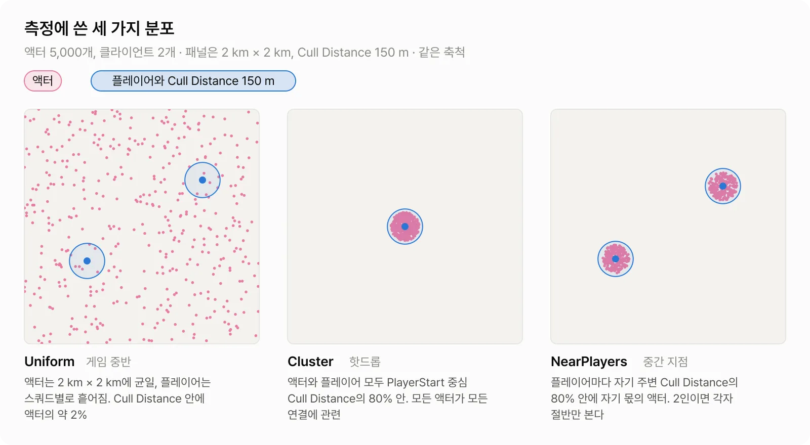

드라이버는 셋이다. 기본 드라이버(`Generic`), `UBasicReplicationGraph`, 앞 절의 `UOpenWorldReplicationGraph`. 주 비교 조건은 5회, 나머지는 3회 반복해 평균을 쓰고, 실행마다 프레임 시간이 흔들리므로 프레임당 ms와 함께 Insights의 호출 수(`Prioritize_InnerLoop`가 검토한 액터 수, `Replicate Actor Time`의 호출 수)를 같이 본다. 밀집 조건에는 갱신률을 맞춘 대조군 둘을 더했다. OpenWorld 그래프의 frequency bucket을 1개로 줄인 것과, 기본 드라이버의 `NetUpdateFrequency`를 10으로 낮춘 것이다.

측정 런의 클라이언트는 `-nullrhi`라 화면이 없다. 아래는 같은 조건을 렌더링하는 클라이언트 8개로 띄워 창마다 찍은 것이다. 노란 상자가 소품, 초록 구가 루트, 빨간 기둥이 AI, 파란 상자가 탈것, 그 위의 하늘색 원뿔이 dependent 무기다. 슬롯 1은 폰 80 m 위에서 내려다본 시점이고, 나머지는 3인칭이다.

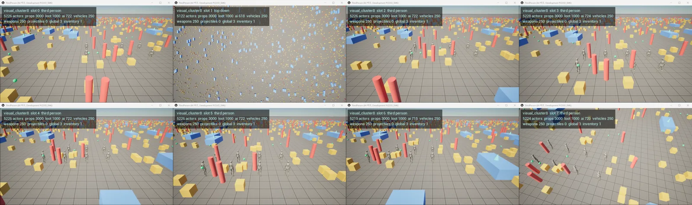

### 드라이버와 분포

측정 전에는 흩어진 조건에서는 그래프가 유리하고, 모든 액터가 모든 연결에 관련된 밀집 조건에서는 리플리케이션 비용이 같은 위에 노드 판별 비용이 얹혀 그래프가 오히려 손해일 거라고 예상했다.

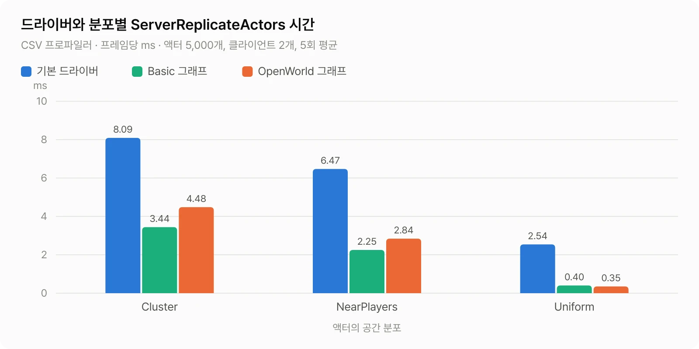

| 분포 | 기본 드라이버 | Basic 그래프 | OpenWorld 그래프 |
| --- | --- | --- | --- |
| Cluster | 8.09 ± 0.09 | 3.44 ± 0.03 | 4.48 ± 0.04 |
| NearPlayers | 6.47 ± 0.47 | 2.25 ± 0.02 | 2.84 ± 0.02 |
| Uniform | 2.54 ± 0.20 | 0.40 ± 0.01 | 0.35 ± 0.02 |

프레임당 `ServerReplicateActors` ms, 5회 평균과 표준편차다. 기본 드라이버의 NearPlayers와 Uniform은 런마다 서버 프레임 시간이 41~47 ms로 흔들려 편차가 ±8%이고, 나머지 조건은 ±2% 안이다. 아래의 단계별 분해는 Insights 트레이스가 있는 첫 번째 런 하나의 값이다.

흩어진 조건은 예측대로다. Uniform에서 그래프는 기본 드라이버의 7분의 1이다. 기본 드라이버의 2.8 ms를 분해하면 consider list 구성 1.7 ms, 두 연결의 우선순위 계산 0.9 ms이고, 실제 `ReplicateActor`는 프레임당 67회 호출에 0.2 ms다. 5,200개 중 연결당 31개만 보내는데 비용의 90% 이상이 보낼지 말지를 정하는 데 든다. OpenWorld 그래프는 같은 조건에서 `PrepareForReplication` 0.12 ms, gather와 우선순위 0.05 ms(검토 항목 71개), 리플리케이션 0.13 ms다. 그리드가 viewer 셀의 리스트만 돌려주므로 나머지 5,100개는 아예 검토 대상이 아니다.

밀집 조건은 예측과 다르다. 모든 액터가 모든 연결에 관련 있는 Cluster에서도 OpenWorld 그래프가 기본 드라이버의 55%, Basic이 43%다. 다만 이것은 판별 비용의 차이가 아니라 보내는 횟수의 차이다. 연결당 `ReplicateActor` 호출이 기본 1,561회, Basic 524회, OpenWorld 735회다. 두 그래프 모두 동적 액터를 frequency bucket 3개에 나눠 세 프레임에 한 번만 후보로 올린다. Basic은 모든 액터를 dormancy 경로로 넣으므로 깨어 있는 1,580개 전부가 버킷 대상이다. OpenWorld는 AI와 탈것 1,000개만 버킷에 있어 333회, 깨어 있는 소품 315개는 static 리스트라 매 프레임, dependent 무기가 탈것에 묻어 83회로 더 많다. 보내는 횟수가 다르면 비교가 아니므로 갱신률을 맞춘 대조군을 두었다.

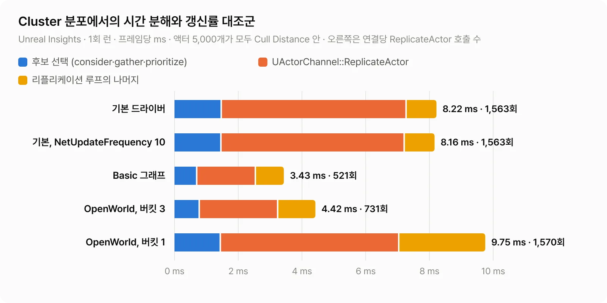

기본 드라이버의 `NetUpdateFrequency`를 10으로 낮춘 것은 아무것도 바꾸지 못했다. 서버가 초당 21 프레임이라 100 Hz든 10 Hz든 매 프레임이 갱신 차례다. 갱신 주기 설정은 서버 프레임 레이트보다 낮아야 뜻이 있다. 반대로 OpenWorld의 버킷을 1개로 줄이면 호출 수가 1,555회로 기본 드라이버와 같아지고, 이때 그래프는 9.89 ms로 기본 드라이버보다 22% 느리다. "같은 양을 보내면 노드 판별이 공짜가 아니다"는 맞았고, 기본 설정으로 돌리면 밀집에서 그래프가 느릴 것이라는 결론은 틀렸다.

어디서 느린지는 Insights가 보여 준다. `UActorChannel::ReplicateActor` 안의 시간은 5.80 ms와 5.60 ms로 같다. 호출당 약 1.8 µs다. 후보를 고르는 단계도 비슷하다. 기본 드라이버의 consider list 0.69 ms와 두 연결의 우선순위 0.80 ms를 합친 1.49 ms에 대해, 그래프는 prepare와 gather 0.16 ms에 우선순위 계산 1.31 ms다. 차이는 `ReplicateSingleActor`가 채널 밖에서 하는 일에 있다. 액터마다 `PreReplication` 호출 0.86 ms(기본 드라이버는 consider list를 만들면서 부르므로 0.69 ms 안에 들어 있다), dependent actor 목록 확인 0.19 ms, 연결 정보의 프레임 번호 갱신과 채널 조회 1.32 ms를 합쳐 2.69 ms로, 기본 드라이버의 리플리케이션 루프 잔여 0.93 ms보다 1.76 ms 많다. 리플리케이션한 액터 하나당 채널 밖 비용이 기본 0.30 µs, 그래프 0.86 µs다. 그래프의 영속 리스트는 검토할 액터를 줄이는 장치이지 보낼 액터의 처리 비용을 줄이는 장치가 아니다. 보낼 액터가 많을수록 액터당 부가 비용이 기본 드라이버보다 크다.

NearPlayers는 둘의 중간이어야 하는데 기본 드라이버는 6.47 ms로 Cluster에 가깝다. 보내는 양은 연결당 770회로 Cluster의 절반인데, consider list 구성이 1.38 ms로 Cluster의 두 배이고 우선순위 계산이 1.97 ms다. 원인은 dormancy의 집계 단위다. 랩은 소품의 90%와 루트 전부를 `DORM_DormantAll`로 두는데, `FNetworkObjectList`는 액터가 모든 연결에서 dormant가 됐을 때만 active 목록에서 뺀다(`Engine/Private/NetworkObjectList.cpp`, `MarkDormant`의 `DormantConnections.Num() == NumConnections`). Cluster에서는 두 클라이언트가 모든 액터를 받으므로 3,685개가 빠져 active가 1,580개이지만, 흩어진 분포에서는 각 소품을 한 클라이언트만 받으므로 영영 active에 남고 매 프레임 5,265개 전부가 consider list를 거친다. Uniform의 1.7 ms도 같은 이유다. CSV의 `NumberOfFullyDormantActors`가 Cluster에서만 0이 아닌 것이 그 흔적이다. 기본 드라이버의 dormancy 절약은 모든 연결이 그 액터를 한 번씩 본 뒤에만 생기고, 넓은 맵에서는 그런 일이 잘 일어나지 않는다. 그래프는 dormant 액터를 연결별 `bDormantOnConnection`으로 걸러서 이 문제가 없다.

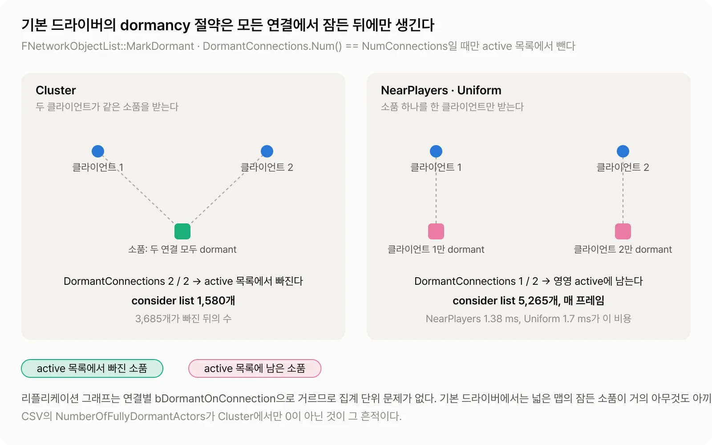

### 액터 수와 연결 수

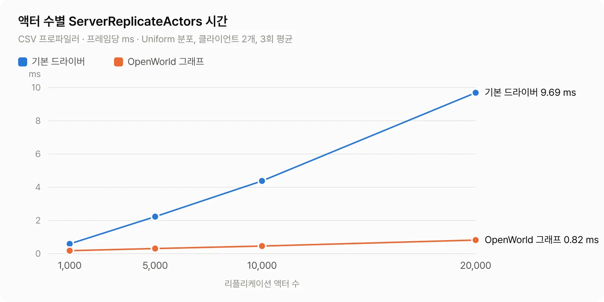

Uniform에서 액터 수를 1,000에서 20,000으로 늘리면 기본 드라이버는 0.59에서 9.69 ms로 정비례한다. 액터 하나당 프레임당 0.46 µs이고, 20,000개 런의 분해는 consider list 5.2 ms, 우선순위 3.8 ms, 리플리케이션 0.5 ms다. OpenWorld 그래프는 0.18에서 0.82 ms로 4.5배 늘고, 그 증가분은 열린 채널 수(50 → 254)에 비례한다. 그래프의 비용은 맵의 액터 수가 아니라 viewer 근처의 액터 수를 따른다.

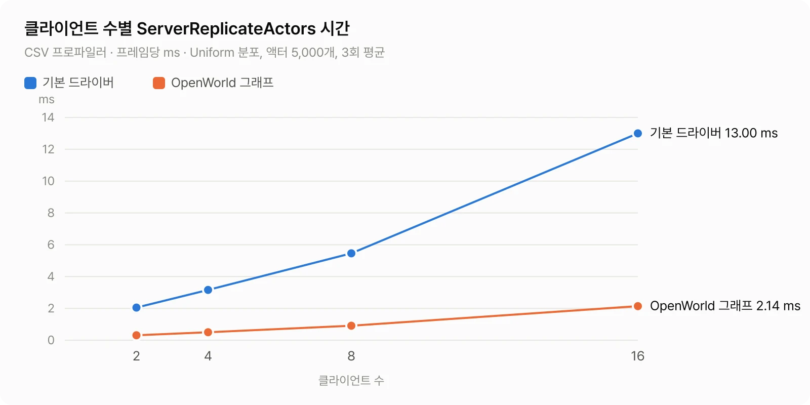

연결 수에서는 둘 다 선형이지만 기울기가 6배 다르다. 기본 드라이버는 연결당 0.78 ms, OpenWorld는 0.13 ms다. 16 연결에서 기본 드라이버의 13.0 ms 중 9.2 ms가 16번의 우선순위 계산이다. 액터 5,200개 × 연결 16개의 `IsNetRelevantFor` 호출이 이 숫자다. 그래프의 2.14 ms는 리플리케이션 0.9 ms와 나머지 1.3 ms이고, 연결마다 자기 셀의 리스트만 본다.

### dormant 비율과 Push Model

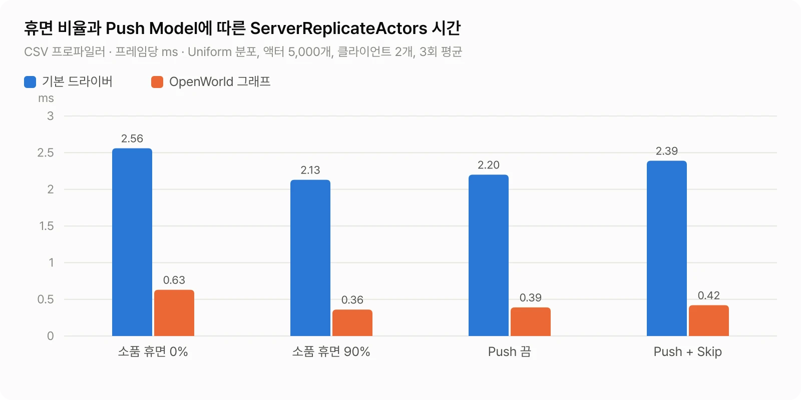

소품을 모두 깨어 있게 두면 기본 드라이버는 2.13에서 2.56 ms, OpenWorld는 0.36에서 0.63 ms로 늘고 채널 수가 73에서 167로 는다. 깨어 있는 소품은 값이 바뀔 때마다 보내지고 채널이 열린 채로 유지된다. 기본 드라이버의 consider list는 앞서 본 대로 어차피 5,200개 전부라 변화는 리플리케이션 단계에만 나타난다.

Push Model은 그래프 위에서 그대로 동작하지만 이 부하에서는 잴 수 있는 차이가 없다. `net.PushModelSkipUndirtiedReplication`은 `UActorChannel::ReplicateActor` 안에서 판정되고 그래프의 `ReplicateSingleActor`도 같은 함수를 부르므로, 그래프 쪽에 Push Model을 의식하는 코드는 없다. 다만 그래프는 채널에 들어가기 전에 `LastRepFrameNum`을 쓰므로 Push Model이 안에서 비교를 건너뛰어 0바이트로 끝나도 주기는 소비되고 `NumReplicatedCleanActors`로 집계된다. 프레임당 리플리케이션이 41건이고 변경률이 1%라 프로퍼티 비교 시간이 0.025 ms에서 0.013 ms로 줄어도 `ServerReplicateActors`의 3~6%다. Push + Skip 조건의 평균이 오히려 높은 것은 프레임 시간 편차 안이다. Push Model 포스트에서 본 절약은 보내는 액터가 많을 때 비교 시간에서 나오는 것이고, 그래프가 보내는 액터 수를 먼저 줄여 버리면 남는 몫이 작다. 두 최적화는 서로 다른 층을 줄이므로 함께 켜서 손해 볼 것은 없다.

## 5.8.3에 남아 있는 버그와 함정

커뮤니티에 보고된 것 중 5.8.3 소스에서 확인되고 랩에서 재현되는 것들이다.

### Dormant 직후의 reliable multicast가 유실된다

Epic 포럼에 2026년 5월 올라온 보고(UE-378758)다. 액터를 `DORM_DormantAll`로 보낸 직후 reliable multicast를 보내면, 네트워크 지연이 있을 때 일부 클라이언트가 받지 못한다. 채널 수명 절에서 본 close와 ack 사이의 창이 원인이다. Epic이 재현을 확인했고 2026년 7월 기준 미수정이다.

랩에서는 AI 50개를 같은 프레임에 `DORM_DormantAll`로 보내고 N프레임 뒤 액터마다 reliable multicast를 하나씩 보낸 뒤, 두 클라이언트가 받은 수를 셌다. Cluster 1,000개 조건이라 50개 모두 두 클라이언트의 컬 거리 안이고(움직이다 벗어나는 한두 개는 제외), 서버 송신에 `PktLag=200`을 걸었다.

| RPC까지의 지연 | OpenWorld 그래프 | 기본 드라이버 |
| --- | --- | --- |
| 4프레임 (190 ms) | 0 / 0 | 48 / 49 |
| 8프레임 (380 ms) | 32 / 32 | 측정 안 함 |
| 12프레임 | 49 / 49 | 49 / 49 |
| 16프레임 | 48 / 49 | 측정 안 함 |
| 24프레임 | 49 / 49 | 49 / 49 |

클라이언트 둘이 받은 RPC 수다. 그래프에서는 4프레임 뒤에 보낸 reliable RPC 50개가 전부 사라졌고 8프레임 뒤에는 18개가 사라졌다. 기본 드라이버는 같은 지연에서 잃지 않는다.

순서는 이렇다. `SetNetDormancy`를 받은 액터는 다음 리플리케이션에서 `StartBecomingDormant`가 걸리고, 마지막 갱신이 비어 있고 ack 안 된 변경이 없으면(`FObjectReplicator::ReadyForDormancy`) 바로 다음 틱에 `Close(Dormancy)`가 된다. 한동안 값이 바뀌지 않은 액터는 잠재우자마자 채널이 닫히는 셈이다. 닫힘 번치가 200 ms 뒤에 도착하고 그 ack가 돌아올 때까지 채널은 `Closing`이고, 그 사이의 multicast는 `ProcessRemoteFunction`이 그 연결을 `continue`로 건너뛴다. reliable이어도 재시도는 없다. ack가 돌아와 채널이 정리된 연결부터 새 채널이 열리며 RPC가 다시 가므로, 8프레임에서는 일부만 도착했고 12프레임부터는 전부 도착했다. 지연 없이 돌린 첫 시도에서는 어느 드라이버도 잃지 않았는데, 창이 로컬 ack 한 번의 길이뿐이기 때문이다.

우회는 순서를 바꾸는 것이다. reliable RPC를 먼저 보내고 잠재우거나, 잠든 액터에 RPC를 보내야 하면 그 연결의 채널이 정리된 뒤(`NotifyActorChannelCleanedUp`)로 미룬다. 우회는 측정하지 않았다.

### Static으로 넣은 액터를 옮기면 보이지 않는다

`AddActor_Static`은 추가 시점의 위치로 셀을 정하고 다시 계산하지 않는다. 스폰 직후 위치를 바꾸는 액터, 플레이어가 집어서 옮기는 소품을 static으로 두면 옛 셀에 남는다. 포럼과 블로그에 "static 액터가 뭉텅이로 사라진다"는 보고가 반복되는 이유다.

랩에서 맵 반대편(2 km 밖)의 소품 5개를 플레이어 0의 폰에서 3~5 m 옆으로 옮기고 값을 하나 바꾼 뒤, 그 클라이언트가 10 m 안에서 보는 소품 수를 30초 동안 셌다.

| 소품 상태와 조작 | 기본 드라이버 | Basic (dormancy 경로) | OpenWorld (static 라우팅) |
| --- | --- | --- | --- |
| 깨어 있는 소품을 옮김 | 5 | 5 | 0 |
| 잠든 소품을 옮기고 `FlushNetDormancy` | 측정 안 함 | 0 | 측정 안 함 |
| 잠든 소품을 `DORM_Awake`로 깨우고 옮김 | 측정 안 함 | 5 | 0 |

static으로 넣은 소품은 깨어 있든 깨우든 옛 셀에 남아 끝까지 보이지 않는다. dormancy 경로도 잠든 채로 옮기면 같다. flush는 연결별 dormancy 사본에 액터를 다시 넣을 뿐 셀을 옮기지 않는다. 옮기기 전에 `SetNetDormancy(DORM_Awake)`로 깨워 동적 액터로 만들어야 그리드가 다음 `PrepareForReplication`에서 새 셀에 넣고, 그때부터 5개가 보였다. 집어서 옮기는 소품이라면 `Spatialize_Dormancy`로 두고 집을 때 깨우고 놓을 때 다시 재우는 순서가 필요하다. 4.24 포럼 보고에 있던 "`Spatialize_Static` 액터를 파괴하면 ensure가 난다"는 5.8.3에서 소품 10개를 측정 중에 `Destroy`해도 재현되지 않았다. 그 뒤 수정된 것으로 보인다.

### bNetTemporary는 지원되지 않는다

`UReplicationGraph::AddNetworkActor`는 `bNetTemporary` 액터에 대해 ensure를 낸다(5.4 릴리스 노트의 "Ensure when an actor is replicated with bNetTemporary set"). 랩의 발사체는 `bNetTemporary`에 `InitialLifeSpan` 1.5초이고, Uniform 5,000개 조건에서 초당 5개를 플레이어 주변에 스폰했다. 그래프 서버 로그에는 ensure가 한 번 찍힌다.

```
Ensure condition failed: !Actor->bNetTemporary [File: ReplicationGraph.cpp] [Line: 790]
ReplicationGraph does not support bNetTemporary. Actor: RepGraphLabProjectile_0 has bNetTemporary set.
```

그 뒤의 동작은 2019년 포럼의 "그래프가 `bNetTemporary`를 무시하고 수백 번 리플리케이션한다"는 관찰과 같다. `bNetTemporary` 액터의 첫 번치는 `bClose`가 켜져 있어 채널을 열면서 닫고, 레거시 드라이버는 `SentTemporaries`로 그 액터를 다시 고려하지 않는다(`Engine/Private/DataChannel.cpp`, `NetDriver.cpp`). 그래프는 이 목록을 보지 않으므로 닫힌 채널이 정리되면 다음 버킷 차례에 채널을 새로 열어 다시 보낸다. 측정에서 프레임당 채널 열기가 0.02회에서 5.1회가 됐고 `ServerReplicateActors`는 0.35에서 0.59 ms로 늘었다. 살아 있는 발사체가 7개 안팎일 때의 값이다. 기본 드라이버는 같은 조건에서 2.51 ms로 발사체가 없을 때와 같다. 발사체는 `bNetTemporary` 대신 짧은 수명의 dynamic 액터로 두고 셀 재구축 금지 목록에 넣는다.

한 가지는 드라이버와 무관하다. 두 드라이버 모두 클라이언트의 발사체 수가 60초 동안 600개까지 늘었다. 클라이언트는 채널이 닫혀도 `bNetTemporary` 액터를 파괴하지 않고(`UActorChannel::CleanUp`의 `!Actor->bNetTemporary` 조건), `SetLifeSpan`은 authority에서만 타이머를 건다. `bNetTemporary`는 서버의 파괴가 전달되지 않는 계약이라 클라이언트가 스스로 지우는 코드가 있어야 하는데 이 랩에는 그것이 없었다. 그래프로 옮기면서 플래그를 떼면 서버의 파괴가 채널 닫힘으로 전달되므로 이 문제도 같이 사라진다.

### 연결이 끊겨도 남는 dormancy 사본

랩에서는 Uniform 5,000개 조건으로 클라이언트 2개를 붙인 뒤, 120초 동안 10초마다 두 번째 클라이언트를 죽이고 다시 띄우는 것을 8번 반복하면서 살아 있는 `UReplicationGraphNode_ConnectionDormancyNode` 수를 5초마다 셌다.

| 설정 | 시작 | 8회 재접속 뒤 |
| --- | --- | --- |
| 기본값 (`DormancyNodeObsoleteBehavior` 0) | 3 | 17 |
| `DormancyNodeObsoleteBehavior` 1, `SetNumFramesUntilObsolete(100)` | 2 | 6 (9까지 올랐다가 2로 떨어지는 톱니) |

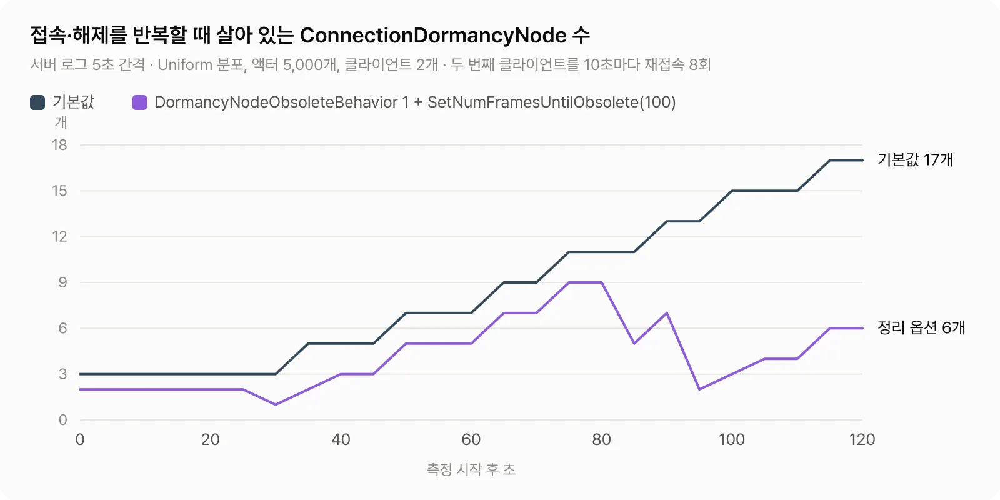

기본값에서는 재접속마다 2개씩 늘고 하나도 줄지 않는다. 정리 옵션을 켜면 줄긴 하지만 즉시는 아니다. 엔진은 오래 gather되지 않은 사본을 `CallFunctionOnValidConnectionNodes` 안에서만 떼어내는데, 이 함수는 그 셀의 dormancy 노드에 액터가 추가·제거되거나 flush될 때 불리고 gather 때는 불리지 않는다. 그래서 조용한 셀의 사본은 다음 액터 변화가 있을 때까지 남고, 측정에서 노드 수가 9에서 5로, 7에서 2로 떨어졌다가 다시 쌓이는 톱니 모양이 됐다. 떼어낸 노드는 `MarkAsGarbage`만 되고 GC까지 객체 목록에 남으므로, 세는 코드는 `IsValid`로 걸러야 한다. 처음에는 그것을 빠뜨려 정리 옵션이 아무 효과가 없는 것처럼 보였다. 접속·해제가 잦은 서버라면 두 설정을 같이 켜고, 셀마다 dormant 액터가 많다면 사본의 메모리까지 같이 본다.

## 디버깅

그래프 문제의 첫 단계는 그래프를 끄는 것이다. `Net.RepDriver.Enable 0`이나 `-RepDriverDisable`로 기본 드라이버에서 같은 현상이 나는지 본다. 그래프 문제로 좁혀지면 로그를 찍는다. 명령은 모두 서버에서 실행하며, 클라이언트에서 `cheat` 같은 릴레이로 보내거나 디버그 액터의 서버 RPC로 보낸다.

### PrintAll

`Net.RepGraph.PrintGraph`는 노드 트리와 각 리스트의 액터를 로그로 찍고, `Net.RepGraph.PrintAll <프레임 수> <연결 인덱스>`는 그 위에 연결 하나의 우선순위 결과를 더한다. 아래는 측정에 쓴 그래프를 액터 5,000개, Uniform 분포, 클라이언트 2개로 띄우고 `Net.RepGraph.PrintAll 1 0`을 찍은 출력에서 셀 하나와 연결 하나만 남기고 줄인 것이다.

```
ReplicationGraphNode_GridSpatialization2D_0
  Tracking 1002 dynamic actors:
  ReplicationGraphNode_GridCell_6
    Static
      World [12 Actors] RepGraphLabProp_219 RepGraphLabProp_403 ...
    Dynamic
      World Bucket 1 [10 Actors] RepGraphLabAI_6 RepGraphLabVehicle_28 ...
      World Bucket 2 [11 Actors] ...
      World Bucket 3 [11 Actors] ...
    Dormant
      World [158 Actors] RepGraphLabLoot_4 RepGraphLabProp_1397 ...
        Child: ReplicationGraphNode_ConnectionDormancyNode_0
          World [158 Actors] ...
ReplicationGraphNode_ActorList_0
  World [5 Actors] WorldSettings GameStateBase_0 RepGraphLabGlobal_0 ...
Connection: NULL
  OpenWorldReplicationGraphNode_AlwaysRelevant_ForConnection_0
    Rebuilt [3 Actors] BP_ThirdPersonPlayerController_C_0 BP_ThirdPersonCharacter_C_0 PlayerState_0
  Team0_0 (Team 0)
    Members [2 Actors] BP_ThirdPersonCharacter_C_0 BP_ThirdPersonCharacter_C_1
[18 Skipped Actors]
RepGraphLabProp_624                      Dist Culled 18108.84
WorldSettings                            Not ready (2 frames left)
PlayerState_1                            Not ready (15 frames left)
[23 Passed Actors]
BP_ThirdPersonCharacter_C_0              -340282346638528859811704183484516925440.0000 (Dist: 399.78 | 0.00)    (FramesLastRep: 1 | 0.95)
BP_ThirdPersonCharacter_C_0              -340282346638528859811704183484516925440.0000 (Dist: 399.78 | 0.00)    (FramesLastRep: 1 | 0.95)
RepGraphLabAI_593                        0.8515 (Dist: 2309.59 | 0.00)     (FramesLastRep: 3 | 0.85)
RepGraphLabProp_1923                     0.9762 (Dist: 9709.84 | 0.03)     (FramesLastRep: 1 | 0.95)
RepGraphLabGlobal_0                      1.9500 (Dist: 77347.03 | 1.00)    (FramesLastRep: 1 | 0.95)
```

트리는 앞 절의 구조 그대로다. 한 액터가 여러 셀에 나오는 것이 정상이고, 연결 0의 dormancy 사본이 마스터와 같은 158개인 것은 이 연결이 그 액터들을 아직 하나도 받지 못했다는 뜻이다. 셀에는 들어 있지만 실제 거리는 150 m 밖이라 매 프레임 컬링되고 있고, trickle이 프레임에 하나씩 흘려보낼 대상이 바로 이 목록이다. 우선순위 결과는 개발 빌드에서만 나온다. `[Skipped Actors]`에는 사유가 붙는다. 15개는 거리가 컬 거리를 넘는 액터이고, 3개는 주기가 안 됐다. `[Passed Actors]`는 점수 오름차순이다. 본인 폰과 컨트롤러는 viewer 규칙으로 `-MAX_FLT`이고, 같은 폰이 여러 번 나오는 것은 그리드, 팀 노드, 연결 노드가 각각 돌려줬기 때문이다. AI 593의 0.8515는 3프레임 전에 받았으니 starvation 항 1 − 3/20 = 0.85에 거리 항 0.0015를 더한 값이다. 전역 액터의 거리 항이 1.00으로 상한에 걸린 것처럼, AlwaysRelevant 노드에 있다고 거리 가중치에서 빠지는 것은 아니다. 플레이하면서 찍고 Passed가 길면 리스트를 줄일 방법을 찾는 것이 라이브스트림의 디버깅 워크플로다.

`Net.RepGraph.PrintAllActorInfo <문자열>`은 이름이 문자열을 포함하는 액터의 클래스 정보, 전역 정보, 연결 정보를 찍는다. 세 층이 어떻게 복사됐는지 눈으로 확인하는 가장 빠른 방법이다.

### 자주 쓰는 콘솔 변수와 명령

플러그인에는 CVar와 명령이 70개 가까이 선언돼 있다. 모두 `Net.RepGraph.` 접두사이고 소스의 `ReplicationGraph.cpp`와 `ReplicationGraphDebugging.cpp` 위쪽에 모여 있다. 본문에서 다룬 것만 추리면 다음과 같다. `cvar*`는 Test·Shipping에서 상수가 되고 개발 빌드에서는 `ECVF_Cheat`다.

| 이름 | 종류 | 기본값 | 의미 |
| --- | --- | --- | --- |
| `Net.RepDriver.Enable` | cvar | 1 | 0이면 그래프를 두고도 기본 드라이버로 간다 |
| `Net.RepGraph.DormancyNodeObsoleteBehavior` | cvar | 0 | 1이면 오래 gather되지 않은 연결별 dormancy 사본을 지운다 |
| `Net.RepGraph.TrickleDistCullOnDormancyNodes` | cvar* | 1 | 거리 밖 dormant 액터를 프레임당 하나씩 흘려보냄 |
| `Net.RepGraph.DormantDynamicActorsDestruction`, `DormantCellsTTLDefault` | cvar | 0, 200 | relevancy 밖 dormant 액터를 클라이언트에서 파괴, 그 전에 셀이 보이지 않아야 하는 프레임 수 |
| `Net.RepGraph.HandleDynamicActorRename` | cvar | 0 | 동적 액터의 Outer가 바뀔 때 레벨 캐시 갱신. 5.5 업그레이드 노트가 1을 권장 |
| `Net.RepGraph.NbDestroyedGridsToTriggerGC` | cvar | 100 | 재구축으로 파괴한 셀이 이 수를 넘으면 GC |
| `Net.RepGraph.UseLegacyBudget`, `FixedBudget` | cvar | 1, 0 | 선언만 있고 읽는 곳이 없다 |
| `Net.RepGraph.Verify` | cvar* | 0 | 리스트의 무효 액터·중복 검사. 느림 |
| `Net.RepGraph.PrintGraph`, `PrintAll`, `PrintAllActorInfo` | cmd | | 노드 트리, 우선순위 결과, 세 층의 정보 |
| `Net.RepGraph.SetClassCullDistance`, `SetPeriodFrame` | cmd | | 세 층의 값을 함께 변경 |
| `Net.RepGraph.StarvedList` | cmd | | 주기를 넘긴 액터 목록을 화면에 |
| `Net.RepGraph.PrintActorChannelCounters` | cmd | | 채널 개폐 횟수 |
| `Net.RepGraph.DyanmicSpatialization.Reinit` | cmd | | DSF 기본 설정 재생성. 오타가 실제 이름 |

로그 카테고리는 `LogReplicationGraph`이고 기본 verbosity는 `Log`다.

### Insights 타이머

Unreal Insights에는 그래프 전용 트랙이 없지만 `-statnamedevents`로 띄우면 다음 타이머가 보인다. 측정의 단계별 분해는 이 타이머로 했다.

| 타이머 | 범위 |
| --- | --- |
| `UReplicationGraph_ServerReplicateActors` | 그래프 전체 |
| `NET_PrepareReplication` | 전역 노드의 `PrepareForReplication`. 그리드의 동적 셀 갱신이 여기 |
| `NET_ReplicateActors_GatherForConnection` | 연결 하나의 gather |
| `NET_ReplicateActors_PrioritizeForConnection` | 연결 하나의 우선순위 계산. `Prioritize_InnerLoop`의 호출 수가 검토한 액터 수 |
| `NET_ReplicateActors_ReplicateActorsForConnection` | 연결 하나의 리플리케이션 루프 |
| `NET_ReplicateActors_ReplicateSingleActor`, `Replicate Actor Time` | 액터 하나 |
| `NET_ReplicateActors_LookForNonRelevantChannels` | 채널 닫기 |

`RG_QUICK_SCOPE_CYCLE_COUNTER`로 선언된 `Prioritize_InnerLoop*`, `ReplicateSingleActor` 등은 Test·Shipping에서 컴파일되지 않는다.

## 5.8의 Replication Graph와 Iris

"deprecated"라는 말이 블로그에 돌지만 Epic의 공개 발언은 그렇지 않다. 2026년 1월 포럼 글 "5.7 Iris Strategy"에서 Epic의 Alex Koumandarakis는 레거시 리플리케이션 시스템과 Replication Graph를 deprecate할 계획이 없고, 세 시스템이 나란히 지원되도록 계획돼 있다고 답했다. 다만 릴리스 노트의 그래프 수정은 5.4에서 끝나고 5.6부터 5.8까지는 항목이 없으며, 5.8 노트는 "legacy" RepGraph라고 따옴표를 쳐서 부른다. 유지보수는 되고 개발은 멈춘 상태로 읽는 것이 정확하다.

Iris와의 관계는 "둘 중 하나"다. 5.8 문서 "Migrate to Iris"는 Iris가 replication graph를 지원하지 않으며, Iris의 필터와 프라이오리타이저가 그래프 기능의 대체물이라고 적고 있다. Fortnite는 2024년 4월에 Iris로 전환했다고 Unreal Fest Orlando 2025에서 Petter Rangström이 말했다. 같은 강연에서 그래프가 "Fortnite가 요구하는 액터·연결 수는 감당했지만 경쟁 게임 같은 고밀도 액션에서는 여전히 struggling"했다는 것이 Iris를 만든 동기로 나온다. 그 강연의 "Porting" 슬라이드(20분 30초)를 소스로 보강해 표로 옮기면 다음과 같다.

| Replication Graph | Iris |
| --- | --- |
| `AlwaysRelevant` 노드, `NotRouted` | ini의 클래스별 always/never relevant 설정 |
| `GridSpatialization2D` | `UNetObjectGridFilter`와 거리 기반 프라이오리타이저 |
| `AlwaysRelevant_ForConnection` | never relevant로 두고 inclusion group에 추가 |
| 빈도 버킷, `DynamicSpatialFrequency`, `ReplicationPeriodFrame` | 프라이오리타이저. 누적 priority가 1을 넘을 때 리플리케이션하고 1 미만의 priority로 빈도를 낮춘다 |
| 연결별 컬 거리 override, dependent actor | `ReplicationSystemUtil` |
| dormancy 노드, Fast Shared, TearOff 노드 | 강연에서 언급 없음 |

`NetUpdateFrequency`의 의미가 바뀐다는 점이 가장 큰 차이다. Iris에서는 폴링 주기일 뿐이고 언제 보낼지는 누적 priority가 정한다. 그래프의 `ReplicationPeriodFrame`을 그대로 옮길 자리는 없다. 5.8.3 기준으로 그래프는 플러그인 하나와 C++ 수백 줄로 켜지고 Fortnite가 2024년까지 쓴 경로이며, Iris는 직렬화 코드까지 이식해야 하고 리플레이가 아직 레거시 경로를 쓴다. 여기서 잰 그래프의 수치는 Iris로 옮겨도 "무엇이 비쌌는가"의 기준점으로 남는다.

## 도입 기준

기준은 하나다. 서버의 `ServerReplicateActors`에서 보낼지 말지를 정하는 비용이 실제로 보내는 비용보다 큰가. 기본 드라이버에서 `stat net`의 `Consider Actors Time`과 `Prioritize Actors Time`을 합친 값이 `Replicate Actor Time`보다 크면 그래프가 그 몫을 줄인다. 둘이 비슷하거나 리플리케이션 쪽이 크면 그래프는 액터당 0.5 µs쯤을 더 쓰는 쪽이다. 그 비율을 키우는 것은 리플리케이션 액터 수와 연결 수의 곱이다. 맵이 넓고 액터가 흩어져 있을수록, 연결이 많을수록 차이가 커진다. 반대로 액터 대부분이 모든 플레이어에게 관련 있는 게임(작은 아레나, 소규모 협동)에서는 그래프가 줄일 검토가 없고, 보내는 양을 줄이려면 기본 드라이버의 `NetUpdateFrequency`를 서버 프레임 레이트보다 낮게 잡는 것으로 충분하다.

도입하기로 했다면 순서는 다음과 같다.

1. 그래프 없이 `stat net`이나 Insights로 검토 비용과 리플리케이션 비용의 비율을 잰다. 이 수치가 없으면 도입 뒤에 무엇이 나아졌는지 말할 수 없다.
2. `UBasicReplicationGraph`로 켜고 같은 조건을 다시 잰다. 그래프 쪽 버그인지 가릴 때는 `-RepDriverDisable`로 끄고 비교한다.
3. 커스텀 그래프는 클래스 라우팅 테이블부터 만든다. 앞의 부하 모델 표대로 나누고, 모르는 클래스는 동적으로 둔다.
4. 버킷 수와 `NetUpdateFrequency`로 보내는 횟수를 정하고, `Net.RepGraph.PrintAll`로 Passed 목록이 기대한 액터로만 차 있는지 확인한다. 셀 크기와 우선순위 스케일은 측정 없이 만지지 않는다.
5. 앞 절의 버그를 피한다. dormant 직후의 reliable multicast, seamless travel 중의 multicast, 옮기는 static 액터, `bNetTemporary`, 끊긴 연결의 dormancy 사본이다.

비용도 있다. 플러그인은 베타로 선언돼 있고 5.6 이후 변경이 없으며 Iris와 양립하지 않는다. 클래스 라우팅은 액터 클래스가 늘 때마다 유지보수 대상이고, 잘못 라우팅된 액터는 조용히 보이지 않는다. 그래서 2번에서 멈추는 것도 선택이다. Basic 그래프는 측정에서 커스텀 그래프와 같은 자릿수였고, 팀 노드와 owner 변경이 필요 없는 게임이라면 그것으로 충분하다.

## 참고 자료

- Unreal Engine 5.8.3 소스: `Engine/Plugins/Runtime/ReplicationGraph/Source/Public/ReplicationGraph.h`, `ReplicationGraphTypes.h`, `Private/ReplicationGraph.cpp`, `ReplicationGraphDebugging.cpp`, `BasicReplicationGraph.cpp`; `Engine/Private/NetDriver.cpp`, `DataChannel.cpp`, `DataReplication.cpp`, `Actor.cpp`; `Samples/Games/Lyra/Source/LyraGame/System/LyraReplicationGraph.*`
- [Replication Graph in Unreal Engine](https://dev.epicgames.com/documentation/en-us/unreal-engine/replication-graph-in-unreal-engine)
- [Replication Graph Fast Shared Path Starting Guide](https://dev.epicgames.com/community/learning/knowledge-base/rm2x/unreal-engine-replication-graph-fast-shared-path-starting-guide)
- [Migrate to Iris in Unreal Engine](https://dev.epicgames.com/documentation/en-us/unreal-engine/migrate-to-iris-in-unreal-engine)
- [Networking in 4.20: The Replication Graph, Unreal Engine Livestream, 2018](https://www.youtube.com/watch?v=CDnNAAzgltw)
- [Developing and Launching a New Replication System, Unreal Fest Orlando 2025](https://www.youtube.com/watch?v=K472O2rVvG0)
- [5.7 Iris Strategy, Epic Developer Community Forums](https://forums.unrealengine.com/t/5-7-iris-strategy/2699685)
- [Reliable RPCs get dropped on Replication Graph if Actor gets set dormant shortly before the reliable RPC gets called](https://forums.unrealengine.com/t/reliable-rpcs-get-dropped-on-replication-graph-if-actor-gets-set-dormant-shortly-before-the-reliable-rpc-gets-called/2726900)
- [Clients destroy vital actors when seamless traveling and server broadcasts a multicast RPC using Replication Graph](https://forums.unrealengine.com/t/clients-destroy-vital-actors-when-seamless-traveling-and-server-broadcasts-a-multicast-rpc-using-replication-graph/2743133)
- [Problems with Destroying Items in Replication Graph](https://forums.unrealengine.com/t/problems-with-destroying-items-in-replication-graph/144619)
- [ReplicationGraph node teardown](https://forums.unrealengine.com/t/replicationgraph-node-teardown/2600456)
- [Guarantee replication order](https://forums.unrealengine.com/t/guarantee-replication-order/2511085)
- [Replication Graph ignores bNetTemporary](https://forums.unrealengine.com/t/replication-graph-ignores-bnettemporary/441733)
