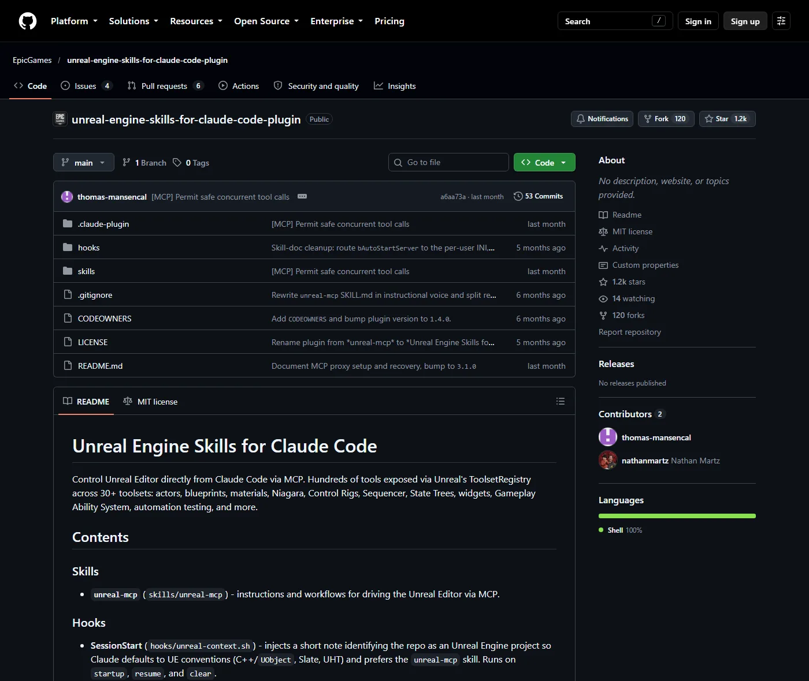
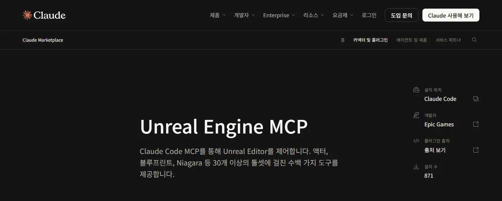
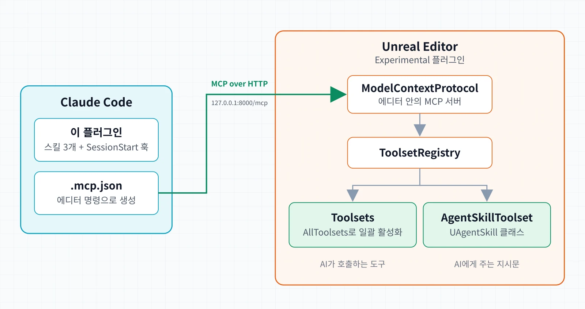
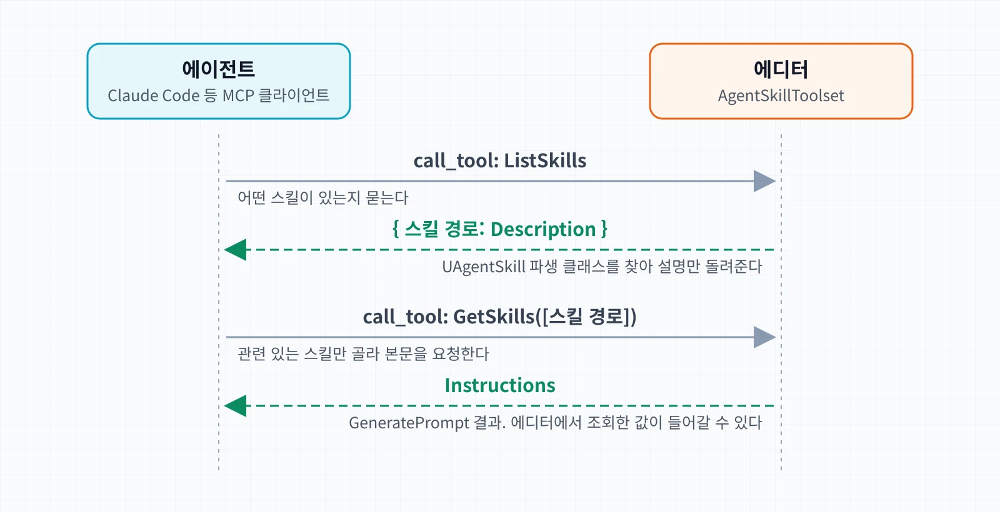

Epic Games의 Claude Code용 플러그인 [Unreal Engine Skills for Claude Code](https://github.com/EpicGames/unreal-engine-skills-for-claude-code-plugin)를 10월 19일에 처음 봤다. 언리얼 엔진 5.8의 실험 기능인 Unreal MCP를 Claude Code에서 쓰기 위한 스킬과 훅을 담은 플러그인이다. [이전 글](/posts/unreal-engine-5-8-mcp-and-agentic-game-development/)에서 Unreal MCP를 직접 써 봤다면, 이번에는 Epic이 Claude에게 Unreal MCP를 어떻게 쓰라고 가르치는지 레포를 읽으며 정리했다.

처음에는 Epic이 공식 스킬을 새로 배포한 줄 알았다. 확인해 보니 5.8.0 릴리스 무렵부터 GitHub에 공개돼 있던 레포였다.

설정 방법은 이전 글과 [공식 문서](https://dev.epicgames.com/documentation/en-us/unreal-engine/unreal-mcp-in-unreal-editor)로 넘기고 이 글은 스킬 자체를 다룬다.

## 한눈에 보기



파일은 12개뿐이고 실행 로직이 있는 코드는 SessionStart 훅 스크립트 하나다.

| 파일 | 역할 |
| --- | --- |
| `skills/unreal-mcp/` | 에디터 조작 |
| `skills/create-toolset/` | 새 도구(툴셋) 작성 |
| `skills/unreal-skill/` | 엔진 쪽 Agent Skill 작성 |
| `hooks/unreal-context.sh` | UE 프로젝트 맥락 주입 |
| `plugin.json`, `README.md` 등 | 메타데이터, MIT 라이선스 |

- 작성자는 Epic Games 개발자들이다.
- 원래 이름은 `unreal-mcp`였다. 개발 중에 "as per legal request"라는 사유로 지금 이름으로 바뀌었다.
- 스킬을 크게 고친 커밋 여러 개에 `Co-Authored-By: Claude` 트레일러가 붙어 있다. 스킬을 Claude와 함께 다듬어 왔다.
- Anthropic 공식 마켓플레이스 `claude-plugins-official`에 등록돼 있다. 마켓플레이스에서는 `Unreal Engine MCP`라는 이름으로 보인다.



실제 기능은 엔진에 있다. 레포는 Claude가 그 기능을 쓰는 방법을 적은 문서 묶음에 가깝다.



- 연결 주소는 기본값 `http://127.0.0.1:8000/mcp`다.
- 플러그인은 `.mcp.json`을 포함하지 않는다. 에디터 콘솔에서 `ModelContextProtocol.GenerateClientConfig ClaudeCode`로 만든다.
- `ModelContextProtocol`만 켜면 서버는 뜨지만 도구가 하나도 없다. 도구는 `AllToolsets`가 켜는 툴셋 플러그인들이 제공한다.

### 언제부터 있었나

- 개발은 5.8 프리뷰가 나오기 전부터 Epic 내부에서 시작한 것으로 보인다. 커밋 히스토리가 GitHub 레포 생성 시점보다 몇 달 앞선다.
- GitHub에는 5.8.0 정식 릴리스와 비슷한 시기에 공개됐고 그 직후부터 외부 사용자의 포크와 PR이 보인다.
- 엔진의 Unreal MCP와 함께 준비해 정식 출시에 맞춰 내놓은 동반 플러그인으로 볼 수 있다.

그런데도 새로 나온 것처럼 보였던 건 10월 19일에 관심이 갑자기 몰렸기 때문이다. 하루 사이에 스타가 수백 개 붙었는데, Threads와 X에서 이 레포를 소개하는 글이 바이럴된 영향으로 보인다. 나도 Threads에서 보고 처음 알았고, X에도 비슷한 영문 글이 올라와 있었다.

## `unreal-mcp`: 에디터를 조작하는 스킬

### description은 트리거 명세다

description은 요약문 대신 언제 불릴지를 정하는 명세로 쓰였다. 원문에 붙은 세 구역의 라벨을 그대로 살려 줄을 나눴다.

```yaml title="unreal-mcp/SKILL.md description (발췌, 줄바꿈 추가)"
Concrete triggers:
  spawn/move/duplicate/transform actors,
  create or edit a Blueprint/Widget/Material/...,
  read or write properties on actors
  (e.g. `bIsLocked` on `BP_DoorActor`), ...
Treat as Unreal context even without
the word "Unreal":
  asset prefixes `BP_`, `WBP_`, `M_`, `SK_`, ...;
  UE C++ types/macros; `.uproject`;
  Content Browser; Outliner; PlayerStart; ...
Skip for:
  pure conceptual/docs questions,
  Unity, Godot, or unrelated uses of
  "blueprint"/"sequencer"/"widget".
```

- 긍정 트리거, 암묵 신호, 부정 트리거로 나뉜다.
- 암묵 신호가 특징적이다. 사용자가 "언리얼"이라고 말하지 않아도 `BP_` 같은 에셋 접두사나 `UPROPERTY`가 보이면 UE 작업으로 본다.
- 부정 트리거는 개념 질문과 다른 엔진, 일반 명사로서의 "blueprint"를 제외한다.

description은 처음부터 이렇지는 않았다.

1. 처음에는 "Control Unreal Editor via MCP: create actors, edit Blueprints, ..."처럼 기능을 나열했다.
2. 다음에는 "Use this skill whenever the user mentions Unreal Engine ... even if they don't explicitly name the skill."로 넓게 불리게 했다.
3. 지금은 위의 세 구역 구조로 정확하게 불리게 했다.

더 자주 불리게 했다가 필요할 때만 불리게 고친 셈이다. 넓게 잡은 description이 UE 개념 질문에도 에디터 조작 스킬을 불렀던 것으로 보인다.

`.gitignore`에는 `skills/*-workspace/`를 무시하는 규칙이 있고 주석에 skill-creator의 description 최적화 루프와 eval 작업 공간이라고 적혀 있다. 트리거 정확도를 측정하면서 다듬은 것 같다.

:::note[내 생각]
description에 이렇게 많은 신호를 넣는 것이 과해 보일 수도 있지만, 사용자가 이름을 부르지 않아도 알아서 불려야 하는 스킬이니 나쁘지 않다고 생각한다. 트리거를 긍정, 암묵 신호, 부정 세 종류로 명확하게 나눠 적은 점이 흥미롭다.
:::

### 본문: 설명서에서 지시문으로

본문도 같은 무렵 지시문 형태로 다시 썼다.

- 이전 본문은 "Unreal MCP exposes hundreds of tools..."로 시작하는 제품 설명이었다.
- 지금은 "You are wired into a live Unreal Editor..."로 시작하는 2인칭 지시문이다.
- 설치와 장애 대응을 `references/setup.md`, `references/operations.md`로 옮겨 본문이 12KB에서 7KB로 줄었다. 처음부터 읽을 내용과 문제가 생겼을 때 읽을 내용을 나눴다.

현재 본문의 구성은 다음과 같다.

| 절 | 내용 |
| --- | --- |
| 도입 | 라이브 에디터 연결 상황 |
| First step every time | 도구 탐색과 호출 순서 |
| Safety rules | 안전 규칙 5개 |
| Project skills | 엔진 Agent Skill 우선 |
| Reference files | 설치, 장애 대응 문서 |
| Companion skills | 다른 두 스킬로 안내 |

### 도구 검색: 메타 도구 3개

- Unreal MCP 서버는 기본 설정(`bEnableToolSearch = true`)에서 `list_toolsets`, `describe_toolset`, `call_tool` 세 도구만 노출한다. 수백 개의 실제 도구는 `call_tool`의 인자로 이름을 넘겨 서버 안에서 실행된다.
- 레포 문서에는 컨텍스트 축소와 프롬프트 캐시 유지가 이유로 적혀 있다. 세션 중에 도구 목록이 바뀌지 않으니 캐시가 깨지지 않는다.
- v3.0.0 이전에는 `load_toolset`으로 툴셋을 네이티브 도구로 등록했고, v3.0.0에서 지금의 `call_tool` 방식으로 바꿨다.

:::note[내 생각]
메타 도구 3개만 노출하는 이유로 레포는 컨텍스트 축소와 캐시 유지를 함께 들지만, 나는 그중에서도 일부 툴셋이 설명만 읽어도 토큰이 굉장히 많이 든다는 점이 더 컸다고 본다. [이전 글](/posts/unreal-engine-5-8-mcp-and-agentic-game-development/)에서 정리한 Epic 세션에서도 툴셋 설명을 읽어 오는 데만 머티리얼은 약 2만 6천 토큰, 나이아가라는 25만 토큰 가까이 든다고 했으니, 모든 스키마를 처음부터 실으면 그만큼 컨텍스트가 찬다. 그래서 도구가 수백 개여도 호출 창구를 `call_tool` 하나로 모으는 편이 더 직관적인 설계라고 본 것 같다.
:::

### Safety rules가 이 스킬의 핵심이다

- 대량 변경 전후로 저장한다. MCP로 한 편집은 특히 컴파일 경계를 넘으면 되돌릴 수 없을 수 있다.
- C++이나 셰이더 컴파일 중에는 도구 호출이 멈추거나 이상하게 실패한다. C++ 재빌드는 `LiveCodingToolset.CompileLiveCoding`으로 하고 결과를 기다린다.
- 서로 의존하는 호출과 같은 에셋을 건드리는 변경은 순서대로 보낸다.
- 많은 도구가 예외 없이 status 값으로 성공과 실패를 돌려준다. 명시적인 성공이 아니면 멈춘다.
- PIE 중에는 에셋 생성 같은 에디터 전용 도구가 다르게 동작한다.

모두 도구 스키마를 읽어서는 알 수 없는 운영 지식이다. 뒤에서 볼 `unreal-skill`의 Novel 원칙(도구를 써서 알 수 있는 것은 쓰지 마라)에 가장 잘 맞는 부분이기도 하다.

### 공식 문서와 겹치는 부분, 겹치지 않는 부분

| 내용 | 문서 | 스킬 |
| --- | --- | --- |
| 플러그인 설정, `.mcp.json` | O | O |
| 도구 검색 | O | O |
| 툴셋 작성 | O | O |
| 저장·PIE·컴파일 수칙 | X | O |
| Agent Skill 확인 | X | O |
| proxy 복구 | X | O |

동시 호출은 둘의 내용이 다르다. 공식 문서는 도구를 게임 스레드에서 순서대로 실행하므로 "clients should not issue overlapping Tool calls"라고 한다. 스킬은 최근 "MCP accepts concurrent requests"로 바뀌었다. 스킬이 문서보다 앞서 바뀌는 구간도 있다.

공식 문서가 이 플러그인을 언급하는 곳은 툴셋 작성 절의 한 문장뿐이다. Claude Code 사용자는 "the `unreal-mcp` Claude Code plugin"의 `create-toolset` 스킬로 툴셋을 만들 수 있다고 적혀 있다. 이름은 개명 전 그대로이고 레포 링크나 설치 방법은 없다. 문서만 읽어서는 이 플러그인이 GitHub와 공식 마켓플레이스에 있다는 것을 알기 어렵다.

## `create-toolset`: Claude가 쓸 도구를 Claude가 만들게 하는 스킬

에디터에 새 도구를 추가하는 방법을 다룬다. 레포에서 가장 큰 스킬이다.

### 쓰기 전에 확인할 것

스킬은 코드를 쓰기 전에 다음을 순서대로 따지게 한다.

1. 이미 있는 기능인가? 있으면 만들지 말고 해당 도구를 알려 준다.
2. 요청이 생각보다 일반적인가? "Blueprint 에셋 메타데이터 읽기"는 모든 에셋에 해당하므로 `BlueprintTools`가 아니라 `AssetTools`에 둔다.
3. 같은 도메인의 툴셋이 이미 있는가?
4. 새 플러그인이 필요한가? 분명하지 않으면 사용자에게 묻는다.
5. Python과 C++ 중 무엇으로 만들 것인가? 사용자가 정할 문제다. 양쪽에서 쓸 수 있는 API를 요약해 보여 주고 결정을 기다린다. 둘 다 API가 없으면 우회하지 말고 멈춘다.

이후에는 공통 규약(실제 타입 사용, 실패는 반환값이 아니라 raise, 모든 도구는 static, 테스트 필수)과 C++/Python 작성법이 이어진다. 마지막은 테스트 루프로, MCP로 에디터에 붙어 만든 도구를 `AutomationTestToolset`으로 테스트한다.

### 문서화 규칙은 AI의 버릇을 겨냥한다

문서화 지침은 나중에 간결한 쪽으로 한 번 더 강화됐다. 해당 커밋 메시지에 따르면 원래 지침이 "too abstract to counter the default bias toward over-documenting"이었다고 한다. 추가된 내용은 다음과 같다.

- 판정 기준: 시그니처, 이름, 타입만 보고 유능한 독자가 추론할 수 있는 줄이면 지운다.
- "LLMs over-document by default; resist it."
- 구현 사유(왜 이렇게 짰는지)는 쓰지 않고 계약(무엇을 하는지)만 쓴다.
- 남길 것: 단위, 범위, 특이한 인코딩, 빈 결과의 의미.
- before/after 예시:

```cpp title="skills/create-toolset/SKILL.md"
// Over-documented: every line restates the signature or narrates usage.
/**
 * Runs a cheat. @param CheatName The cheat name (case-insensitive), pass it to run the cheat.
 * @param Args Optional arguments; fill in the slots from the Args hint (e.g. "<float F>" -> "2.0",
 *             "<float A> <float B>" -> "1 2"). Empty string for no arguments.
 */
// Trimmed: only the non-inferable facts remain.
/**
 * Runs a cheat on the local player, as if typed into the console.
 * @param CheatName The cheat command name.
 * @param Args Arguments as a single space-separated string. Empty for none.
 */
```

이 수정에도 `Co-Authored-By: Claude` 트레일러가 붙어 있다. Claude가 말이 많아지는 버릇을 막는 규칙을 Claude와 함께 썼다.

엔진 쪽 구조 때문에 이 규칙이 중요하다. 여기서 쓴 주석은 그대로 AI가 보는 도구 설명이 된다. `list_toolsets`는 툴셋마다 이름과 설명 한 줄만 돌려주므로 스킬도 "An LLM will often see only the toolset name and this description"이라고 적고 툴셋 설명이 혼자서 이해되게 쓰라고 한다. 장황한 문서는 다음 에이전트의 컨텍스트를 잡아먹는다.

:::note[내 생각]
"LLMs over-document by default; resist it."처럼 AI의 버릇을 직접 겨냥한 지침은 흥미롭다. 이런 한 줄이 실제로 효과가 있는지는 의문이지만, 효과가 있다면 내 스킬에도 써 보고 싶다.

LLM의 과잉 문서화와 과한 텍스트는 AI 산출물의 가장 큰 문제라고 생각한다. 툴셋이나 스킬에서 가장 중요한 것은 간단명료함인데, LLM으로 만들 때 한 번에 그것을 지켜서 잘 만들어지는 경우는 거의 본 적이 없다.
:::

### 엔진 코드가 규칙에서 벗어난 한 곳

- 공통 규약은 "Return values carry data, not status"이고 "Never return a boolean"이라고 한다.
- 엔진의 `UAgentSkillToolset::CreateSkill`은 실패하면 `RaiseScriptError`로 에러를 올린 뒤 빈 문자열을 반환한다. C++ 에러 처리 절이 시키는 방식 그대로다.
- 같은 클래스의 `UpdateSkill`은 성공하면 `true`를 반환한다. 이 부분은 규칙과 다르다. `CreateSkill`이 내부에서 이 반환값을 쓰고 있어서 생긴 형태로 보인다.

:::note[내 생각]
`UpdateSkill`의 `bool` 반환은 실수일 수도 있다. 앞으로 코드를 지침에 맞추거나 지침을 고치거나 둘 중 하나가 될 것 같다. 해당 코드는 플러그인 레포가 아니라 엔진(`ToolsetRegistry`)에 있으니, 고친다면 엔진 쪽에 PR을 올려 볼 만하다.
:::

## `unreal-skill`: 스킬을 만드는 스킬

### 스킬이 두 층이다

이 스킬은 엔진 쪽 Agent Skill을 작성하는 방법을 다룬다. Claude Code 스킬과는 이름만 같고 다른 물건이다.

| | Claude Code 스킬 | Agent Skill |
| --- | --- | --- |
| 정체 | `SKILL.md` 파일 | `UAgentSkill` 파생 UClass |
| 위치 | `.claude/skills/` 등 | 플러그인 코드, Content 에셋 |
| 전달 | 하네스가 파일을 읽음 | 에디터가 MCP로 반환 |
| 호출 | 자동 | `ListSkills` 직접 호출 |
| 클라이언트 | Claude Code | MCP 클라이언트 전부 |

Agent Skill은 플러그인의 C++/Python 클래스로 정의하거나 프로젝트 Content에 블루프린트 클래스 에셋으로 만든다. 어느 쪽이든 에디터가 로드한 클래스를 MCP 도구가 텍스트로 돌려준다.



- `ListSkills`는 `UAgentSkill`의 파생 클래스를 모두 찾아 경로와 Description을 돌려준다. 프로젝트 설정의 허용/차단 정규식(`AgentSkillAllowedNames`, `AgentSkillBlockedNames`)으로 노출할 스킬을 거른다.
- 자동 호출이 없기 때문에 `unreal-mcp` 스킬이 "낯선 작업을 시작할 때마다 `ListSkills`를 확인하라"고 지시한다. Claude Code에서는 하네스가 하는 일을 여기서는 지시문이 대신한다.

### Agent Skill 에셋의 정체: Data-only Blueprint

`CreateSkill`이 만드는 것은 블루프린트다.

- `UBlueprintFactory`의 부모 클래스를 `UAgentSkill`로 지정해 블루프린트 에셋을 만든다.
- 생성된 클래스의 CDO(Class Default Object)에 Description과 Instructions를 쓴다.
- 패키지를 dirty로 표시할 뿐 저장하지는 않는다.
- `UpdateSkill`은 C++/Python으로 정의한 스킬은 수정하지 않는다. 저장할 에셋이 없어서 재시작하면 바뀐 내용이 사라지기 때문이다.

형식은 그래프 없이 Class Defaults만 채우는 Data-only Blueprint다. GameplayEffect를 블루프린트로 만들어 값만 채우는 것과 같은 방식이다. 다만 채우는 내용이 AI에게 주는 자연어 지시문이다.

### 지시문이 코드처럼 동작하는 예: PCG

5.8.3에는 이미 Agent Skill이 몇 개 들어 있다. PCG 툴셋의 스킬은 `GeneratePrompt`를 오버라이드해 지시문의 자리표시자를 에디터에서 조회한 값으로 채운다.

경로는 `Engine/Plugins/Experimental/Toolsets/PCGToolset/Source/PCGToolset/Public/PCGToolsetSkills.h`다.

```cpp title="PCGToolsetSkills.h (UE 5.8.3, 발췌)"
UCLASS()
class UPCGGraphGenerationSkill : public UAgentSkill
{
	GENERATED_BODY()

protected:
	virtual FString GeneratePrompt_Implementation(const FString& InitialInstructions) const override
	{
		FString CustomInstructions = InitialInstructions;
		CustomInstructions.ReplaceInline(TEXT("{Subgraphs}"),
			*FString::Join(UPCGToolset::ListAvailableSubgraphs(), TEXT(", ")));
		CustomInstructions.ReplaceInline(TEXT("{Nodes}"),
			*FString::Join(UPCGToolset::ListNativeNodes(true), TEXT(", ")));
		// {Examples}, {Instant Graphs}도 같은 방식으로 채운다.
		return CustomInstructions;
	}
};
```

스킬을 불러오는 순간 현재 프로젝트의 PCG 노드 목록과 서브그래프가 지시문에 들어간다. 정적인 `SKILL.md`로는 할 수 없는 일이다.

### 작성 원칙 6개

`unreal-skill`이 제시하는 원칙은 다음과 같다.

- Novel: 도구를 써 보면 알 수 있는 것은 쓰지 않는다.
- Collegial: 문서가 아니라 유능한 동료에게 브리핑하듯 쓴다.
- Flexible: 개념 설명이든 절차든 가장 명확한 형태를 고른다.
- Durable: 프로퍼티나 도구 이름처럼 바뀌는 세부를 넣지 않는다.
- Agnostic: 오케스트레이션, 역할 이름, 모델 이름을 언급하지 않는다.
- Parsimonious: 모든 토큰은 비용이다. 없어도 아쉽지 않을 문장은 지운다.

Agnostic이 눈에 띈다. Claude Code용 플러그인이 엔진 Agent Skill에는 Claude조차 언급하지 말라고 한다. Agent Skill은 MCP로 전달되고 `GenerateClientConfig`는 Claude Code 외에 Cursor, VS Code, Gemini, Codex 설정도 만든다. 클라이언트와 무관한 지식은 엔진 쪽에 두고 이 플러그인은 Claude Code에서 그 지식에 닿는 입구 역할을 맡는 것으로 보인다.

Durable은 레포 스스로도 적용했다. `unreal-mcp`의 `## Workflows` 절을 "names that drift"라는 이유로 지웠다. 정확한 `Toolset.tool` 이름에 묶인 절차였다.

:::note[내 생각]
`unreal-skill`을 읽으며 가장 독특하다고 느낀 점은 AI 지시문을 블루프린트 에셋으로 관리한다는 것이다. 기법 자체는 익숙한데 쓰임새가 새롭다.

그렇다면 네이밍 규칙이나 폴더 구조 같은 팀의 프로젝트 노하우는 어디에 둘까. 나라면 Claude Code 스킬 쪽에 둘 것 같다. 언리얼 Agent Skill은 PCG 예시처럼 에디터 기능을 활용한 특정 프로세스를 구축할 때 쓰는 편이 맞아 보인다.
:::

## SessionStart 훅

- 세션이 시작될 때(`startup`, `resume`, `clear`) 현재 디렉터리에서 위로 올라가며 UE 프로젝트 루트를 찾는다. `Source/`나 `Content/` 안에서 세션을 열어도 찾는다.
- 루트 판정은 `*.uproject` 또는 `GenerateProjectFiles.*`(엔진 소스 트리)로 한다. `Engine` 폴더는 일부러 기준에서 뺐다.

```bash title="hooks/unreal-context.sh (발췌)"
is_project_root() {
  # Reliable top-level markers only. A bare `Engine` directory is NOT a marker:
  # the Unreal source tree contains an `Engine` module at
  # `Engine/Source/Runtime/Engine`, so walking up from a Runtime module would
  # otherwise short-circuit at `Source/Runtime` and mis-identify it as the root.
  local directory="$1"
  [ -f "$directory/GenerateProjectFiles.bat" ] && return 0
  [ -f "$directory/GenerateProjectFiles.sh" ] && return 0
  [ -f "$directory/GenerateProjectFiles.command" ] && return 0
  for candidate in "$directory"/*.uproject; do
    [ -e "$candidate" ] && return 0
  done
  return 1
}
```

- 찾으면 다음 내용을 컨텍스트에 넣는다. UE 프로젝트(또는 엔진 소스 트리)라는 사실, C++/UObject·Slate·UHT 관례를 따르라는 안내, 에디터 조작에는 `unreal-mcp` 스킬을 쓰라는 안내, `.mcp.json`이 없으면 생성 명령.
- UE 프로젝트가 아니면 아무것도 출력하지 않는다.
- 스킬의 자동 호출은 description에 기대므로 확률적이다. 훅은 이 폴더가 UE 프로젝트이고 쓸 스킬이 있다는 사실을 세션 처음에 확정적으로 알린다.
- bash 스크립트라서 Windows에서는 Git Bash나 WSL이 필요하다. 없으면 훅만 빠지고 MCP 도구는 동작한다. README에도 "There is no separate PowerShell companion script today"라고 적혀 있다.

:::note[내 생각]
Windows에서 Git Bash가 필요하다는 점은 크게 문제되지 않을 것 같다. Git을 쓰는 개발 환경이라면 Git Bash도 대개 함께 깔려 있다. PowerShell용 스크립트를 따로 두지 않은 것도, 멀티 플랫폼을 지향하는 엔진이라 플랫폼별로 나누면 코드만 늘어서인 것 같다.
:::

## 보안: 경고는 글로, 강제는 어디서

README의 Security 절은 네 가지를 경고한다.

1. "Localhost is not a trust boundary." Origin 검증은 브라우저 탭을 막을 뿐이고 같은 사용자로 도는 프로세스는 모두 서버에 붙을 수 있다. 공식 문서도 인증 계층이 없다고 밝힌다.
2. `ProgrammaticToolset.execute_tool_script`는 에디터 프로세스 안에서 임의의 Python을 실행한다.
3. `--dangerously-skip-permissions`와 함께 쓰지 않는다. 쓴다면 범위를 좁히고 버려도 되는 프로젝트에서 쓴다.
4. 긴 세션 전에는 저장하고 커밋해 둔다. 도구 호출 한 번이 버전 관리 대상 에셋을 옮기거나 지울 수 있다.

스킬과 도구 설명도 같은 내용을 모델에게 말한다. 엔진의 `CreateSkill`/`UpdateSkill` 설명에는 "This should ONLY be called after getting explicit direction or permission from the user."라고 적혀 있다. 사람이 읽는 README의 경고를 모델 쪽에서는 스킬과 도구 설명이 맡는다.

:::note[내 생각]
경고를 글로만 두지 말고 훅으로 막으면 좋겠다는 생각도 들었다. 그런데 README의 네 가지 경고 중에는 훅으로 막을 수 없어 보이는 것도 있었다.
:::

그렇다면 플러그인이 훅으로 강제할 수 있었을까. 네 가지를 하나씩 보면 대부분 Claude Code 훅의 범위 밖이다.

| 경고 | 훅으로 | 이유 |
| --- | --- | --- |
| localhost | 불가 | 다른 프로세스의 접속 |
| `execute_tool_script` | 가능 | `call_tool` 인자 검사 |
| skip-permissions | 대상 아님 | 사용자가 고르는 모드 |
| 저장과 커밋 | 경고만 | 미저장 에셋은 안 보임 |

- localhost 문제의 위협 주체는 Claude Code가 아닌 다른 프로세스다. 서버 인증, 즉 엔진의 문제다.
- `execute_tool_script`는 `PreToolUse` 훅이 `call_tool`의 `toolset_name`과 `tool_name`을 보고 확인을 요구하거나 거부할 수 있다.
- 에디터의 미저장 에셋은 셸 훅이 볼 수 없다. 커밋 안 된 변경을 알려 주는 정도만 가능하다.

결국 훅으로 다룰 수 있는 경고는 `execute_tool_script` 하나다. 도구 검색 모드에서는 모든 호출이 `call_tool` 하나로 들어오므로, 도구 이름 기반 권한 규칙으로는 읽기 도구와 Python 실행을 나눠 허용할 수 없다. 훅이라면 나눌 수 있다. 다만 훅에 `ProgrammaticToolset.execute_tool_script`라는 이름을 넣으면 레포가 지키려는 Durable 원칙과 부딪힌다. 이 레포의 위험은 대부분 엔진 서버와 사용자의 운영 습관 쪽에 있어서 플러그인이 할 수 있는 일은 원래 좁다.

## MCP만으로는 안 되나

:::note[내 생각]
MCP만으로도 에디터는 조작할 수 있는데, 트리거용 스킬을 따로 두는 것이 패턴으로서 더 나은지 궁금했다. 이렇게 MCP와 스킬을 함께 묶는 구성을 몇 번 본 것 같기는 하다.
:::

MCP 서버도 연결 직후(initialize 응답)에 `instructions` 문자열로 사용법을 보낼 수 있고 Claude Code는 이를 시스템 프롬프트에 넣는다. Unreal MCP의 응답 구조체에도 `Instructions` 필드가 있지만(`ModelContextProtocolSession.h`) 5.8.3 소스에서 값을 채우는 코드는 찾지 못했다. 지금은 스킬이 이 자리를 대신하고 있다.

`instructions`를 채운다고 해도 스킬이 맡는 일은 남는다.

| 상황 | MCP만 | 스킬 함께 |
| --- | --- | --- |
| 언제 쓸지 판단 | 메타 도구 3개뿐 | 에셋 이름으로도 트리거 |
| 서버가 꺼졌거나 설정 전 | 정보 없음 | 설치·복구 안내 |
| MCP 밖의 작업 | 해당 없음 | 툴셋 코드 작성 |
| 상주 컨텍스트 | `instructions` 전체 | description만 |

- 도구 검색 모드에서 모델이 보는 것은 범용 메타 도구 3개뿐이다. 스킬은 `BP_DoorActor` 같은 표현만으로도 불린다.
- MCP는 연결되지 않으면 아무 정보도 보내지 못한다. 스킬은 `setup.md`, `operations.md`로 서버를 켜는 법과 복구법을 안내한다.
- 툴셋을 C++/Python으로 작성하는 일은 MCP 호출 밖의 코드 작업이라 `create-toolset`이 맡는다.

MCP는 연결된 뒤에만 말할 수 있고 스킬은 연결되기 전에도 말할 수 있다. 대신 스킬은 Claude Code에서만 동작하고 앞의 동시 호출 항목처럼 문서나 서버와 따로 바뀔 수 있다.

:::note[내 생각]
그래서 이 레포는 Unreal MCP 공식 문서 내용에 운영 지식을 더해 스킬로 만들어, Unreal MCP를 적극적으로 활용할 수 있게 해 주는 역할이 크다고 생각한다.
:::

## Claude Code용만 있다

- 엔진의 Unreal MCP 서버는 특정 클라이언트에 묶여 있지 않다. `ModelContextProtocol.GenerateClientConfig`는 Claude Code, Cursor, VS Code, Gemini CLI, Codex CLI 다섯 가지 설정 파일을 만든다.
- 그런데 Epic이 함께 내놓은 스킬과 훅은 Claude Code 플러그인 하나뿐이다. EpicGames GitHub 조직에 공개된 AI 클라이언트용 플러그인은 이 레포뿐이고, 공식 문서도 이 플러그인만 언급한다.
- 설정 파일도 대우가 조금 다르다. Claude Code용 `.mcp.json`은 다시 생성하면 기존 내용에 병합되지만, Codex용 `.codex/config.toml`은 이미 있으면 덮어쓰지 않아서 손으로 고쳐야 한다.
- Codex 같은 다른 클라이언트도 MCP 도구와 엔진 쪽 Agent Skill은 그대로 쓸 수 있다. 빠지는 것은 이 레포의 스킬이 주는 트리거, 안전 수칙, 설치·복구 안내와 툴셋 작성 가이드다.

:::note[내 생각]
요즘 다음 결제를 Codex로 할지 Claude로 할지 고민하고 있다. 이 플러그인이 공개된 지 4개월이 넘었는데도 여전히 Claude Code용만 있는 것을 보면, 언리얼도 기본적으로는 Claude를 우선 지원하는 방향으로 가는 것 같다. 그래서 Claude를 계속 쓰는 쪽으로 생각이 더 기운다.
:::

## 참고 자료

- [EpicGames/unreal-engine-skills-for-claude-code-plugin](https://github.com/EpicGames/unreal-engine-skills-for-claude-code-plugin)
- [Epic Games: Unreal MCP in Unreal Editor](https://dev.epicgames.com/documentation/en-us/unreal-engine/unreal-mcp-in-unreal-editor)
- [Claude 마켓플레이스: Unreal Engine MCP](https://claude.com/plugins/unreal-engine-skills-for-claude-code)
- [언리얼 엔진 5.8 MCP로 본 게임 개발과 에이전틱 코딩의 거리](/posts/unreal-engine-5-8-mcp-and-agentic-game-development/)
