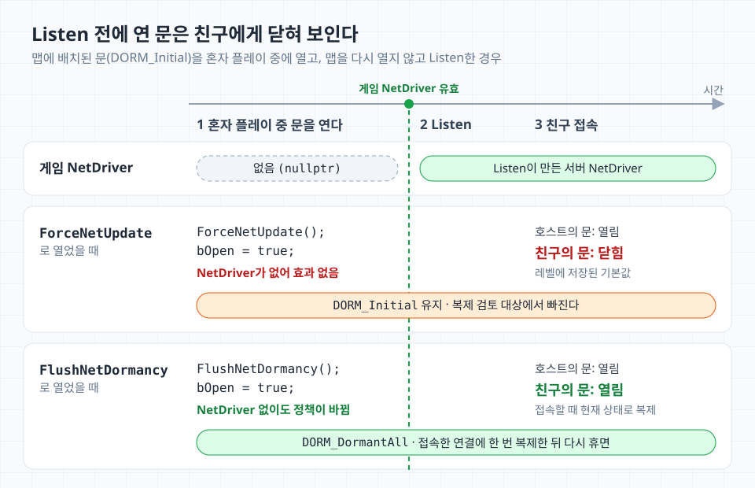

휴면(dormant) 상태인 액터의 replicated property를 바꾸면 그 변경은 클라이언트로 가지 않는다. 액터를 깨우는 API는 `FlushNetDormancy`, `ForceNetUpdate`, `SetNetDormancy` 세 가지가 있고, 각각 바꾸는 것이 다르다.

## 세 함수 비교

| | `FlushNetDormancy` | `ForceNetUpdate` | `SetNetDormancy` |
| --- | --- | --- | --- |
| 바꾸는 것 | 연결별 휴면 상태 | 다음 복제 검토 시점 | 액터의 휴면 정책(`NetDormancy`) |
| 호출 뒤 `NetDormancy` | 유지. 한 번 더 복제한 뒤 다시 휴면 | 유지 | 지정한 값 |
| `DORM_Initial` 액터 | `DORM_DormantAll`로 바뀐다 | 게임 NetDriver가 있을 때만 바뀐다 | 지정한 값 |
| 복제 시점 | 앞당기지 않는다 | 다음 복제 검토에 바로 넣는다 | 앞당기지 않는다 |
| 휴면 해제 | 항상 | 조건부로 `FlushNetDormancy` 호출 | `DORM_Awake` 이하로 바꿀 때 |
| 클라이언트에서 호출 | 무시 | 게임 NetDriver에는 무시 | 무시 |
| Blueprint | `BlueprintAuthorityOnly` | `BlueprintCallable` | `BlueprintAuthorityOnly` |

## 각 함수가 하는 일

### `FlushNetDormancy`

클라이언트이거나, `NetDormancy`가 `DORM_Awake` 이하이거나, 파괴 대기 중이면 바로 반환한다(`Engine/Private/Actor.cpp`). 통과하면 `DORM_Initial`을 `DORM_DormantAll`로 바꾸고 활성화된 모든 NetDriver의 휴면을 푼다. 게임 NetDriver가 없어도 `NetDormancy`는 바뀐다.

레거시 복제는 연결마다 액터를 dormant 목록에서 빼고, 액터와 서브오브젝트의 replicator를 현재 상태로 다시 만든다(`Engine/Private/NetConnection.cpp`). 레거시 복제, Replication Graph, Iris 모두 휴면만 풀 뿐 복제 시점은 건드리지 않는다. 휴면 정책도 그대로라 한 번 복제한 뒤 다시 휴면하므로, 계속 깨워 두려면 `SetNetDormancy`를 쓴다.

### `ForceNetUpdate`

`NetUpdateFrequency` 주기를 기다리지 않고 다음 복제 검토에 넣는다. Replication Graph는 우선순위도 올리지만 레거시 복제는 올리지 않는다.

보장하는 것은 검토 시점뿐이다. 관련성 검사, 대역폭 포화, 프로퍼티 비교는 그대로 거치고, Push Model의 마킹을 대신하지 않는다. 휴면 액터라면 내부에서 `FlushNetDormancy`도 부르지만, authority이고 서버 게임 NetDriver가 있을 때만이다.

### `SetNetDormancy`

클라이언트이거나 파괴 대기 중이면 반환한다. `DORM_Awake` 이하로 바꿀 때는 액터를 네트워크 액터 목록에 넣고 각 NetDriver의 휴면을 푼다. 휴면 해제까지 함께 하므로 따로 `FlushNetDormancy`를 부를 필요는 없다.

## 언제 무엇을 부르나

| 상황 | 호출 |
| --- | --- |
| 휴면 액터의 값을 가끔 바꾼다 | 값을 바꾸기 전에 `FlushNetDormancy` |
| 그 변경을 다음 복제 주기보다 빨리 보내야 한다 | `FlushNetDormancy` → 값 변경 → `ForceNetUpdate` |
| 깨어 있는 액터의 변경을 빨리 보내야 한다 | 값 변경과 함께 `ForceNetUpdate` |
| 한동안 값이 자주 바뀐다 | 시작할 때 `SetNetDormancy(DORM_Awake)`, 끝나면 `SetNetDormancy(DORM_DormantAll)` |

`ForceNetUpdate`도 휴면 액터에서는 안에서 flush하지만 게임 NetDriver가 있을 때만이므로, `FlushNetDormancy`는 따로 부른다. 둘을 함께 쓰면 flush가 두 번 일어나는 것은 피할 수 없다. 다만 두 번째 flush는 replicator를 다시 만들지 않아 비용이 거의 없다.

## 자주 하는 실수

### `ForceNetUpdate`가 휴면을 풀지 못하는 경우

`ForceNetUpdate`는 authority이고, 게임 NetDriver가 있고, 그 NetDriver가 서버일 때만 휴면을 푼다.

```cpp
// Engine/Private/Actor.cpp
void AActor::ForceNetUpdate()
{
	UNetDriver* NetDriver = GetNetDriver();

	if (GetLocalRole() == ROLE_Authority)
	{
		if (NetDriver && NetDriver->GetNetMode() < ENetMode::NM_Client)
		{
			NetDriver->ForceNetUpdate(this);

			if (NetDormancy > DORM_Awake)
			{
				FlushNetDormancy();
			}
		}
	}

	// (생략) 게임 NetDriver가 아닌 NetDriver에는 ForceNetUpdate만 전달한다.
}
```

데디케이티드 서버와 맵을 리슨 서버로 연 경우는 문제가 없다. `UEngine::LoadMap`이 `Listen`을 액터 초기화보다 먼저 호출하기 때문이다.

문제는 게임 NetDriver가 없는 월드다. 혼자 플레이하던 호스트가 맵을 다시 열지 않고 `UWorld::Listen`으로 친구를 받는 협동 게임에서, 맵에 배치된 문(`DORM_Initial`)을 연다고 하자.



`Listen` 전에는 게임 NetDriver가 없어 `ForceNetUpdate`가 아무것도 하지 않는다. 결과가 갈리는 것은 `DORM_Initial`과 `DORM_DormantAll`이 둘 다 휴면이지만 새로 접속한 연결을 다르게 다루기 때문이다.

| | `DORM_Initial` | `DORM_DormantAll` |
| --- | --- | --- |
| 휴면인 연결 | 처음부터 모든 연결. 나중에 접속한 연결도 포함 | 그 연결에 한 번 복제한 뒤부터 |
| 새 연결이 받는 값 | 없음. 레벨 패키지의 기본값을 쓴다 | 접속 시점의 서버 값 |

`DORM_Initial`은 클라이언트도 레벨을 로드하면서 같은 액터를 이미 갖고 있다는 전제로, 배치 액터를 복제 검토 대상에서 아예 뺀다. 그래서 친구는 레벨에 저장된 닫힌 문을 보고, 다음 flush 전까지 상태가 어긋난다. `DORM_DormantAll`은 연결마다 휴면에 들어가므로, 새 연결에는 현재 상태를 한 번 보낸 뒤 휴면한다.

Standalone에서 리플레이를 녹화할 때도 같은 분기를 탄다. 게임 NetDriver가 없으면 데모 NetDriver에는 `ForceNetUpdate`만 전달되고 휴면은 풀리지 않는다.

`FlushNetDormancy`는 게임 NetDriver가 없어도 `DORM_Initial`을 `DORM_DormantAll`로 바꾸고, 데모 NetDriver를 포함한 모든 NetDriver의 휴면을 푼다.

### 값을 바꾼 뒤 깨우면 FastArray 변경이 사라진다

레거시 복제 기준이다. 휴면 액터의 FastArray에 항목을 추가한 뒤 깨우면 그 항목은 클라이언트로 가지 않는다.

```cpp
void AChestActor::AddItem(const FChestItem& NewItem)
{
	FChestItem& Item = Items.Items.Add_GetRef(NewItem);
	Items.MarkItemDirty(Item);

	// 휴면 중이었다면 위 항목은 전달되지 않는다.
	ForceNetUpdate();
}
```

결과는 서버와 클라이언트의 배열 불일치다. 이후 같은 순서로 추가한 항목도 전달되지 않고, Push Model로 등록하고 마킹한 FastArray도 같다.

`ForceNetUpdate`는 휴면 액터에서 내부적으로 `FlushNetDormancy`를 부르므로 "변경 → flush"와 같은 순서다. 레거시 복제는 기본 설정에서 flush할 때 연결마다 replicator를 현재 상태를 기준선으로 다시 만든다. 그래서 flush 전에 추가한 항목은 이미 보낸 것으로 취급되는 것으로 보인다.

일반 프로퍼티는 순서를 바꿔도 지금은 전달되지만, Epic은 이를 기대면 안 되는 구현 세부로 본다([Actor Network Dormancy](https://dev.epicgames.com/documentation/en-us/unreal-engine/actor-network-dormancy-in-unreal-engine)).

값을 바꾸기 전에 깨우면 된다.

```cpp
void AChestActor::AddItem(const FChestItem& NewItem)
{
	FlushNetDormancy();

	FChestItem& Item = Items.Items.Add_GetRef(NewItem);
	Items.MarkItemDirty(Item);
}
```

이 뒤에 `ForceNetUpdate`를 더해도 변경은 그대로 전달된다.

## 실수를 막는 방법

### Setter 패턴

위 두 문제는 휴면할 수 있는 액터의 replicated property를 setter로만 바꾸면 막을 수 있다.

```cpp
void ADoorActor::SetOpen(bool bNewOpen)
{
	check(HasAuthority());

	if (bOpen == bNewOpen)
	{
		return;
	}

	FlushNetDormancy();
	bOpen = bNewOpen;

	// 바로 보내야 하는 변경일 때만
	ForceNetUpdate();
}
```

- 같은 값이면 반환한다. 값이 그대로여도 flush는 휴면을 푼다. 레거시 복제에서는 flush할 때마다 연결별 replicator를 다시 만들고 Actor channel을 다시 연 뒤 다시 휴면한다. 값이 한동안 자주 바뀌면 같은 이유로 변경마다 flush하지 말고 `SetNetDormancy`로 깨워 둔다.
- `FlushNetDormancy`를 직접, 값을 바꾸기 전에 부른다. 게임 NetDriver가 없는 월드와 FastArray 순서 문제를 함께 막는다.
- 프로퍼티를 `private`로 두고 setter만 공개한다.

### Push Model과 함께 쓸 때

마킹도 setter 안에서 값을 바꾼 직후에 한다. 마킹하지 않은 Push Model 프로퍼티는 flush해도 전달되지 않는다. 반대로 마킹은 dirty 표시일 뿐 휴면을 풀지 않으므로, 마킹했더라도 flush는 그대로 필요하다.

Push Model은 값이 그대로인 flush의 비용을 줄여 주지 않는다. 건너뛰는 것은 dirty가 아닌 프로퍼티의 비교뿐이고, 깨우고 다시 재우는 비용은 그대로라 setter의 early-return으로 막는다. 비교 비용 절감은 깨어 있는 액터에서 의미가 있다([Push Model 글](/posts/unreal-engine-push-model-networking/)). 이 패턴에서 Push Model의 역할은 비용보다 강제에 가깝다. 마킹 없이는 변경이 전달되지 않으니 값을 바꾸는 경로가 setter로 모이고, 그 setter가 flush 순서까지 고정한다.

## 참고 자료

- [Epic Games: Actor Network Dormancy](https://dev.epicgames.com/documentation/en-us/unreal-engine/actor-network-dormancy-in-unreal-engine)
- [Unreal Engine - Push Model Networking](/posts/unreal-engine-push-model-networking/)
