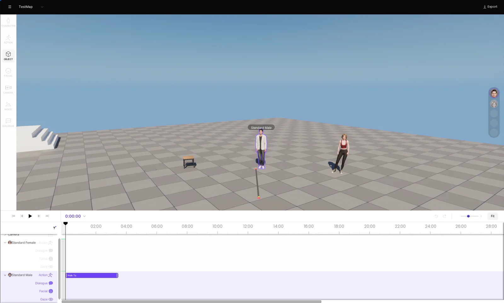
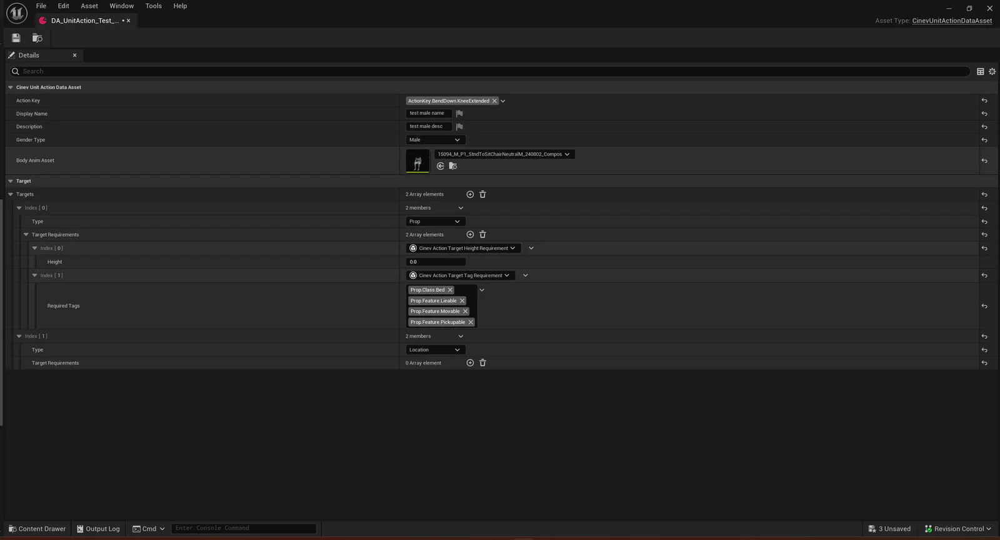
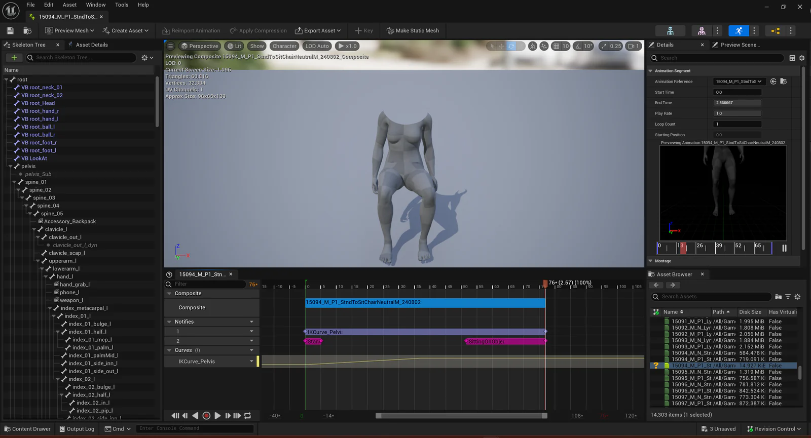
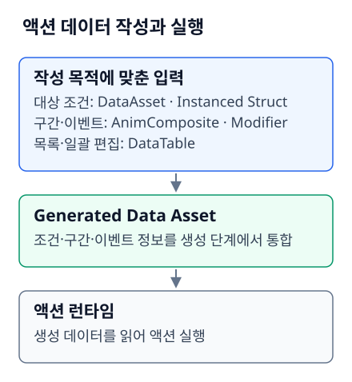
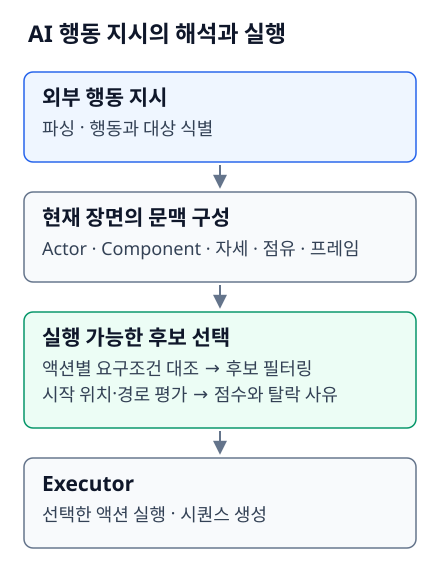
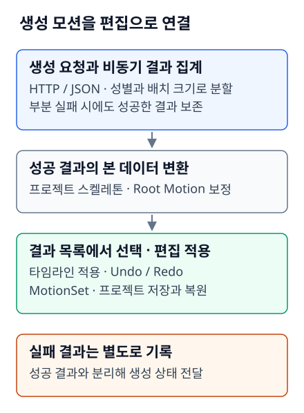
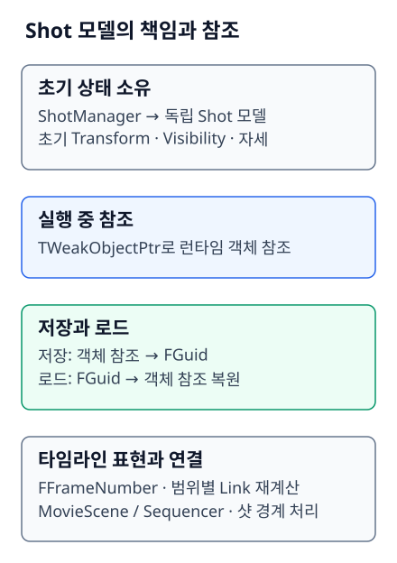
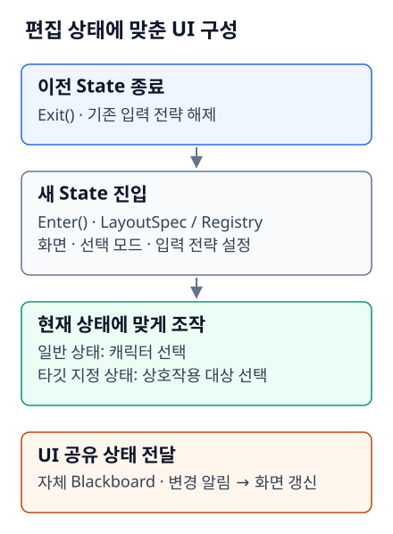
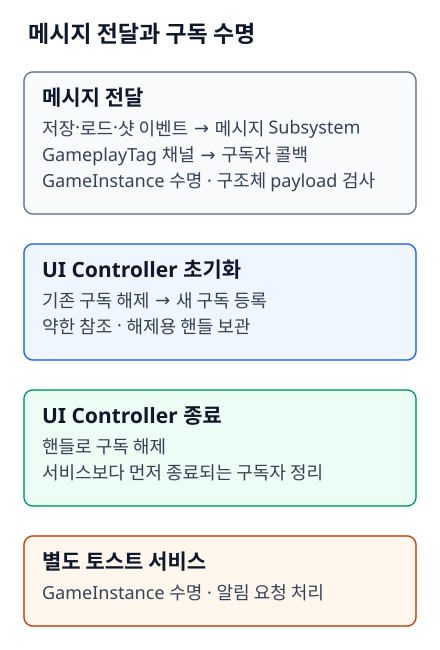

| 항목 | 내용 |
| --- | --- |
| 기간 | 2024.06 - 2026.04 |
| 소속 | 시나몬 |
| 역할 | 클라이언트 프로그래머 |
| 기술 | Unreal Engine 5, C++, UMG, Sequencer, ONNX |

<iframe class="video-embed" src="https://www.youtube.com/embed/8Pq8nM0Rm-w" title="CineV Build Storyboard 튜토리얼" loading="lazy" allow="accelerometer; autoplay; clipboard-write; encrypted-media; gyroscope; picture-in-picture; web-share" referrerpolicy="strict-origin-when-cross-origin" allowfullscreen></iframe>

## 프로젝트와 담당 역할

CineV는 사용자가 입력한 이야기를 AI가 장면으로 구성하고, 제작자가 그 장면을 편집해 영상으로 출력하는 AI 애니메이션 제작 서비스다. 이야기 입력, AI 장면 구성, Studio 편집, 영상 출력 순서로 이어진다. CINEVStudio는 이 가운데 3D 장면 제작과 연출을 맡는 Unreal Engine 5 기반 제작 도구다. 제작자는 AI가 구성한 장면에서 캐릭터, 소품(Prop), 액션, 카메라, 타임라인을 직접 편집한다. 편집 타임라인은 Sequencer의 런타임 계층인 `MovieScene`을 확장한 커스텀 트랙과 섹션으로 이루어져 있다.

시나몬에서 2024년 6월부터 2026년 4월까지 클라이언트 프로그래머로 참여했다. 콘텐츠팀이 액션 데이터를 작성하는 단계부터 AI 결과 해석, 타임라인 편집, 저장과 재생까지 잇는 클라이언트 개발을 맡았다. 담당한 영역은 액션과 Prop의 데이터 규칙, AI 결과의 해석과 적용, 편집 UI의 상태 관리, Shot 상태 모델과 저장, 복원, 그리고 빌드와 패키징, 크래시 수집, 엔진 이전이다.

장면을 생성하는 S2M(Story-to-Movie)과 모션을 생성하고 검색하는 Text2Motion의 서버 쪽은 AI 팀의 작업이다. 나는 그 결과를 Studio가 받아 해석하고 보정하고 편집하는 클라이언트 쪽을 맡았다. 액션 에셋을 작성하는 일은 콘텐츠팀이 한다. 나는 그 데이터의 구조와 실행 경로, 기존 데이터의 변환기를 맡았고 작성 도구 작업은 동료와 나눠 했다. 이 글의 코드는 설계를 보여 주기 위해 이름과 구조를 일반화한 것이다.

## 대표 결과

Studio의 편집 화면은 캐릭터와 소품을 배치하는 뷰포트, 그리고 캐릭터별 액션과 카메라를 시간순으로 놓는 타임라인으로 이루어진다.

CINEVStudio로 『무조건 이혼한다』를 애니메이션으로 만드는 과정이다.

<iframe class="video-embed" src="https://www.youtube.com/embed/NQJT8oN7NGg" title="CINEVStudio로 『무조건 이혼한다』를 애니메이션으로 만드는 과정" loading="lazy" allow="accelerometer; autoplay; clipboard-write; encrypted-media; gyroscope; picture-in-picture; web-share" referrerpolicy="strict-origin-when-cross-origin" allowfullscreen></iframe>

이 글에 실은 Studio 기능 시연 영상들은 회사가 공개한 것으로, 제품의 최종 상태를 보여 준다. 영상에 나오는 기능 전체가 아니라 그 가운데 내가 맡은 부분을 이 글에서 다룬다.

캐릭터를 장면에 배치하고 액션과 카메라 타깃을 설정하는 시연이다. 이 화면의 사이드패널과 컨텍스트 메뉴, 편집 상태에 따라 바뀌는 선택 동작이 [UI 상태 관리](#ui-상태별로-화면-선택-입력-처리-분리)에서 다루는 부분이다. ZEPETO 캐릭터 지원과 대상을 바라보는 중의 대기 동작은 내 작업이 아니다.

<iframe class="video-embed" src="https://www.youtube.com/embed/nD2Aw2uxv9s" title="CINEVStudio에서 내 캐릭터로 장면 제작" loading="lazy" allow="accelerometer; autoplay; clipboard-write; encrypted-media; gyroscope; picture-in-picture; web-share" referrerpolicy="strict-origin-when-cross-origin" allowfullscreen></iframe>

카메라 템플릿을 고르고 타깃을 기준으로 구도를 잡는 시연이다. 카메라 편집 화면의 기반인 포커스 타깃, 키 편집 상태, 템플릿 탭을 만들었다. 템플릿의 확장과 여러 인물의 중심을 기준으로 한 구도는 내 작업이 아니다.

<iframe class="video-embed" src="https://www.youtube.com/embed/NJJ5w8NFKiU" title="CINEVStudio 카메라 연출" loading="lazy" allow="accelerometer; autoplay; clipboard-write; encrypted-media; gyroscope; picture-in-picture; web-share" referrerpolicy="strict-origin-when-cross-origin" allowfullscreen></iframe>

CINEVStudio로 [『무조건 이혼한다』](https://m.comic.naver.com/webtoon/list?titleId=842623)를 애니메이션으로 만든 완성 영상은 [네이버 컷츠 1화](https://comic.naver.com/cuts/embed?id=KW-cuts:0-cuts_6502-1)에서 볼 수 있다.

## 문서와 대조하던 액션 조건을 타입별 입력 구조로 전환

액션 하나를 정의하려면 재생할 애니메이션과 구간, 대상이 갖춰야 할 조건, 상호작용이 일어나는 시점이 함께 필요하다. 기존에는 이것을 `DataTable` 행에 적었다. 애니메이션 ID와 프레임을 입력하고, 상호작용 설정은 문자열과 인덱스로 맞췄다. 콘텐츠 제작자는 어떤 값을 넣어야 하는지 별도 문서와 대조해야 했고, 런타임은 필요한 정보를 읽기 위해 애니메이션 에셋을 직접 열었다.

제작자가 기억해서 맞추던 관계를 입력 구조가 대신 갖게 하는 것을 목표로 삼았다. 모든 조건 칸을 펼쳐 두고 쓸 것을 표시하는 방식 대신, 액션에 필요한 조건만 골라 추가하고 그 조건의 타입에 맞는 칸만 채우는 방식을 택했다. `DataTable`은 없애지 않고, 액션 `DataAsset`과 다른 에셋들을 한 행에서 묶는 역할로 남겼다.

### 조건 값과 동작 설정에 다른 표현 사용

액션 정의는 `UDataAsset`으로 분리했다. 대상별 요구조건은 `TInstancedStruct` 배열로 두어, 서로 다른 조건 타입을 한 목록에 섞어 넣으면서도 타입마다 필요한 필드만 편집하게 했다. 애니메이션 이벤트(`Notify`, `NotifyState`)에는 Instanced `UObject`인 Modifier를 두어 이벤트의 시점과 그 시점에 일어날 동작의 설정을 같은 자리에서 편집하게 했다.

아래 화면은 액션, 대상, 요구조건으로 이어지는 입력 구조다.

### 작성한 데이터를 실행용 에셋으로 통합

모션 구간과 이벤트 시점은 `AnimComposite`에서 편집하게 했다. 액션 애니메이션은 시퀀서에 올려야 하는데, 시퀀서의 애니메이션 섹션은 `AnimSequence`와 `AnimComposite`는 받고 `AnimMontage`는 받지 않는다. 여러 시퀀스를 이어 붙인 구간 위에 `Notify`와 Curve를 놓을 수 있으면서 시퀀서에 그대로 올릴 수 있는 에셋이 `AnimComposite`였다.

| 작성 목적 | 데이터 구조 |
|---|---|
| 액션별 대상과 조건 조합 | `DataAsset` + Instanced Struct |
| 이벤트의 동작 설정 | `Notify` + Instanced `UObject` Modifier |
| 구간, `Notify`, Curve 편집 | `AnimComposite` |
| 액션 `DataAsset`과 다른 에셋의 연결 | `DataTable` 유지 |

이렇게 나눠 작성한 데이터는 생성 단계에서 실행용 에셋(Generated Data Asset) 하나로 모은다. 애니메이션 메타데이터와 이벤트 시각, 길이, Modifier를 이 단계에서 정리해 두므로 런타임은 애니메이션 에셋을 열지 않고 생성 에셋만 읽는다. 기존 데이터를 새 구조로 옮기는 변환기를 에디터 유틸리티 위젯으로 만들고 전환 절차를 문서로 정리했다. 도구 작업은 동료와 나눠 맡았다.

[액션 데이터 도식 원본 확대](./images/cinev-studio/authoring.svg)

### 수동 입력을 계산과 검증으로 대체

입력 구조를 바꾼 뒤에도 사람이 맞춰야 하는 값이 남아 있었다. 액션 시작 위치의 오프셋은 애니메이션 첫 프레임의 프록시 본에서 자동으로 계산하게 해 수동 입력을 없앴다.

구조로 막을 수 없는 오류는 검증기로 잡았다. 기존 데이터 검증 프레임워크에 액션 데이터 행을 검사하는 커맨드릿을 추가했고, 상위 단위인 메타 액션이 요구하는 타깃의 종류와 순서를 그 아래 유닛 액션이 갖추고 있는지 검사하는 정적 규칙 검증을 더했다. 쓰지 않는 로직과 데이터 구조는 조사해서 제거했다.

> **확인한 범위**
>
> 콘텐츠팀 제작 가이드에 에셋 작성 절차가 반영됐고, 검증기 결과를 기준으로 콘텐츠 변경의 반영 여부를 정하게 됐다. 검증기가 잡는 것은 타깃의 종류와 순서, 데이터 개수 같은 정적 규칙 위반이고 의미 판단은 사람이 한다. 입력 오류나 작성 시간이 얼마나 줄었는지는 측정하지 않았다.

## AI의 행동 지시를 현재 장면에서 실행할 수 있는 액션으로 해석

S2M은 "누가 무엇에 어떤 행동을 한다"는 장면 설명을 내놓는다. Studio는 이것을 실제 액션, 대상, 위치로 바꿔야 한다. 같은 지시라도 캐릭터의 자세, 대상 소품, 점유 상태, 이동 경로에 따라 실행할 수 있는 후보가 달라진다. 이 판단이 여러 곳에 흩어져 있어 같은 후보를 여러 번 순회했고, 후보가 왜 탈락했는지 알 방법이 없었다.

AI 결과를 읽는 처리와 월드 상태를 보고 판단하는 처리를 나눴다. S2M 코드에 묶여 있던 메타 액션 처리를 분리하고, 행동을 실행하는 실행기(Executor)를 `GameplayTag`로 찾게 했다. 샷 JSON 파서는 초기 상태, 카메라, 블록, 섹션 단위로 나누고 타입 검사를 넣었다.

액션 선택은 Strategy와 Functor로 구성한 파이프라인으로 만들었다. 자세, 대상, 점유 상태, NavMesh 경로를 기준으로 후보를 걸러내는 검사와 점수를 매기는 평가를 Functor 단위로 나누고, 선택한 액션을 실행기와 시퀀스 생성으로 넘긴다. 따로 돌던 시작 위치 검증과 경로 길이 점수 계산은 한 파이프라인으로 합쳐 중복 순회를 없앴다. 후보가 어느 검사에서 탈락했는지, 점수에 어떤 항목이 얼마나 기여했는지를 기록하는 디버깅 기능도 함께 만들었다.

[AI 행동 해석 도식 원본 확대](./images/cinev-studio/interpreter.svg)

### 빌드 결과의 불일치와 배치 위치 보정

S2M이 만든 장면을 Studio가 빌드하는 과정에서는 크래시가 났고, 서 있어야 할 캐릭터가 앉아 있거나 저장하고 다시 열면 다른 대기와 걷기 애니메이션이 나오는 문제가 있었다. 빌더의 크래시와 자세 상태 불일치를 고치고, 랜덤 시드를 고정해 저장 전후에 같은 애니메이션이 나오게 했다. 캐릭터 배치는 위치 문맥을 기준으로 다시 작성했고, 극좌표 샘플링과 근접도 점수로 배치 위치를 보정했다.

> **확인한 범위**
>
> S2M은 앉은 상태로 보는데 Studio에서는 서 있는 식의 자세 불일치는 그 뒤에도 간헐적으로 다시 나타났다. 선택 정확도나 빌드 실패율은 측정하지 않았다.

## AI가 생성한 모션을 선택, 편집, 저장까지 연결

Text2Motion은 텍스트에서 모션을 생성하거나 검색해 돌려주는 AI 서비스다. 이 결과를 Studio의 제작 경로에 넣을 방법이 없었다. 요청은 비동기로 끝나고 여러 요청 가운데 일부만 성공할 수 있으며, 응답의 본 데이터는 프로젝트의 스켈레톤에 맞게 변환해야 했다.

생성 결과를 별도 도구에 두는 대신 Studio가 이미 갖고 있는 섹션, 빌드, 저장, 편집 명령 스택에 맞춰 받아들이기로 했다. 그래야 생성 모션도 다른 액션처럼 타임라인에 놓고, 되돌리고, 프로젝트와 함께 저장할 수 있다. 생성 결과를 무조건 적용하지도 않았다. 루트 모션의 이동 거리가 설정한 임계값을 넘으면 Text2Motion 적용을 건너뛰고 기존 S2M 액션 생성으로 돌아가게 했다.

### 생성 요청과 런타임 애니메이션 변환

HTTP/JSON API를 연동하고 요청을 성별과 배치 크기 단위로 나눠 병렬로 보냈다. 일부 요청이 실패해도 성공한 결과는 보존한다. 장면 설명 전체를 보내던 요청은 모션이 필요한 섹션만 보내는 섹션 단위 요청으로 바꿨다. 응답의 본 데이터에는 기존 ONNX 본 변환을 적용하고 최적화했으며, 루트 모션을 보정해 런타임 애니메이션으로 만들었다. S2M 빌드에도 이 처리를 통합했다.

[AI 모션 연동 도식 원본 확대](./images/cinev-studio/motion.svg)

### 생성 결과를 고르고 되돌리고 저장하는 흐름

생성한 모션 묶음(MotionSet)은 프로젝트 파일과 별도의 파일에 저장했다. 프롬프트와 생성 조건을 입력하는 Prompt Workspace, 결과를 고르는 Asset Picker, 사이드패널을 ViewModel 기반으로 만들었다. 제작자는 결과 목록에서 모션을 골라 타임라인에 적용하고, 다른 편집과 똑같이 Undo와 Redo로 적용을 취소하거나 다시 적용한다.

프롬프트로 모션을 생성해 캐릭터 타임라인에 적용하는 시연이다.

<iframe class="video-embed" src="https://www.youtube.com/embed/Yp7Ao5nen8Q" title="CINEVStudio AI 액션 생성" loading="lazy" allow="accelerometer; autoplay; clipboard-write; encrypted-media; gyroscope; picture-in-picture; web-share" referrerpolicy="strict-origin-when-cross-origin" allowfullscreen></iframe>

> **확인한 범위**
>
> API 응답을 받는 것부터 선택, 타임라인 적용, Undo와 Redo, 저장과 복원까지 구현해 병합했다. 생성 품질, 처리 시간, 실패율은 측정하지 않았다. 모션을 생성하고 검색하는 서버는 AI 팀의 작업이고, 영상에 나오는 남성 캐릭터 지원과 액션 길이 자르기는 내 작업이 아니다.

## 샷 초기 상태의 소유와 저장, 복원 경로 정리

타임라인에는 처음에 샷이라는 편집 단위가 없었다. 샷을 도입한 뒤에는 샷이 시작할 때 캐릭터와 Prop이 어디에 어떤 자세로 있고 보이는지, 곧 샷의 초기 상태를 누가 갖고 어떻게 복원하는지가 문제가 됐다. 샷을 나타내던 샷 밴드는 타임라인의 섹션으로 구현돼 있어 확대 비율에 따라 폭이 변했고, 샷을 그리는 일과 샷 데이터를 관리하는 일이 한 위젯에 묶여 있었다. 초기 상태는 GUID로 액터를 찾아 가며 조회했고, 샷을 지워도 가시성이 초기 상태로 돌아오지 않았다.

타임라인에 어떻게 그려지는지와 상관없이 초기 상태를 소유하는 독립된 샷 모델을 두기로 했다. 샷 매니저와 샷 객체가 초기 변환, 가시성, 자세를 관리하고, 타임라인 쪽 표현(샷 블록)은 이 모델을 보여 주기만 한다. 이 초기 상태 관리와 샷 블록으로의 전환은 설계와 구현을 주도했고, 샷 블록의 타임라인 위젯은 동료가 구현한 것을 리뷰했다.

구현에서 정한 규칙은 다음과 같다.

- **참조:** 실행 중에는 `TWeakObjectPtr`로 객체를 가리키고, 저장할 때는 `FGuid`로 기록했다가 불러올 때 객체 참조로 되돌린다.
- **전파:** 앞 샷이 끝난 상태를 다음 샷의 초기 상태로 넘긴다.
- **저장 구조:** 중첩 배열이던 저장 데이터를 평면화한 맵 구조로 바꿨다.
- **재계산 범위:** 링크를 다시 만드는 범위를 샷 단위로 좁혔다.
- **하위 호환:** 샷 밴드 섹션이 든 예전 저장 파일은 불러올 때 새 초기 상태로 변환하고, 저장 데이터에 없는 액터는 안전하게 건너뛴다.

[Shot 모델 도식 원본 확대](./images/cinev-studio/shot.svg)

### 섹션 사이의 빈 구간과 샷 경계 처리

타임라인에서 액션 섹션과 섹션 사이에는 빈 구간이 생긴다. 이 구간을 자동으로 채우는 처리(링커)는 앞 프레임의 캐릭터 상태를 여러 곳에서 따로 조회했고, 상태를 잃거나 잘못된 링크를 만드는 일이 반복됐다. 캐릭터의 변환, 자세, IK 상태를 한 번 평가해 구조체 하나(프레임 문맥)에 담아 넘기도록 바꾸고, 플래그로 갈라 두었던 실험용 경로를 걷어내며 빈 구간을 채우는 규칙을 다시 작성했다.

포즈에서 포즈로 넘어가는 전환(P2P)의 빈 구간 처리도 링커 한곳으로 모았다. IK를 켜고 끄는 순간 전환 대신 이웃한 애니메이션 섹션의 IK 커브를 이어받아 시간에 따라 보간하게 했다.

### Prop 점유를 타임라인 모델로 표현

캐릭터가 액션 도중 Prop을 잡거나 자리를 차지하는 상태는 런타임의 임시 상태로만 있었다. 그래서 저장하고 다시 열면 사라졌고, Prop 쪽에 자동으로 만들어지는 링크 섹션과 충돌해 애니메이션이 어긋났다. 점유를 전용 트랙과 섹션으로 타임라인 모델에 올리고, 샷 안에서 캐릭터별 액션을 시간순으로 따라가며 점유가 바뀌는 구간에 제어 섹션을 자동으로 만들게 했다. 그 구간에서는 링크를 만들지 않는다. 들기 액션 뒤에 다음 액션을 추가하면 물건을 내려놓지 않은 채 실행되던 버그가 이 구조로 해결됐다.

### 여러 변경을 하나의 Undo 단위로 묶기

클립 하나를 옮기는 편집도 안에서는 여러 섹션과 링크의 변경으로 이루어진다. GUID로 객체를 추적하고 Command 패턴을 적용해 여러 변경을 하나의 Undo와 Redo 단위로 묶었다. 묶음이 실행되는 중간에는 링크 재계산을 막고 끝난 뒤에 한 번만 하게 했다.

클립 이동과 빈 구간의 추가, 삭제를 Undo와 Redo로 되돌리는 시연이다.

<iframe class="video-embed" src="https://www.youtube.com/embed/72bpQuRm7qM" title="CINEVStudio 액션 위치와 타이밍 편집" loading="lazy" allow="accelerometer; autoplay; clipboard-write; encrypted-media; gyroscope; picture-in-picture; web-share" referrerpolicy="strict-origin-when-cross-origin" allowfullscreen></iframe>

> **확인한 범위**
>
> 샷 모델 전환은 병합됐고, 그 직후 QA에 타임라인과 링크의 선행 검증을 요청했다. 들기 액션 버그는 해당 이슈가 완료 처리된 것으로 확인했다. 회귀가 얼마나 줄었는지는 측정하지 않았고, 새 링커 규칙이 모든 경계 사례를 처리하는지도 확인하지 못했다. 영상에 나오는 여러 액션의 시작 위치 일괄 이동과 캐릭터 트랙 재정렬은 내 작업이 아니다.

## UI 상태별로 화면, 선택, 입력 처리 분리

뷰포트를 클릭했을 때 일어나야 할 일은 편집 상황에 따라 다르다. 평소에는 캐릭터를 선택하지만 액션의 타깃을 지정하는 중에는 상호작용 대상을 골라야 하고, 카메라 편집 중에는 또 다르다. 이 분기가 큰 위젯과 UI 서브시스템 안에 섞여 있었다.

화면 구성, 선택 모드, 입력 처리를 편집 상태(State) 단위로 나눴다. 상태마다 `Enter()`와 `Exit()`를 두고, 상태에 들어갈 때 레이아웃과 선택 모드, 입력 처리 방식을 설정한다. 상태 전환은 UI Controller가 맡는다. 새 편집 기능은 기존 위젯에 분기를 더하지 않고 State를 하나 추가해 만든다. 캐릭터 생성과 이동, Prop 이동, 걷기 액션 생성, 액션 클립 편집 같은 기능이 각각 하나의 State다.

상태 사이에 공유해야 하는 값은 Blackboard에 둔다. Unreal Engine의 AI Blackboard에서 착안한 것으로, `GameplayTag`를 키로 값을 보관하고 관찰자를 등록하고 해제할 수 있다. 선택은 선택 관리자 하나가 모든 진입점이 되어 선택 이벤트를 받고 현재 선택된 객체를 알려 준다. UI 서브시스템이 갖고 있던 상태 보관과 화면 로직을 이 구조로 옮기면서 편집기와 UI 서브시스템 사이의 순환 의존도 없앴다.

[UI 도식 원본 확대](./images/cinev-studio/ui.svg)

같은 시기에 새 UI 시안을 적용하면서 화면마다 따로 구현돼 있던 버튼, 모달, 컨텍스트 메뉴를 공통 컴포넌트로 통일했다. 캐릭터, Prop, 타임라인 클립의 컨텍스트 메뉴와 사이드패널 인터페이스도 함께 정리했다.

### 메시지 서비스와 구독 수명 관리

저장과 불러오기 요청, 샷 변경 이벤트, 토스트 알림은 화면 여러 곳에서 보내고 받는다. 이것을 Subsystem 기반의 채널 메시지 서비스로 전달하게 했다. 구독할 때 받은 핸들로 구독을 해제하게 해 구독자의 수명을 위젯의 수명과 구분해 관리했다.

[Subsystem 도식 원본 확대](./images/cinev-studio/subsystems.svg)

> **확인한 범위**
>
> 이 구조가 생긴 뒤의 편집 기능은 State를 추가하는 방식으로 만들어졌다. 내가 만든 것 가운데는 Text2Motion의 Prompt Workspace와 Asset Picker가 그렇다. 공통 컴포넌트는 이후의 패널에서 재사용됐다. 상태 전환 중의 크래시와 포커스에 의한 상태 초기화 같은 문제는 그 뒤에도 고쳐 나갔다. 기능 추가에 드는 시간이나 버그 수의 변화는 측정하지 않았다.

## 그 밖의 담당 업무

### 빌드, 패키징과 오류 추적

- **빌드와 배포:** GitLab Runner 기반으로 Unreal Engine 빌드와 패키징 환경을 구축하고 운영했다. 코드가 바뀌면 에디터 바이너리를 빌드해 아티팩트로 등록하고 스크립트로 내려받게 해, 기획과 QA가 직접 빌드를 받아 검증하게 됐다.
- **패키징:** 빌드, 패키징, 정리 단계를 나누고 버전 태그를 올리면 Shipping 패키지가 자동으로 만들어지게 했다.
- **심볼과 캐시:** Shared DDC, Symbol Store, 미니덤프와 PDB 업로드를 구성했다.
- **크래시 수집:** Sentry에 크래시가 들어오면 Slack으로 알리고 스크린샷을 첨부하게 했으며, 빌드 구성별로 심각도 수준을 나눴다.
- **빌드 시간:** `UnrealBuildTool`의 실행 방식을 바꾸고 출력 리다이렉션을 꺼, 에디터 바이너리 생성 파이프라인에 생겼던 약 10분의 성능 저하를 회복했다. 변경 전후의 같은 파이프라인을 비교한 자체 측정이고 다시 측정하지는 않았다.
- **쿠킹 시간:** 같은 패키징 작업에서 쿠킹 프로세스 수를 4에서 8로 올려 쿠킹 단계가 약 600초에서 500초대로 줄어드는 것을 자체 측정으로 확인했다. 전체 패키징은 1~2분만 줄어, 시간의 대부분은 아카이빙과 압축, 복사에 든다는 결론을 얻었다.

### 타임라인과 카메라

- **카메라 편집:** 카메라 편집 V2와 Auto Camera 워크플로에서 포커스 타깃, 자동 카메라 파라미터 ViewModel, 키 편집 상태, 템플릿 탭을 구현했다.
- **Orbit 카메라:** 대상 주위를 도는 중에 충돌이 나면 카메라가 원래 거리를 잃고, 극점을 지나면 회전이 뒤집히는 문제가 있었다. 거리를 나중에 되돌리는 방식과 입력 각도를 제한하는 방식을 비교한 뒤, 오프셋 벡터를 구면 위에서 회전시켜 반경을 보존하고 극점에서 각도를 제한하는 방식을 함께 적용했다.
- **루트 모션:** 타임라인에서 재생 속도, 반복, 프레임 오프셋을 바꾸면 루트 모션 키를 다시 계산하게 했다.
- **시퀀서 분리:** 씬 시퀀서와 샷 시퀀서를 별도 클래스로 나누고 카메라 컷, 재생 상태, 클립보드, Undo와 Redo 명령 처리를 개선했다.
- **영상 내보내기:** 내보내기 모니터를 재구성하고, 메타데이터 내보내기의 불필요한 프로세스 대기와 클립 수에 비례하던 파일 스캔을 없앴다. 줄어든 시간은 측정하지 않았다.

### 데이터와 엔진

- **Prop 구조:** Prop의 하위 클래스를 모두 없애고 클래스 하나에 컴포넌트 합성과 `GameplayTag`로 특성을 표현하게 했다. 대상 Prop을 고르는 태그 필터의 다중 조건, 높이 요구조건, 점수 계산은 한 번의 순회로 처리한다. 태그를 수직 계층으로 다시 짜지 않고 Prop에 속성 태그를 여러 개 주는 방향은 리드, 동료와 합의해 정했다.
- **씬 설명 파일:** 안정적인 샷 ID, 프레임 단위 범위, 결정적 정렬을 갖춘 샷 중심 스키마로 다시 작성해, 사람이 diff로 어느 샷의 무엇이 바뀌었는지 리뷰할 수 있게 했다.
- **내비게이션:** 동적 장애물과 어태치된 Prop의 내비게이션 영향에 대한 정책을 정리하고 콘텐츠팀에 원리와 적용 기준을 설명했다.
- **엔진 이전:** Unreal Engine 5.3에서 5.7로 옮길 때 엔진 API 변경에 따른 코드 이전을 맡았다.

### 문서와 협업

- **개발 문서:** IDE MCP 설정 가이드, 사이드패널 개발 가이드, AI 에이전트 작업 규약 문서를 작성했다.
- **코드 리뷰:** 팀의 코드 리뷰를 꾸준히 맡았다. 약한 참조의 캐싱, `UPROPERTY`가 없는 `UObject` 참조의 GC 위험, 블루프린트 이벤트 호출 비용이 자주 다룬 주제였다.
- **직군 간 공유:** 기획, 애니메이션, TA, QA와 데이터 규칙과 전환 절차를 공유했다.
- **사내 선정:** 2025년 12월 연말 타운홀에서 GitLab 활동을 기준으로 뽑는 사내 'GitLab 개발왕'에 선정됐다.

## 용어

- **CineV:** 시나몬의 AI 애니메이션 제작 서비스
- **CINEVStudio:** CineV에서 3D 장면을 편집하는 Unreal Engine 5 기반 제작 도구. 본문에서는 Studio로도 쓴다
- **S2M(Story-to-Movie):** 이야기에서 장면 설명을 만드는 AI 파이프라인
- **Text2Motion:** 텍스트에서 모션을 생성하거나 검색하는 AI 서비스
- **Prop:** 장면에 놓는 소품
- **메타 액션, 유닛 액션:** 메타 액션은 필요한 타깃의 종류와 순서를 정하는 상위 행동 단위, 유닛 액션은 애니메이션과 조건을 갖춘 실행 단위
- **샷(Shot):** 타임라인을 나누는 편집 단위. 샷마다 캐릭터와 Prop의 초기 상태를 갖는다
- **링커(Linker):** 타임라인의 섹션 사이 빈 구간을 자동으로 채우는 처리
- **P2P:** 포즈에서 포즈로 넘어가는 전환
- **MotionSet:** Text2Motion으로 생성한 모션 묶음

## 관련 글

- [CINEVStudio에서 Shotloom으로 전환한 배경](/posts/from-cinev-studio-to-shotloom/)
- [AI 에이전트 지침에 점진적 노출 적용하기](/posts/progressive-disclosure-ai-agent/)
