| 항목 | 내용 |
| --- | --- |
| 기간 | 2021.01 - 2024.06 |
| 소속 | 작두 스튜디오 |
| 역할 | 클라이언트 프로그래머 |
| 기술 | Unreal Engine 4/5, C++, Dedicated Server, Steamworks, TeamCity |

<iframe class="video-embed" src="https://www.youtube.com/embed/VVwmqfkluGw" title="Night of the Dead 1.0 트레일러" loading="lazy" allow="accelerometer; autoplay; clipboard-write; encrypted-media; gyroscope; picture-in-picture; web-share" referrerpolicy="strict-origin-when-cross-origin" allowfullscreen></iframe>

## 프로젝트와 담당 역할

Night of the Dead는 밤마다 몰려오는 좀비에 대비해 방어 시설을 짓고 섬에서 살아남는 오픈월드 생존 게임이다. 건설, 제작, 채집, 전투가 있고 밤에는 좀비 무리가 기지로 몰려오는 웨이브가 온다. 지역마다 보스와 던전이 있다. Unreal Engine과 C++로 개발했고 싱글 플레이, 호스트 멀티플레이와 Windows Server 기반 Dedicated Server를 지원한다. [Steam](https://store.steampowered.com/app/1377380/Night_of_the_Dead/)에서 얼리 액세스로 서비스하다가 2024년 5월 1.0으로 정식 출시했다.

얼리 액세스 중이던 2021년 1월에 클라이언트 프로그래머로 합류해 개발 업데이트 #03부터 #19, 1.0 정식 출시까지 참여했다. 플레이어 전투와 무기, 좀비 AI와 보스, 아이템과 장비 시스템을 만들었고, Dedicated Server의 네트워크 대역폭과 서버 CPU, 애니메이션 최적화를 맡았다. UE4 프로젝트를 UE 5.3 커스텀 엔진으로 옮기는 작업과 빌드, 협업 서버 같은 개발 인프라도 담당했다.

클라이언트 프로그래머 2~3명 중 한 명으로 일했다. 보스의 패턴 기획과 애니메이션, 무기 에셋은 다른 직군이 만들었다. 같은 영역에서 팀이 맡은 부분은 각 절에서 따로 구분해 적었다.

## 대표 결과

얼리 액세스 기간의 개발 업데이트 #03부터 #19까지 담당 기능을 반영했고 2024년 5월 1.0 정식 출시까지 참여했다. 업데이트마다 맡은 범위는 [업데이트별 담당 업무](#업데이트별-담당-업무)에 있다.

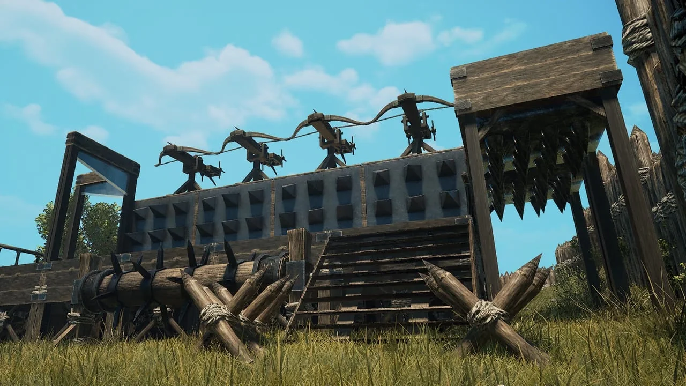

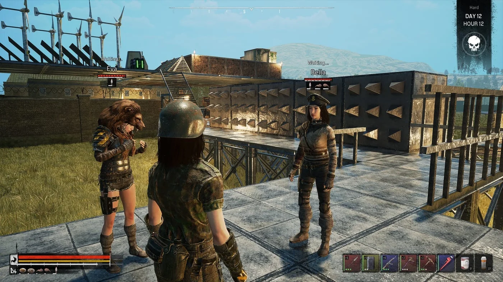

출시 당시의 최적화 효과는 수치로 측정하지 않았다. 이 글에서 측정한 성능 수치는 파괴 시스템을 2026년 11월 별도 프로젝트에서 재현해 잰 값뿐이고 [파괴 시스템 절](#apex-destruction을-대체한-조각-메시-기반-파괴-시스템)에 있다. 네트워크와 서버 최적화는 출시 코드에 남은 구조와 남지 않은 것을 구분해 적었다.

## 복제 대상과 크기, 빈도로 나눠 다룬 Dedicated Server 대역폭

넓은 맵에 건물, 채집 자원, 아이템이 많은 게임이다. 엔진의 기본 복제는 프레임마다 복제 액터를 연결마다 연관성 검사하므로 액터가 늘수록 후보와 검사 비용이 함께 커진다. 수는 많지만 상태가 거의 바뀌지 않는 액터도 깨어 있으면 주기마다 복제 비교를 거친다. 접속할 때는 문제가 더 직접 드러났다. 월드맵을 수천 개의 스트리밍 레벨로 나눈 뒤 서버가 접속한 플레이어에게 보내는 레벨 스트리밍 상태 RPC가 Bunch 한도를 넘었고, 지도 안개처럼 큰 데이터는 한 번에 나가면서 Reliable 버퍼를 압박했다.

2021년 7월 Replication Graph 도입부터 2024년 6월까지 이 주제를 이어 갔다. 그동안 한 일은 세 갈래로 묶인다. 무엇을 복제할지(대상), 한 번에 얼마나 크게 보낼지(크기), 얼마나 자주 보낼지(빈도)다.

### 복제 대상: Replication Graph와 휴면

Replication Graph는 세 번 작성했다. 2021년 7월 ShooterGame 샘플을 바탕으로 처음 도입했는데, 다른 클라이언트의 캐릭터가 보이지 않는 문제가 생겨 한동안 꺼 두었다가 복구했다. 2023년 2월에는 팀 단위로 연관성을 공유하는 구조로 다시 구현했다. 이때 자체 실험 그래프와 서드파티 플러그인을 들여와 구조를 참고한 뒤 둘 다 지웠다. 2023년 11월 UE5로 옮기면서 Lyra 구조를 바탕으로 한 번 더 썼고, 클래스마다 어느 노드로 보낼지를 ini 설정으로 분리했다. 팀 단위 공유는 이 재작성에서 빠져 출시 코드에 구현이 남아 있지 않다.

출시 버전의 그래프는 클래스 정책에 따라 액터를 네 갈래로 보낸다.

- 지도 마커를 달 수 있는 아이템과 건물, 에어드롭은 거리와 상관없이 모든 연결에 복제한다. 스트리밍 레벨에 속한 액터는 그 레벨을 로드한 연결에만 복제한다.
- 정적 아이템, 파괴된 채집 자원, 맵에 배치된 문과 건물은 셀 크기 100m의 공간 그리드에 넣고 휴면 중에는 정적 액터로 다룬다.
- 플레이어가 지은 건물은 공간 그리드의 동적 액터로 다룬다.
- 장비, 무기 부착물, 터렛, 플레이어를 따라다니는 동료 캐릭터(파트너)는 그래프 노드에 넣지 않고 소유 캐릭터의 의존 액터로 묶는다. 부모가 복제되는 연결에만 따라가므로 따로 공간 검사를 하지 않는다.

상태가 드물게 바뀌는 액터는 기본을 휴면으로 두고, 복제 값을 바꾸는 지점에서만 `ForceNetUpdate`로 깨웠다. 아이템과 맵에 배치된 문에 먼저 적용했고, 출시 직전에는 맵에 배치된 건물, 채집 자원 액터, 장비와 부착물까지 넓혔다. 오브젝트 풀에 반납한 좀비를 휴면시키는 처리는 초기 코드에 있던 것을 수정했다. 장비를 휴면시키자 서버가 캐릭터를 순간이동시킬 때 클라이언트에 장비 액터가 남는 부작용이 생겼다. 장비를 다시 깨워 두는 방법도 써 봤지만, 최종적으로는 휴면을 유지하고 캐릭터가 복제로 사라질 때 `PreDestroyFromReplication`에서 장비 액터를 함께 지우는 것으로 풀었다.

창고, 농장, 전기 건물의 내용물과 소켓 연결은 바로 앞에서 열어 보는 플레이어에게만 필요하다. 전기 건물은 0.5초, 농장은 1초마다 거리를 검사하고, 창고는 내용이 바뀔 때 거리를 검사한다. 플레이어가 가까이 있을 때만 전송용 배열에 복사해 복제하고, 멀어지면 배열을 비웠다.

### 전송 크기: ID, 양자화, 비트 단위 직렬화

인벤토리, 제작, 창고의 서버 RPC는 아이템 구조체 전체를 보내고 있었다. 모든 엔티티 데이터 테이블에 정수 `EntityId`를 부여해 이름 대신 ID를 보내게 하고, 이 서버 RPC들의 인자를 엔티티 ID, 수량, 개체 ID만 담은 `FInventoryItem_Net`으로 바꿨다. 받는 쪽이 ID로 원래 구조체를 되찾는다. 장비 스탯은 0이 아닌 값만 소유자에게 보낸다.

발사체 방향은 `FVector_NetQuantizeNormal`로 보낸다. 처음에는 위치용인 `FVector_NetQuantize`를 썼는데, 각 성분을 정수로 반올림하는 형식이라 단위 벡터가 크게 틀어져 클라이언트의 발사체가 엉뚱한 방향으로 나갔다. 이 문제를 겪은 뒤로 방향과 법선은 모두 `NetQuantizeNormal`로 보낸다. 피격 이펙트 멀티캐스트 RPC도 출시 직전에 대부분을 `FHitResult` 대신 양자화 구조체를 받도록 바꿨다. 이 구조체는 팀이 먼저 만들어 둔 것이다.

레벨 스트리밍 상태 RPC는 세 단계에 걸쳐 고쳤다. 2022년 11월에는 레벨 경로의 접두어를 코드 테이블로 치환한 문자열을 보내 Bunch 한도 초과를 풀었다. 2023년 7월 압축 방식을 한 번 바꿨고, 2024년 5월 전송용 구조체에 커스텀 `NetSerialize`를 붙였다. 코드 표에 있는 레벨은 `int16` 코드로, LOD는 `int8`로, 로드와 표시 상태를 나타내는 bool 4개와 코드 사용 여부는 5비트로 묶어 직렬화한다. 자세한 과정은 [접속 시 레벨 스트리밍 상태 RPC 줄이기](/posts/notd-level-streaming-status-rpc/)에 썼다.

### 갱신 빈도와 전송 경로

서버의 게임 내 시각은 매 틱 바뀐다. 초 단위 정수 하나만 복제하게 한 다음, 분이 바뀔 때만 그 값을 갱신하도록 막아 값이 그대로인 동안에는 패킷이 나가지 않게 했다. 같은 시기에 Adaptive Net Update Frequency 설정이 효과가 없는 섹션에 적혀 있던 것을 찾아 실제로 적용되는 섹션으로 옮겼다.

접속할 때 한꺼번에 보내야 하는 큰 데이터를 위해 스트리밍 데이터 라우터를 만들었다. 서버가 데이터를 100개 단위 청크로 나누고, 그 연결의 Reliable 버퍼에 여유가 있을 때만 다음 청크를 보낸다. 지도 안개 동기화를 Fast Array 복제에서 이 경로로 옮겼고, 채집 자원의 리스폰 정보 동기화도 같은 경로를 쓴다. 구조는 [Reliable 버퍼 상태를 보고 대용량 데이터 나눠 보내기](/posts/notd-reliable-rpc-data-streaming/)에 썼다.

> **확인한 범위**
>
> 대상, 크기, 빈도를 줄이는 구조는 1.0 출시 코드에 남아 있다. 대역폭이 얼마나 줄었는지는 측정하지 않았다. 팀 단위 연관성 공유는 출시 코드에 구현이 남아 있지 않다. 직접 넣은 `ForceNetUpdate`는 모두 값을 바꾼 직후에 불렀고 Dedicated Server에서 의도대로 동작했지만, 지금 기준의 권장 순서는 값을 바꾸기 전에 `FlushNetDormancy`를 부르는 것이다. 그 차이는 [휴면 액터 깨우기](/posts/unreal-engine-waking-dormant-actors/)에 정리했다.

## 싸우는 좀비만 포즈를 갱신하는 서버와 중요도 기반 애니메이션 갱신

웨이브에서는 좀비가 한꺼번에 몰린다. Dedicated Server는 렌더링하지 않으므로 렌더링 여부로는 갱신할 좀비를 가를 수 없고, 항상 갱신으로 두면 모든 좀비의 포즈와 본을 매 틱 계산한다. 반대로 꺼 두면 포효 같은 특수 애니메이션이 서버에서 재생되지 않는다. 클라이언트에서는 멀리 있는 캐릭터도 가까운 캐릭터와 같은 빈도로 애니메이션을 갱신하고 있었다.

기준을 "플레이어 가까이 있거나 싸우는 좀비만 제대로 계산한다"로 잡았다. 서버와 클라이언트는 줄일 비용이 달라 따로 다뤘다.

### 서버: 포즈, 스폰, 인지, 내비메시

서버의 좀비는 전투 중이거나 특수 애니메이션에 허용한 시간 동안에만 포즈와 본을 갱신하고, 그 밖에는 몽타주만 진행한다. 2023년 2월에 넣은 조건을 3월에 한 번 걷어 내 항상 갱신으로 되돌렸다가 5월에 다시 넣었고, 출시 코드도 이 상태다.

필드의 좀비는 플레이어가 멀면 액터로 두지 않는다. 스포너가 좀비를 데이터로만 들고 있다가 플레이어가 가까워지면 액터로 만들고, 플레이어가 멀어지면 추적 중이 아닌 좀비부터 데이터로 되돌린다. 액터는 오브젝트 풀로 다시 쓴다. 이 구조로 바꾸면서 레벨 스트리밍이 끝나기 전에 좀비가 스폰되어 바닥 아래로 빠지던 문제도 함께 풀었다.

AI Perception은 감각마다 주변 대상을 주기적으로 검사하므로 좀비 수만큼 비용이 는다. 웨이브 좀비는 스폰 직후 모든 감각을 끄고 Perception 컴포넌트를 제거했다. 내비메시는 인보커 주변에서만 런타임에 생성된다. 틱이 없는 내비게이션 인보커 액터를 만들어 웨이브 중 좀비가 지나가는 웨이포인트마다 두고 웨이브가 끝나면 제거했다. 건물의 인보커는 웨이브 중이면서 플레이어가 활성 거리 안에 있을 때만 켠다.

### 클라이언트: 중요도 기반 갱신

거리 구간으로 중요도를 계산하는 Significance 매니저와 컴포넌트를 만들어 캐릭터에 붙였다. 프레임이 낮을 때만 엔진의 Update Rate Optimization을 켜는 `AnimUROComponent`도 만들었고, 출시 코드에서는 수족관 물고기와 캐릭터 전시대에 쓴다.

### 만들었다가 뺀 것

거리와 서버 프레임, 카메라 정면 여부, 전투 상태로 좀비 이동 컴포넌트의 틱 간격을 늘리는 최적화를 2021년 9월과 2023년 5월에 구현했다. Significance 등급을 AI 이동 틱에 연결하는 것도 만들었지만 2주 만에 껐고, 닷새 뒤 서버 전용 판정이 그 자리를 대체했다. 근처 건물 검색을 멀티스레드 공간 쿼리로 바꾸는 실험은 3주 뒤 폐기하고 기존 공간 그리드로 돌아갔다.

좀비의 이동, 동기화와 길찾기 비용까지 포함한 전체 구조는 [다수 좀비의 서버 비용과 전송량 줄이기](/posts/notd-zombie-horde-cost/)에 정리했다.

> **확인한 범위**
>
> 프레임 비용이나 개선 비율은 측정하지 않았다. 출시 코드에 남은 것은 전투 중 포즈 갱신, 스포너의 데이터화, 웨이브 좀비의 Perception 제거, 웨이포인트 인보커다. 거리, 프레임, 카메라 기반의 이동 틱 간격 조절은 출시 전인 2024년 1월 팀 작업에서 제거됐다. 보이지 않는 좀비의 LOD 기반 이동 틱 조절은 남아 있다. Significance는 출시 코드에서 Dedicated Server에서만 꺼진다.

## APEX Destruction을 대체한 조각 메시 기반 파괴 시스템

돌, 나무, 건물, 루팅 오브젝트가 부서지는 연출을 UE4에서는 PhysX 기반 APEX Destruction으로 처리했다. APEX는 원인을 알 수 없는 에러와 크래시를 냈고, 대규모 파괴에서는 프레임 스파이크도 문제였다.

소스 엔진으로 PhysX 연동 코드까지 디버깅했지만, 남은 분석은 PhysX 바이너리 내부여서 시간이 과도하게 든다고 봤다. 원인을 추적하는 대신 APEX에 의존하지 않고 직접 제어할 수 있는 커스텀 시스템으로 교체하기로 했다. 교체 시점인 2023년 4월은 UE4여서 Chaos Destruction은 선택지가 아니었고, UE 5.3으로 옮긴 뒤에도 이 시스템을 그대로 썼다.

조각은 Blender에서 미리 나눈 StaticMesh로 둔다. 부서지기 전에는 일반 StaticMesh 하나이고, 파괴 시점에 조각들을 만들어 물리로 날린 뒤 일정 시간이 지나면 제거한다. 건물, 문, 부서지는 오브젝트의 연출용 파괴는 Dedicated Server에서 조각을 만들지 않는다. 부분 파괴 대상은 처음부터 조각으로 두고 맞은 반경 안의 조각만 떨어뜨린다. 비용은 두 군데서 제어했다. 건물과 문은 체력이 70% 이하로 내려가면 조각 메시를 미리 로드해 파괴 순간의 로드 비용을 없앴고, 프레임이 15fps 이하로 떨어지거나 웨이브가 큰 상황에서는 연출용 파편을 만들지 않는다. 구조와 엔진 Destructible과의 비교는 [엔진 Destructible 대신 조각 메시로 파괴 오브젝트 처리하기](/posts/notd-custom-destructible/)에 썼다.

### 재현 환경에서 잰 수치

회사 저장소에는 측정값이 없어, 2026년 11월 별도 프로젝트에서 당시 구성을 UE 4.27로 재현해 비교했다. 비교 대상은 교체형 APEX다. 평소에는 통짜 StaticMesh를 두고 파괴할 때 Destructible 컴포넌트를 만들어 교체하는 구성을 가리킨다. 회사 에셋 대신 Starter Content 재질을 썼고 조합마다 3회 측정했다.

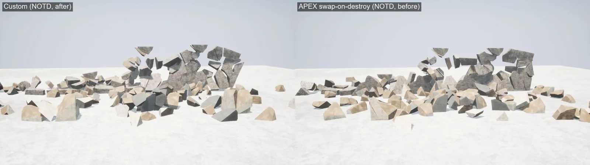

- 재현 환경에서 오브젝트 하나를 부순 프레임의 스파이크는 커스텀 2.67ms로 교체형 APEX(3.68ms)보다 27% 낮았다.
- 재현 환경에서 50개를 순차로 부술 때 커스텀의 p95는 5.24ms로 60fps 예산 안이었다.
- 재현 환경에서 2,000개를 세워 둔 대기 상태의 프레임 시간은 처음부터 Destructible을 배치하는 방식의 1/10.8이었다.
- 재현 환경에서 100개를 동시에 부수는 부하 시험의 스파이크는 처음에 138ms였다. 병목은 조각 컴포넌트 등록 2,400회였고, 한 프레임에 만들 조각 컴포넌트 수에 예산 240개를 두어 25ms로 82% 낮췄다. 같은 조건의 교체형 APEX는 32ms였다.

> **확인한 범위**
>
> 수치는 모두 2026년 11월 재현 환경의 값이고 출시 당시의 효과 수치는 없다. 회사의 코드와 에셋이 아니라 새로 만든 재현 구현과 Starter Content 재질로 쟀다. 프레임당 조각 예산은 재현 환경의 부하 시험에서 찾아 적용한 것이다. UE 5.3의 Chaos Geometry Collection과도 비교했지만 UE4 시점의 결과가 아니어서 여기에는 적지 않았다. 측정 조건과 그 비교는 [재현 환경에서 측정하기](/posts/notd-custom-destructible/#재현-환경에서-측정하기)에 있다.

## 무기 계층 재구성과 클라이언트 판정, 서버 검증 방식의 샷건

장비 데이터를 데이터 테이블 중심으로 개편하면서, 원거리와 투척 공격을 컴포넌트 하나와 투척 전용 클래스가 맡던 구조를 새 데이터에 맞게 다시 나눠야 했다. 총기를 넣으면서는 판정 문제가 따라왔다. 펠릿이 여러 발인 샷건은 지연이 있어도 맞힌 결과가 바로 보여야 하는데, 클라이언트가 보낸 히트를 그대로 믿으면 조작된 결과도 통과한다.

2022년 4월부터 8월까지 무기 시스템을 전면 개편했다. 기존 장비 하위 클래스를 모두 걷어 내고 근접, 원거리, 투척, 활, 기계 무기의 `AWeaponEntity` 계층으로 대체했다. 무기는 발사와 장전, 사격 모드를 맡고 캐릭터의 공격 컴포넌트는 입력과 조준을 맡는다. 탄약, 탄창, 반동, 조준 상태는 인터페이스로 연결해 컴포넌트끼리 서로를 직접 참조하지 않는다.

<details>
<summary>무기 클래스 구조</summary>

```text
AEquipmentEntity
└─ AWeaponEntity ──────── 무기 데이터(DataTable), 1인칭/3인칭 무기 액터, 무기 애니메이션, AI 소음
   ├─ ARangedWeaponEntity ── 조준 원점 계산, 트레이스, 반동 전송(IRecoilSender), 탄약 사용자(IAmmoUser)
   │  ├─ AFirearmEntity ──── 상태 머신(Idle/Firing/Reloading), 발사 모드, 탄 퍼짐, 탄창, 서버 RPC
   │  │  ├─ AShotgunEntity ─────── 시드 기반 펠릿 히트스캔, 서버 피격 검증
   │  │  └─ AProjectileFirearmEntity ─ 카메라 트레이스 후 총구 재조준, 서버 스폰 투사체(관통/유도/범위)
   │  ├─ ABowEntity
   │  └─ AThrowingWeaponEntity
   ├─ AMeleeWeaponEntity
   └─ AMachineryWeaponEntity
ULFPlayerRecoilComponent ── 반동 보간과 회복, 입력에 따른 축별 회복 취소
ULFCharacterFiringAttackComponent ── 조준 알파, ADS 카메라 전환, 스코프 FOV와 조준점 정렬
```

</details>

샷건은 처음에 범용 히트스캔 화기로 만들었다가 샷건 전용 클래스로 대체하고 범용 클래스를 지웠다. 판정은 로컬 클라이언트가 한다. 랜덤 시드로 펠릿을 트레이스해 맞은 결과를 서버로 보내고, 서버는 두 조건을 통과한 히트에만 피해를 준다. 하나는 시선 방향과 명중 방향의 수평 내적이다. 펠릿 퍼짐 각도만큼 허용치를 완화하고, 시선에서 그보다 더 벗어난 히트는 거절한다. 다른 하나는 대상의 위치다. 지형과 정적 액터는 그대로 통과시키고, 움직이는 대상은 클라이언트와 서버의 위치 차이를 감안해 서버 쪽 바운딩 박스를 배율로 넓혀 그 안에 있는지 검사한다. 다른 클라이언트에는 시드와 퍼짐 값, 발사 원점만 소유자를 제외하고 복제해, 같은 시드로 다시 트레이스한 이펙트만 그린다.

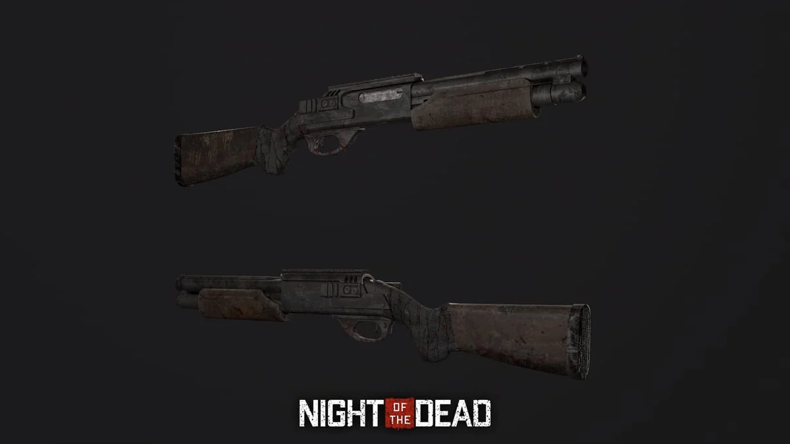

발사체는 다시 작성하면서 피해 계산을 쏜 쪽이 구현한 인터페이스에 넘겼고, 모든 플레이어로부터 멀어진 탄환은 서버가 제거한다. 그 위에 반동과 제어성 컴포넌트, 조준 시 1인칭 전환, 총기 부착물을 만들었다. 부착물은 장비를 장착할 때 데이터대로 자동 생성한다. 액터는 서버에서만 만들고, 소음기 소리처럼 다른 플레이어 쪽에서도 효과가 적용되어야 해서 부착물 목록은 모든 클라이언트에 복제한다.

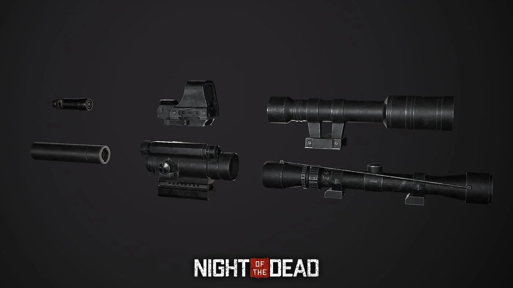

> **확인한 범위**
>
> 총기 시스템은 개발 업데이트 #09에 반영됐다. 서버 검증은 시선 각도와 바운딩 박스 두 조건까지다. 내적은 수평 방향만 비교해 위아래로 벗어난 히트는 거르지 못하고, 바운딩 박스 배율은 C++ 기본값이 커서 위치 검사는 느슨하다. 발사 RPC는 묶지 않고 발마다 보낸다. 다른 클라이언트의 발사 연출은 복제된 발사 카운터가 바뀔 때 한 번 재생하는 구조인데, 한 번의 갱신에 여러 발이 묶일 때의 동작은 확인하지 않았다. 무기 에셋과 애니메이션은 다른 직군이 만들었다.

## 보스 여섯 종이 함께 쓰는 어그로와 상태 머신 모듈

지역마다 보스 좀비가 하나씩 있다. 보스마다 패턴은 다르지만 타겟 선택, 상태 전환, 쿨다운, 그로기 같은 뼈대는 같다. 보스는 여러 플레이어 사이에서 타겟을 계속 골라야 하는데 타겟이 자주 바뀌면 움직임이 흔들리고, 보스의 상태는 Behavior Tree와 애니메이션, 클라이언트가 함께 알아야 한다.

공통 기능을 보스 클래스에서 떼어 독립 모듈과 컴포넌트로 만들기로 했다. 2023년 6월부터 10월까지 이 틀을 만들면서 그 위에 보스를 올렸다.

- **어그로 모듈 `AggroSystem`:** 대상별 어그로 값을 테이블로 들고, 값은 틱마다 일정 비율로 줄어든다. 새 대상의 값이 현재 타겟보다 임계 이상 높을 때만 타겟을 바꿔 흔들림을 막는다.
- **상태 머신 모듈 `GTSM`:** GameplayTag를 상태 이름으로 쓴다. 상태마다 진입, 갱신, 종료 델리게이트가 있고, 현재 상태 태그 하나만 복제해 클라이언트가 같은 전환을 실행한다. Behavior Tree, 애니메이션, 쿨다운이 같은 태그 이름을 쓴다.
- **강인도와 그로기:** 강인도는 100에서 시작하고 피해를 받은 뒤 5초 동안 맞지 않으면 다시 찬다. 0이 되면 그로기에 들어가 상태 머신이 경직 상태로 바뀌고, 끝나면 원래 상태로 돌아간다. 그로기 뒤에는 30초 쿨다운이 있다.
- **페이즈:** 체력 비율에 따라 전환 서브트리를 실행하고, 페이즈마다 공격과 이동 속도 배율을 바꾼다.
- **피격 규칙과 물리 반응:** 보스는 공격 중에 맞아도 패턴을 유지한다. 맞은 본에 임펄스를 주고 물리 블렌드 가중치를 되돌리는 방식으로 피격 반응을 만들었다.

패턴 선택은 상태 머신 안이 아니라 Behavior Tree에서 한다. 패턴마다 서브트리를 두고, 거리 구간과 확률, 쿨다운을 통과한 패턴 가운데 가중치로 하나를 고른다. 패턴의 동작은 추적 공격, 구체 범위 판정, 전진 이동 같은 전투용 애님 노티파이 클래스를 만들어 몽타주에 배치하는 방식으로 조립한다. 여섯 보스가 모두 같은 구성을 쓴다.

이 틀로 1지역부터 6지역까지 보스 6종의 AI와 던전 보스룸을 구현했다. 보스는 일반 좀비와 달리 서버에서 포즈를 항상 갱신하고 클라이언트는 화면에 보이지 않을 때 몽타주만 진행한다.

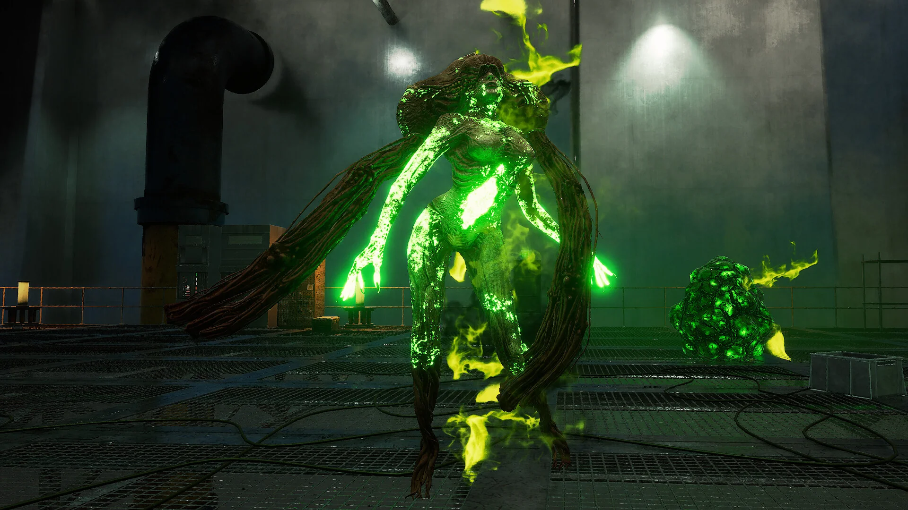

> **확인한 범위**
>
> 보스 6종은 개발 업데이트 #14, #16, #18, #19로 출시됐다. 구현한 것은 공통 틀과 보스의 AI, 판정 노티파이 클래스다. 몽타주에 노티파이를 배치하는 작업은 팀과 나눠 했고 팀의 몫이 더 많다. 패턴 기획과 애니메이션, 이펙트는 다른 직군이 만들었고, 보스 한 종의 폴리싱과 일부 패턴의 확률, 쿨다운 수치 조정은 팀이 했다.

## 그 밖의 담당 업무

**좀비 AI**

- 일반 좀비의 AI를 전용 AI 컨트롤러와 네이티브 Behavior Tree 노드로 다시 짰다. 행동 단계(배회, 추적, 전투), 시각과 청각, 피격 자극 처리, 소리가 난 곳으로 좀비들이 모이는 탐색, 건물 공격이 들어간다.
- 플레이어가 건물 안이나 차 위에 있어 길이 없을 때의 처리를 세 번에 걸쳐 풀었다. 2021년에는 EQS로 대체 타겟을 골랐고, 2023년에는 EQS 결과의 재사용 조건과 시간 제한을 넣었다. 2024년 2월에는 후보마다 도달할 수 있는 공격 지점이 있는지 검증하는 3단계 EQS 체인을 C++ 태스크로 만들었다.
- 산성 투사체를 뱉고 자폭하는 좀비, 줄로 대상을 끌어당기는 작살 좀비, 비명으로 웨이브 좀비를 부르는 좀비 같은 특수 좀비를 구현했다.
- 미끼 덫처럼 좀비의 공격 대상을 끌어오는 도발 시스템과 소음 어그로를 만들었다.
- 플레이어를 따라다니는 동료 캐릭터인 파트너 시스템에서 플레이어 전용이던 레벨링, 치명타, 흡혈, 장비, 소음 기능을 캐릭터 공용 기반이나 인터페이스로 추상화하고 경험치 분배, 채집 AI, 명령 UI, 복제와 세이브 복구를 구현했다. 파트너 캐릭터 본체와 AI, 애니메이션, 기획은 팀이 맡았다.

**전투**

- 2022년 2~3월에 상태 이상과 버프를 Gameplay Ability System으로 옮겼다. GameplayEffect와 Ability System Component를 확장해 속성 상쇄(독과 번개, 냉기와 화염)와 게임 시간 단위의 지속 시간을 적용 시점 한 곳에서 처리한다.
- 공격 경로마다 흩어져 있던 효과 부여를 AttackTrait 하나로 모았다. AttackTrait는 무기 특성 데이터에서 부여할 GameplayEffect 묶음(레벨 포함)을 갖는 단위다.
- 적중 시 서버에서 확률로 발동하는 추가 공격(넉백, 강타, 즉사, 전기 폭발, 독가스)을 공통 컴포넌트 체계로 정리했다.
- 슈퍼아머와 무적을 컴포넌트로 분리하고, 방패 패링 피해와 패링 강화 스킬을 구현했다. 가드와 패링의 판정 창은 팀이 만들었다.
- 피격 애니메이션은 서버가 피격 유형과 랜덤 시드를 멀티캐스트하고 모든 클라이언트가 같은 시드로 같은 몽타주를 고른다.

**아이템과 장비**

- 장비 시스템을 만들었다. 종류별 데이터 테이블과, 개체마다 등급과 옵션이 다른 장비를 만드는 생성 로직이 들어간다.
- 생성된 장비의 개체 정보는 플레이어와 관련된 것만 그 플레이어에게 복제한다. 기본값 장비는 ID만 보내고 클라이언트가 테이블로 채운다.
- 아이템을 내놓는 요청이 서버에서 확정되기 전에 같은 아이템을 다시 쓰지 못하도록 대기 목록을 두었다. 장비는 복제된 소지품에서 실제로 빠진 것만 대기에서 풀고, 그 밖의 아이템은 다음 소지품 복제 때 푼다.
- 장비에 끼워 속성 공격이나 방어, 유틸 효과를 더하는 부품인 코일의 스킬, 장비 개조대, 레벨과 경험치를 맡는 레벨링 모듈과 능력치 분배를 만들었다.
- 장비 내구도와 수리, 대장간의 티어 강화, 고유 장비 재조립을 구현했다.
- 캐릭터 외형을 바꾸는 형상변환과 스킨 DLC, 장식대와 수족관, 가격이 변동하는 상점(키오스크), 통합 게임 메뉴를 구현했다.

**채집 자원**

- 돌과 나무 같은 채집 자원은 평소에 인스턴스 폴리지로만 두고, 타격한 것만 액터로 바꾼다. 레벨이 내려가면 액터를 지운다. 리스폰은 별도 모듈로 분리했다.
- 제거한 자원이 로드 뒤 되살아나거나 클라이언트에서 중복 생성되던 문제는 클라이언트가 받은 제거 목록의 개수를 서버와 비교해 다르면 전체를 다시 보내는 방식으로 풀었다.

**엔진 이전과 온라인 서비스**

- 2023년 11월 전후 Epic Online Services가 Steam 외부 인증을 Web API 티켓으로 바꾸도록 요구하고 기존 세션 티켓을 거부하는 기한을 뒀다. 이 티켓을 받는 함수는 Steamworks SDK 1.57 이상에만 있고 UE 4.27은 더 낮은 SDK를 포함한다. 엔진을 고쳐 SDK만 올리면 수정한 엔진을 계속 관리해야 해서, 그 대신 UE 5.3 커스텀 엔진으로 옮기기로 했다. 미지원 플러그인 정리, 약 7만 파일의 에셋 리패키지, 쿠킹 설정, 세이브 마이그레이션을 한 달 안에 끝냈고 개발 업데이트 #15에 반영했다. 인증 과정에서 겪은 문제는 [Steam 인증 티켓과 EOS Private Sandbox 권한 확인](/posts/steam-eos-private-sandbox-web-api-auth-ticket/)에 썼다.
- UE5로 옮긴 뒤 깨진 Epic Online Services 세션 연결, Steam 초대, 서버 목록을 복구했다. Dedicated Server의 인원은 서버 설정 파일에서 읽게 했다.
- Easy Anti-Cheat 제어 모듈을 만들었다. 가장 이른 로딩 단계에서 명령줄 인자를 읽어 안티치트 설정을 정한다. 안티치트 없이 실행한 클라이언트의 보호 세션 접속 차단은 EOS 인증 설정으로 처리했다.
- Steam 업적을 연동했다.
- 크래시 리포트에 버전, 난이도, 네트워크 모드, 게임 흐름 태그, 그래픽 설정을 실었다. 개발용 치트와 디버그 UI를 만들고 Shipping 빌드에서는 원격 치트 명령을 막았다.

**개발 인프라**

- Jira, Confluence, Slack을 대체하는 JetBrains Space On-Premise 서버를 구축하고 운영했다.
- TeamCity On-Premise로 빌드와 패키징을 자동화했다. 개발 브랜치에 푸시하면 에디터 바이너리를 만들고, 매일 자정에 클라이언트와 서버 패키지를 만든다. 릴리즈 패키지는 수동으로 실행하며 Steam 업로드와 메신저 알림까지 이어진다.
- Shared DDC를 운영하고, Nginx와 Certbot으로 회사 서버에 공개 도메인을 부여하고 인증서를 관리했다.

## 업데이트별 담당 업무

개발 업데이트마다 담당한 작업을 최신순으로 정리했다. 팀이 낸 업데이트 가운데 직접 구현하거나 개편한 범위만 적었다.

[개발 업데이트 #19](https://steamcommunity.com/games/1377380/announcements/detail/4174351800564228844?snr=1_2108_9__2107)

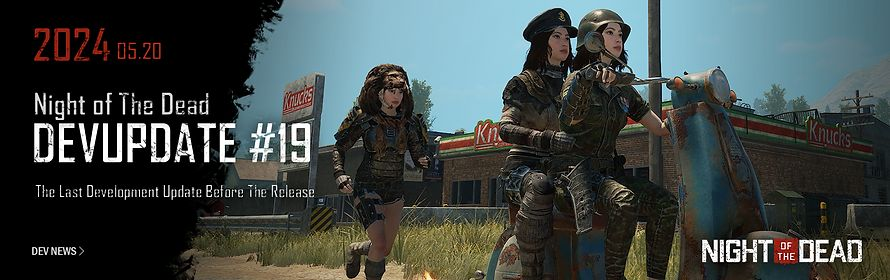

- 멀티플레이 개설 및 접속 과정 개편
- 추종자 일부 기능 구현
- 6지역 보스 좀비 구현
- 네트워크 최적화
- 자연물 리스폰 시스템 개선

[개발 업데이트 #18](https://steamcommunity.com/games/1377380/announcements/detail/7675897515552221213?snr=1_5_9_)

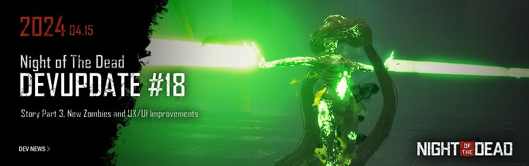

- 5지역 보스 좀비 구현
- 추종자 일부 기능 구현

[개발 업데이트 #17](https://steamcommunity.com/games/1377380/announcements/detail/4101163232898580763?snr=1_5_9_)

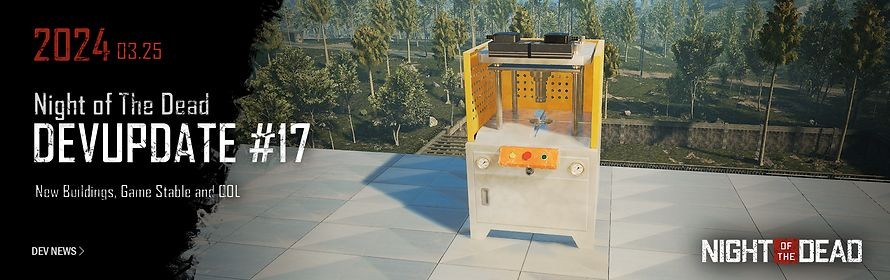

- 좀비 AI 로직 개선
- 부활 시스템 개편

[개발 업데이트 #16](https://steamcommunity.com/games/1377380/announcements/detail/4177721893479578937?snr=1_5_9_)

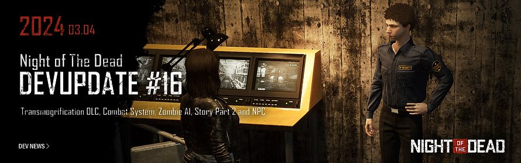

- 캐릭터 외형을 바꾸는 형상변환(스킨) DLC 구현
- 4지역 보스 좀비 구현
- 고유 장비 재조립 구현
- 통합 게임 메뉴 구현

[개발 업데이트 #15](https://store.steampowered.com/news/app/1377380/view/3888357282609115394?l=koreana)

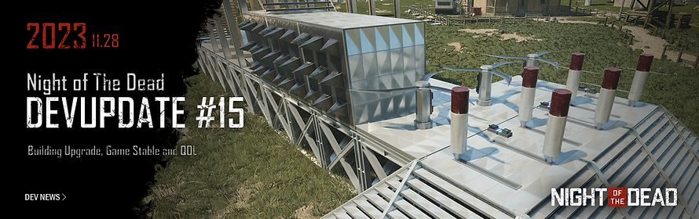

- EOS의 Steam Web API 티켓 요구에 대응한 Unreal Engine 5 이전 주도
- Replication Graph 개편

[개발 업데이트 #14](https://steamcommunity.com/games/1377380/announcements/detail/5560312482573003457?snr=1_5_9_)

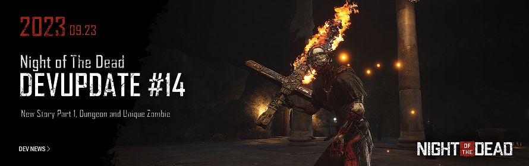

- 1, 2, 3지역 보스 좀비 구현
- AOE 공격 시스템 개편
- 앰비언트 사운드 시스템 개편

[개발 업데이트 #13](https://steamcommunity.com/games/1377380/announcements/detail/3684558705424158476?snr=1_5_9_)

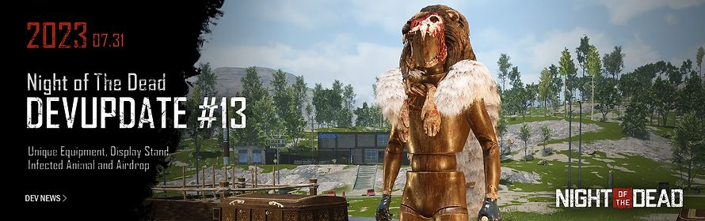

- 장식대 구현 (방어구, 무기, 좀비, 동물, 수족관)
- 고유 장비 구현
- 폴리지 리스폰 시스템 개편

[개발 업데이트 #12](https://steamcommunity.com/games/1377380/announcements/detail/3684555534412335389?snr=1_5_9_)

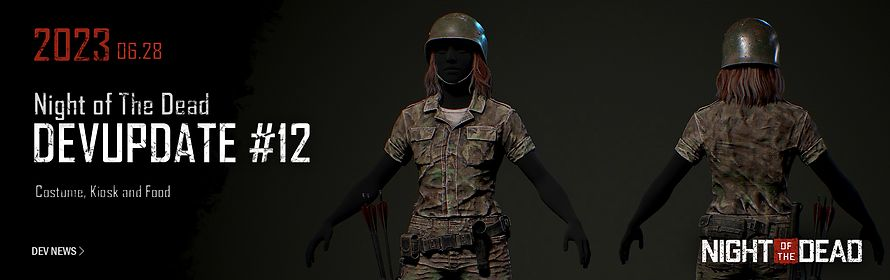

- 월드 빌딩 개편
- 월드 도어 개편
- 가격이 변동하는 상점(키오스크) 구현
- 좀비 무브먼트 개선
- 코스튬(스킨) 구현

[개발 업데이트 #11](https://steamcommunity.com/games/1377380/announcements/detail/3716078195361732057?snr=2_groupannouncements_detail_)

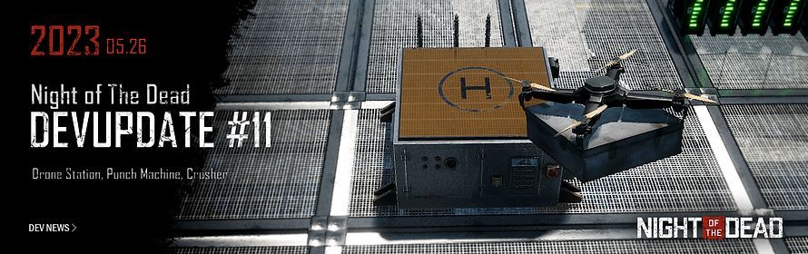

- Tick 최적화
- 네트워크 최적화
- 서버와 클라이언트 간 대용량 데이터 전송을 위한 RPC 기반 데이터 스트리밍 시스템 개발
- 애니메이션 업데이트 비용 최적화
- 좀비 리더 시스템 개선
- 좀비 길찾기 개선

[개발 업데이트 #10](https://steamcommunity.com/games/1377380/announcements/detail/3711572693139781185?snr=1_5_9_)

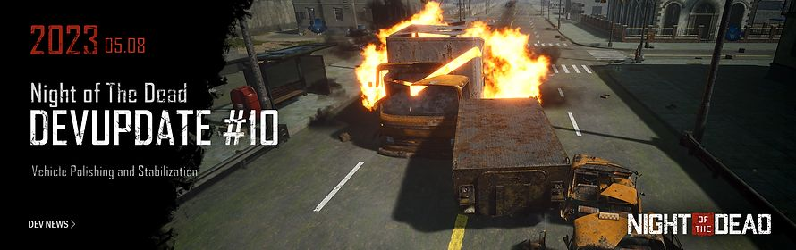

- 전투 판정 개편
- 서버 세션 리스트 개편
- 좀비 최적화
- 네트워크 최적화 (Replication Graph, Net Dormancy 적용)
- Destructible Mesh 시스템 재구성
- 네비게이션 인보커 최적화
- 에셋 사전 로딩 시스템 구현

[개발 업데이트 #09](https://steamcommunity.com/games/1377380/announcements/detail/3632746453304905737?snr=1_5_9_)

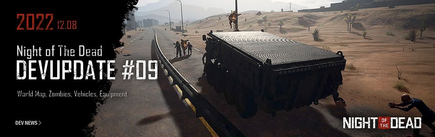

- 신규 좀비 구현
- 웨이브 시스템 개편
- 장비 티어 시스템 구현
- 장비 내구도 시스템 구현
- 장비 파츠 개조 시스템 구현
- 총기 시스템 구현

[개발 업데이트 #08](https://steamcommunity.com/games/1377380/announcements/detail/3210511728813822228?snr=1_5_9_)

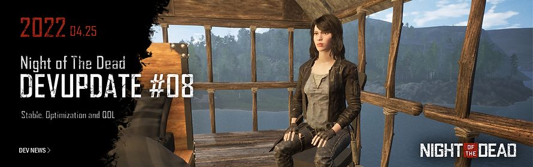

- 휴식 시스템 구현
- Destructible 오브젝트 최적화

[개발 업데이트 #07](https://steamcommunity.com/games/1377380/announcements/detail/3130565222384389708?snr=1_5_9_)

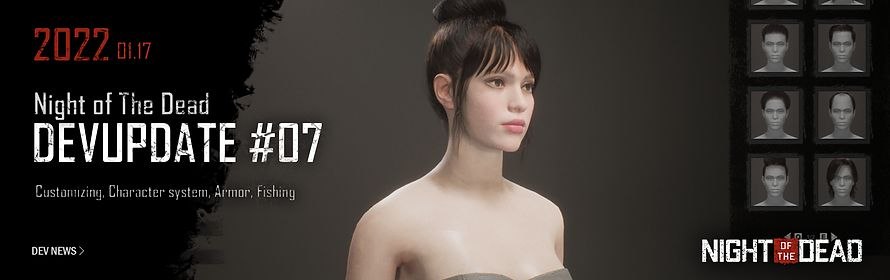

- 캐릭터 레벨 시스템 구현
- 캐릭터 능력치 시스템 구현
- 장비 희귀도 시스템 구현
- 장비 재조립 시스템 구현
- 장비에 끼우는 부품(코일) 개조 시스템 구현

[개발 업데이트 #06](https://steamcommunity.com/games/1377380/announcements/detail/3019092467760502290?snr=1_5_9_)

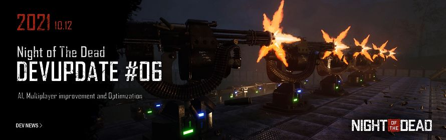

- 좀비 AI 개선
- 좀비 최적화
- 아이템 최적화
- 트랩 최적화

[개발 업데이트 #05](https://steamcommunity.com/games/1377380/announcements/detail/2988683441438443136?snr=1_5_9_)

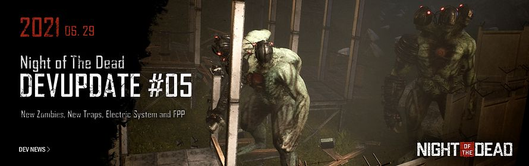

- 신규 좀비 구현
- 함정 개조 장비 구현

[개발 업데이트 #04](https://steamcommunity.com/games/1377380/announcements/detail/3044968289462619227?snr=1_5_9_)

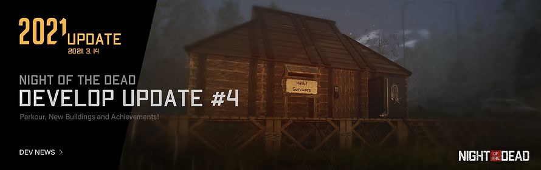

- 신규 건물 구현
- 업적 시스템 구현

[개발 업데이트 #03](https://store.steampowered.com/news/app/1377380/view/3050593984714457440)

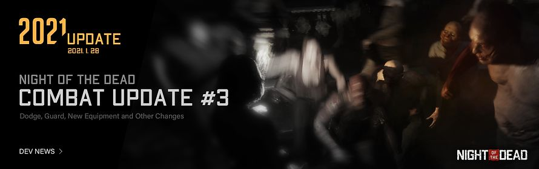

- 신규 연구 스킬 추가
- 전투 시스템 개선
- 전투 UI 개선

## 용어

- **웨이브:** 밤마다 좀비 무리가 기지로 몰려오는 습격
- **교체형 APEX:** 평소에는 통짜 StaticMesh를 두고 파괴할 때 APEX Destructible 컴포넌트를 만들어 교체하는 구성. 커스텀 파괴 시스템의 비교 기준
- **파트너:** 플레이어를 따라다니는 동료 캐릭터. 업데이트 공지에서는 추종자
- **코일:** 장비에 끼워 화염, 냉기, 번개, 독 같은 속성 공격이나 방어, 유틸 효과를 더하는 부품
- **AttackTrait:** 무기 특성 데이터에서 부여할 GameplayEffect 묶음(레벨 포함)을 갖는 효과 단위
- **형상변환:** 장비 성능과 별개로 부위별 외형을 바꾸는 기능
- **키오스크:** 가격이 변동하는 상점
- **`AggroSystem`, `GTSM`:** 보스용으로 만든 어그로 테이블 모듈과 GameplayTag 상태 머신 모듈

## 관련 글

- [Night of the Dead 멀티플레이 최적화 돌아보기](/posts/notd-multiplayer-optimization-overview/)
- [접속 시 레벨 스트리밍 상태 RPC 줄이기](/posts/notd-level-streaming-status-rpc/)
- [Reliable 버퍼 상태를 보고 대용량 데이터 나눠 보내기](/posts/notd-reliable-rpc-data-streaming/)
- [오픈월드의 오브젝트를 액터 대신 데이터로 두기](/posts/notd-world-objects-as-data/)
- [다수 좀비의 서버 비용과 전송량 줄이기](/posts/notd-zombie-horde-cost/)
- [엔진 Destructible 대신 조각 메시로 파괴 오브젝트 처리하기](/posts/notd-custom-destructible/)
- [Night of the Dead 멀티플레이를 지금 다시 설계한다면](/posts/notd-multiplayer-redesign/)
- [Steam 인증 티켓과 EOS Private Sandbox 권한 확인](/posts/steam-eos-private-sandbox-web-api-auth-ticket/)
- [휴면 액터 깨우기: FlushNetDormancy, ForceNetUpdate, SetNetDormancy](/posts/unreal-engine-waking-dormant-actors/)
