| 항목 | 내용 |
| --- | --- |
| 기간 | 2021.01 - 2024.06 |
| 소속 | 작두 스튜디오 |
| 역할 | 클라이언트 프로그래머 |
| 기술 | Unreal Engine 4/5, C++, Dedicated Server, DevOps |

## 프로젝트와 담당 역할

Night of the Dead는 밤마다 몰려오는 좀비에 대비해 방어 시설을 짓고 섬에서 살아남는 오픈월드 생존 게임이다. Unreal Engine과 C++로 개발했으며, Windows Server 기반 Dedicated Server에서 멀티플레이를 지원한다. 얼리 액세스 기간의 업데이트부터 2024년 5월 1.0 정식 출시까지 클라이언트 프로그래머로 참여했다.

전투와 장비, 보스 및 일반 좀비 AI, 월드 상호작용 같은 게임플레이와 함께 멀티플레이 동기화, 다수 좀비의 실행 비용 최적화, 엔진 이전과 개발 인프라를 담당했다. 동기화의 적용 방식은 [멀티플레이 동기화](#network-sync)에 정리했다.

[Steam 상점](https://store.steampowered.com/app/1377380/Night_of_the_Dead/)

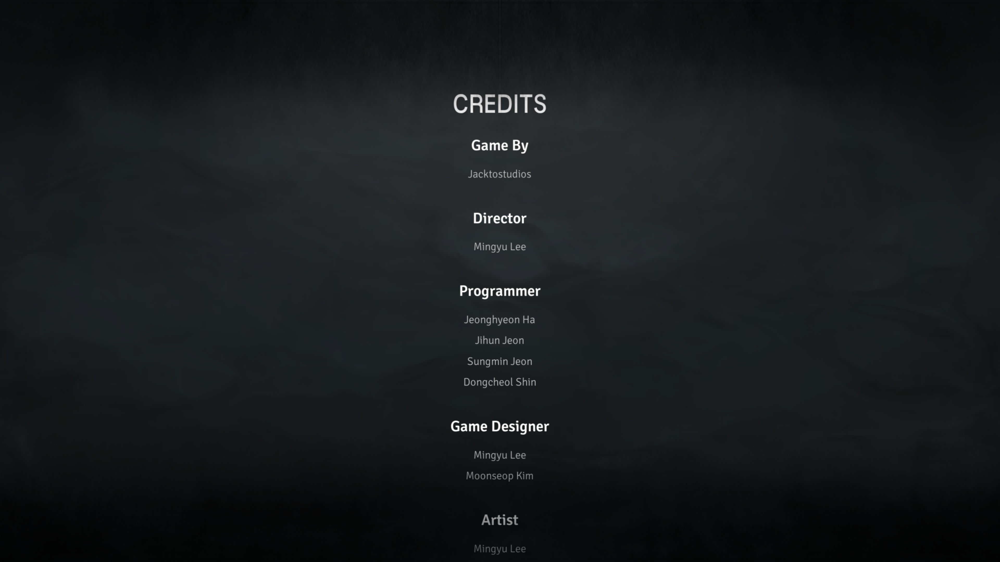

## 업데이트별 주요 담당 업무

공개된 개발 업데이트 공지를 기준으로 각 업데이트에서 담당한 작업을 정리했다. 항목은 팀 업데이트 중 내가 구현하거나 개편한 범위다.

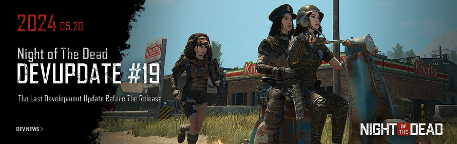

[개발 업데이트 #19](https://steamcommunity.com/games/1377380/announcements/detail/4174351800564228844?snr=1_2108_9__2107)

- 멀티플레이 개설 및 접속 과정 개편
- 추종자 일부 기능 구현
- 6지역 보스 좀비 구현
- 네트워크 최적화
- 자연물 리스폰 시스템 개선

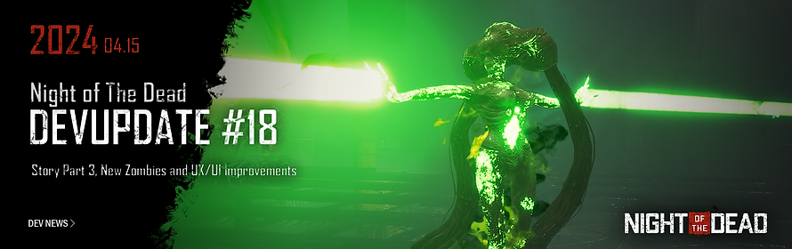

[개발 업데이트 #18](https://steamcommunity.com/games/1377380/announcements/detail/7675897515552221213?snr=1_5_9_)

- 5지역 보스 좀비 구현
- 추종자 일부 기능 구현

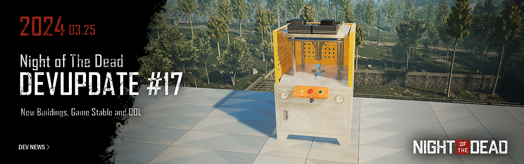

[개발 업데이트 #17](https://steamcommunity.com/games/1377380/announcements/detail/4101163232898580763?snr=1_5_9_)

- 좀비 AI 로직 개선
- 부활 시스템 개편

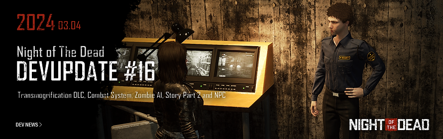

[개발 업데이트 #16](https://steamcommunity.com/games/1377380/announcements/detail/4177721893479578937?snr=1_5_9_)

- 캐릭터 외형을 바꾸는 형상변환(스킨) DLC 구현
- 4지역 보스 좀비 구현
- 고유 장비 재조립 구현
- 통합 게임 메뉴 구현

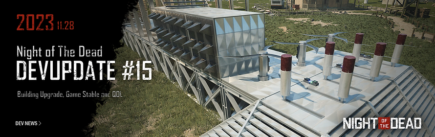

[개발 업데이트 #15](https://store.steampowered.com/news/app/1377380/view/3888357282609115394?l=koreana)

- EOS의 Steam Web API 티켓 요구에 대응한 Unreal Engine 5 이전 주도
- Replication Graph 개편

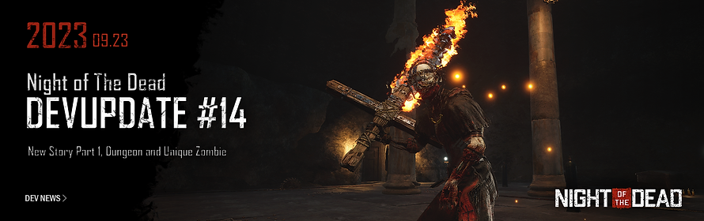

[개발 업데이트 #14](https://steamcommunity.com/games/1377380/announcements/detail/5560312482573003457?snr=1_5_9_)

- 1, 2, 3지역 보스 좀비 구현
- AOE 공격 시스템 개편
- 앰비언트 사운드 시스템 개편

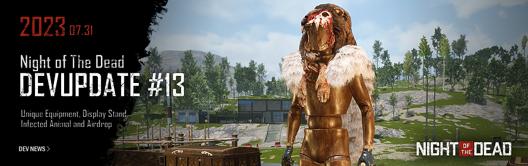

[개발 업데이트 #13](https://steamcommunity.com/games/1377380/announcements/detail/3684558705424158476?snr=1_5_9_)

- 장식대 구현 (방어구, 무기, 좀비, 동물, 수족관)
- 고유 장비 구현
- 폴리지 리스폰 시스템 개편

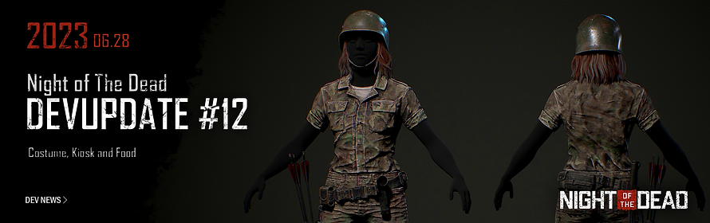

[개발 업데이트 #12](https://steamcommunity.com/games/1377380/announcements/detail/3684555534412335389?snr=1_5_9_)

- 월드 빌딩 개편
- 월드 도어 개편
- 가격이 변동하는 상점(키오스크) 구현
- 좀비 무브먼트 개선
- 코스튬(스킨) 구현

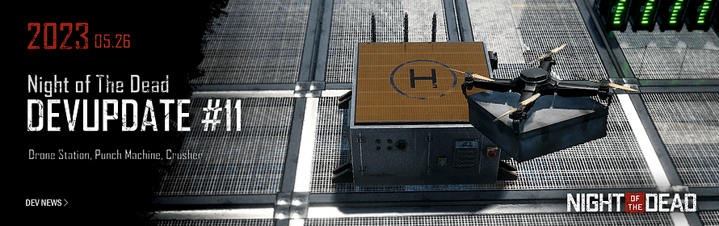

[개발 업데이트 #11](https://steamcommunity.com/games/1377380/announcements/detail/3716078195361732057?snr=2_groupannouncements_detail_)

- Tick 최적화
- 네트워크 최적화
- 서버와 클라이언트 간 대용량 데이터 전송을 위한 RPC 기반 데이터 스트리밍 시스템 개발
- 애니메이션 업데이트 비용 최적화
- 좀비 리더 시스템 개선
- 좀비 길찾기 개선

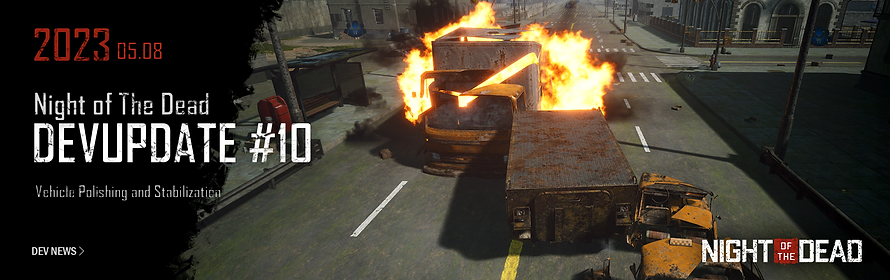

[개발 업데이트 #10](https://steamcommunity.com/games/1377380/announcements/detail/3711572693139781185?snr=1_5_9_)

- 전투 판정 개편
- 서버 세션 리스트 개편
- 좀비 최적화
- 네트워크 최적화 (Replication Graph, Net Dormancy 적용)
- Destructible Mesh 시스템 재구성
- 네비게이션 인보커 최적화
- 에셋 사전 로딩 시스템 구현

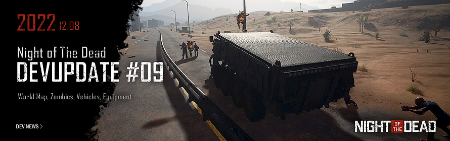

[개발 업데이트 #09](https://steamcommunity.com/games/1377380/announcements/detail/3632746453304905737?snr=1_5_9_)

- 신규 좀비 구현
- 웨이브 시스템 개편
- 장비 티어 시스템 구현
- 장비 내구도 시스템 구현
- 장비 파츠 개조 시스템 구현
- 총기 시스템 구현

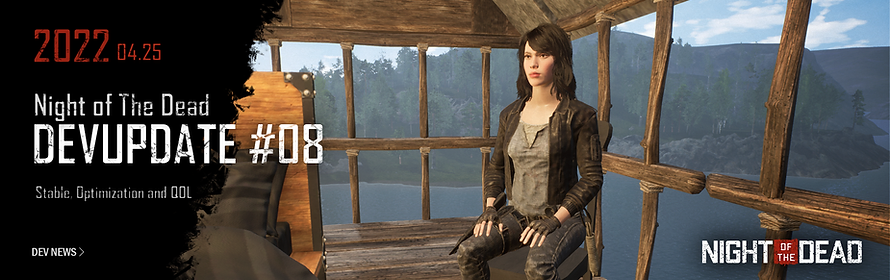

[개발 업데이트 #08](https://steamcommunity.com/games/1377380/announcements/detail/3210511728813822228?snr=1_5_9_)

- 휴식 시스템 구현
- Destructible 오브젝트 최적화

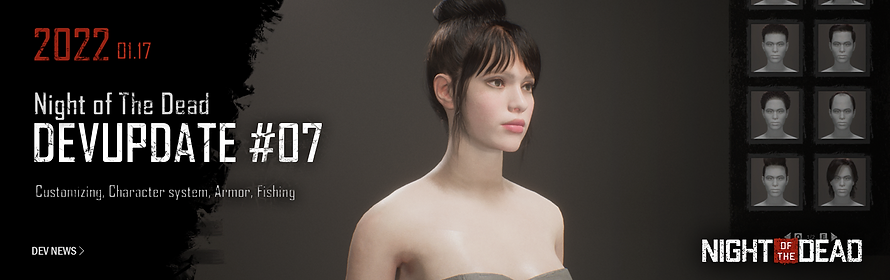

[개발 업데이트 #07](https://steamcommunity.com/games/1377380/announcements/detail/3130565222384389708?snr=1_5_9_)

- 캐릭터 레벨 시스템 구현
- 캐릭터 능력치 시스템 구현
- 장비 희귀도 시스템 구현
- 장비 재조립 시스템 구현
- 장비에 속성 공격을 더하는 부품(코일) 개조 시스템 구현

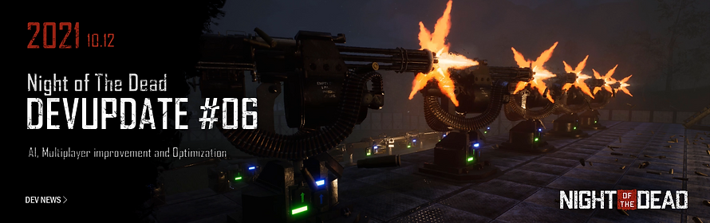

[개발 업데이트 #06](https://steamcommunity.com/games/1377380/announcements/detail/3019092467760502290?snr=1_5_9_)

- 좀비 AI 개선
- 좀비 최적화
- 아이템 최적화
- 트랩 최적화

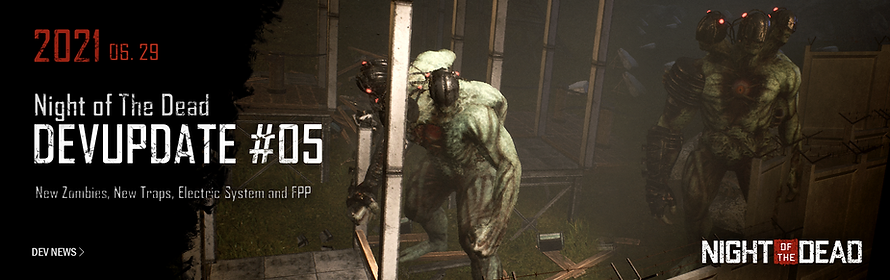

[개발 업데이트 #05](https://steamcommunity.com/games/1377380/announcements/detail/2988683441438443136?snr=1_5_9_)

- 신규 좀비 구현
- 함정 개조 장비 구현

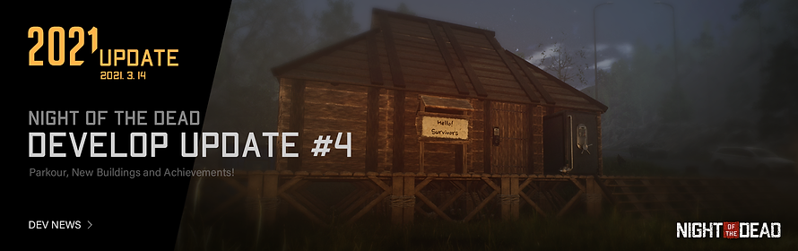

[개발 업데이트 #04](https://steamcommunity.com/games/1377380/announcements/detail/3044968289462619227?snr=1_5_9_)

- 신규 건물 구현
- 업적 시스템 구현

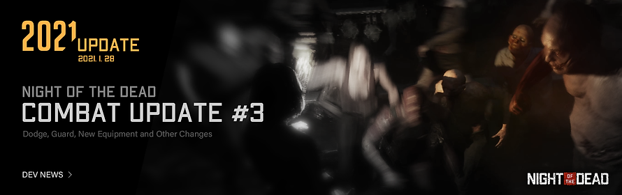

[개발 업데이트 #03](https://store.steampowered.com/news/app/1377380/view/3050593984714457440)

- 신규 연구 스킬 추가
- 전투 시스템 개선
- 전투 UI 개선

## 개발 인프라

- Jira, Confluence, Slack을 대체하기 위해 JetBrains Space On-Premise 서버를 구축하고 운영했다.
- TeamCity On-Premise로 빌드와 패키징 자동화를 구성하고 Shared DDC를 운영했다.
- Nginx와 Certbot으로 회사 서버에 공개 도메인을 부여하고 인증서를 관리했다.
- UE5 이전 후 Epic Online Services 세션의 개설과 접속 흐름을 다시 구성하고 Easy Anti-Cheat 보호 세션의 접속 처리를 구현했다. Steamworks 업적도 연동했다.

2023년 11월 전후 EOS가 Steam 외부 인증을 Web API 티켓(`GetAuthTicketForWebApi`)으로 바꾸도록 요구하고 기존 세션 티켓을 거부하는 기한을 뒀다. 이 함수는 Steamworks SDK 1.57 이상에만 있다. UE 4.27이 포함한 SDK를 엔진 수정으로 올릴 수도 있었지만, 수정한 소스 엔진을 계속 관리하는 위험이 커서 피하고 싶었다. 대신 SDK 1.57 이상을 포함하고 엔진 전반의 최적화와 에디터 신기능도 들어오는 UE5로 이전했고, 이전 결과는 [개발 업데이트 #15](https://store.steampowered.com/news/app/1377380/view/3888357282609115394?l=koreana)에 반영했다. 인증 과정에서 겪은 문제는 [Steam 인증 티켓과 EOS Private Sandbox 권한 확인](/posts/steam-eos-private-sandbox-web-api-auth-ticket/)에 정리했다.

## 기술별 담당 내용

### 멀티플레이 동기화

Windows Server 기반 Dedicated Server를 Unreal Insights로 분석하며 복제 대상 선정, 전송 데이터와 전송 경로를 나눠 최적화했다. 공간상 가까운 액터 외에도 소유 관계에 따라 전달해야 하는 상태가 있어 복제 조건을 나눴다.

Replication Graph에서 공간과 거리로 연결별 후보를 수집하고, 오너와 팀, 그룹에 종속된 액터는 해당 연결에 거리와 무관하게 포함했다. 장착 장비와 무기 부속품, 고용한 NPC, 탑승물과 그 위의 건물은 Dependent Actor로 묶어 부모 액터가 복제될 때 함께 검토하도록 구성했다. 전역 매니저는 Always Relevant 노드에, 휴면 액터는 별도 노드에 두어 상태에 맞게 처리했다. 상태가 드물게 바뀌는 아이템, 문, 풀링 좀비는 Net Dormancy로 휴면시켰다. 구성 방식은 [멀티플레이 최적화 돌아보기의 복제 대상](/posts/notd-multiplayer-optimization-overview/#복제-대상)에 정리했다.

접속 시 보내는 레벨 스트리밍 상태는 전송용 구조체에 커스텀 NetSerialize를 붙여 패키지 경로를 `int16` 코드와 비트 플래그로 압축했다([접속 시 레벨 스트리밍 상태 RPC 줄이기](/posts/notd-level-streaming-status-rpc/)). 1.0 출시 직전에는 장비 이름 대신 ID를 복제하고 게임 시각은 분이 바뀔 때만 복제하는 식으로 장비 상태, 게임 시각, 웨이브 진행도의 복제를 줄였고, 설정 위치가 잘못돼 적용되지 않던 Adaptive NetUpdateFrequency를 바로잡았다.

접속 시 한꺼번에 보내야 하는 데이터를 위해 Reliable 버퍼의 여유를 보고 레코드 단위로 나눠 보내는 스트리밍 라우터를 만들고, 지도 안개 동기화를 Fast Array에서 이 경로로 옮겼다([Reliable 버퍼 상태를 보고 대용량 데이터 나눠 보내기](/posts/notd-reliable-rpc-data-streaming/)).

### 물리와 파괴 오브젝트

UE4의 PhysX 기반 Destructible 오브젝트를 구현하고 최적화했다. APEX Destruction에서 원인을 알 수 없는 에러가 잦아 소스 엔진으로 PhysX 연동 코드까지 디버깅했지만, 남은 분석은 PhysX 바이너리 내부를 디버깅하는 일이라 감당하기 어려웠고 시간도 너무 많이 들었다. 그래서 원인 추적을 멈추고, 직접 제어할 수 있도록 최소 기능의 커스텀 Destructible 시스템으로 교체했다. Blender에서 미리 나눈 조각 StaticMesh를 파괴 시점에 만들어 물리 시뮬레이션하고 일정 시간 뒤 제거하는 구조이며, 교체 후 파괴할 때의 프레임 저하가 크게 줄었다. 환경 오브젝트 상호작용의 물리 기반 반응도 함께 다뤘다. 구조와 엔진 Destructible과의 비교는 [엔진 Destructible 대신 조각 메시로 파괴 오브젝트 처리하기](/posts/notd-custom-destructible/)에 정리했다.

### 애니메이션

다수 좀비의 애니메이션 부하를 줄이기 위해 Significance Manager로 계산한 중요도를 Animation Budget Allocator에 전달해 캐릭터의 애니메이션 갱신을 예산 안에서 조절하고, ACL로 애니메이션 데이터를 압축했다. 수족관 물고기와 캐릭터 전시물처럼 여럿 배치되는 장식 개체에는 평균 프레임률이 기준보다 낮을 때만 엔진의 Update Rate Optimization을 켜는 컴포넌트를 따로 만들어 붙였다. 서버에서는 근접 판정에 본 위치가 필요한 전투 중에만 포즈를 갱신하도록 했다. 좀비의 이동, 동기화와 길찾기 비용까지 포함한 전체 구조는 [다수 좀비의 서버 비용과 전송량 줄이기](/posts/notd-zombie-horde-cost/)에 정리했다. 캐릭터와 좀비 모션의 품질을 개선하는 과정에서 IK를 활용했다.

### 능력치와 전투 판정

캐릭터 능력치, 장비 효과, 전투 판정을 구현하고 캐릭터 스킬과 버프, 디버프 시스템을 만들었다. 2022년 2~3월에는 직접 만든 버프 컴포넌트를 Gameplay Ability System으로 옮겼다. 화상 같은 상태 이상과 버프는 GameplayEffect로 적용하되, 능력치 보정은 GAS의 Attribute가 아니라 프로젝트의 장비 능력치 체계로 계산하도록 GameplayEffect와 Ability System Component를 확장했다. 효과의 남은 시간을 저장하고 복원하는 기능과 게임 시간 기준의 지속 시간도 이때 넣었다. 근거리, 원거리, 투척 무기의 장착 구조와 능력치를 구현하고 던전과 전투 UI를 개발했다.

### 장비 커스터마이징

장비 파츠 개조, 재조립과 고유 장비처럼 아이템을 분해하고 조합하는 시스템을 설계하고 구현했다. 티어, 희귀도, 내구도 등 여러 속성이 겹치는 아이템 구조를 정리하고 코스튬(스킨)과 형상변환 DLC를 구현했다. 장비 기능은 별도의 장비 시스템 모듈로 묶었고, 대장간의 티어 강화, 가격 변동과 할인이 있는 상점, 장비와 수집물을 전시하는 장식대를 구현했다.

### 좀비와 보스 AI

일반 좀비의 AI 컨트롤러와 공격할 건물을 찾는 탐색 그리드를 만들고, 대체 대상과 공격 지점을 고르는 EQS 질의를 구현했다. 2024년 1~2월에는 좀비 이동과 대체 대상 질의 같은 Behavior Tree 태스크를 C++로 옮겼다. 비명으로 주변 좀비를 불러 모으는 좀비와 작살로 대상을 끌어당기는 좀비 같은 특수 좀비를 구현했고, 미끼 덫처럼 좀비의 공격 대상을 끌어오는 도발 시스템을 만들었다. 1지역부터 6지역까지의 보스 좀비에는 공격 대상 선정, 행동 상태 전환, 누적 피해에 따른 경직과 기절, 피격 물리 반응을 담은 공용 모듈을 만들어 썼다.

### 성장과 월드 시스템

레벨링 시스템 모듈을 만들고, 장비에 끼워 화염, 냉기, 번개, 독 같은 속성 공격을 더하는 부품(코일)의 스킬, 패시브 스킬, 능력치 분배를 구현했다. 인스턴스드 폴리지를 관리하는 폴리지 서브시스템과 범용 리스폰 모듈을 만들었다.

### 안티치트와 개발 도구

Easy Anti-Cheat 보호 세션의 접속 처리와 안티치트 제어 시스템을 구현했다. 로딩 스크린, Sentry 태그와 게임 흐름 상태를 담은 크래시 진단, 디버그 위젯과 치트 명령을 만들었다.
