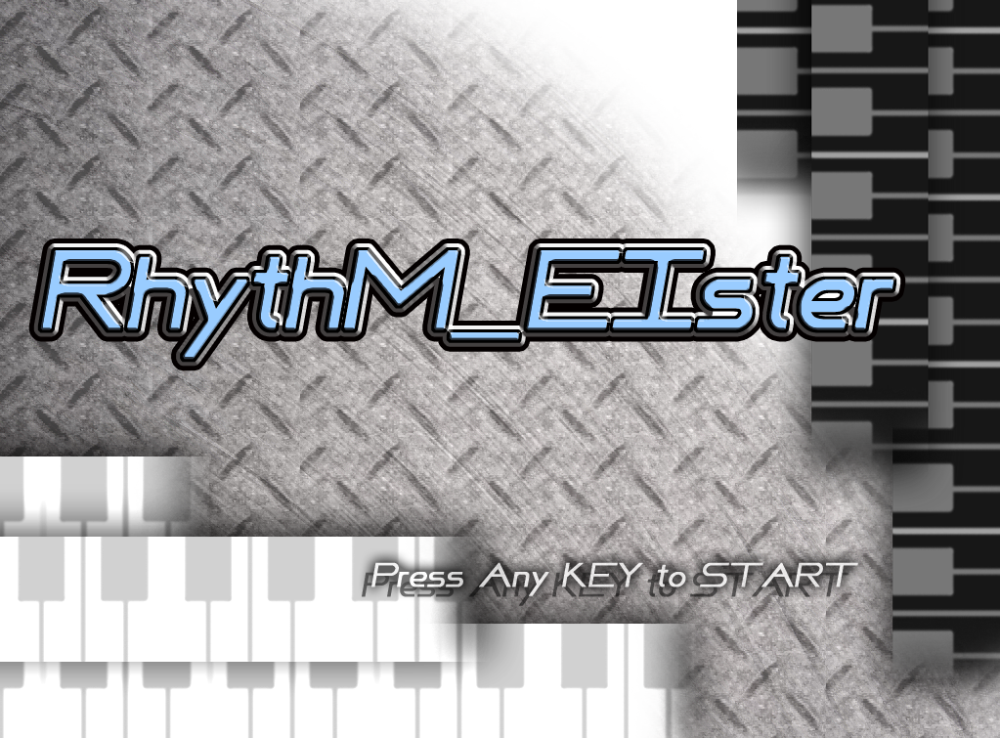
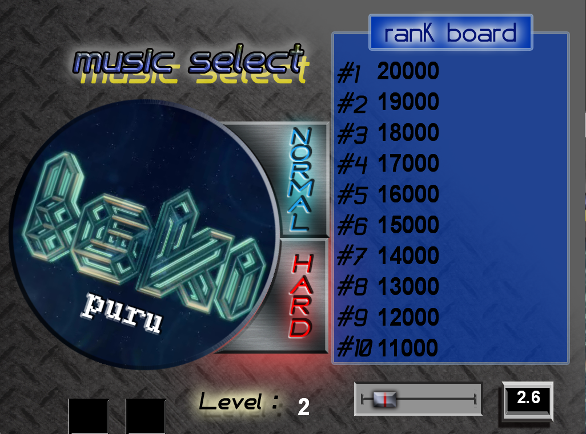
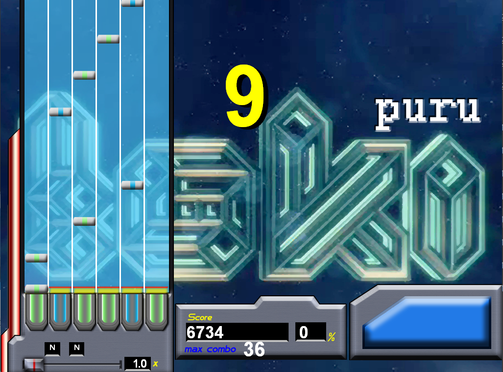
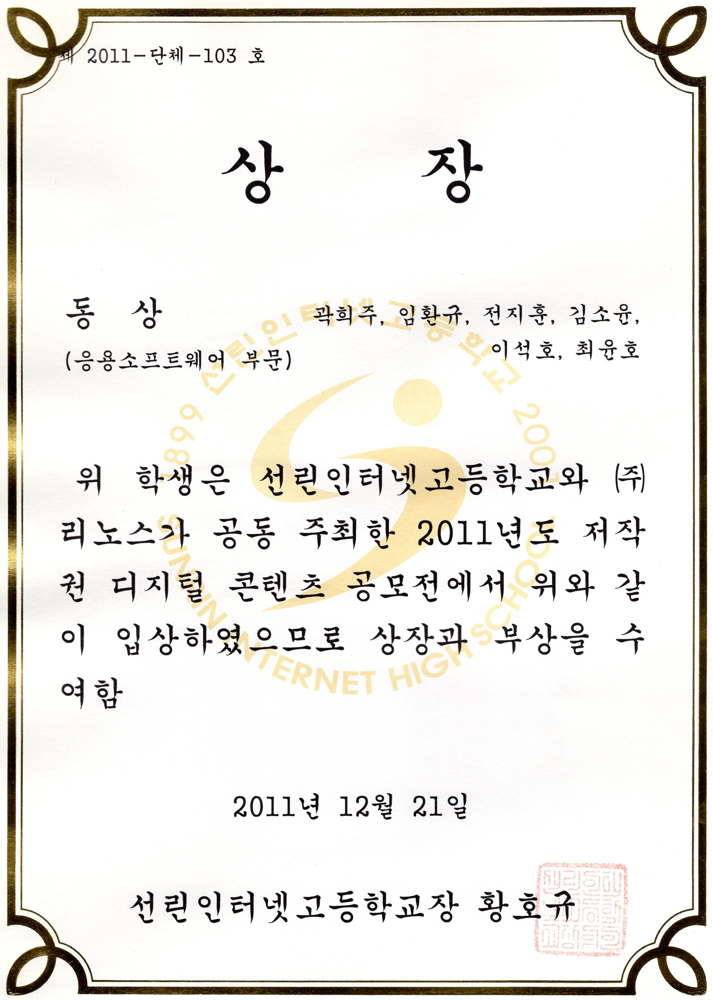

| 항목 | 내용 |
| --- | --- |
| 기간 | 2011.10 - 2011.12 |
| 소속 | 선린인터넷고등학교 |
| 역할 | 기획, 클라이언트 프로그래머 |
| 기술 | DirectX, C++ |

## 프로젝트 소개

BMS 파일 형식을 기반으로 하는 리듬 게임이다. DirectX와 C++로 개발했고, 곡에 맞춰 노트를 직접 배치할 수 있는 에디터를 함께 구현했다. 2011년 선린인터넷고등학교 디지털 콘텐츠 경진대회 응용소프트웨어 부문에서 동상을 받았다.

- [실행 파일 다운로드](https://drive.google.com/file/d/0BzRVCdwGHum_ZVFsQjVVTTJIZUE/view?usp=drive_link&resourcekey=0-8s69WJ3_oFlChYLc-Pr5Ig)
