| 항목 | 내용 |
| --- | --- |
| 기간 | 2026.04 - 2026.09 |
| 소속 | 시나몬 |
| 역할 | 클라이언트 프로그래머 |
| 기술 | Rust, Bevy, WebAssembly, React, TypeScript |

<iframe class="video-embed" src="https://www.youtube.com/embed/7tAEuFip6nA" title="Shotloom의 포즈, 동작, 카메라 편집부터 SceneGen 영상 생성까지의 제작 과정" loading="lazy" allow="accelerometer; autoplay; clipboard-write; encrypted-media; gyroscope; picture-in-picture; web-share" referrerpolicy="strict-origin-when-cross-origin" allowfullscreen></iframe>

## 프로젝트와 담당 역할

Shotloom은 캐릭터의 동작과 카메라 구도를 편집하는 브라우저 기반 3D 장면 연출 도구다. 캐릭터와 소품을 배치하고 포즈, 동작, 카메라 움직임을 타임라인에서 구성한다. 편집한 장면은 이미지와 영상으로 출력하거나 영상 생성 기능인 SceneGen의 입력으로 쓴다. AI 애니메이션 제작 서비스 CineV의 후속 제작 도구로, 사용자마다 서버 GPU 세션이 필요하던 Unreal Engine과 Pixel Streaming 경로를 브라우저 우선 편집기로 대체하는 것이 목표였다.

Rust, Bevy와 React 환경에서 캐릭터 가져오기, 편집 문서 모델, 저장과 되돌리기, 카메라와 포즈 저작 기능을 구현했다. 이후 생성 서비스의 결과를 편집 가능한 장면으로 변환하고, 편집 결과를 CineV의 제작 흐름으로 연결하는 작업을 맡았다. 이전에는 Unreal Engine 기반의 [CINEVStudio](/projects/cinev-studio/)를 개발했고, 그때 다룬 좌표계, 애니메이션, 카메라와 자산 로딩을 Rust의 소유권, Bevy의 ECS 구조, 브라우저의 비동기 실행과 저장 환경에 맞춰 다시 구현했다.

클라이언트 프로그래머 4명 가운데 캐릭터와 카메라 편집, 문서 모델, 저장과 복원, 생성 서비스 연동을 맡았다. 기술 스택 선정과 초기 저장소, 문서 구성은 팀이 맡았다.

## 대표 결과

### 하나의 샷에서 다른 구도의 장면으로

스토리보드에서 인물을 가까이 담은 샷을 3D 장면으로 열고, 주변 공간이 함께 보이도록 카메라 구도를 바꾼 사례다. 원본 샷은 벤치에 앉아 책을 읽는 인물을 가까이 담은 스토리보드 이미지다.

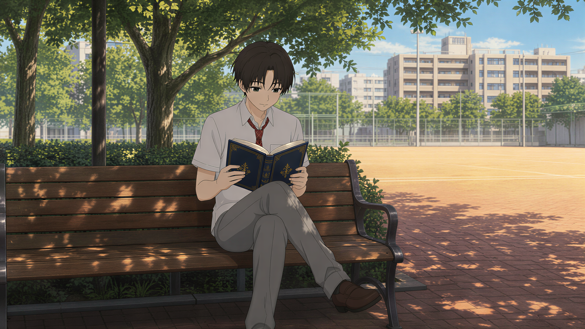

아래는 Shotloom에서 카메라를 조정해 인물과 벤치, 나무와 주변 공간이 함께 보이도록 구도를 넓힌 3D 장면이다.

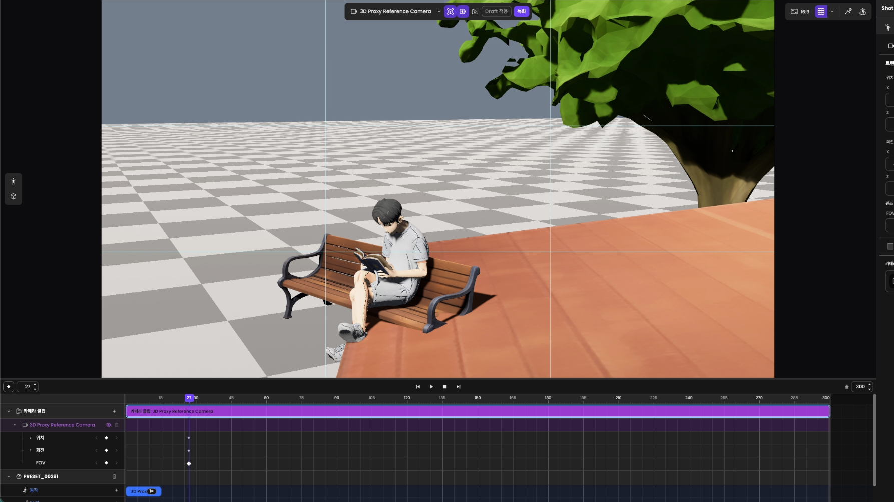

아래 영상은 이렇게 편집한 장면을 바탕으로 SceneGen에서 생성한 결과다.

<iframe class="video-embed" src="https://www.youtube.com/embed/P-CnmKYDoxg" title="Shotloom에서 연출한 장면을 바탕으로 SceneGen에서 생성한 결과 영상" loading="lazy" allow="accelerometer; autoplay; clipboard-write; encrypted-media; gyroscope; picture-in-picture; web-share" referrerpolicy="strict-origin-when-cross-origin" allowfullscreen></iframe>

### 포즈, 동작, 카메라를 편집하는 과정

CineV는 스토리보드의 샷을 관리하는 AI 애니메이션 제작 서비스이고, Shotloom은 그 샷의 동작과 구도를 편집하는 도구다. SceneGen은 편집한 장면과 생성 조건을 바탕으로 영상을 만든다. 제작은 다음 순서로 진행한다.

1. **장면 준비:** CineV의 샷에서 3D 장면을 생성해 Shotloom으로 열거나, Shotloom에서 직접 캐릭터와 소품을 배치한다.
2. **동작과 카메라 편집:** 생성한 모션 후보를 비교해 캐릭터의 클립에 적용하고, 서로 다른 프레임에 카메라 키를 저장해 구도와 움직임을 구성한다.
3. **재생과 수정:** 타임라인을 재생하며 동작과 카메라를 확인한다. 편집 내용은 번들로 보관해 다시 열 수 있다.
4. **생성과 다음 샷:** SceneGen에서 영상을 생성하고, 선택한 결과의 마지막 프레임 이미지를 CineV 스토리보드에 추가한다. 이 이미지를 다음 3D 장면의 입력으로 사용해 편집을 이어간다.

모션 후보를 미리 보는 것과 타임라인에 적용하는 것은 별개다. 후보를 확인한 뒤 대상 캐릭터와 구간을 정해 클립을 추가한다. 카메라도 프레임별로 구도를 저장하고, 키 사이를 재생하면서 의도한 움직임인지 확인한다.

작업 보관과 카메라 출력, 생성 결과 전달은 각각 다른 결과물을 남긴다.

| 동작 | 남는 결과 |
| --- | --- |
| 파일 → 내보내기 | 다시 열어 편집할 수 있는 `.shotloom.zip` 번들 |
| 카메라 Export | 편집한 3D 장면의 첫 프레임과 마지막 프레임 PNG, 무음 WebM |
| SceneGen 생성 | 장면과 생성 조건을 바탕으로 생성한 영상 |
| CineV로 보내기 | 선택한 생성 영상의 마지막 프레임 이미지가 추가된 스토리보드 |

## 캐릭터를 가져와 조작하는 3D 편집기 기반

저장소 골격과 초기 설계 결정 기록, 번들 형식 명세의 초안은 팀이 먼저 만들었다. 그때 Rust 도메인 모델은 한 파일에 흩어진 초기 상태였고, 엔진이 샷 안의 대상을 어떻게 생성하고 식별할지는 정리되지 않았다. VRM 로더는 런타임 로딩과 모델 정규화를 한 덩어리로 갖고 있었고, 뒤를 보는 모델이나 SpringBone(머리카락과 의상의 흔들림을 계산하는 VRM의 보조 데이터) 순환 참조처럼 실제 자산에서 깨지는 경우가 있었다. 브라우저에서 번들을 만들어 VRM 캐릭터를 가져와 배치하고, 뷰포트에서 선택해 옮기는 흐름은 아직 없었다.

구조는 팀이 정한 세 계층을 따른다. React 편집 UI는 버전을 가진 명령과 이벤트 계약으로 편집 의도를 보내고 확정된 결과를 받는다. Rust 코어는 문서와 검증을, Bevy는 실행과 렌더링을 맡는다. 이 구조에서 나는 번들 형식 명세를 Rust 도메인 모델로 구현했다. 편집 문서 모델인 `BundleModel`과 그 아래의 샷, 클립, 트랙, 카메라 모델을 만들고, 명세에 따로 적혀 있던 타입 정의는 Rust 모델을 참조하도록 되돌려 모델을 하나의 기준으로 삼았다.

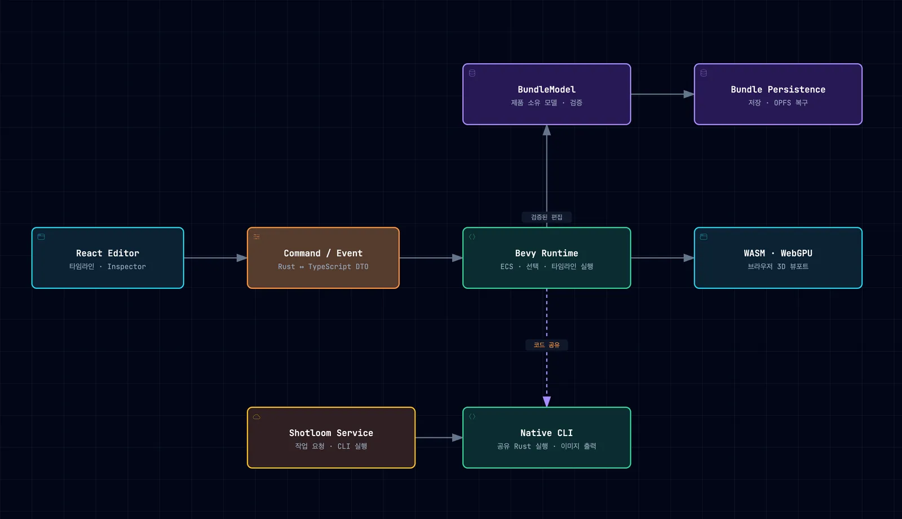

파일을 가리키는 자산 참조인 `AssetRef`와 장면에 배치된 편집 대상의 ID를 구분했다. 같은 자산을 쓰는 캐릭터도 뷰포트, 패널, 타임라인에서 독립된 편집 대상으로 다룬다.

VRM 로더는 정규화와 검증, 정규화 산출물의 캐시, 런타임 로딩 세 단계로 분리했다. 뒤를 보는 VRM 1.x 모델은 Y축으로 180도 회전해 방향을 맞추는데, 렌더링 외형만 돌리면 SpringBone의 충돌체와 중력 방향이 어긋난다. 이 보조 데이터에도 같은 좌표 변환을 적용해 모델 방향과 물리 입력을 맞췄다. 뷰포트에는 클릭 선택과 이동, 회전 기즈모를 넣었다. 가려진 메시 뒤의 대상이 선택되지 않게 하고, NaN이나 무한대 값을 거부하고, 드래그 중에 선택이 바뀌는 경쟁 조건을 처리했다. 선택한 캐릭터의 변환은 속성 패널에서도 편집할 수 있다.

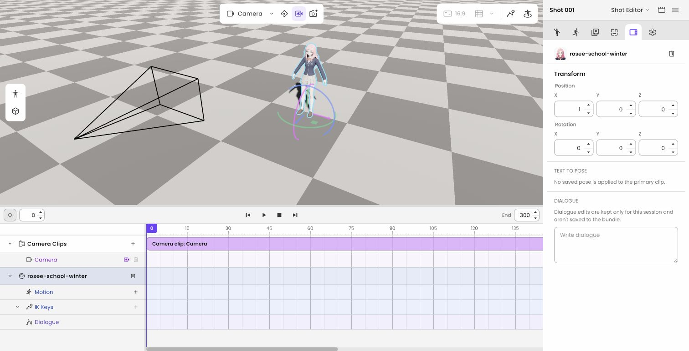

브라우저에서 캐릭터가 표시된 직후 화면 전체가 검게 변하는 문제도 있었다. 원인을 VRM 렌더링 라이브러리 bevy_vrm1의 MToon 셰이더가 emissive 텍스처를 다루는 부분의 결함으로 좁혔다. 포크에 패치를 적용해 편집기에 먼저 반영하고, 같은 수정을 [라이브러리에 기여](https://github.com/not-elm/bevy_vrm1/pull/57)했다. 원인 분석 과정은 [포트폴리오](/portfolio/#bevy_vrm1)에 정리했다.

> **확인한 범위**
>
> 로컬 실행에서 VRM 캐릭터를 가져와 배치하고, 뷰포트와 속성 패널에서 변환을 편집하는 흐름을 확인했다. bevy_vrm1은 포크 패치로 먼저 반영하고, 이튿날 라이브러리의 정식 릴리스로 되돌렸다. 좌표 보정은 VRM 1.x 모델을 대상으로 했다.

## 작업을 저장하고 다시 이어가는 편집 구조

React UI, Rust 문서 모델, Bevy 런타임이 각자 상태를 갖고 있어서, 명령이 거절되거나 시간이 초과되면 화면과 런타임과 저장 상태가 서로 어긋날 수 있었다. 그래서 편집 명령, 되돌리기와 다시 실행, 저장과 복원을 하나의 경로로 묶었다.

판단이 필요한 곳은 두 가지였다. 첫째는 되돌리기에 쓸 스냅샷이다. 조작마다 문서 전체를 깊은 복사하면 비용이 크다. 조작 전후의 상태를 모두 유지하면서 복사를 피하려고, `BundleModel`에서 도달할 수 있는 모든 컬렉션을 변경하지 않은 부분을 공유하는 영속 자료구조로 바꿨다. 정렬된 맵을 기본으로 삼아 같은 문서가 항상 같은 JSON으로 출력되게 했다. 둘째는 되돌리기 이력의 소유자다. 확정된 상태를 가진 쪽은 런타임이고 React는 명령을 보내고 이벤트를 받는 쪽이다. 이력을 양쪽에 나눠 두면 어긋나므로 엔진이 이력을 소유하게 했다.

문서 변경은 `BundleEditor`라는 공통 편집 경로로 모았다. 이 경로에서 변경 전 상태를 보존하고, 변경을 적용해 검증하고, 실패하면 되돌린다. 성공하면 변경된 범위(`DirtyScope`)를 표시하고 되돌리기용 스냅샷을 기록한다. 검증 실패는 전용 거절 코드로 구분해 화면의 오류 안내와 연결했다.

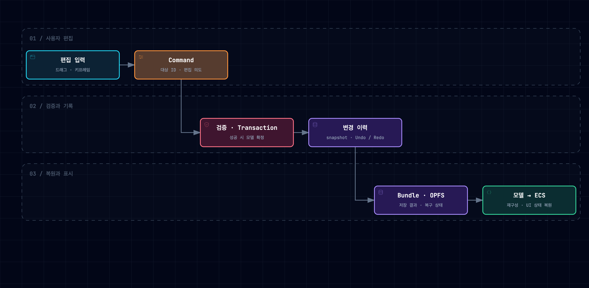

### 사용자의 조작 단위로 변경을 확정하기

드래그 중에는 많은 위치 값이 지나가지만 사용자가 한 일은 한 번의 이동이다. 중간값을 모두 문서 변경으로 기록하면 되돌리기 이력을 쓸 수 없게 된다. 조작을 시작할 때의 상태를 보존하고, 중간 입력은 미리보기에만 반영하고, 놓을 때 확정한 결과만 하나의 트랜잭션으로 기록했다. 취소하면 시작 상태로 돌아가고, 되돌리기를 실행하면 그 조작 전의 문서와 화면을 복원한다. 명령이 거절되거나 시간이 초과되면 트랜잭션을 롤백한다. 트랜잭션을 명시하지 않은 변경은 자동으로 트랜잭션에 감싸, 이 경로를 벗어나는 변경이 없게 했다.

자산을 가져오는 과정에도 같은 기준을 적용했다. 파일을 내려받거나 후보를 살펴보는 동작은 문서 변경으로 기록하지 않는다. 사용자가 캐릭터를 배치하거나 클립에서 자산을 참조할 때 프로젝트 자산으로 확정하고, 자산 등록과 편집 대상 생성을 같은 트랜잭션에 넣었다. 되돌릴 때 참조와 자산이 따로 남지 않는다.

### 문서 저장과 편집 환경의 복원

명시적인 파일 저장과 브라우저의 복구 데이터는 보존 범위가 다르다. 두 경로의 결과와 오류를 구분해 표시했다. 브라우저 내부 파일 저장소인 OPFS의 복구 데이터에는 복구 정리 진단과 백그라운드 자동 저장의 복원을 추가했다. 선택 상태처럼 문서 내용이 아닌 편집 환경은 문서 본문과 분리해 저장했다. 선택했던 대상이 사라져 선택을 복원하지 못해도 문서 자체는 열린다.

> **확인한 범위**
>
> 로컬 실행에서 캐릭터, 포즈 후보와 그 후보를 할당한 클립, 카메라 키를 저장한 뒤 페이지를 다시 열어 편집 상태가 복원되는 것을 확인했다. 자산 카탈로그의 중복 키와 경로처럼 보이는 자산 ID의 거부는 테스트로 고정했다.

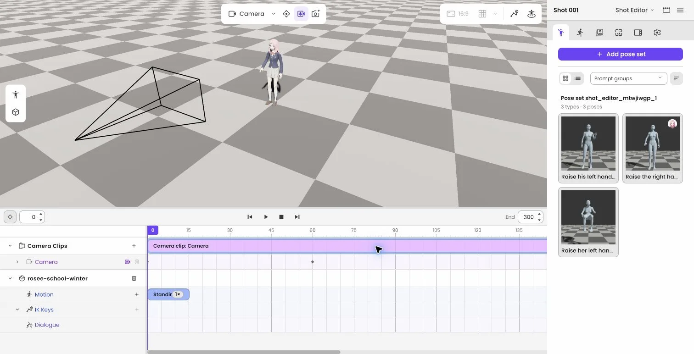

## 생성 결과를 편집 가능한 장면과 자산으로 변환

생성 서비스가 내놓는 데이터를 Shotloom의 편집 모델로 옮겨야 했다. 하나는 S2M(Story-to-Movie) 입력으로, 상위 AI 시스템이 만든 스토리보드의 인물, 장면, 샷, 카메라 정보를 담은 JSON이다. 다른 하나는 Text2Pose로, 텍스트 조건으로 포즈 후보를 돌려주는 서비스다.

S2M 입력은 브라우저 미리보기, 명령행 도구, 서비스 세 곳에서 해석한다. 세 경로가 각자 규칙을 가지면 같은 입력이 서로 다른 장면이 된다. 그래서 장면 구성과 검증 정책을 공유 Rust 코드에 모으고, 네트워크와 파일 접근만 실행 환경별 어댑터에 두었다.

### 장면 구성 정책을 공유 Rust 코드로 모으기

S2M 처리는 원본 파싱과 진단, 편집 문서의 기본 구조 생성, 카메라 템플릿 적용을 거쳐 실제 자산과 연결하는 번들 컴파일러로 이어진다. 컴파일러는 생성 입력과 준비된 자산으로, 저장하고 불러올 수 있는 번들을 만든다. 필요한 자산을 먼저 확인하고 완성된 임시 문서를 검증한 뒤에 결과를 확정해, 처리 중에 실패한 일부 데이터가 기존 문서나 공개 출력에 섞이지 않게 했다.

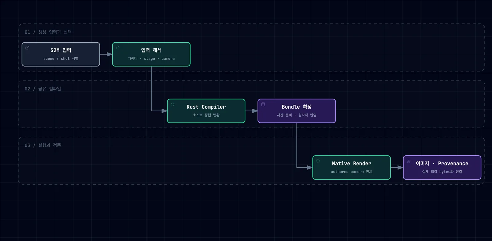

명령행 경로에서는 화면 없이 번들을 만들고, 작성된 카메라 전체의 이미지를 하나의 결과 집합으로 렌더한다. 렌더에 실제로 사용한 입력 바이트와 해시를 함께 기록해, 결과 이미지가 어떤 입력에서 나왔는지 추적할 수 있다. 내부 백엔드 서비스가 S2M 입력을 보내고 번들과 렌더 이미지를 받아 가는 실행 경로에서는, 동작이 정해지지 않은 캐릭터의 동작 프롬프트를 Text2Pose 검색으로 채워 렌더 전에 적용했다. 이 서비스 자체의 런타임 결정과 API 승격에 관한 설계 결정 기록은 팀이 썼다.

### 포즈 후보를 프로젝트 자산으로 다루기

Text2Pose에서는 요청과 응답을 연결하는 데 더해, 포즈 후보를 묶은 포즈 세트의 등록, 목록, 선택, 클립 적용을 구현했다. 생성 결과와 미리보기 이미지는 프로젝트에 저장해 다시 열 수 있다. 미리보기 이미지는 부가 정보이므로, 미리보기가 손상되어도 유효한 포즈 데이터는 열리도록 실패 범위를 나눴다.

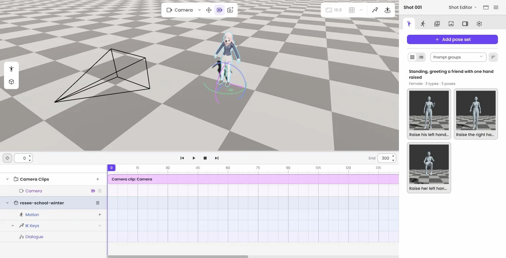

> **확인한 범위**
>
> 명령행 경로와 브라우저 개발 패널 경로가 같은 입력에서 바이트 단위로 같은 번들을 내는지를 테스트로 대조했다(PR 당시 기록). 배포된 데모 서비스가 다른 내부 백엔드의 실제 요청을 처리한 것은 응답, 로그, 산출물로 확인했다.

## 카메라와 포즈를 저작하고 결과를 출력하는 기능

장면을 영상 생성의 입력으로 쓰려면 제작자가 카메라 구도와 인물 포즈를 직접 조정할 수 있어야 한다. 처음 만든 카메라 키는 프레임 번호로 키를 식별했고, 카메라 키와 포즈 키가 서로 다른 묶음 레코드와 선택 식별자를 썼다. 이 구조에서는 여러 키를 한 번에 일관되게 바꾸거나 저장 형식을 결정적으로 변환하기 어려웠다. 카메라와 포즈 키프레임의 데이터 모델, 평가기, 명령, 편집 UI, 저장 형식을 함께 바꿨다.

### 키프레임의 식별과 회전 의미를 보존하기

키프레임을 프레임 번호로 식별하면 시간을 옮겼을 때 선택 대상을 잃기 쉽다. 위치와 회전을 한 묶음으로 저장하면 일부 축만 편집하기 어렵다. 저장 형식 버전 4에서는 프레임과 독립적인 키 ID를 두고, 속성별로 키를 다루도록 모델과 UI를 연결했다.

카메라와 관절의 회전은 표현을 구분했다. 카메라를 0도에서 720도로 돌리는 조작에는 두 바퀴 회전한다는 의미가 있다. 시작과 끝의 방향만 저장하면 이 의도가 사라지므로, 카메라는 회전 횟수를 유지하는 오일러 각으로 보간했다. 포즈의 관절 회전은 방향 사이를 보간하는 쿼터니언을 썼다.

편집 명령에는 문서의 변경 버전과 트랜잭션 ID를 검사하는 경로를 붙였다. 오래된 화면의 요청과 중복 전송을 구분해, 같은 요청이 두 번 적용되거나 일부 키만 저장되는 상황을 막는다. 키 복사와 붙여넣기의 타입 검사, 카메라 모드를 전환할 때의 구도 보존 검사도 이 전환에 넣었다. 이전 형식의 파일은 계속 읽고 쓰기는 버전 4로만 하며, 업그레이드할 때 이전 형식의 원본을 남긴다.

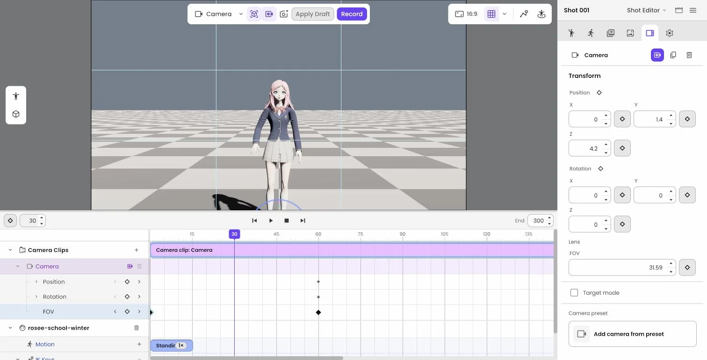

이 전환은 AI 에이전트와 작업하면서 명세 1건과 구현 11건, 12개의 의존 작업으로 나눠 6일 동안 진행했다. 명세와 설계 결정 기록을 먼저 확정하고, 작업마다 입력과 완료 기준을 정하고, 구현과 독립 검토를 분리했다. 새 경로는 꺼 둔 상태로 순서대로 올린 뒤 마지막 작업에서 켜면서 이전 쓰기 경로를 제거했다.

### 재생 반응성과 출력 완료까지 다루기

타임라인을 드래그하며 탐색하는 스크럽에서는 입력이 처리 속도를 앞질러 지연과 메모리 증가가 생겼다. 진행 중인 요청 하나와 최신 대기 입력 하나만 유지하고, 재생, 일시정지, 정지와 샷 전환이 오래된 입력을 대체하도록 했다.

출력은 편집 화면과 분리했다. 편집 중인 뷰포트를 그대로 캡처하면 출력이 저작 상태에 묶이고, 프레임마다 렌더 환경을 새로 만들면 비용이 크다. 전용 Worker에서 렌더 환경을 작업당 한 번만 세우고, 같은 장면 스냅샷에서 1920x1080 프레임을 순서대로 만든다. 프레임은 WebCodecs의 VP9로 인코딩해 무음 WebM으로 저장한다. WebM과 첫 프레임, 마지막 프레임 PNG를 OPFS의 임시 위치에 모은 뒤, Web Lock으로 순서를 직렬화해 출력 패키지를 한 번에 공개한다. 이미지 생성이나 최종 저장만 실패했을 때는 성공한 영상 렌더를 다시 하지 않도록 재시도 범위를 나눴다. 취소하면 진행 중인 작업을 정리하고, 기존 출력 파일은 그대로 둔다.

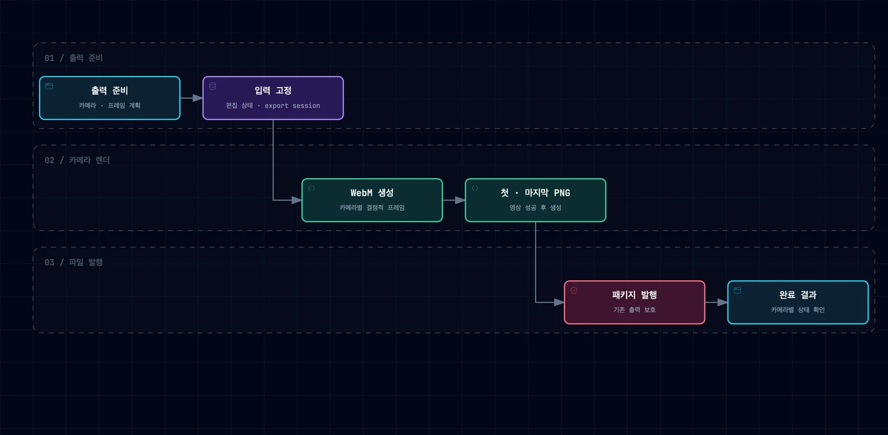

> **확인한 범위**
>
> 스크럽은 수정 후 50회 반복에서 점진적인 지연과 선형 메모리 증가가 재현되지 않았고, 카메라 키 30개를 둔 카메라 시점 뷰에서 마지막 입력과 최종 프레임이 일치했다(수정 PR 당시 기록).
>
> 출력은 PR 시점에 실제 Chromium에서 돌리는 자동 테스트로 확인했다. 120프레임을 출력해 디코딩까지 통과했고, 5프레임 출력의 공간 오차는 96x54 샘플 기준 1픽셀 미만이었다. 확인한 범위는 이 자동 테스트까지다.

## CineV에서 시작해 편집 결과를 돌려보내는 서비스 통합

편집기 기능만으로는 제작 흐름이 이어지지 않았다. CineV의 샷에서 3D 장면을 생성해 Shotloom으로 열고, 편집 결과로 생성한 이미지를 다시 스토리보드로 돌려보내는 경로가 없었다. 이 진입과 반환을 구현했다.

장면 진입에서는 전달받은 작업 ID와 입력을 검증하고, 런타임과 자산 준비가 끝난 뒤에 장면을 구성한다. 준비하는 동안에는 충돌하는 편집을 막고, 이전 요청이 늦게 끝나도 다른 작업의 장면을 바꾸지 않게 했다. 진입하면 인물, 소품, 카메라가 편집 가능한 장면으로 구성된다.

결과 반환에서는 생성과 CineV 저장을 별도 작업으로 나눴다. 둘을 한 작업으로 묶으면 저장만 실패해도 생성부터 다시 해야 한다. 서버의 생성 이력과 결과별 저장 상태를 편집기에 연결해, 저장이 실패하면 같은 결과를 다시 보낼 수 있다. CineV로 전달하는 대상은 생성 영상의 마지막 프레임 이미지다. 편집 가능한 3D 번들을 CineV 서버에 저장하고 다시 여는 기능은 구현 범위에 넣지 않았다.

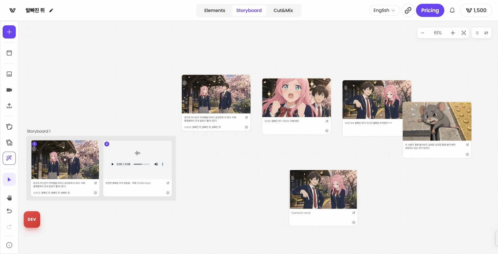

> **확인한 범위**
>
> 초기 통합은 개발 배포 환경에서 확인했다. CineV의 버튼으로 진입해 인물 2명, 소품 4개, 카메라와 타임라인이 자동으로 구성되는 것을 확인했고, 카메라 구도를 바꿔 새 이미지를 생성하고 CineV로 보낸 뒤 원래 스토리보드에 결과가 추가되는 것까지 확인했다.
>
> 이 검증 당시의 진입은 기존 작업의 백업이나 교체 확인 없이 새 장면을 여는 범위였다. 같은 작업의 저장된 작업 공간을 이어서 여는 기능과, 다른 장면에 진입하기 전의 백업과 교체 확인은 그 뒤에 추가했다.

## 그 밖의 담당 업무

- **타임라인 기본 조작:** 클립 선택과 삭제, 컨텍스트 메뉴, 재생 토글과 재생 헤드, 클립의 원본 타이밍과 유효 타이밍 분리, 트림을 구현했다.
- **캐릭터 자산 관리:** 캐릭터 패널과 장면 아웃라이너, 캐릭터를 지우면 트랙과 클립까지 함께 지우는 연쇄 삭제, 격리된 미리보기 환경에서 캡처하는 캐릭터 썸네일을 만들었다.
- **Text2Motion 결과 저장:** 텍스트로 생성한 모션 후보를 특정 공급자에 묶이지 않는 형식으로 번들에 저장하고 클립에 적용하는 흐름을 만들었다. 2026년 8월에 실시간 연동을 폐기하면서 이전 번들과의 호환 경계를 설계 결정 기록으로 남겼다.
- **오류 안내:** 토스트 알림과 명령 거절 코드별 진단 메시지를 한곳에서 관리하고, 거절 코드와 메시지의 매핑을 완전 열거로 강제했다.
- **배포:** 개발, 스테이징, 운영 배포 프로필의 계약과 검증기를 만들고, 환경별 정적 파일 업로드와 CDN 캐시 무효화를 구성했다.

### CI 캐시와 개발 체계

Rust 엔진 CI 작업은 빌드 결과 폴더를 통째로 압축한 아카이브를 캐시로 썼는데, 이 캐시가 커져 CI 러너의 디스크가 부족해졌다. 아카이브를 컴파일 결과 단위로 저장하는 sccache로 교체했다. 캐시 크기는 약 1.8GB에서 684MB로 약 62% 줄었고, 캐시가 채워진 상태의 재실행에서 컴파일 374건이 모두 캐시에 적중했다. 교체 PR 당시의 CI 기록이다.

Linux의 헤드리스 WebGPU 스모크 테스트는 거짓 통과하고 있었다. Chrome for Testing 150과 151이 헤드리스 모드에서 Bevy의 첫 버퍼 생성을 거부해 준비 이벤트 뒤에 치명 오류가 나는데도 테스트는 통과했다. 가상 디스플레이(Xvfb) 위에서 창이 있는 Chrome으로 실행하고, 준비 이벤트 이후의 오류를 다시 확인하도록 고쳤다.

이 프로젝트는 처음부터 AI 에이전트와 함께 코드를 쓰는 것을 전제로 했다. 에이전트 진입 문서와 문서 표준, AI 리뷰 절차 같은 공통 체계는 팀이 저장소 시작부터 갖춰 두었고, 나는 그 위에 다음을 추가했다.

- **실행 전에 막는 규칙:** 에이전트 지침 파일(CLAUDE.md)에 반드시 지킬 규칙을 적고, 명령을 실행하기 전에 검사하는 PreToolUse 훅으로 강제했다. 에이전트의 실수 뒤에 추가한 규칙은 주기적으로 팀 규칙으로 올리거나 지운다는 원칙을 함께 두었다.
- **PR 가이드라인과 템플릿:** 자동으로 만들어진 PR은 본문이 빈약하고 제목에 이슈 ID가 중복되어, 리뷰어가 이 PR이 무엇을 하는지 되묻게 됐다. 확장 PR 템플릿을 기본으로 바꾸고 제목 규칙을 훅으로 검사했다.
- **문서 가드:** 오래 남는 문서에 특정 이슈 ID를 적지 못하게 하는 검증 스크립트를 만들어 문서 검증, CI, 커밋 전 검사에 연결했다.
- **패키지 매니저 정책:** 고정한 pnpm 버전을 에이전트의 명령 경로에서도 지키도록, 버전 관리 도구(Corepack)를 거치지 않는 pnpm 호출을 훅에서 막았다. 명령 치환이나 중첩된 셸 호출도 잡아내도록 셸 파서로 명령을 분석한다.

요구사항은 Linear 이슈, 명세, ADR(설계 결정 기록), 테스트로 구조화했다. 여러 계층을 함께 바꾸는 기능은 설계 문서를 먼저 쓰고 의존 작업으로 나눠, 구현과 독립 검토를 분리했다. 저장 형식 버전 4 전환이 이 방식으로 진행한 가장 분명한 사례다. 에이전트 오케스트레이션 도구 Symphony의 파일럿도 설계하고 문서로 만들었지만, 시도한 뒤 철회했다.

> **확인한 범위**
>
> 캐시 수치는 교체 PR 당시의 CI 기록이다. 에이전트와의 역할 분담에서 사람은 보통 브라우저에서의 동작 확인을 맡았고, 테스트, 린트, Rust와 WebAssembly 검증은 대부분 에이전트에 맡겼다. 서비스와 명령행 도구의 검증도 에이전트가 수행했고, 나는 최종 산출물과 로그를 확인했다.

## 용어

- **CineV:** 스토리보드의 샷을 관리하는 AI 애니메이션 제작 서비스. Shotloom에서 편집할 장면의 출발점이고, 생성 결과 이미지를 돌려받는다.
- **SceneGen:** 편집한 장면과 생성 조건을 바탕으로 영상을 생성하는 기능. 선택한 결과의 마지막 프레임을 CineV로 전달한다.
- **CINEVStudio:** Shotloom 이전에 개발에 참여한 Unreal Engine 기반 제작 도구.
- **S2M:** Story-to-Movie. 스토리보드의 인물, 샷, 카메라 등 장면 구성 정보를 담은 입력. Shotloom은 이를 편집 문서로 변환한다.
- **Text2Pose:** 텍스트 조건으로 포즈 후보를 얻는 서비스. 후보를 포즈 세트로 관리하고 클립에 적용한다.
- **VRM:** 캐릭터 모델을 가져올 때 사용하는 아바타 파일 형식.
- **샷과 클립:** 샷은 장면과 타임라인을 담는 편집 단위이고, 클립은 그 안에서 특정 시간 구간에 적용되는 동작이나 카메라 편집 단위다.
- **번들과 `BundleModel`:** 번들은 문서와 자산을 함께 보존하는 프로젝트 저장 단위다. `BundleModel`은 그 문서를 표현하는 Rust 데이터 모델이다.
- **ECS:** 객체와 속성 데이터, 처리 로직을 분리하는 엔진 구성 방식. Bevy 런타임이 문서의 캐릭터와 카메라를 실행 가능한 상태로 구성할 때 쓴다.
- **OPFS:** 브라우저가 사이트별로 제공하는 내부 파일 저장소. 편집 문서의 자동 저장과 복구 데이터에 쓴다.
- **ADR:** 설계 결정과 그 이유를 한 건씩 남기는 기록.

## 관련 글

- [CINEVStudio에서 Shotloom으로 전환한 배경](/posts/from-cinev-studio-to-shotloom/)
- [Rust와 AI 에이전틱 코딩에서 다시 본 TDD](/posts/tdd-game-development-rust-ai-agent/)
