게임 클라이언트와 실시간 3D 제작 도구를 개발해 왔습니다. 대표 작업에서 맡은 문제와 구현 내용을 화면, 영상과 설계 자료로 소개합니다.

- **기술 검증:** [Unreal 호드 최적화 실험실](#unreal-호드-최적화-실험실)의 Mass Entity 기반 군중 최적화 측정, [UE5 Dedicated Server 최적화 실험실](#ue5-dedicated-server-최적화-실험실)의 리플리케이션 비용 측정과 단계별 최적화 비교
- **3D 제작 도구:** [Shotloom](#shotloom)의 편집과 저장 구조, [CINEVStudio](#cinevstudio)의 액션 데이터와 편집 UI 설계
- **게임 개발과 출시:** [Night of the Dead](#night-of-the-dead)의 전투와 무기 시스템, Dedicated Server 동기화, 다수 좀비 처리, [길고양이 이야기 2](#길고양이-이야기-2)의 PC 출시 전담
- **VR 장치 연동:** [CircleVR](#circlevr)의 좌표계 보정과 다중 사용자 전시, [Space Walker](#space-walker)의 실시간 모션 연동
- **개발 도구와 오픈소스:** [IDE 플러그인](#copy-selection-context)과 [브라우저 확장](#github-pulls-show-reviewers) 배포, [Firefly](#firefly)와 [bevy_vrm1](#bevy_vrm1) 기여

[hon454@gmail.com](mailto:hon454@gmail.com) / [이력서](/resume/) / [경력기술서](/cv/) / [전체 프로젝트](/projects/)

## 기술 검증 프로젝트

### [Unreal 호드 최적화 실험실](https://github.com/hon454/unreal-horde-optimization-lab)

| 항목 | 내용 |
| --- | --- |
| 소개 | Unreal Engine 5.8.4에서 클라이언트가 그리고 움직이는 군중의 비용을 측정하고 Mass Entity 기반 최적화를 하나씩 적용해 비교하는 실험 프로젝트 |
| 주요 기술 | Unreal Engine 5, C++, Mass Entity, Unreal Insights |

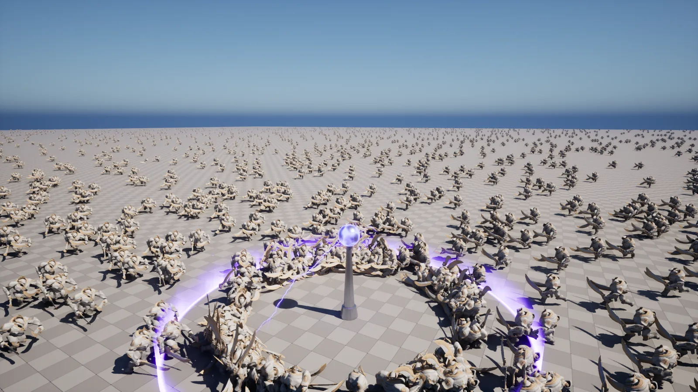

- **벤치마크 시나리오:** 맵 중앙의 오브를 향해 개체가 사방에서 걸어오고, 오브가 가까운 개체를 지우고 먼 개체를 쏘는 시나리오를 구성했습니다. 고정 시드와 고정 카메라 프리셋으로 같은 조건을 반복합니다.
- **측정 방법:** Test 구성 패키지에서 `csvprofile`과 Unreal Insights로 프레임, Game Thread, Render Thread, GPU 시간을 60초 동안 재고, 세 번 실행한 중앙값을 비교합니다.
- **Mass Entity 전환:** Night of the Dead에서 액터로 했던 좀비 호드 최적화를 다시 구현했습니다. 액터 + AnimBP 군중을 기준선으로 두고 이동, 피해, 사망 로직을 Fragment와 Processor로 옮겼습니다.
- **거리별 표현:** 먼 개체는 AnimToTexture로 구운 VAT 애니메이션이 있는 ISM으로 그리고, 가까운 개체에만 액터를 붙이는 액터 하이드레이션과 풀링을 구현했습니다.
- **애니메이션 예산:** Significance Manager, Animation Budget Allocator와 URO로 가까운 액터의 애니메이션 비용을 제한했습니다.

**관련 자료**

- [단계별 수치와 측정 조건](https://github.com/hon454/unreal-horde-optimization-lab#결과-한눈에-보기)

### [UE5 Dedicated Server 최적화 실험실](https://github.com/hon454/ue-dedicated-server-optimization-lab)

| 항목 | 내용 |
| --- | --- |
| 소개 | Unreal Engine 5.8.3 Dedicated Server의 리플리케이션 비용을 측정하고 최적화 기법을 하나씩 적용해 비교하는 실험 프로젝트 |
| 주요 기술 | Unreal Engine 5, C++, Unreal Insights, PowerShell |

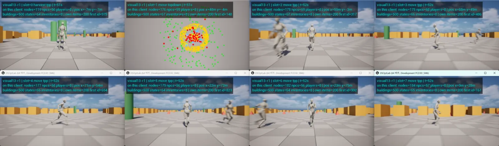

- **측정 시나리오:** PC 한 대에서 서버 하나와 클라이언트 8개를 띄우고, 한 변이 2km인 맵에 자원 노드 5,001개, NPC 350명, 건축물 500개를 고정 시드로 배치한 같은 시나리오로 측정을 반복합니다.
- **측정 방법:** 실행마다 처음 30초를 제외하고 60초를 측정하며, 세 번 실행한 중앙값으로 서버 프레임 시간과 대역폭을 비교합니다.
- **단계별 최적화:** 최적화가 없는 오픈월드 서버에서 시작해 Relevancy, Dormancy, Net Update Frequency 같은 엔진 기능을 한 번에 하나씩 적용합니다.
- **복제 상태 표시:** 클라이언트 화면마다 그 클라이언트에 복제된 자원 노드, NPC, 건축물 수와 플레이어 위치를 표시합니다.

**관련 자료**

- [자원 노드의 Relevancy, Dormancy와 갱신 빈도 설정](https://github.com/hon454/ue-dedicated-server-optimization-lab/blob/51816f637c4b8a99013e5c14591cd41cfdb85345/Source/DSOptLab/LabResourceNode.cpp#L19-L29)
- [단계별로 최적화해 보기](https://hon454.github.io/ue-dedicated-server-optimization-lab/)

## 주요 경력

### 시나몬

| 항목 | 내용 |
| --- | --- |
| 소속 기간 | 2024.06 - 2026.09 |
| 참여 형태 | 정규직 |
| 담당 직무 | 클라이언트 프로그래머 |

#### [Shotloom](/projects/shotloom/)

| 항목 | 내용 |
| --- | --- |
| 소개 | 캐릭터 동작과 카메라를 편집하고 영상 생성 서비스와 연결하는 브라우저 3D 편집기 |
| 참여 기간 | 2026.04 - 2026.09 |
| 팀 규모 | 클라이언트 4명 중 캐릭터·카메라 편집, 문서 모델, 저장·복원, 생성 서비스 연동 담당 |
| 주요 기술 | Rust, Bevy, WebAssembly, WebGPU, React, TypeScript |

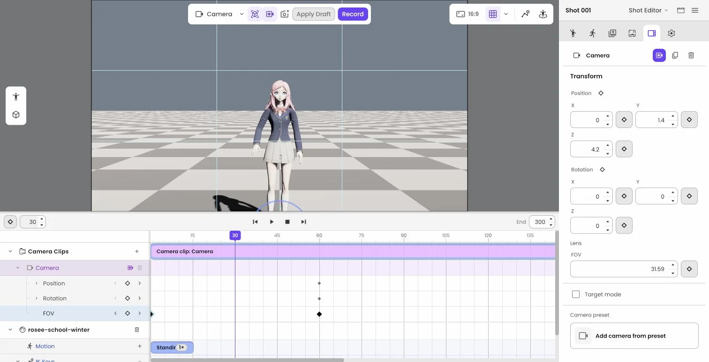

- **편집 명령과 Undo/Redo:** React UI, Rust 문서 모델과 Bevy 런타임을 잇는 브리지 계약에 트랜잭션 수명주기와 Undo/Redo 명령을 추가하고, 이 경로 위에 Undo/Redo와 저장, 복원을 구현했습니다.
- **편집 트랜잭션과 롤백:** 드래그 시작부터 확정까지를 하나의 트랜잭션으로 기록하고, 명령이 거절되거나 시간이 초과되면 롤백해 UI와 런타임, 저장 상태를 일치시켰습니다.
- **캐릭터와 카메라 저작:** 캐릭터 배치와 포즈 후보 적용, 속성별(Position, Rotation, FOV) 카메라 키프레임을 편집 UI부터 타임라인 평가와 저장 형식까지 연결했습니다. 브라우저와 CLI가 같은 Rust 코어와 번들 형식을 사용하도록 구성했습니다.
- **생성 서비스 통합:** AI 애니메이션 제작 서비스 CineV의 샷을 편집 가능한 3D 장면으로 열고, 생성 영상의 마지막 프레임 이미지를 스토리보드로 돌려주도록 구현했습니다. 생성과 결과 저장을 분리해 저장에 실패하면 같은 결과를 다시 전송할 수 있게 했습니다.
- **카메라 출력:** 같은 장면 스냅샷에서 WebM 영상과 첫·마지막 프레임 PNG를 만드는 출력을 구현했고, PR 시점 Chromium 자동 테스트로 출력과 디코딩을 검증했습니다.
- **CI 캐시 개선:** Rust 엔진 CI의 캐시를 target 아카이브에서 sccache로 바꿔 캐시 크기를 약 1.8GB에서 684MB로 약 62% 줄였습니다. warm CI에서 컴파일 374건이 모두 캐시에 적중했습니다.

**관련 자료**

- [포즈·동작·카메라 편집 과정 영상](https://www.youtube.com/watch?v=7tAEuFip6nA)
- [SceneGen 생성 결과 영상](https://www.youtube.com/watch?v=P-CnmKYDoxg)
- [제작 순서와 결과물](/projects/shotloom/#포즈-동작-카메라를-편집하는-과정)
- [저장 구조와 복원 화면](/projects/shotloom/#작업을-저장하고-다시-이어가는-편집-구조)
- [서비스 통합과 검증 범위](/projects/shotloom/#cinev에서-시작해-편집-결과를-돌려보내는-서비스-통합)

#### [CINEVStudio](/projects/cinev-studio/)

| 항목 | 내용 |
| --- | --- |
| 소개 | AI가 구성한 3D 장면을 편집하고 영상으로 출력하는 Unreal Engine Sequencer(MovieScene) 기반 제작 도구 |
| 참여 기간 | 2024.06 - 2026.04 |
| 팀 규모 | 클라이언트 6~10명 중 액션 데이터, AI 결과 해석, 편집 UI와 Shot 상태 모델 담당 |
| 주요 기술 | Unreal Engine 5, C++, UMG, Sequencer, ONNX |

<iframe class="video-embed" src="https://www.youtube.com/embed/NQJT8oN7NGg" title="CINEVStudio 사용 예시 - 무조건 이혼한다" loading="lazy" allow="accelerometer; autoplay; clipboard-write; encrypted-media; gyroscope; picture-in-picture; web-share" referrerpolicy="strict-origin-when-cross-origin" allowfullscreen></iframe>

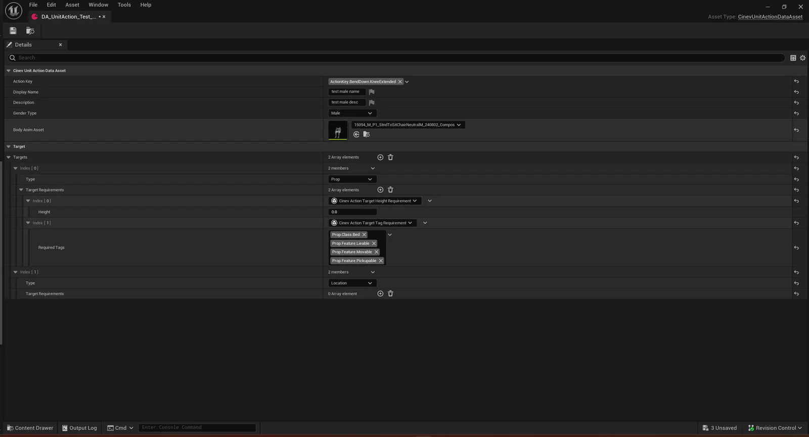

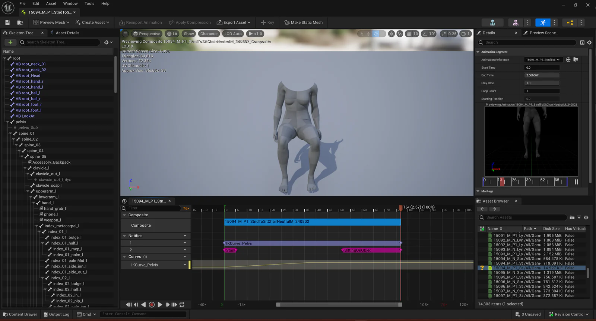

- **액션 데이터 작성 구조:** 문서와 대조하며 맞추던 액션 조건을 타입별 에셋 입력 구조로 바꾸고, 테이블에 프레임 값으로 적던 모션 구간과 이벤트 시점은 애니메이션을 보며 AnimComposite에서 편집하게 했습니다. 데이터 타입과 실행 경로, 변환기를 개발하고 검증 프레임워크에 액션 데이터 검증기를 추가했습니다. 제작자가 기억해 맞추던 조건 관계를 입력 구조와 검증기가 대신하게 됐습니다.
- **AI 결과의 실행과 편집:** AI의 행동 지시를 현재 장면에서 실행할 수 있는 액션으로 해석하고, 생성 모션을 선택해 타임라인에 적용하는 흐름을 구현했습니다. 이 결과도 일반 편집 데이터와 같은 Undo/Redo와 저장, 복원 경로를 거치게 했습니다. 서버·생성 측은 AI 팀의 작업입니다.
- **편집 UI 상태 관리:** UI Controller와 편집 State로 화면, 선택과 입력 처리를 나누고 Blackboard로 공유 상태를 전달했습니다. 새 편집 기능을 State 단위로 추가하는 구조를 만들고 공통 UI 컴포넌트를 개발했습니다.
- **Shot 상태 모델:** 샷 초기 상태를 관리하는 Shot 모델과 ShotManager의 재설계를 설계·구현 주도하고, 상태 저장과 조회, 프레임 문맥과 재계산, 기존 저장 데이터 이관을 구현했습니다. ShotBlock 타임라인 위젯은 동료의 구현을 리뷰했습니다.
- **Root Motion과 카메라:** Root Motion 키를 타임라인 조건에 맞춰 다시 계산하고, 카메라 orbit의 반경 손실과 수직 회전 뒤집힘을 해결했습니다.
- **빌드 환경과 엔진 이전:** GitLab CI 기반 빌드와 패키징, Shared DDC를 구성하고(2024년) Sentry 크래시 수집을 고도화했습니다(2025년). Unreal Engine 5.3에서 5.7로 이전할 때는 엔진 API 변경에 따른 코드 이전을 담당했습니다.

**관련 자료**

- [Shot 상태 모델](/projects/cinev-studio/#샷-초기-상태의-소유와-저장-복원-경로-정리)
- [액션 입력 화면과 실행 구조](/projects/cinev-studio/#문서와-대조하던-액션-조건을-타입별-입력-구조로-전환)
- [UI 상태 관리와 도식](/projects/cinev-studio/#ui-상태별로-화면-선택-입력-처리-분리)
- [제품 화면과 실제 제작 사례](/projects/cinev-studio/#대표-결과)

### 작두 스튜디오

| 항목 | 내용 |
| --- | --- |
| 소속 기간 | 2021.01 - 2024.06 |
| 참여 형태 | 정규직 |
| 담당 직무 | 클라이언트 프로그래머 |

#### [Night of the Dead](/projects/night-of-the-dead/)

| 항목 | 내용 |
| --- | --- |
| 소개 | 좀비의 습격에 대비해 방어 시설을 만들고 생존하는 오픈월드 멀티플레이 게임 |
| 참여 기간 | 2021.01 - 2024.06 |
| 팀 규모 | 클라이언트 2~3명 중 전투·장비·좀비 AI·네트워크 최적화 담당 |
| 주요 기술 | Unreal Engine 4/5, C++, Dedicated Server, Steamworks, TeamCity |

<iframe class="video-embed" src="https://www.youtube.com/embed/VVwmqfkluGw" title="Night of the Dead 1.0 트레일러" loading="lazy" allow="accelerometer; autoplay; clipboard-write; encrypted-media; gyroscope; picture-in-picture; web-share" referrerpolicy="strict-origin-when-cross-origin" allowfullscreen></iframe>

- **전투와 무기 시스템:** 2022년 4월부터 8월까지 플레이어 무기를 `AWeaponEntity` 계층과 무기 종류별 공격 컴포넌트로 다시 짰습니다. 무기는 발사와 장전을, 캐릭터의 공격 컴포넌트는 입력과 조준을 맡고, 탄약·반동·조준 상태는 인터페이스로 연결해 컴포넌트끼리 직접 참조하지 않습니다. 그 위에 샷건, 발사체, 반동과 제어성, 총기 부착물을 만들었습니다. 부착물 액터는 서버에서만 만들고 장착 목록을 모든 클라이언트에 복제하며, 부착물의 호환 무기와 효과는 데이터로 정의합니다.

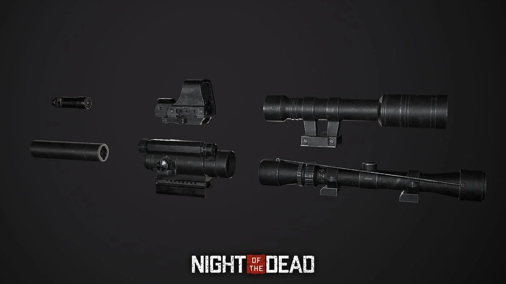

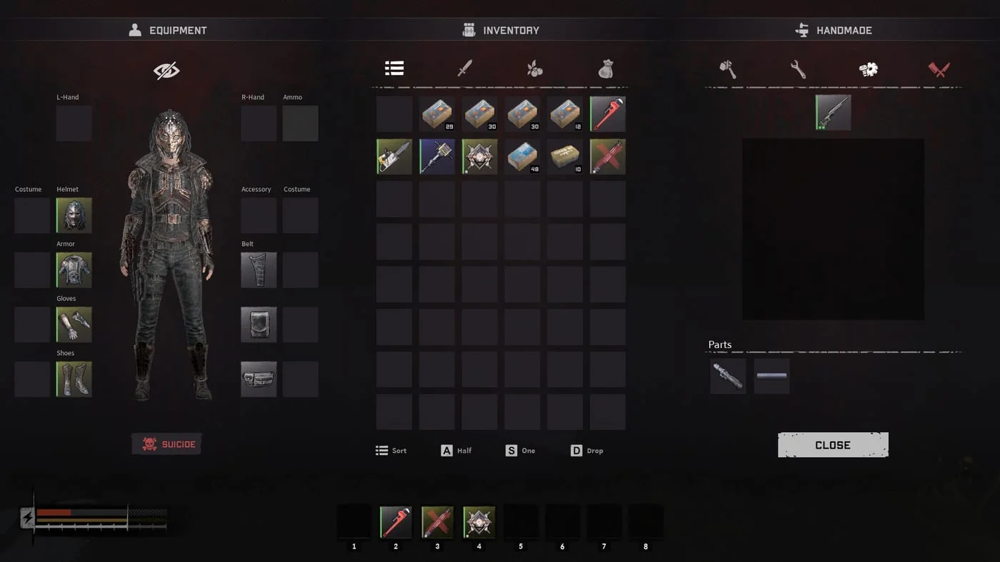

- **멀티플레이 판정:** 샷건은 클라이언트가 랜덤 시드로 펠릿을 트레이스하고, 서버가 시선의 수평 방향과 배율로 넓힌 대상 바운딩 박스로 검증한 히트에만 피해를 줍니다. 다른 클라이언트에는 시드와 퍼짐 값, 발사 원점만 복제해 같은 펠릿 패턴으로 이펙트를 그립니다. 발사체는 피해 계산을 쏜 쪽의 인터페이스에 위임하고, 모든 플레이어로부터 멀어진 탄환은 서버가 제거합니다.

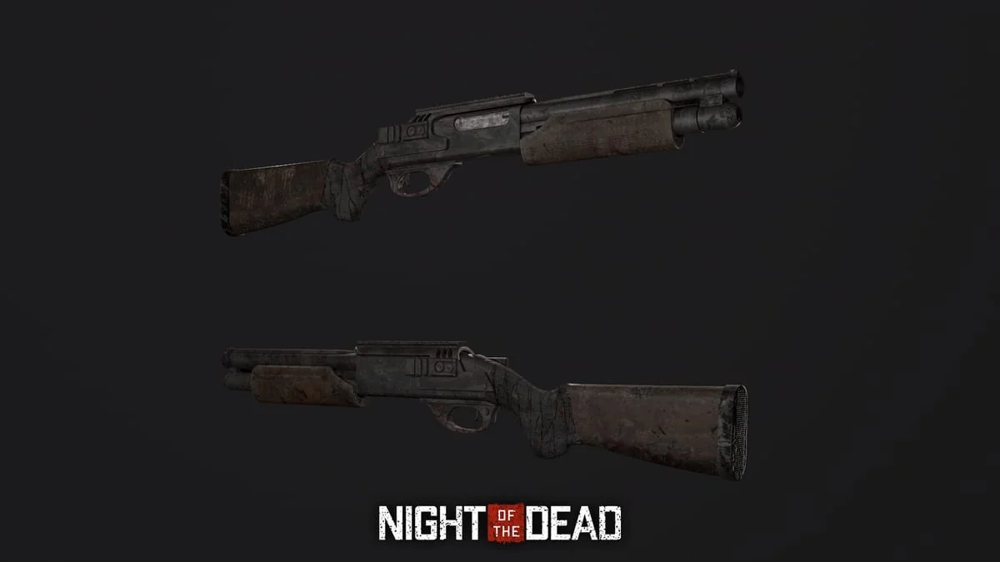

- **상태이상과 무기 특성:** 상태이상과 버프를 Gameplay Ability System으로 옮기고, 속성 상쇄(독↔번개, 냉기↔화염)와 게임 시간 단위 지속시간을 GameplayEffect 적용 시점 한 곳에서 처리하도록 Ability System Component를 확장했습니다. 공격 경로마다 흩어져 있던 효과 부여를 AttackTrait 하나로 모았습니다.
- **근접 전투와 피격:** 적중 시 서버에서 확률로 발동하는 추가 공격 체계(넉백·강타·즉사·전기 폭발·독가스), 0.75초 안에 다시 맞출 때마다 쌓이는 연타 스택, 애니메이션 노티파이·장비 스탯·포스처로 판정하는 슈퍼아머와 무적 컴포넌트, 방패 패링 피해와 패링 강화 스킬을 구현했습니다. 피격 애니메이션은 서버가 피격 유형과 랜덤 시드를 멀티캐스트하고 모든 클라이언트가 같은 시드로 같은 몽타주를 고릅니다. 근접 판정의 박스 스윕과 가드·패링 판정 창은 팀이 만든 것을 보강했습니다.
- **보스 전투:** 어그로 테이블 모듈, GameplayTag 상태 머신 모듈, 강인도와 그로기, 페이즈, 물리 피격 반응, 보스 무브먼트와 몽타주 관리를 독립 컴포넌트로 만들고, 추적 공격·AOE 판정·전진 이동 같은 전투용 애님 노티파이로 패턴을 조립해 1~6지역 보스 6종의 AI와 던전 보스룸을 구현했습니다. 패턴은 Behavior Tree 서브트리마다 거리 구간·확률·쿨다운·가중치 선택으로 고르고, 보스는 공격 중에 맞아도 패턴을 유지하다가 강인도가 0이 되면 그로기에 들어갑니다. 패턴 기획과 애니메이션은 다른 직군의 작업입니다.

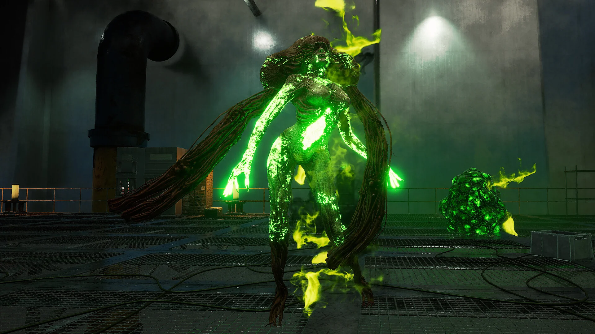

- **좀비 AI:** 일반 좀비는 전용 AI 컨트롤러와 네이티브 Behavior Tree 노드로 다시 짜고, 플레이어까지 길이 없을 때 도달 가능한 공격 지점을 검증하는 3단계 EQS 체인을 C++ 태스크로 만들었습니다. 산성 투사체를 뱉고 자폭하는 좀비, 줄로 대상을 끌어당기는 작살 좀비 같은 특수 좀비도 구현했습니다.
- **Dedicated Server 동기화:** Replication Graph가 거리와 소유 관계에 따라 연결별 복제 대상을 고르게 했습니다. 상태가 드물게 바뀌는 액터는 Net Dormancy로 휴면시키고, 접속 시 보내는 레벨 스트리밍 상태에는 커스텀 NetSerialize를 붙여 코드와 비트 플래그로 압축했습니다. 접속 시 한꺼번에 보내야 하는 기록 데이터는 Reliable 버퍼의 여유를 보고 레코드 단위로 나눠 보내는 RPC 스트리밍 라우터로 전송했습니다.

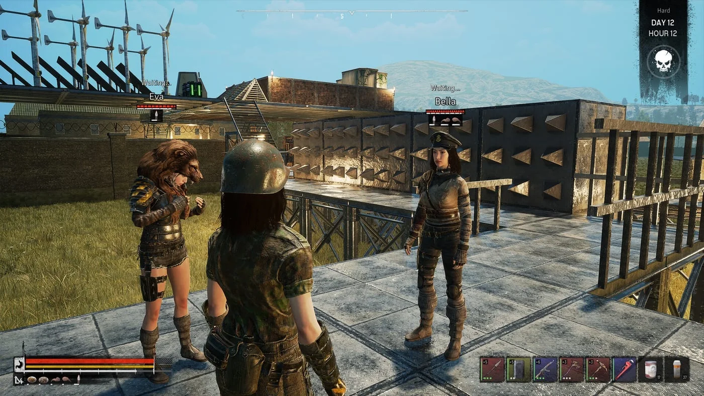

- **다수 좀비의 실행 비용:** 서버의 포즈 갱신은 근접 판정이 필요한 전투 중에만 켰습니다. Significance Manager로 계산한 중요도로 애니메이션 갱신 빈도를 조절했습니다.

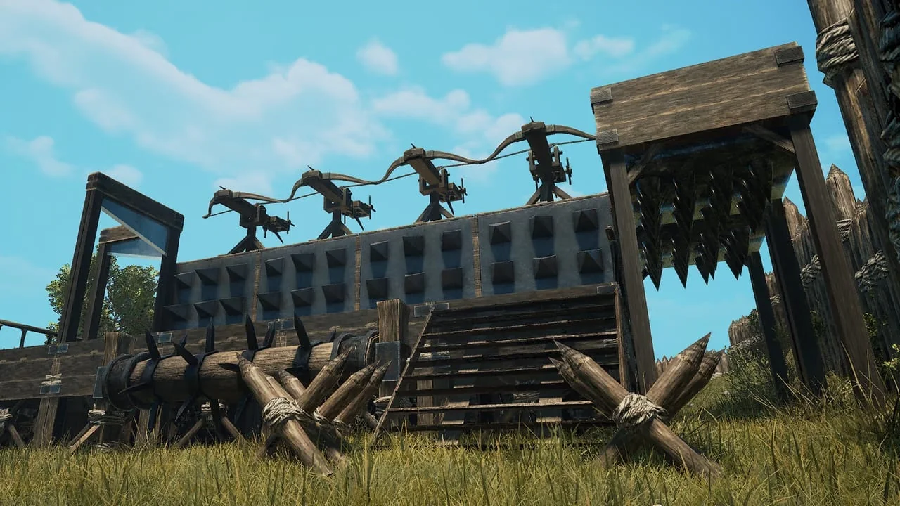

- **UE5 엔진 이전:** EOS가 Steam 외부 인증을 Web API 티켓으로 바꾸도록 요구하자, 이를 지원하는 Steamworks SDK 1.57 이상을 포함한 UE 5.3 커스텀 엔진으로 UE 4.27 프로젝트를 이전했습니다.
- **파괴 연출:** 원인을 알 수 없는 에러가 잦던 UE4 APEX Destruction을 직접 제어할 수 있는 커스텀 Destructible 시스템으로 교체했습니다. 당시 환경을 재현해 교체 전 구성(교체형 APEX)과 비교한 결과 단일 파괴 스파이크가 27% 낮았고, 동시 파괴 부하 시험에서 찾은 병목을 프레임당 조각 컴포넌트 예산으로 줄여 100개 동시 파괴 스파이크를 교체 전 구성보다 낮췄습니다(UE 4.27, 138ms → 25ms, 교체 전 32ms).

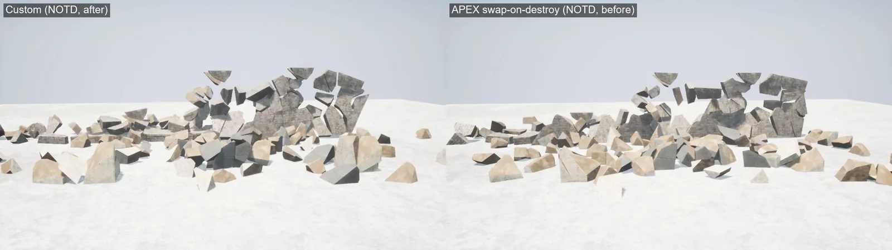

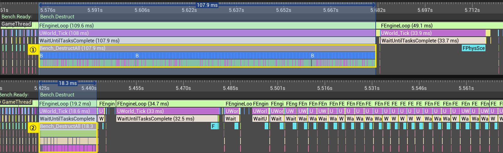

- **개발 인프라:** JetBrains Space와 TeamCity On-Premise 서버를 구축해 협업 도구와 빌드, 패키징 자동화를 운영했습니다.

**관련 자료**

- [서버 포즈와 애니메이션 갱신](/projects/night-of-the-dead/#싸우는-좀비만-포즈를-갱신하는-서버와-중요도-기반-애니메이션-갱신)
- [파괴 오브젝트](/projects/night-of-the-dead/#apex-destruction을-대체한-조각-메시-기반-파괴-시스템)
- [멀티플레이 동기화](/projects/night-of-the-dead/#복제-대상과-크기-빈도로-나눠-다룬-dedicated-server-대역폭)
- [멀티플레이 최적화 시리즈](/posts/notd-multiplayer-optimization-overview/)
- [다수 좀비 최적화](/posts/notd-zombie-horde-cost/)
- [커스텀 Destructible](/posts/notd-custom-destructible/)
- [재현 환경에서의 측정](/posts/notd-custom-destructible/#재현-환경에서-측정하기)
- [Steam 출시 페이지](https://store.steampowered.com/app/1377380/Night_of_the_Dead/)

### 삐요 스튜디오

| 항목 | 내용 |
| --- | --- |
| 소속 기간 | 2021.10 - 2023.12 |
| 참여 형태 | 비고용 팀 활동, 정규직과 병행 |
| 담당 직무 | 클라이언트 프로그래머(리드) |

#### [길고양이 이야기 2](/projects/a-street-cats-tale-2/)

| 항목 | 내용 |
| --- | --- |
| 소개 | 길고양이의 모험을 다룬 2D 퍼즐 어드벤처 |
| 참여 기간 | 2021.10 - 2023.12 |
| 주요 기술 | Unity, C#, Steamworks, STOVE SDK |

<iframe class="video-embed" src="https://www.youtube.com/embed/CkWISiLW1p0" title="길고양이 이야기 2 공식 트레일러" loading="lazy" allow="accelerometer; autoplay; clipboard-write; encrypted-media; gyroscope; picture-in-picture; web-share" referrerpolicy="strict-origin-when-cross-origin" allowfullscreen></iframe>

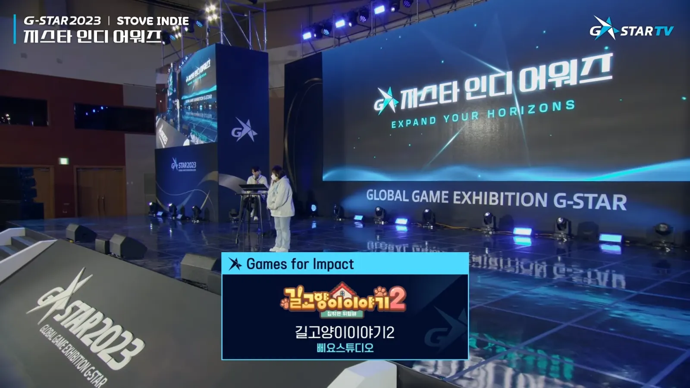

- **주요 게임 시스템:** 3인 팀의 프로그래머 2명 중 리드를 맡아 세이브와 로드, 퀘스트, 대화, 이동, 컷신, 환경설정과 UI를 개발했습니다.
- **플랫폼 연동:** 컨트롤러 입력, Steamworks 업적과 STOVE 구매 인증을 연동했습니다.
- **PC 출시 전담:** 스토어 등록부터 5개 언어 지원 빌드 준비, 출시 빌드 검수와 업로드까지 맡았습니다. 2023년 STOVE Windows 얼리 액세스와 Steam Windows, macOS 정식 출시를 진행했습니다. 프로젝트는 G-STAR 2023 인디 어워즈 Games for Impact 부문을 수상했습니다(2023.11).

**관련 자료**

- [게임 영상과 출시, 수상 자료](/projects/a-street-cats-tale-2/#출시와-전시-기록)
- [담당 범위](/cv/#길고양이-이야기-2)

### 육군

| 항목 | 내용 |
| --- | --- |
| 소속 기간 | 2018.02 - 2019.10 |
| 참여 형태 | 군 복무 |
| 담당 직무 | SW개발병 |

#### 프로그램 개발과 시스템 운영

| 항목 | 내용 |
| --- | --- |
| 참여 기간 | 2018.02 - 2019.10 |
| 주요 기술 | C#, WPF, VBA |

- **프로그램 개발:** C#과 WPF로 기존 프로그램을 이식하고, VBA로 엑셀 데이터 정리 프로그램을 개발했습니다.
- **시스템 운영:** 육군 지휘통제시스템의 장애 대응과 운영을 맡고 응용체계관리반 분대장으로 복무했습니다.

### 클릭트

| 항목 | 내용 |
| --- | --- |
| 소속 기간 | 2016.07 - 2018.02 |
| 참여 형태 | 정규직 |
| 담당 직무 | VR 소프트웨어 엔지니어 |

Unity 기반 VR 클라이언트와 소켓 통신을 통한 장치 연동을 담당했습니다. 아래 대표 작업 외에 [onAirVR Client 2.0](/projects/onairvr-client-2/), [학도병의 편지](/projects/student-soldiers-letter/), [#BeFearless - Fear of Heights](/projects/be-fearless/) 개발에 참여했습니다.

#### [CircleVR](/projects/circle-vr/)

| 항목 | 내용 |
| --- | --- |
| 소개 | 여러 사용자의 VR 체험과 외부 디스플레이를 연결한 전시 시스템 |
| 참여 기간 | 2017.06 - 2018.02 |
| 주요 기술 | Unity, C#, Gear VR, HTC Vive Tracker |

<iframe class="video-embed" src="https://www.youtube.com/embed/9N7_6xO2kNQ" title="CircleVR in Hongik University" loading="lazy" allow="accelerometer; autoplay; clipboard-write; encrypted-media; gyroscope; picture-in-picture; web-share" referrerpolicy="strict-origin-when-cross-origin" allowfullscreen></iframe>

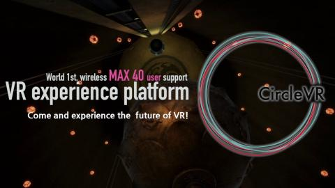

- **장치 간 좌표 보정:** HMD와 외부 트래커의 좌표계를 맞추고 장착 오프셋을 보정했습니다. Vive Tracker 정보는 소켓 통신으로 수신해 체험자의 위치와 자세를 콘텐츠에 연결했습니다.
- **체험과 외부 시점 연결:** 여러 사용자의 시점을 외부 곡면 OLED 디스플레이 22대로 연결해 체험자의 화면을 관람객과 공유하도록 했습니다.

**관련 자료**

- [전시 영상과 담당 업무](/projects/circle-vr/#전시-영상)

#### [Space Walker](/projects/space-walker/)

| 항목 | 내용 |
| --- | --- |
| 소개 | 무용수의 움직임을 VR 공간에 실시간으로 연결하는 공연 콘텐츠 |
| 참여 기간 | 2017.05 - 2017.06 |
| 주요 기술 | Unity, C#, Perception Neuron, GPU 파티클, onAirVR |

<iframe class="video-embed" src="https://www.youtube.com/embed/S7bRLNLz0TA?start=5" title="Space Walker - Unite ’17 Seoul 키노트 오프닝 공연" loading="lazy" allow="accelerometer; autoplay; clipboard-write; encrypted-media; gyroscope; picture-in-picture; web-share" referrerpolicy="strict-origin-when-cross-origin" allowfullscreen></iframe>

- **전신 모션 연동:** Perception Neuron의 모션을 Unity Humanoid 아바타에 연결하고 좌표축 차이를 보정했습니다.
- **실시간 배경 연출:** 3D 배경 인터랙션을 구현하고, 다수의 파티클을 처리할 때의 성능 부담을 줄이기 위해 GPU 파티클 시스템을 적용했습니다.

## 오픈소스 프로젝트

### 유지관리자 (Maintainer)

#### [GitHub Pulls Show Reviewers](https://github.com/hon454/github-pulls-show-reviewers)

| 항목 | 내용 |
| --- | --- |
| 소개 | GitHub PR 목록에 리뷰 요청 대상과 리뷰 상태를 표시하는 Chrome 확장 프로그램 |
| 주요 기술 | TypeScript, React, WXT, GitHub REST API, Vitest, Playwright |

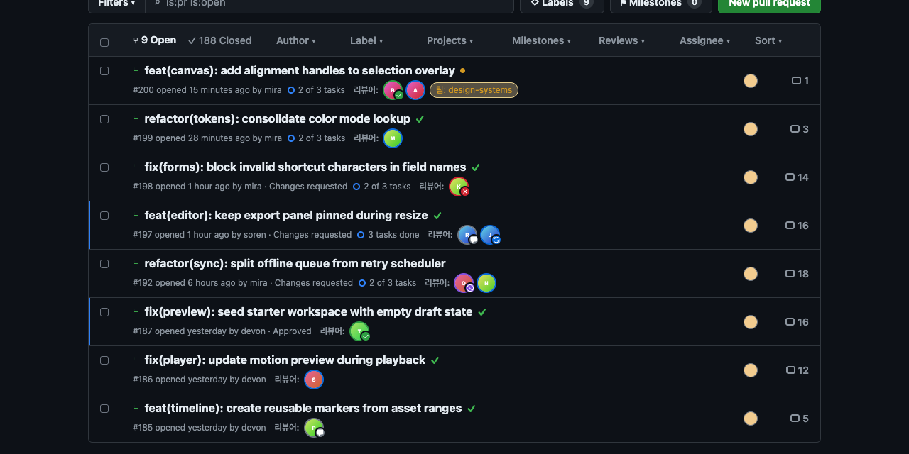

- **리뷰 상태 표시:** 요청된 사용자와 팀, 리뷰어별 승인 및 변경 요청 상태를 PR 목록에 표시했습니다. 한국어를 포함한 5개 언어를 지원합니다.
- **화면 갱신과 API 처리:** GitHub의 목록 갱신에 맞춰 표시를 복원하고, 페이지 단위 API 배치와 행 단위 캐시, 동시 요청 수 제한을 구현했습니다.
- **계정 연동과 배포:** GitHub App으로 계정별 비공개 저장소 접근을 처리하고 [Chrome Web Store](https://chromewebstore.google.com/detail/github-pulls-show-reviewe/hoocgjopdboeghdkfjlkngkkpbiljggk)에 배포했습니다.

**관련 자료**

- [프로젝트 글 전체 보기](/projects/github-pulls-show-reviewers/)

#### [Copy Selection Context](https://github.com/hon454/copy-selection-context)

| 항목 | 내용 |
| --- | --- |
| 소개 | 선택한 코드의 파일 경로와 줄 번호를 함께 복사하고 여러 파일의 문맥을 모으는 JetBrains 플러그인 |
| 주요 기술 | Kotlin, IntelliJ Platform SDK, Gradle, JUnit 5, GitHub Actions |

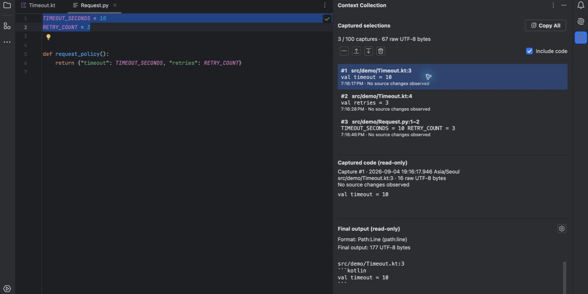

- **코드와 위치 복사:** 선택 영역의 경로와 줄 범위를 계산하고, 여러 커서의 선택 영역과 사용자 지정 출력 형식, GitHub와 GitLab permalink를 지원했습니다.
- **문맥 수집과 검토:** 수집 당시의 코드와 위치를 스냅샷으로 보관하고, 도구 창에서 순서를 조정한 뒤 함께 복사하도록 구현했습니다.
- **검증과 배포:** 단위 테스트와 IntelliJ 플랫폼 테스트, 플러그인 호환성 검증을 구성하고 GitHub Actions에서 릴리스와 배포를 자동화해 [JetBrains Marketplace](https://plugins.jetbrains.com/plugin/30262-copy-selection-context)에 배포했습니다.

**관련 자료**

- [프로젝트 글 전체 보기](/projects/copy-selection-context/)

### 기여자 (Contributor)

#### [Firefly](https://github.com/CuteLeaf/Firefly)

| 항목 | 내용 |
| --- | --- |
| 소개 | Astro와 Svelte 기반의 정적 블로그 테마 |
| 주요 기술 | Astro, Svelte, TypeScript, Mermaid |

- **[GitHub 카드 빌드 캐시](https://github.com/CuteLeaf/Firefly/pull/588):** GitHub 저장소 카드를 빌드 시점 캐시로 전환해 API 장애와 사용량 제한에 대응했습니다.
- **[Mermaid 렌더러 이전](https://github.com/CuteLeaf/Firefly/pull/584):** Mermaid 렌더링을 Node.js 기반 최신 버전으로 이전하며 기존 테마의 출력 형태를 유지했습니다.
- **[카테고리 바 휠 스크롤](https://github.com/CuteLeaf/Firefly/pull/613):** 누적 이동 손실과 입력 지연을 제거하고, 가로 트랙패드 제스처를 보존하면서 목록 경계에서는 페이지 스크롤이 이어지도록 개선했습니다.
- **[레이아웃 슬롯 수정](https://github.com/CuteLeaf/Firefly/pull/587):** 페이지별 `<head>` 콘텐츠가 최상위 레이아웃으로 전달되지 않던 Astro 슬롯 구조를 수정했습니다.
- **[한국어 README 작성](https://github.com/CuteLeaf/Firefly/pull/583):** 설치와 구성, 배포와 Markdown 확장 기능을 다룬 한국어 README를 작성했습니다.

#### [bevy_vrm1](https://github.com/not-elm/bevy_vrm1)

| 항목 | 내용 |
| --- | --- |
| 소개 | Bevy에서 VRM 1.0 아바타를 불러오고 렌더링하는 라이브러리 |
| 주요 기술 | Rust, Bevy, WGSL, WebGPU |

- **재현과 원인 격리:** Shotloom 브라우저 편집기에서 MToon VRM을 표시한 직후 화면이 검게 변하는 문제를 Chrome WebGPU에서 재현했습니다. Metal 네이티브에서는 나타나지 않는 문제였고, 조명 단계별로 비교해 원인을 emissive 처리로 좁혔습니다.
- **[셰이더 플래그 수정](https://github.com/not-elm/bevy_vrm1/pull/57):** MToon 셰이더가 `EMISSIVE_TEXTURE` 비트를 MToon uniform이 아닌 Standard Material 플래그 필드에서 읽어, WebGPU에서 바인딩되지 않은 텍스처를 샘플링하고 그 NaN이 톤매핑과 Bloom으로 퍼지는 것을 확인했습니다. 플래그를 MToon uniform에서 읽도록 수정해 라이브러리에 기여했습니다.

## 함께 일한 동료들의 추천

직책과 협업 관계는 함께 일한 당시를 기준으로 표기했습니다.

<blockquote class="career-recommendation">
  
기술적 문제의 근본 원인을 끝까지 파고드는 끈기.

  <footer class="recommendation-source">
    
<strong>홍XX</strong>시나몬 CTO, AI Lab Lead

    
상급자(비직속)번역 발췌

  </footer>
</blockquote>

<blockquote class="career-recommendation">
  
가장 신뢰했던 것은 복잡한 문제를 구조화하는 능력이었습니다.

  <footer class="recommendation-source">
    
<strong>황XX</strong>시나몬 Lead Software Engineer

    
직속 상사원문 발췌

  </footer>
</blockquote>

<blockquote class="career-recommendation">
  
주변의 문제를 발견하고, 필요한 일을 스스로 찾아 실제 변화로 만들어내는 동료입니다.

  <footer class="recommendation-source">
    
<strong>심XX</strong>시나몬 클라이언트 개발자

    
같은 팀 동료원문 발췌

  </footer>
</blockquote>

<blockquote class="career-recommendation">
  
새로운 영역의 문제를 깊게 파고들어 구조화하고, 팀이 함께 이해할 수 있는 형태로 만들어 갔습니다.

  <footer class="recommendation-source">
    
<strong>임XX</strong>시나몬 테크니컬 아티스트

    
같은 팀 동료원문 발췌

  </footer>
</blockquote>

<blockquote class="career-recommendation">
  
미래지향적이면서도 신뢰할 수 있는 엔지니어.

  <footer class="recommendation-source">
    
<strong>고XX</strong>시나몬 AI PO

    
협업 동료(타 부서)번역 발췌

  </footer>
</blockquote>

<blockquote class="career-recommendation">
  
기획과 개발의 경계를 두기보다 함께 좋은 결과물을 만들어가기 위해 고민해주는 클라이언트 개발자였습니다.

  <footer class="recommendation-source">
    
<strong>최XX</strong>시나몬 서비스 기획자

    
협업 동료(타 부서)원문 발췌

  </footer>
</blockquote>

[LinkedIn에서 추천사 전체 읽기](https://www.linkedin.com/in/jihoon-jeon-b7ab83116/details/recommendations/?detailScreenTabIndex=0)
